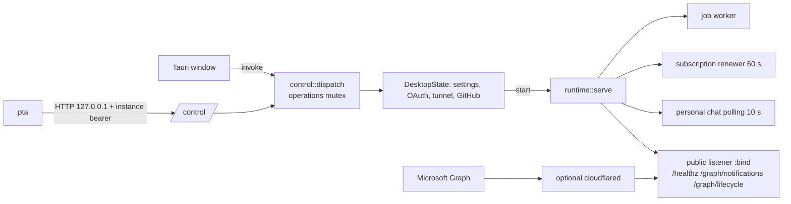
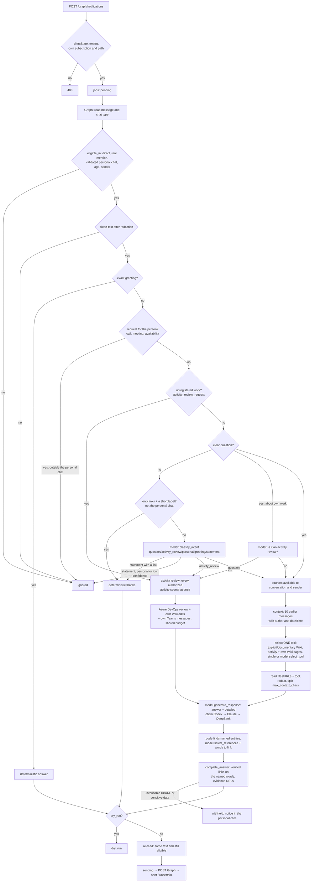

# Architecture

Technical reference for coding agents. It describes how the system is built, how a message flows through it and which invariants cannot be broken. The operating manual (`pta` commands) is the [built-in skill](../desktop/skills/personal-teams-assistant/SKILL.md).

## 1. What it is

A personal Microsoft Teams assistant that answers **as the user** (delegated OAuth, no bot). It receives messages through Microsoft Graph webhooks, decides whether to step in, retrieves evidence only from sources authorized for that conversation, writes with a language model (Codex or Claude Code through their installed CLI, or the DeepSeek API, in a fallback chain), checks references, URLs and sensitive data in code and sends once. If a code check withholds the answer, nothing is sent: the answer is left to the person (and in the personal chat they get a notice). The same model chain classifies ambiguous messages and picks the references an answer uses; no model decision withholds an answer or grants a permission. Azure DevOps writes register the user's unlinked work with a separate credential: personal-chat linking or task creation after exact-plan confirmation (§6.10), and opt-in local/scheduled completed tasks (§6.11).

An additional opt-in host process registers performed work as completed Azure DevOps tasks, manually or on a schedule (§6.11). It uses the same separate write credential, verifies the HU, fields and effort budget, and persists each attempt before the one request. Ambiguities stay pending for local/CLI clarification.

Everything in the repository — code, comments, prompts, documentation, the GUI's source text, CLI and IPC messages, diagnostics and audit steps — is in English. What the user reads follows `llm.language` (Spanish by default, or English): the GUI, translated at runtime from its English source by `desktop/ui/i18n.js` (the only Spanish UI catalog), what the assistant writes to Teams, and the activity drafts and issues written for the user.

It is distributed only through Cargo. One package, `personal-teams-assistant`, installs three pieces (up to 0.4.0 the app came in a separate package, `personal-teams-desktop`, now obsolete):

| Piece | Binary / path | Role |
| --- | --- | --- |
| GUI + host | `personal-teams-assistant` | Tauri tray/menu bar app. It is the **only owner** of the profile, the credentials and the Teams service. It can run hidden (`--host`) or **headless** (`--headless`, or built without the `gui` feature for Linux/servers). |
| CLI | `pta` | Administrative client. Talks to the host over authenticated loopback IPC; starts it hidden if there is none. |
| Skill | `desktop/skills/personal-teams-assistant/` | Manual for agents, built into `pta` (`pta skill show/path/install`). |

## 2. Repository layout

```text
Cargo.toml                    single package `personal-teams-assistant`: library + binaries
                              `personal-teams-assistant` (GUI/host) and `pta`; `gui` feature (Tauri)
build.rs                      tauri-build from `desktop/` (only with `gui`), into OUT_DIR
src/                          core: pipeline, Graph adapters, LLM, knowledge, tools, SQLite
  llm.rs                      LlmProvider contract, prompts (`Model`), fallback chain (`Chain`), validation
  llm/deepseek.rs             DeepSeek API (`/chat/completions`)
  llm/agent.rs                Codex (`codex exec`) and Claude Code (`claude -p`) as tool-less CLIs; catalog
  ado.rs                      Azure DevOps activity for status questions (work items, commits, pipelines)
  ado/progress.rs             a work item a status request names, read directly whoever holds it now
  ado/review.rs               activity review: own work compared with work items, verified links
  ado/link.rs                 linking unlinked work to a work item: offer, plan, the one confirmed write
  ado/registration.rs         daily effort deltas, task field/state schema, validate-only and Done creation
  activity.rs, activity/      local/scheduled task planning and durable daily history/clarification
  ado/wiki.rs                 Wiki search/read with verified authorship; own edits for reviews
  cases.rs                    built-in cases (kinds of request) and what the user may change in each
  llm/prompts.rs              default prompt texts a case may replace
  index.rs                    knowledge index (SQLite FTS5 + optional embeddings): repositories, verified notes
  app.rs                      host: Host/Shell, state, start/stop, OAuth, tunnel, settings, `run` entry
  app/gui.rs                  Tauri shell (`gui` feature): window, tray, the WebView's `command`
  app/headless.rs             headless shell: foreground, SIGTERM/Ctrl-C, `--start`
  app/web.rs, app/web/         browser GUI, Access-bound sessions, isolated per-user host processes
  app/control.rs              profile paths, IPC channel (contract 1), single dispatcher, update
  app/cli.rs                  `pta`: help, parsing, argument validation, translation to IPC methods
  app/github.rs               GitHub App with Device Flow, clone/sync without a token in URL/argv
  app/skill.rs                skill texts embedded with include_str!
  app/notes.rs                notes, ratings, knowledge search and index status/refresh operations
  app/mcp.rs                  `pta mcp`: Model Context Protocol server over stdio for agents
  app/activity.rs             host scheduler, asynchronous activity IPC, shared Graph token owner
  main.rs, bin/pta.rs         binaries (`app::run`, `app::cli::run`)
desktop/                      app resources: tauri.conf.json, Info.plist, capabilities/, icons/
  ui/                         shared HTML/CSS/JS; transport.js selects Tauri invoke or authenticated web API;
                              i18n.js translates the English source text to `llm.language`
  skills/                     operating skill (canonical source)
site/                         static landing outside the Cargo package: `public/` (HTML and CSS without
                              JavaScript or a build, `_headers`, `404.html`, GUI screenshots with
                              synthetic data) and `wrangler.jsonc` (Cloudflare Workers, assets only)
tests/integration.rs          integration with wiremock (Graph, DeepSeek) and test doubles
config.example.toml           profile template (`Config::desktop_template`)
knowledge-map.example.toml    synthetic example of the source map
scripts/export-public.py      exports a snapshot without private history (requires gitleaks)
scripts/ui-preview/           GUI preview with a mocked Tauri bridge and synthetic data: screenshots,
                              axe WCAG 2.2 AA scans and interaction checks (Playwright outside the repo)
scripts/vps-update.py         server updater: installs new crates.io releases, verifies, rolls back;
  systemd/                    its systemd user service and timer (docs/delivery.md)
.github/workflows/            ci.yml (checks on Linux, macOS, Windows) and release.yml (crates.io)
.agents/skills/save-knowledge to save facts into the knowledge base
```

## 3. Process model



- **Host and shell.** `Host` = `DesktopState` (operations) + `Shell` (what the owning process can do: show/hide the window, open a URL, quit). `gui::TauriShell` implements it with Tauri; `headless::HeadlessShell` answers `not_ready` to `app open/hide`, returns URLs to the caller and ends the process on `app quit`. No operation depends on Tauri.
- **One host per profile.** `control.lock` (flock) proves ownership; `control.json` publishes port, random token and `wiki_support`. A descriptor without a lock is stale. A process is never signaled by PID.
- **IPC.** `POST /control` on an ephemeral loopback port, constant-time bearer, rejects any `Origin` (browsers). Body at most 1 MB, client timeout 120 s (no limit for `chat` and `test_providers`, which wait for the model).
- **Single dispatcher.** GUI and CLI go through `control::dispatch`, which serializes with `operations` and checks `revision` (SHA-256 of config + map + tunnel) for writes based on a snapshot. While a Microsoft/GitHub login is pending only reads are allowed.
- **Update.** `cargo install` runs nothing when it finishes and replaces the file while the previous host keeps running. `control.json` publishes `binary` (size and date of the executable at start; older hosts do not have it). If the running host was started from the **same installed path** and its fingerprint no longer matches, it is outdated (`control::outdated_host`): the first `pta` (except `capabilities`, `skill` and `doctor --offline`) or the new app retires it (`retire_outdated_host`: reads whether the assistant was running, sends `app_quit` — which stops assistant and tunnel — and waits for the lock, 60 s). If it was running, `pta` asks on the terminal whether to keep it running with the new version (without a terminal, `--json` or `--non-interactive` keeps the state); the new GUI shows the `restart_offer` notice (`start_assistant` or `dismiss_restart_offer`); the headless host asks if there is a terminal or keeps the state. `start`, `restart`, `stop` and `app quit` decide the state themselves. A host started from another path (e.g. a development build) is never retired this way.
- **The CLI starts the host** (`host_executable`: sibling binary or `host-path.txt`) with `--host` in its own process group and waits for the descriptor. The host inherits `pta`'s environment (`NAME`/`NAME_FILE` credentials, `PTA_HEADLESS`).
- **Service.** `runtime::serve` runs as a Tokio task inside the host. `app.rs::start` launches it, waits for `ready` (60 s; `runtime::Service` hands over the Graph handle and the `Pipeline`, kept in `Running` to write and send answers at the user's request, §6.12) and then starts `cloudflared` if needed. Failure before readiness retains the service's error category; a readiness timeout still stops and aborts it. `stop` kills the tunnel, sends `true` on the `watch` and waits 20 s before aborting. Closing the channel also counts as a stop.
- **Activity registration.** `control::launch` owns a separate 30-second scheduler. Runs/refinements return immediately and run in a tracked task; reads remain available, and settings/identity mutations are blocked during a run. It does not need Teams reception or a public listener. `runtime::serve` returns its Graph handle on readiness so the recorder shares the existing OAuth refresh owner; a stopped service's handle can still read chats. Quitting the host aborts registration and recovers any in-flight write as uncertain.

### Browser GUI and independent accounts

`personal-teams-assistant --web` serves the same `desktop/ui` assets on a separate
loopback listener (default `127.0.0.1:38656`), with an HTTPS origin through the
dedicated Cloudflare Tunnel. Cloudflare Access owns the interactive GitHub login,
using a dedicated OAuth App unrelated to repository GitHub Device Flow. Access
protects the complete hostname and API; an explicit email allowlist plus the
configured GitHub login method gates admission at the edge. Admission never
creates or selects an application profile.

`app/web/access.rs` accepts exactly one `Cf-Access-Jwt-Assertion` and verifies
RS256 signature, pinned issuer/application audience, required subject/issuance/
not-before/expiration and application token type. Keys come only from the team's
HTTPS `/cdn-cgi/access/certs`, with bounded responses, five-minute freshness and
rate-limited rotation refresh. Expired keys are never used after a failed refresh.
The exact verified assertion is sent as `CF_Authorization` to the pinned team's
`/cdn-cgi/access/get-identity`; account, GitHub IdP ID/type and `user_uuid == sub`
are checked. Positive identity responses are cached by assertion hash for at most
30 seconds; JWT validity and local revocation are checked on every request.
Identity/email headers, service tokens and caller-selected URLs grant no access.

`pta web configure` writes private `web/settings.json`, whose additive `access`
configuration contains issuer, audience, account and dedicated GitHub IdP ID.
Legacy settings remain readable for inspection; a portal cannot start without
Access. `pta web users add/bind/unbind/revoke/disable/enable/list` manages private
`web/accounts.json` under the existing operator-local lock. `bind` takes the
operator's verified Access identity JSON on stdin. Its binding is the issuer,
GitHub IdP ID and provider subject (`id` from get-identity). GitHub's positive
integer IDs are normalized losslessly to decimal strings; legacy string subjects
remain readable. Floats, negative/zero integers and other JSON types are rejected.
The binding is never an email, name or email-associated Access `sub`.
Bindings cannot belong to two accounts. Existing
IDs, profile selection and retired password hashes survive additive schema reads;
hashes are never used to authenticate. Local association/reassociation is the
recovery path; there is no public registration or password endpoint/form.

`GET /login` exchanges a verified, enabled, explicitly associated identity for a
random local session and serves the shared panel document without another form.
This ends the cross-site OAuth navigation before asset/API requests need the
SameSite=Strict cookie, avoiding a redirect loop without weakening its protection.
An existing first-party session may redirect to `/`. Sessions
are bound to the exact Access assertion, provider binding, Access subject and
account version, and expire at the earlier of local duration or JWT expiration.
Cookies are HttpOnly/SameSite=Strict and host-only Secure on HTTPS. Every browser
POST requires the exact configured Origin and a session-specific CSRF header.
Logout revokes the local session and persists the assertion fingerprint until its
expiration in private `web/access-revocations.json`, then the browser visits
`/cdn-cgi/access/logout` to revoke Access and clear its application cookie. Local
`users revoke` also sets an issuance cutoff so old Access assertions cannot open
new sessions. Disable, unbind and rebind take effect on the next request.

Hosts advertise additive `web_access_support` in their IPC descriptors and CLI
capabilities. The portal refuses to reuse a password-era host, and account edits
refuse to migrate the schema while one is running. A controlled Mac transition
updates the compatible host/CLI pair and preserves the previous assistant state.
The native transport remains unchanged and never accepts browser credentials.

Each web account gets an opaque-ID directory `web/profiles/<id>/`, its own settings,
map, SQLite data, file credentials and provider home, and a separate instance of
the same headless host binary. `PTA_PROFILE_DIR` selects that explicit absolute
profile; the existing desktop profile and Keychain identifiers remain unchanged
when it is absent. New web profiles use DeepSeek, with their own key, by default.
The portal and CLI scrub inherited app/provider credentials when launching isolated
hosts, preserve proxy/CA configuration, and use private credential files on all OSes.
These are application profiles under one trusted operator's OS account, not OS-level tenants.

One account may instead use `pta web users add USER --current-profile` followed by a local identity association to operate
the existing GUI/headless host and its actual data without a copy or re-login.
The portal selects each IPC descriptor from the authenticated account, strips browser
transport headers and uses the existing instance bearer. IPC itself still rejects
Origin and never accepts cookies. A web command allowlist, immutable hosting/data
paths, canonical repository roots and confined imports prevent access to another
profile's data through GUI operations. Current-profile repositories already in the
saved desktop map remain available. Tenant/user identities cannot be reused across
profiles: portal operations and host start check them, and a duplicate new Microsoft
login is logged out locally before an assistant can start.

Graph URLs use optional `server.webhook_prefix` (empty and omitted for existing
profiles, `/webhooks/<opaque-id>` for isolated profiles). The portal forwards only
the matching notifications/lifecycle POST to that host's loopback service, with no
browser cookies or administration token. All existing Graph batch checks remain
in that host. One Cloudflare hostname covers the GUI and every user's callbacks.
The prefix is canonical and validated; it does not change OAuth scopes or redirects.
On a remote device the GUI offers the existing loopback redirect paste/forward
workflow, while GitHub uses its existing device flow. Activities open in the web tab.

The portal owns its own lock, starts enabled profile hosts for offline scheduling,
remembers explicit Assistant Start/Stop state in private `web/resume/<id>` files,
and stops only processes it started on exit. Disabling an account revokes access
immediately and its portal-owned host on reconciliation. The tunnel setup helper
`scripts/configure-web-cloudflare.py` needs a Cloudflare API token, creates a
dedicated remotely managed Tunnel/DNS route, saves its connector token privately
and refuses to replace unrelated DNS or Tunnel routes. The existing static landing
and desktop tunnel remain separate. `scripts/configure-web-access.py` separately
creates/reuses only the dedicated GitHub IdP and panel/Graph Access applications,
rejects overlapping unmanaged resources, installs only explicit callback paths
exported by `pta web callbacks` before protecting the hostname, and verifies
readback before writing private portal settings. No broad `/webhooks/*` bypass is
allowed. The backend exempts only canonical notification/lifecycle POST paths;
Graph forwarding and its existing batch authentication stay unchanged. The current
profile's separate desktop Graph hostname/tunnel remains unchanged. See the [web operating guide](../desktop/skills/personal-teams-assistant/references/web-access.md).

### Headless host (Linux and servers)

```sh
cargo install personal-teams-assistant --no-default-features --locked   # no Tauri/WebKit
personal-teams-assistant --headless --start                              # foreground; `--start` starts the service
```

- Without the `gui` feature the binary is always headless; with it, `--headless` or `PTA_HEADLESS=1` force it. Same profile, contract and operations as the GUI; operated only with `pta`.
- It runs in the foreground: `pta app quit`, SIGTERM or Ctrl-C stop service and tunnel before exiting. A second host on the same profile exits with code 1. Logs go to stderr (no ANSI outside a terminal), fit for journald.
- `--start` tries to start the service; if it fails, the host stays alive to diagnose with `pta status/doctor/audit`.
- Remote Microsoft login: `pta auth microsoft login --no-browser` returns the URL; after authorizing on any device, the browser cannot open `http://localhost:PORT/?code=…`; that URL is pasted into `pta auth microsoft finish --redirect 'URL'` and the host forwards it to its own loopback listener (`forward_microsoft_redirect`: same pending port, rejected at once if the callback does not accept it). Alternative: migrate an existing profile with `pta config import` plus `STATE_ENCRYPTION_KEY`.
- The server still needs a stable HTTPS URL to the listener (Cloudflare tunnel with a token) and must not coexist with another active instance of the same account: it would duplicate answers and cause loops in the personal chat.

## 4. Profile, data and credentials

**This is what keeps the user's session: do not change names or paths.**

| Item | Location |
| --- | --- |
| Profile (Tauri identifier `dev.personalteams.assistant`) | macOS `~/Library/Application Support/dev.personalteams.assistant/`; Windows `%APPDATA%\dev.personalteams.assistant\`; Linux `${XDG_CONFIG_HOME:-~/.config}/dev.personalteams.assistant/` |
| Profile files | `config.toml`, `knowledge-map.toml`, `cloudflared-path.txt`, `control.json`, `control.lock`, `host-path.txt`, `settings-rollback.json` (transient journal), `skills/` |
| Data directory | `config.server.data_dir` (the imported one is kept; it may be outside the profile). In a new profile: the profile's own on macOS/Windows, `${XDG_DATA_HOME:-~/.local/share}/dev.personalteams.assistant/` on Linux |
| Data | `assistant.db` (service), `desktop-chat.db` (local chat/simulation), `activity-registration.db` (runs, tasks and persistent decisions), `activity-cache.db` (isolated evidence cache), `knowledge-index.db` (sections of repository sources and verified notes, with optional vectors; a cache of authorized sources plus the notes), `instance.lock`, `repositories/` (GitHub clones) |
| Credentials | macOS Keychain / Credential Manager, service `personal-teams-assistant.default`, account = credential name. Linux: files `<profile>/credentials/default/NAME` (0600, directory 0700) |

Resolving a secret (`security::secret`): `NAME_FILE` → variable `NAME` → system store (Keychain/Credential Manager, or the file store on Linux, configured by `configure_credentials`). `secret_source` only inspects metadata (on macOS it uses `/usr/bin/security find-generic-password` without decrypting). Known credentials: `DEEPSEEK_API_KEY` (required at start only if DeepSeek is active in `llm.chain`; otherwise `credentials list` shows it as `unused`), `GRAPH_WEBHOOK_SECRET` and `STATE_ENCRYPTION_KEY` (both generated at the first start if missing), `CLOUDFLARE_TUNNEL_TOKEN` (tunnel mode with a token), `GITHUB_OAUTH_TOKENS`, and those mapped in `[secrets]` (e.g. `AZURE_DEVOPS_TOKEN`). `TYPESAFE_API_KEY` is retired (`app::RETIRED_CREDENTIALS`): nothing reads it, it cannot be set, and a stored one is listed as `retired` so it can be removed; it is never deleted automatically.

**Local development without Keychain prompts (macOS).** Every `cargo build` produces a new ad-hoc signature, so the Keychain treats each build as a different application and asks again for the items of `personal-teams-assistant.default`. Resolve the credentials from private files instead. Bootstrap once (each read may ask for the login password; let the human click "Always Allow" — `/usr/bin/security` is Apple-signed, so that grant sticks):

```sh
mkdir -p ~/.config/pta && chmod 700 ~/.config/pta
for n in STATE_ENCRYPTION_KEY GRAPH_WEBHOOK_SECRET DEEPSEEK_API_KEY AZURE_DEVOPS_TOKEN GITHUB_OAUTH_TOKENS CLOUDFLARE_TUNNEL_TOKEN; do
  f="$HOME/.config/pta/$n"
  if v=$(security find-generic-password -w -s personal-teams-assistant.default -a "$n" 2>/dev/null); then
    printf '%s\n' "$v" > "$f" && chmod 600 "$f"
  else
    rm -f "$f"
  fi
done
```

Then `source scripts/dev-env.sh` before `cargo run` / `cargo tauri dev`: it exports `NAME_FILE` for every non-empty file in `~/.config/pta` (override the directory with `PTA_DEV_CREDENTIALS_DIR`). `STATE_ENCRYPTION_KEY` must keep its current value or `assistant.db` cannot be decrypted. Reads use the files; `pta credentials set` and the GitHub login still write to the Keychain.

Invariants:

- `STATE_ENCRYPTION_KEY` (base64 of 32 bytes) encrypts the OAuth tokens in `vault` with AES-256-GCM-SIV (AAD `teams-oauth-v1`). It cannot be replaced or deleted while `assistant.db` exists; importing a different key is rejected (`validate_state_key`).
- A database is never reused with another tenant/client/user (`protect_identity`).
- Profile writes: temporary 0600 file + atomic rename; `commit_settings` writes a journal and rolls back on failure; the next host recovers a pending journal.
- Directories 0700 / the account's ACL on Windows.
- On Linux the file store keeps values in clear (protected only by permissions), next to the database whose tokens `STATE_ENCRYPTION_KEY` encrypts. On a server, prefer systemd credentials or a secret manager mounted through `NAME_FILE`.

## 5. Configuration

`Config` (`src/config.rs`) and `KnowledgeMap` (`src/knowledge.rs`) use `deny_unknown_fields`. **Do not remove or rename fields**: existing profiles (and older hosts sharing the profile) would stop loading. Add fields only with `#[serde(default)]`. The single exception is the retired `[jev]` section of profiles written before 0.6.1: `Config::retired_reviewer` (`rename = "jev"`, `IgnoredAny`, `skip_serializing`) accepts it and drops it, so it disappears the next time the profile is saved. A host or CLI older than 0.6.1 requires that section and cannot load a profile saved by 0.6.1 or later.

| Section | Relevant fields |
| --- | --- |
| `server` | `bind` (must be loopback), `public_url` (HTTPS origin), `data_dir`, `cloudflare_tunnel`, optional canonical `webhook_prefix` for portal profiles |
| `graph` | `tenant_id`, `client_id`, `user_id` (UUID; nil until login), `discover_all_chats` or `allowed_chats`, `self_chat {id,user_id,enabled_at}`, `channels` (legacy, must be empty) |
| `llm` | `style`; `language` (`es` by default or `en`: the language of the GUI, of everything sent to Teams and of activity drafts; overrides the style); `chain`: ordered list `{provider, model, effort, enabled}` (`codex`, `claude`, `deepseek`; one of each, at least one active). Legacy `provider`/`model`: apply only with an empty `chain` (DeepSeek, effort `max`) |
| `policy` | `dry_run`, `greeting`, `max_context_chars` (256–32000), `max_message_age_seconds` (30–3600), `sensitive_patterns`, `allowed_senders`; `max_answer_chars` and `max_detailed_answer_chars` are kept for compatibility but no longer applied |
| `secrets` | `"secret://..." = "CREDENTIAL_NAME"` (allowlist of references; never values) |
| `knowledge_index` | optional `embeddings` (`url` HTTPS or loopback HTTP, `model`, `secret_ref` mapped in `[secrets]`) for semantic search of repositories and notes; omitted when empty |
| `activity_registration` | disabled by default; `enabled`, `auto_register`, `daily_hours` (9), daily/interval schedule and workdays/time zone, selected activity `sources`, separate `write_source`, task kind/Completed state/effort field/extra fields; see the [CLI guide](../desktop/skills/personal-teams-assistant/references/activity-registration.md) |

`validate_teams_setup` (host) also requires a real public URL, real IDs and a connected account before starting Teams. The local chat does not need them.

## 6. Message pipeline

Input: webhook or polling → `Store.enqueue(resource)` → worker → `Pipeline::process` (`src/pipeline.rs`).



Details that matter when changing it:

1. **Eligibility** (`teams::IncomingMessage::eligible_in`): a user message, not deleted, not own (except a validated personal chat after `enabled_at`), ≤16,000 bytes, within `max_message_age_seconds`, the global `allowed_senders`, and in groups only with a real mention by Graph ID (never by `@name` text).
2. **Intent.** An exact greeting (`teams::greeting`, Spanish and English) → the configured greeting. A request for the person (`personal_request`: calling them, meeting, reviewing something together or their availability, e.g. «te puedo llamar», «¿tienes un minuto?», "can we talk?", "let's meet") → no answer (`personal_request`), even with `?`. Unregistered work (`activity_review_request`: «no están registrados», «sin tarea», «sin HU», "not logged", "untracked"…) → activity review. A clear question (`question_request`: `?`/`¿` outside links — a URL's query string asks nothing — or interrogative prefixes in Spanish or English; «necesito que…», «cuando puedas…», "please…" do not count because they ask someone to act) → retrieval; if it mentions the user's own work (`work_mention`), is not a status or documentation question and some source can review activity, `LlmProvider::classify_intent` decides whether it is an activity review (a failure keeps it a question). A shared link (`shared_link`: at least one `http(s)://` link and at most `SHARED_LINK_LABEL_WORDS` (8) other words, not asking someone to act, outside the personal chat; «Hotfix: https://…») → the deterministic `thanks_reply` in `llm.language`, with the sender's first name from Graph's `displayName` («Gracias Victoria.», or «Gracias.» without a usable name), no model or source needed (reason `deterministic_thanks`, intent `shared_link`). Anything else goes to `classify_intent` (`question`, `activity_review`, `personal`, `greeting`, `statement`; no source catalog; confidence ≥0.5) and only if some source is authorized; `question`, `activity_review` and `greeting` are answered, and a confident `statement` that carries a link gets the same thanks. In the personal chat the user is the one asking: the request-for-the-person filter does not apply there and `personal` is treated as a question. The intent is recorded in `audit.intent`; a message left unanswered records `statement` (informational) or `personal` (a request for the person) since 0.7.18, so the user can still answer it from the app (§6.12).
3. **Context and follow-ups.** `MessageAdapter::history` reads the `HISTORY_MESSAGES` (10) earlier messages of the same conversation (Graph: recent page of `chats/{id}/messages` by `createdDateTime desc`; excludes deleted messages, system events and those after the current one), once per message. Each carries its author (`me`, `assistant` if it is a recorded output of the app, or the display name) and local date/time; it is redacted, bounded to 6000 characters (the most recent are kept) and ends with the time of the current request. It goes as `conversation_history` to `classify_intent`, `standalone_request` and `generate_response`: it helps interpret the request, never as evidence. If Graph fails, it continues without history (`conversation_history_unavailable`). Besides, `conversation_context` keeps the last exchange per conversation (expires after 30 min): the resolved question and the answer **without** its links (copied URLs would fail verification). «dame más detalles», "tell me more" and equivalents reuse that question as the tool query. With another message, some authorized tool and either context (history or last exchange) or, without context, an authorized Wiki source and a request that is not a status question, `LlmProvider::standalone_request` rewrites the request as a standalone one (`question`) and extracts the topic to search (`topic`), e.g. «¿cómo se invoca si quiero pagar 2 servicios?» → topic «Crear SPS». `question` decides the tool, picks passages and is saved as the context question; `topic` is the Wiki Search query. Both are validated (length, no control characters, `Redactor::clean`); if the provider fails or does not apply, the literal request is used. Without context the call only extracts the topic: searching the whole first request («¿qué parámetros recibe en el body el endpoint crear usuario natural?») ranked generic API pages above the service's own page. It only shapes the query inside sources already authorized by code. Earlier context goes as reference, never as evidence; the current request wins. Activity reviews skip the rewrite.
4. **Sources.** `KnowledgeMap::available` requires `enabled`, `external_processing`, an exact conversation or `*`, and the source's `allowed_senders`. In a local simulation explicit IDs are selected (still requiring `enabled` and `external_processing`) without widening Teams audiences. Every authorized file/URL is read; a normal answer reads **one tool**:
   - a question with «wiki» or a documentary one (`documentation_question`) → the Wiki if there is only one;
   - an activity question (`status_question`: «HU», «avance», «compromiso», «bloqueos», pipelines, progress, commitments, blockers…) → `azure-devops-status` (fixed ID) and, besides, every authorized Wiki source (at most two) in status mode: `ReadOnlyTool::status_pages` reads the user's own pages created or edited in the last month (`wiki::Reader::own_edits`, now with their content) and `wiki::status_evidence` keeps those that name a requested work item or plan a production deployment (title first, then content: «paso a producción», «despliegue», "deploy"…, and «PAP» as a whole word in a title), at most three, or the two most recent when none is related. The first keeps 3,600 characters and the others 1,600, with excerpts that favor dates, installation windows and pending items, because a plan's date and pending PROD items are often far down a long page. It runs alongside the status read (audit tool `read_own_wiki_pages`); a failure only makes coverage partial. A question about the user's own work that names a day or period (`activity::recorded::requested_days`: «ayer», «el martes», «el 10 de octubre», «del 5 al 9 de octubre», day/month «10/10», «la semana pasada», «en septiembre», "last 3 days", "October 5 to 9"; a date without a year is the latest one not after today, in the registration's time zone) and names no work item, status round word (`status_words`) or unregistered work is a **recap**: when the Activities section recorded something on those exact days and the record is authorized for this conversation (`Pipeline::record_source`: the `activity_record` source, or, in a map without one, Azure DevOps activity), that record is its only evidence (`Pipeline::recorded_between`, trace step `activity history`; no tool is read and the generation prompt asks for a concise day-by-day answer with each task, its HU and hours); otherwise the normal routing applies. The record is local, so a recap is not limited to five weeks. Status rounds and activity reviews also add what the Activities section recorded (`Pipeline::recorded_activity`, audit tool `read_recorded_activities`): `activity::store::Database::recent` reads `activity-registration.db` read-only, and `activity::recorded::evidence` lists the entries of the last five weeks (a status round) or of the review's window, newest day first and within 5,000 characters: tasks the app registered (with the task and its HU as verified work item references) and verified work detected but not registered yet; dismissed entries are left out. It needs the record authorized for the conversation (the same `record_source`). A registered task (done, uncertain or already linked) shows as the user approved it and wrote it to Azure DevOps; work not registered yet that was drawn from Wiki pages or Teams messages (by the activity's link) shows only if those sources are authorized there too, so text drawn from other chats never reaches a conversation that may not read them. It is the second case that combines tools. The record is also a tool like the others (`ToolSpec::ActivityRecord`): the single candidate or `select_tool` may choose it for a question about the user's work, and the user may choose it when answering a message from the app; read that way it covers the days the request names or the recent window (`ado::recent_window`, two weeks by default), and a span with nothing recorded says so;
   - a single Wiki and only Wiki/activity/Teams-message/activity-record tools → Wiki;
   - a single candidate → that one; several → `LlmProvider::select_tool` with closed IDs (failure = none).
   **Repositories, notes and contexts.** A `repository` source (a whole checkout) and the `notes` source are documents read through the knowledge index (`Pipeline::indexed`): the repository is first compared with its checkout (`index::Index::sync_repository`, in a blocking task: sizes and modification times of md/txt/rst/adoc/json/toml/yaml files, at most 5000 of 1 MB, hidden and dependency folders skipped; changed files are split again into Markdown sections of at most 1500 characters), then FTS5 ranks its sections for the resolved request plus the Wiki topic (BM25 with headings weighted double, accents folded, words of five or more letters by their stem, Spanish and English stopwords dropped; only letters and digits reach the expression) and the eight best go to the evidence as `### heading (path)` passages, shared by need like any document (audit tools `search_repository`/`search_notes`, trace step `index`). With `knowledge_index.embeddings`, up to 256 sections still without a vector get one per search and the request's vector is fused with the text ranking by reciprocal rank (k = 60); texts are redacted first and any failure leaves the text ranking. Notes keep those of the source's `contexts` (or of the request's context) and the general ones. A failed search only marks coverage partial. Recaps, status rounds and activity reviews read no indexed source. A **context** (`KnowledgeMap::context_for`: the context with the most keywords, name or ID found as whole words in the request and its resolved form, accents folded; the first on a tie) narrows, outside chosen sources, the documents to its sources when it names any of the authorized ones and the general routing (the single-Wiki shortcut, the single candidate and `select_tool`) to its tools when it names any; its `instructions` reach `generate_response` as `context_instructions`, which never override the evidence, link, identifier and sensitive-data rules. Recaps, status rounds and reviews keep their sources. `audit.context` records it.
   **Activity reviews** read every authorized source whose `ToolSpec::reviews_activity()` (Azure DevOps activity, Wiki, own Teams messages) at once and concurrently, and no file or URL source (`Pipeline::review_evidence`). Each tool's `ReadOnlyTool::review(spec, days)` returns `Evidence`; a source that fails is reported as unread in the evidence and the trace, and coverage becomes partial. The context budget goes first to the shorter sources and the rest share what is left (`shares`), cutting at line boundaries; the evidence ends by naming the sources that were cut or unread. Without any such source, a review is answered as a question.
5. **Evidence.** Redaction before trimming. For normal answers every source is read first and `max_context_chars` is then shared by need (`evidence::shares`): a source whose evidence is shorter than an even share keeps all of it and the rest share what remains (an even split gave the Wiki half the budget while the other source was a 1.3 KB page). The Wiki and Azure DevOps return typed JSON (`ado::wiki::WikiResult`, `evidence::Evidence`) with a reference registry (ID, verified URL, authorship) and Teams messages with their author; the rest is trimmed with `knowledge::excerpt`. `excerpt` returns a text that fits whole; otherwise it splits Markdown into sections at headings (a too-long section into paragraphs), never inside a fenced code block, weighs each question word by how few parts contain it (the page's own topic barely counts) plus a bonus when the part's heading or a parent heading has it, always keeps the most relevant part (cut if it alone exceeds the budget), adds the next ones whole while they fit, gives the room left to the best one that did not fit, cut, and keeps document order, so a parameter table or a curl example is not displaced by prose that repeats the page title. Inside the Wiki evidence the budget is also shared by need: a page found identical in several wikis is written once (the copies add only their reference), and a repository file whose lines are at least 80% in a page (a README copied into the Wiki) adds only its other lines. The status tool cuts each project at 5,000 characters with work items and run results first and commit details last. A work item the request names (`ado::progress::requested`: «HU #23553», «bug 4512», «AB#77», a bare «#23553», not one after «run», «build», «PR», «release», «pipeline», «commit» or «stage»; at most five) is read first and directly in the catalog's projects, whoever holds it now, and its block leads the evidence. It is described only if the user took part in it (assigned now or at some point in its update history, created or changed it, a child item assigned to, created or changed by them, or one of its recent comments); otherwise the block only names it with its current assignee and says it is not the user's work. A described item gives type, title and state, since when (`StateChangeDate`), the current assignee and the last change, and, from the last five weeks only, its state and assignment changes, the child items changed (all children still count by state), the commits and pull requests linked to it or its children with the latest link date and the newest comments as plain text; plus the dates on the item (non-system dates such as target, due or a custom commitment date, custom fields named through `_apis/wit/fields`, at most eight lookups) and its parent. A named ID outside the scope is reported as not found («do not write its number»). A pull request the request names (`ado::progress::requested_pull_requests`: «PR !4848», «PR #4848», «PR 4848», «pull request 4848», a bare «!4848»; at most five) is read by ID at the organization (`_apis/git/pullrequests/{id}`) and kept only in a project the **configured** catalog allows (`*`: any project the credential reads, not just the user's team projects, because a review request often concerns another team's repository): title, repository, project, state, who created it and when, closing date and branches, with a verified `pull_request` reference (aliases «PR #N», «PR !N», «PR N», «pull request N», «!N»), so the answer can link it; a 404 or a project outside the catalog is reported as not found. The user's work items also include those ever assigned to them and now held by someone else (`EVER [System.AssignedTo]`, changed in the window; a failed read loses only them), marked «previously assigned to the user, now assigned to X», with the state change date and the item's dates; the window keeps ten items.
6. **Activity review** (`ado::review`, `ado::wiki::Reader::own_edits`, `Graph::own_messages`). The window is `ado::recent_window` (two weeks unless the request names today, yesterday, this week, this month or «últimos N días»/"last N days"; at most five weeks, `ado::MAX_WINDOW_DAYS` = 35, the cap of every activity and status read) and the evidence states it. Every read is limited to the user's own activity or work they took part in: their commits, pull requests, queued runs, created releases and given approvals, release definitions they modified, work items assigned to, created, changed or previously held by them, their own Wiki edits and Teams messages.
   - **Azure DevOps** per project, read-only and bounded: the user's work items in the window (assigned to, created or last changed by them) with their links (`ArtifactLink` to commits, pull requests and builds); the user's own commits per repository (cache 10 min; a repository the account cannot read answers 404 and is not a gap); pull requests they created (with their commits and linked work items); pipeline runs they queued (with the run's work items); releases they created and approvals they gave. Activity is **registered** when a work item links it, it names a work item (`#123`, `AB#123`, «HU 123», «Bug 123», a branch named after one of the user's items) or it belongs to registered work (a commit of a registered pull request, a run of a registered commit, a release of a registered run); the rest are **candidates**. Merge commits and commits of the user's pull requests are folded into them. Under each candidate, code suggests up to three of the user's work items whose titles share the most distinctive words with it (repository, pull request title, pipeline or release name; accents folded, words of four letters or more, without the words every Git message or pipeline shares) as «Possible work items», each with its verified link, or says that none matches. Work items mentioned but not the user's own are read from Azure DevOps and named only if they exist in the catalog's scope; the rest show as "could not be verified", so no unverifiable number reaches the model.
   - **Wiki**: for each wiki in scope, the user's own commits in the window, their changed `.md` pages mapped through the page tree to verified page links (`created_by_me` when the commit adds only that page); a page whose change or title names a work item counts as registered, with the same verification.
   - **Teams** (`ToolSpec::TeamsMessages`, a source of its own, born disabled): the user's own messages in the window, from up to 30 chats with recent messages that the profile may read (`Graph::allowed_collection`), leaving the personal chat out; each with its chat (topic or other participants) and, when Graph returns one, its Teams link as a `teams_message` reference. Read with `Chat.Read` (already granted); no new scope.
   - The generation prompt for a review asks for a short chat reply that answers only what was asked: one line with the period and the count, then one bullet per unregistered piece of work (date, what, identifiers) with an indented line of the work items where it could be registered (from «Possible work items», or a proposed title for a new task), and one closing question asking in which work item to register each. No summary of registered work, sources list, deployment caveats or closing summary; Teams messages count only for concrete work nothing else covers; verified authorship proves the user's own action (first person, no «requires your confirmation»); never ask which system or period to use or invent activity. It overrides the general prompt's limits on identifiers and closing questions. Each source's evidence also carries a `LinkOffer` (`ado::link`): its unlinked work as `Linkable`s (label, verified URL, organization, date, the `vstfs:///` artifact and link type for pull requests, commits and runs — a release or Wiki page becomes a hyperlink — and the suggested work items) and the user's work items read from Azure DevOps. `review_evidence` merges them with closed keys `a1`, `a2`… (at most 40); in the personal chat a sent review keeps the offer for linking (§6.10).
7. **Generation.** `LlmProvider::generate_response` returns JSON `{answer, detailed}`; the model chooses the mode. The prompt sets the voice: the user replying to a colleague, natural, warm and professional — never robotic, vulgar, slangy or overly casual —, with varied wording and without reusing earlier replies, without the app's internals (evidence, context, references, tools, searches, verification) or stock disclaimers, and without menus of options or generic offers of help. A missing fact is mentioned briefly, in plain words, only when the request needs it. A status round («avance, compromiso, riesgos o bloqueos») is answered part by part in the order asked: progress of a named work item from its state (still in development: child items, linked code and comments with dates; past development: since when and who holds it now, never «I don't have its progress»), where a work item previously assigned to the user is their work handed over; the commitment from the user's dated work items within two weeks and their production deployment pages with their date (or the nearest dated one when none falls within two weeks); and blockers from the pending items in those pages or comments (missing configuration, accesses, definitions), naming who was asked when the evidence says so. When the user has an answer written from the app (§6.12), `owner_guidance` and `previous_draft` (if any) reach the model: the user's statements about their work count as true and override the draft and the evidence, identifiers they give may be used, and nothing else may be invented; a message left unanswered is written as the user's reply (`unprompted`), not as an answer to a question. `answer` is bounded Markdown, without links, citations or a sources section (code links what the text names, §8): a work item, pull request, run or release it mentions goes with its identifier (#123, PR !45, build #678), a stage with the word «stage», and a Wiki page it relies on is named by its title so it can be linked. A direct first sentence, then formatting only where it makes the answer clearer (concise, never decorative): **bold**, *italics*, `-`/`1.` lists and `- [x]`/`- [ ]` checklists, pipe tables for items that share attributes, `code`, ```json blocks, `>` for one key warning, `###` headings only in long answers, ~~strikethrough~~ for something obsolete and `{green:…}`/`{orange:…}`/`{red:…}`/`{blue:…}`/`{gray:…}` to color a status in a word or two. A URL or endpoint is written only if it appears literally in the evidence (e.g. an environment address documented in the Wiki); otherwise the model says so and uses placeholders in examples (`<BASE_URL>`) so it does not trip the URL check or the `Redactor`. No character limit: only that the HTML fits in a Teams message (27,800 bytes). No autonomous tools.

   **Providers and fallback** (`src/llm.rs`). Prompts and contracts live in `Model` and are the same for every provider; each transport implements `Backend::complete_json(system, user, schema)`. `llm::from_config` builds a `Chain` with the active providers of `llm.chain` in order. **Every call** (`classify_intent`, `standalone_request`, `select_tool`, `generate_response`, `select_references`, `propose_registration`, `plan_links`) starts with the first and moves to the next only if it fails; the next call starts with the first again, so the default resumes as soon as it gets its quota back. Failures carry only a class (`usage_limit`, `not_installed`, `invalid_answer` — the reply broke the JSON contract —, `failed`; `llm::Unavailable`), never provider text, and are logged as `llm_provider_unavailable`/`llm_fallback_used`. `audit.provider` stores `provider:model:effort` of the one that wrote. Falling back is safe because it only repeats a model call; no Graph send is ever retried.

   - **DeepSeek** (`llm/deepseek.rs`): direct HTTP to `/chat/completions` (no SDK), JSON mode, the configured `reasoning_effort` (`none` turns `thinking` off), no `max_tokens` or temperature and **no deadline** (only the connection, 30 s, and TCP keepalive are bounded). 402/429 = `usage_limit`. Only `content` is used; `reasoning_content` is discarded and never logged.
   - **Codex and Claude Code** (`llm/agent.rs`): the installed CLI with **its own login** (the app stores no OpenAI/Anthropic credentials). Found in `PATH` or the usual locations (`~/.local/bin`, Homebrew…), because a GUI opened from Finder has a minimal PATH; they are looked up on every call, so installing a CLI needs no restart. Each call runs in an empty private temporary directory, with a minimal environment (`HOME`, `USER`, locale, proxy, `CODEX_HOME`/`CLAUDE_CONFIG_DIR`; **never** the host's `NAME`/`NAME_FILE`), the request and evidence on **stdin** (not argv) and the contract's JSON schema. Codex: `codex exec --ephemeral --ignore-user-config --ignore-rules --sandbox read-only --json --output-schema`, instructions as `developer_instructions` and `-c features.X=false` for shell, exec/code, apps, plugins, browser, computer use, sub-agents, skills, memories, hooks and web search (the `-c` form tolerates versions that do not know a feature); the last `agent_message` of a `turn.completed` turn is used. Claude: `claude -p --output-format json --tools "" --safe-mode --strict-mcp-config --no-session-persistence --system-prompt --json-schema`; `structured_output` is used, and `is_error` with HTTP 402/429 or credit/limit text = `usage_limit`. 20-minute deadline per call (the CLIs retry on their own); when it expires the process is killed and the next provider answers.
   - **Catalog** (`llm::catalog`, IPC `llm_providers`, `pta llm providers`): detected CLIs and their version; Codex models from `codex debug models` (visible, without the `ultra` effort, which delegates to sub-agents); Claude and DeepSeek from a fixed list. Efforts validated in `llm::efforts`; model IDs with a closed alphabet and no leading dash because they reach argv.

   **Holding notice** (`Pipeline::awaiting_model`): if the model is still working 5 minutes after processing of a Teams message started, the fixed text `holding_reply` («Déjame revisarlo.» or «Let me look into it.», per `llm.language`) is sent once and the answer is still awaited. `audit.holding_reply` records `sending` before the POST and then `sent` or `uncertain`; a retried job with that field never sends it again, and a failure is not retried. It does not apply to `dry_run` or simulations (`pta chat`), nor to intent classification (the message may not need an answer). In the personal chat it carries the same output marker, so it is not processed as a question.
8. **References and inline links.** There is no sources section: references are linked on the very words of the answer that name them, and the full list stays in the audit (`references`, `used_sources`), shown in the Messages tab as «Cited references» and «Wiki pages read, not cited». Code first finds the entities it sees named in the text (`evidence::named_references`: alias or `#id`, matched as whole words so «Notificador» does not name the entity inside «notificadorimport», and Wiki pages by a distinctive title). It links a reference by itself (`evidence::code_linked`) only on a **distinctive** name — one with a digit or a symbol (`#26477`, `PR !4848`, `sag.portalpagos.ms.solicitud`) or of several words — or on a single word right after a word saying what it is («stage QA», «la página Runbook», «commit cccccccc»), outside code, existing links and bare URLs, joined with names of the same reference that follow, so «#26477 — PR Pipeline Transversal» becomes one link. A single common word is not linked by code: «Sección Desarrollo» is a project, not the stage «Desarrollo». `LlmProvider::select_references` then gets every reference code did not see named or cannot link and returns, per used one, the exact words of the answer that name it (`{"used":[{"key":"r1","mention":"PR !4848"}]}`, `""` when the text uses it without naming it). The model sees short closed keys (`r1`, `r2`…) with kind, label, project and authority — never IDs or URLs — and any key outside the list is an `invalid_answer` (the next provider answers); words not found in the answer only leave that reference unlinked. `audit.reference_selection` is `llm`, or `code` when no model could choose (or nothing was left to choose); when no model could choose and no Wiki page was named, code counts every Wiki page read as used. `evidence::complete_answer` verifies every used reference, then links code's spans first and the model's words next, once per entity (the same entity captured twice is linked once); a Wiki page used but not named goes into one closing sentence in the language of `llm.language` («Más detalle en [A](url) y [B](url).» / «More detail in …»), so a Wiki-based answer always links its pages, and a third-party page with a known last editor carries «(última edición de Ana)» / «(last edited by Ana)» right after its link unless the text already names that person; own pages and unknown authorship add nothing (nothing is invented). URLs in the body must be verified references or appear literally in the evidence. Code still withholds the answer for: an invented ID, a concrete entity without a verified reference or a new URL (`invalid_references: …`), and sensitive data or size (`unsafe_proposal`/`unsafe_answer`). The withheld proposal stays in `audit.proposed`. `teams_message` references accept only `https://teams.microsoft.com/l/message/…` links; every other reference must be a `dev.azure.com` URL inside its organization and project. Answers recorded before 0.7.15 end with a «**Fuentes**»/«**Páginas consultadas**» section; the context saved from one sent by hand drops it.

   **Withheld answer** (`Pipeline::withhold`): in the personal chat, outside `dry_run` and simulations, a fixed text in the language of `llm.language` («No envié la respuesta a tu mensaje: <cause>…» / «I didn't send the reply to your message: …») is sent once, without the withheld content. `audit.withheld_notice` records `sending` before the POST and then `sent`/`uncertain`; a retry never repeats it. In chats with other people there is no notice.

   **The record of each message.** `Audit` also keeps the user's context for an answer written at their request (`refinement`, §6.12; omitted without `content`) and the sources they chose for it (`chosen_sources`, omitted when empty), the redacted text of the eligible message (`question`; never for ineligible ones), the interpreted request and the topic searched, the intent, the conversation type, the message time, the number of context messages, the provider and those that failed first (`provider_fallbacks`), the links of a confirmed plan with their result (`links`), and `trace`: timed steps with an explanation that never includes message content (step names in English; audits before 0.6.1 have Spanish ones). `Store::inspect` returns `created_at` and, without `content`, omits `question`, `resolved_question`, `topic`, `proposed` and `sent`. `final_check` exists only in audits written before 0.6.1.
9. **Send.** `teams::html` turns the Markdown into Teams HTML: escaped text; `<b>`, `<i>`, `<s>`, `<code>`; only `https` links as `<a>`; fences as `<codeblock>`; `#` headings as `<h2>`/`<h3>` (never `<h1>`); lists, with checklists as ☐/☑; one level of `<blockquote>`; `<hr>`; pipe tables as `<table>` with a `<thead>`; colors only from a fixed palette of five names, as `<span style="color:#…">`. Anything else (raw HTML, other color names, images) stays text. The URL check ignores a `|`, `}` or `~` right after a URL; every chat is sent with `contentType: html` and the personal chat adds its output marker. `valid_answer` also requires the HTML to fit Graph's limit (27,800 bytes) before `sending`. Re-read the message: same text and still eligible, with the age measured when processing **started** (`max_message_age_seconds` + processing time; no limit once the holding notice went out); persist `sending` with `synchronous=FULL` before the POST; never retry a send. A failure or restart during the send = `uncertain` (manual review).

10. **Registering unregistered work** (`Pipeline::propose`, `Pipeline::link_conversation`, personal chat only; nothing is stored in `dry_run` or simulations).
    - **Proposal.** When a review in the personal chat has unlinked work and an authorized source has `link_secret_ref`, the generation prompt drops its per-bullet suggestions and closing question (`GenerationInput::proposing`) and `LlmProvider::propose_registration` proposes, per activity key, `link` to an existing work item or `create` a task (title) under a work item that holds tasks (`Target::holds_tasks`: an HU — a user story, backlog item or Basic-process issue — or a bug, defect or incident, in any state that is not closed, such as new, active, in development or in QA; not a task, feature, epic or impediment, and not done, closed, resolved, aborted or removed), with a one-sentence reason. The review's offer includes the user's work items and their parents (`ProjectActivity::parents`, read with the same credential) with type, state and parent, and the task type the user's own tasks use (`LinkOffer::task_kind`: `Task` or `Tarea` from `link::TASK_KINDS`, `Task` by default; never an HU type, even when the user owns more of those). Code keeps a proposal only if its key and ID are in the offer, a new task's parent holds tasks and its title is clean, re-reads each work item (`ReadOnlyTool::work_item`) and requires the activity's organization; at most 20. After the citation checks (the section is built by code from verified data, so it does not go through the body's reference and URL checks) it appends, at the end of the review, «**Propuesta de registro**»: one bullet per destination, with each activity's short identifier linked (`Linkable::short`: «PR #12», «run #345», «Release-6», «Wiki «page»»; one that would trip the sensitive-data check, such as a release named like a RUT, is shown as «actividad del <date>»), → «vincular a [#id title](url)» or «crear la tarea «T» en [#id title](url)» and the reason, then «¿Quieres que las registre?». A section that is not clean is dropped instead of withholding the review. The plan is stored once the review was sent (`link_plan|<conversation>`, 60 minutes). Without a proposal the review ends with a fixed question asking where to register each one.
    Later turns run before any intent decision, are answered with fixed texts in the language of `llm.language` and go through the normal send path (intent `link`):
    - **Change request.** Within 60 minutes of a review whose offer was kept (`activity_cache` key `link_offer|<conversation>`), a message with a linking verb (registr-, vincul-, asoci-, link…), an opening «sí»/«ok» or a work item number the review offered goes to `LlmProvider::plan_links`, which returns only `{activity: "aN", work_item: N}` pairs (closed contract). Code keeps a pair only if its key is in the offer and its ID was offered, suggested or written in the message; then reads each work item with the **read** credential (`ReadOnlyTool::work_item`, scoped to the catalog's organization and projects) and requires the same organization as the activity. At most 20 links, without duplicates. The reply lists the exact plan («Voy a vincular: [activity](url) → [#id title](url)», plus the IDs it could not find) and asks for «confirmo» or «cancelar»; the plan (`LinkPlan` with the source that will write each link) is stored only once that reply was sent (`link_plan|<conversation>`). An empty plan leaves the message to the normal pipeline; an unresolved one asks how to say it. Without a source with `link_secret_ref` in the chat's audiences, the reply explains how to set it up.
    - **Confirmation.** Within 60 minutes of the plan, a message made only of confirming words («sí», «confirmo», «sí, regístralas», «ok», «dale»…) writes it: each link is appended to `audit.links` as `sending` and checkpointed **before** its request, then `ReadOnlyTool::add_link` (the source's **write** credential, `link_secret_ref`) sends one JSON Patch `add /relations/-` (`ArtifactLink` with `Pull Request`, `Fixed in Commit` or `Build`; otherwise a `Hyperlink`), or, for activities that share a new task, `ReadOnlyTool::create_task` sends one `POST …/workitems/$<task type>` with the title, `System.AssignedTo` = the catalog's `author_email`, the parent's area and iteration, the parent link (`System.LinkTypes.Hierarchy-Reverse`) and every activity's relation; the result (and the new ID, `LinkRecord::created`) is recorded: `linked`, `already_linked` (Azure DevOps answered that the relation exists), `failed` (rejected or never sent) or `uncertain` (transport error or deadline after sending). The reply lists each result. Linked work leaves the offer, so the rest can still be linked.
    - **Cancellation** («cancelar», «no») drops the plan. Any other message leaves the plan pending and is handled normally.

    A link is never written twice: a job whose earlier attempt has `audit.links` only reports them (`sending` becomes `uncertain`), and the plan is cleared before writing. The model never sees URLs or artifact IDs, and no model output reaches a request: keys, IDs, organizations and the source come from data code read and verified.

11. **Local/scheduled activity registration** (`activity::Recorder`, `app::activity`, `ado::registration`). Selected enabled sources with external processing authorize local review, without new Teams audiences. The writer is an included Azure DevOps activity source with its own `link_secret_ref` and one catalog organization. Daily slots catch up once after `at`; interval slots are anchored to `window_start` and stop after `window_end`, on selected workdays in the computer's or an IANA time zone. Durable slot claims prevent replay after restarts; missed historical slots are not replayed.
    - Day-level explicit context reaches discovery through `ReadOnlyTool::registration_review`. `activity::context::ExplicitContext` matches supplied artifact routes and HU/taskboard IDs against verified own activity, never fetching caller-provided URLs. ADO registration can offer explicitly mentioned artifacts that the general linking review already associates with work items; a related code task does not prove separate build/release/validation effort was registered. Additive `Linkable.related_work_items` and verified Wiki URL `aliases` support matching, with organization/project checks. Candidate selection runs before bounded offer merging so other days cannot crowd out the selected day's activity. The ordinary day filter keeps automatically discovered work on its day; an explicit match can keep an artifact from another day within the existing bounded discovery window. Local/IANA conversion preserves the artifact date and original timestamp. Claims are checked against original and converted dates before planning, preventing repeats on either day and preserving legacy decisions after a zone change. The planner receives the requested day and zone with its evidence. Code keeps other-day drafts pending and supplies a date question regardless of model confidence; creation also refuses until the user's explicit `Resolution.date_attribution` is saved as additive `Entry.date_attribution`. General refinement context cannot confirm this attribution. The GUI displays both dates and has a separate explanation input; the CLI uses the same field. An empty result with nonempty context reports that no new verified activity was matched. Server `local` is the server zone; Chilean profiles should use `America/Santiago` for days, effort and seasonal scheduling.
    - Registration uses at most 14 days of the user's own activity as context, and accepts selected days only within the last 14 local dates. Task/HU discovery applies both the date window and catalog author (assigned, created or last changed by) in WIQL, with `timePrecision=true`; the parent candidates are the user's user stories, backlog items, HUs, requirements, issues and bugs, kept only if they can hold tasks. Older parent HUs are read by ID only through the user's recent tasks or verified activity. Daily effort comes from task revision deltas in the selected day's boundaries, not cumulative effort from the context window. Tasks backfilled by this process carry a day tag when supported. The remaining target (9 hours by default) deducts confirmed remote work plus local tasks not yet visible remotely, and reserves uncertain attempts. Insufficient evidence never fabricates time to reach the target.
    - Reviews read all supported own ADO artifacts (authored commits, created PRs, queued pipeline runs, created releases and stage approvals), Wiki creation/edits and, when selected, own messages and call-ended events in authorized Teams chats/meeting chats. Wiki HU mentions alone do not prove task registration; verified task mentions and existing browser/artifact relations suppress duplicates, and unverified mentions require context. `Chat.Read` is unchanged: no calendar, attendance-report or call-record API. A call event never proves attendance; it always needs user input. `Linkable.occurred_at` keeps local-day selection accurate and `context_required` prevents automatic call registration.
    - `LlmProvider::plan_activity_tasks` has a closed JSON contract: closed activity keys and verified IDs of HUs or bugs that can hold tasks, title, description, completion evidence (the result and the artifacts by name, without URLs; additive `Draft::evidence`), hours or null, confidence, clarification question and suggested HUs. Related artifacts can share a task; generic chat messages can be ignored. Code validates IDs, text and effort. Complete proposals at confidence ≥0.85 may be created when `auto_register=true` and observation mode is off; other activities remain pending. Manual `activity run --context-stdin` and the GUI's day-level context field accept up to 6000 bytes of non-sensitive context; the configured provider chain receives it as untrusted data, and pending entries retain it for refinement. Refinement passes the user's Other/context to the model and updates the draft without writing. CLI `activity resolve` and the GUI confirm, refine or dismiss the same entry.
    - Code re-reads the HU and budget, reads task fields and actual Completed states, then checks the process rules without writing (`ado::registration::check_task`, `validateOnly=true`). The task type's transitions from no state give the states a task may be created in; when the completed state is not one of them, the completed state's rules are read from a validation in that state (its own state error is expected), whose `invalidNotEmpty` fields must be cleared when completing, and the creation is validated in the first initial state. Missing values (`invalidEmpty`) of user fields become inputs (`Check::missing`, merged into `Entry::required`, with their data type), and any other rule error is shown as Azure DevOps words it; nothing is written until both pass. The real write is then one creation (Task/Tarea, assignment to the catalog author, parent area/iteration, description, hours, RemainingWork=0 when supported, configured and required fields and verified parent/activity links), in the completed state or, for such processes, in the initial state followed by one PATCH to the completed state that removes the fields it requires empty. Both belong to the same recorded attempt and neither is retried: a creation whose move is rejected stays `uncertain` with its task ID, link and Azure DevOps' reason, for the user to complete by hand; a rejected creation is `failed` with that reason. Unavailable or required fields keep the draft pending. The type's required fields that the user supplies (`TaskSchema::inputs`: not `System.*`, the effort field or RemainingWork, which code sets, and not those with a process default, which Azure DevOps applies on creation) are read with their friendly name, allowed values, help text and data type (`_apis/wit/fields/{reference}`, at most 10, a failed read leaves the type unknown) and stored on the entry (`Entry::required`, additive); they are shared with the other pending entries that have an HU in the same project, and a later review gives new entries the fields last learned for their project. The GUI shows one input per field (a list of allowed values, a number, a date or text) and sends the values in `fields`; the issue names the missing fields by their friendly names. When the configured `effort_field` is not in the task type, the issue says so and lists the type's hour fields (real or completed work first), because effort is always written to that field and the daily total is read from it; additional fields cannot replace it. Attempts are recorded as `sending` before the request, then `done`, `failed` or `uncertain`; no write retries. Restart recovery runs once per host/data directory and does not recover Teams jobs.
    - A user-chosen HU outside the offered ones is read in scope before anything else changes. A bug or HU being worked on holds the task directly. A work item that cannot hold tasks (a task, a feature, a closed or resolved HU or bug) is not an error: the entry stays pending with the user's edited title, description, effort and fields, and its issue names the item's type and state; when that item's parent can hold tasks in the same organization, the parent is added to the entry's HUs and preselected. Nothing is written until the user creates again. Invalid edits (links or sensitive data in the description, out-of-range effort, an overlong title) are rejected with the exact reason and never stored. `plan_activity_tasks` writes titles, descriptions and questions in `llm.language`, and `Recorder` writes entry issues, the fallback question and summary warnings in the same language (`Language::say`); run stages, run errors and recovery notes stay in English for agents, and the GUI translates the known ones.
    - `activity-registration.db` owns `runs`, `entries`, daily `totals` and unique per-activity `claims`. An additive `runs.diagnostics` JSON column preserves the current/failed step, redacted error chain, finish time, supplied context and run configuration/provider. `Recorder::run` owns finalization so failures are retained for all callers; source and planning failures also appear as partial-coverage warnings. The run API exposes an absent result as `summary: null`, including the legacy stored `{}` default on running or interrupted runs, so every GUI can render progress before totals exist. Restart recovery preserves the last step and records why a run was interrupted. Older failed runs cannot recover discarded errors. Dismissed and uncertain entries are also claimed, preventing repeat registration. CLI exposes `activity status|run|pending|history|resolve|open`; history is filtered by day and includes the same diagnostics and current settings as the panel, and `activity history FROM..TO` (IPC `activity_history` with additive `from`) returns every day's entries in a range, newest first (at most 1000), for the GUI's History view. GUI/native notifications use the same operations; a notification opens the separate `activity-registration` window. Browser review buttons select and scroll to the inline activity editor without requesting a native host window; native review buttons still open the separate activity window. The GUI shows diagnostics directly and copies an agent troubleshooting prompt with additional context without invoking a model or writing. Headless records all results without OS notifications.

12. **Answering a message by hand** (`Pipeline::begin_refinement`, `Pipeline::refine`, `Pipeline::send_draft`; IPC `answer_refine`/`answer_send`, `pta answer refine|send`, the Messages tab). Any message addressed to the assistant that was not sent an answer qualifies (`unsent`): a job `ignored` or `dry_run` with a recorded `question` and no `sent`, outside simulations, except `sensitive_question` (its text never reaches a model). That covers messages the assistant left unanswered (`informational_message`, `personal_request`, `no_authorized_resource`) and answers it wrote but did not send (withheld, observed or written earlier at the user's request, `unsent_draft`). The assistant must be running (`not_ready` otherwise), because it reads and writes Teams with the service's session.
    - **Generate or regenerate.** `begin_refinement` validates the user's context (plain text, at most 4000 characters, `Redactor::clean`; `invalid_input` otherwise) and the chosen sources (each one must exist, be enabled and allow external processing; `invalid_input` otherwise), records them as `audit.refinement` and `audit.chosen_sources` and sets the job to `refining` under the operations lock, so a second request is a `state_conflict`; the IPC returns at once and `refine` runs in a host task. It runs the normal path in draft mode: the message is read again without the age limit, there is no link conversation or intent decision (the earlier intent is kept, so a review stays a review and a message left unanswered stays `statement` or `personal`; audits before 0.7.18 take it from their reason), no holding notice and no registration proposal; the sources are read again and `generate_response` receives `owner_guidance` and `previous_draft` (empty for a first answer). A message left unanswered is generated with `GenerationInput::unprompted`: the prompt asks for the user's reply to a message that asks no question (a brief acknowledgment and what it implies), not for an answer to a question, and an empty evidence does not ask the model to explain a limitation. Chosen sources replace the conversation's audiences for this answer only, like a simulation (enabled with external processing), and every chosen source is read, without tool routing, recap or status extras: the user reviews and sends the result. Without a choice, the conversation's authorized sources and the normal routing apply. Every check still applies: a failing answer is stored with its withheld reason, a passing one as `ignored`/`draft_ready`. Nothing is sent and the withheld-answer notice is never repeated. While it works the job is `refining`, never `processing` (which a restart would queue as a new message): `Store::open` turns a leftover `refining` into `ignored`/`refinement_failed`. A run that stops before writing restores the earlier audit with the reason it recorded (`no_authorized_resource`, `sensitive_question`, or `message_changed` when the message was deleted or stopped being eligible); any other failure restores it with `refinement_failed`. The earlier proposal stays until a new one is written.
    - **Send.** `send_draft` requires a proposal, re-reads the message and requires its redacted text to equal the recorded `question` (`state_conflict` otherwise), checks `valid_answer` (sensitive data, redaction markers, Teams' size), records `sending`, POSTs once and records `sent` (reason `manual_send`, saving the conversation context without its links) or `uncertain`. It is the user's own decision on a held answer, not a retry: like any send it happens once, and a sent, sending or uncertain job cannot be sent or written again.

13. **Cases** (`cases::BUILT_IN`, `[[cases]]` in the map, `pta cases`, Knowledge › Cases). The kinds of request the pipeline tells apart are built in — `general` (every answer; the question category), `status_round`, `recap`, `report_tasks`, `activity_review`, `documentation`, `personal_request` and `statement` — and the map keeps only what the user changed in each (`cases::Case`: `enabled`, `description`, `keywords`, `sources`, `instructions`, each allowed only where the case uses it; `cases::validate`). A case not listed behaves exactly as built. `enabled = false` turns an optional route off (a status round, recap, review or documentation question then takes the general route; a request for the person is answered). `keywords` are phrases code also recognizes the case by, whole and accent-folded (`knowledge::phrases_named`), on top of the built-in Spanish and English words (`status_request`, `documentation_request`, `work_request`, the review and personal-request checks). `description` replaces the category description the model classifies with (`LlmProvider::classify_intent_as` with `Categories`; the closed contract does not change). `sources` replaces what the route reads, always among the sources authorized for the conversation: the status round's activity source (the first listed `azure_devops_status`, otherwise the one with ID `azure-devops-status`), Wikis and record; the review's activity sources and record; the Wikis a documentation question reads. `instructions` replaces the case's part of the generation prompt (`GenerationInput::prompts`; defaults in `llm::prompts`: `GENERAL`, `STATUS_ROUND`, `RECAP`, `DOCUMENTATION`, `ACTIVITY_REVIEW`, `STATEMENT`); the rules on evidence, attribution, links, identifiers, URLs, sensitive data, format and the JSON contract stay in `llm::Model` and are not replaceable, and a review's app-written suggestions and closing question are kept. The snapshot carries `cases` (the built-ins with their defaults) for editors. Subjects of the user's own are contexts (§6.4), which a model may also recognize by their description (`LlmProvider::select_context`, closed IDs; only for the general route when no context is named; a failure or `null` reads as none): such a context guides the routing, the notes and the instructions, but does not narrow the documents read, so no model choice hides a document (trace `context` «id (model)»).

14. **Ratings, examples and people** (`Store::set_feedback`, `index::Index::examples`, `KnowledgeMap::person_for`; IPC `answer_feedback`, `pta answer feedback`, `pta people`). The user rates an answer (sent or proposed) `good` or `bad` with a comment (at most 2000 characters, refused with sensitive data); it is written with one `json_set` into the job's audit (`audit.feedback`), never while the job is pending, processing, being written or sent, so it cannot race with the pipeline. A good answer can also be kept as an **approved example** (`example`, optionally in a context): its request and its answer without links go to `knowledge-index.db` (`examples` table, the request searchable as source `@examples`). Each later answer (not reviews) receives at most two approved examples whose request shares at least half of the request's meaningful words, and two at least (`approved_examples`, trace step `examples`); the prompt uses them for structure, length and tone only and takes no facts, identifiers or names from them. The user marks an answer as an example knowing it may guide answers in any chat. **People** (`[[people]]` in the map: `id`, `name`, `senders` (Graph user IDs), `aliases`, `address`, `notes`) say how the user addresses each person: the sender's profile, by Teams ID or else by name (accent- and case-folded), reaches `generate_response` as `recipient` only when answering that person (never in the personal chat), for the form of address, tone and length, never as evidence (`audit.person`, trace step `person`). Eligible messages record `audit.sender_id` and `audit.sender_name` so the GUI can offer the profile. Messages › an answer has **Your rating** (Good answer / Needs work, comment, «Use it as an example for similar requests» with its context) and **Save as a note** (Knowledge › Notes prefilled, origin `answer`, reference the message); a sender links to their profile or adds them to People.

`jobs` states: `pending → processing → ignored | dry_run | failed | sending → sent | uncertain`; a message the user has an answer written for goes `ignored | dry_run → refining → ignored`, and one the user sends `→ sending → sent | uncertain`. Failed reads/providers retry with backoff 2^n s up to 5 attempts. When the database opens, `processing` goes back to `pending`, `sending` becomes `uncertain` and `refining` becomes `ignored` (`refinement_failed`). The audit (`jobs.audit`, redacted JSON) keeps reason, sources, tools, confidences, references and proposal; `pta audit` reads it.

Frequent reasons: `ineligible_message`, `sensitive_question`, `no_authorized_resource`, `informational_message`, `personal_request`, `deterministic_greeting`, `deterministic_thanks`, `unsafe_proposal`, `invalid_references: …`, `supported_answer`, `message_changed`, `send_result_unknown_manual_review`, for linking `links_planned`, `links_applied`, `links_cancelled`, `links_unresolved`, `links_not_configured`, and for unsent answers `refining`, `draft_ready`, `refinement_failed` and `manual_send`. `reference_selection_failed` and `final_gate` appear only in audits from before external reviews stopped withholding answers.


### Task registration reports (0.7.24)

The `report_tasks` case recognizes reminders to log hours and requests for registered tasks before activity-review phrases or model classification. It reads the authorized local activity record only, for the requested dates or today in the registration timezone, and includes only confirmed `done` / `already_registered` entries. Pending, uncertain and dismissed entries are excluded. The recap evidence route supplies verified task and parent links without remote tools or document searches; empty records produce an explicit no-confirmed-tasks answer, without falling back to an unregistered-work review. The case has configurable keywords and instructions, a fixed source kind, and appears as «Reportar tareas» in Spanish.

## 7. Microsoft Graph and Entra

- **OAuth** (`adapters/oauth.rs`): public client, system browser, PKCE S256, redirect `http://localhost:<port>/` served by the host during login (600 s). Fixed scopes `offline_access User.Read Chat.Read ChatMessage.Send` (`Config::scopes`). `/me` is checked against `graph.user_id` before storing tokens. Refresh is serialized and each rotated token is persisted encrypted before use.
- **Entra registration:** *Mobile and desktop* platform with `http://localhost`, multi-organization accounts, delegated permissions only. Do not add scopes: it would change the consent already granted.
- **Subscriptions** (`Graph::reconcile_subscriptions`, every 60 s): `discover_all_chats` → one `users/{id}/chats/getAllMessages` resource; otherwise `chats/{id}/messages` per chat in `allowed_chats`; plus the personal chat. 50-minute duration, renewed with <10 min left. Own subscriptions are recovered by exact callback and `applicationId` (Graph hides `clientState`). Lifecycle: `subscriptionRemoved`, `reauthorizationRequired`, `missed` (queues recovery of the recent page).
- **Webhook** (`adapters/webhook.rs`): validates the whole batch before queuing (constant-time clientState, tenant, persisted subscription, allowed collection, canonical path `chats/{id}/messages/{id}`). Never follows URLs from the notification. Answers 202.
- **Personal chat**: `48:notes` (notes) or a oneOnOne whose only member is the user; validated by `validate_self_chat`. Received by webhook + polling of 50 messages every 10 s. Each output carries a `https://personalteams.invalid/output/{nonce}` link registered in `outputs` before sending, to recognize echoes and ambiguous sends after a restart. An output without an ID pauses the personal chat until `pta self-chat reconcile`.
- **Own messages** (`Graph::own_messages`, activity reviews only): `me/chats` with the last message preview, then each readable chat's recent messages; only the user's own, non-deleted, in the window, never the personal chat or app outputs.

## 8. Knowledge and tools

`KnowledgeMap` = `repositories` (alias → local Git checkout) + `resources` (at most 250) + `people` (at most 500, §6.14) + `cases` (the user's changes to the built-in cases, §6.13) + `contexts` (at most 50: `id`, `name`, `description`, `keywords` (≤50), `sources` (existing IDs), `instructions`; omitted when empty). Each resource: `id`, `description`, `topics`, `enabled`, `external_processing`, `allowed_conversations`, `allowed_senders` and an access:

| `kind` | Rules |
| --- | --- |
| `file` | Relative path inside a declared checkout, without `..` or escaping symlinks; Markdown/TXT/JSON/TOML/YAML; ≤1 MB. |
| `repository` | A declared checkout, searched through the knowledge index (§6.4); symlinks are never followed. |
| `notes` | The verified notes in the knowledge index; optional `contexts` (existing context IDs) keeps only theirs and the general ones. |
| `url` | Exact HTTPS URL, port 443, no credentials; DNS resolved and pinned, private IPs rejected, no redirects. |
| `tool` | `ToolSpec` (`src/tools.rs`), always read-only; a `secret_ref` when it has one must be allowlisted in `[secrets]`. |

| `ToolSpec` (`type`) | Name in the audit | What it does | Timeout |
| --- | --- | --- | --- |
| `azure_devops_status` | `get_azure_devops_status` | Recent activity (7/14 days): work items (including those handed over to someone else), own commits, pipelines/stages, releases, relevant Teams context; a work item the request names is read directly with its owner, history, dates, children, linked code and comments (§6.5). In a review, own work compared with work items (`ado::review`). Catalog (`organization`, `projects`, `author_email`) inline in the map (`catalog`, an array of those entries) or, in older maps, a TOML file in a knowledge repository (`repository` + `path`); exactly one of them (`ToolSpec::catalog`), and the Wiki tool takes the same; `projects = ["*"]` means the projects of the teams the user belongs to (`_apis/teams?$mine=true`, resolved by `Catalog::own` for the status, review and Teams-link reads and by `wiki::Reader::own_scope` for Wiki, Search and repositories), never the whole organization; an organization where the user is in no team is not read; repository index in `activity_cache` (active 5 min, inactive 6 h; review commits 10 min). Optional `link_secret_ref`: a second, allowlisted credential (a PAT with Work Items Read & write), different from `secret_ref`, used only to add confirmed links (§6.10); without it the source never writes. | 180 s (work item read and each link 20 s) |
| `azure_devops_wiki` | `search_azure_devops_wiki` (`read_own_wiki_pages` in a status round) | Native Search + Pages + authorship through Git (`created_by_me`/`edited_by_me`/`other`/`unknown`). `wiki_ids`, `author_mode` (`prefer_mine`, `mine_only`, `all`), `repository_docs` (off by default): also reads the README and one OpenAPI file (`swagger*`/`openapi*` YAML or JSON) at the root of up to two Git repositories of the catalog's projects whose name carries every word of the topic (accents folded, generic words such as «microservicio» or «endpoint» dropped, a word of five or more letters may lose its last one), at the default branch, cited as `repository_file` references (`_git/{repo}?path=…&version=GB…`); a separate 30 s deadline, and a failure only adds a warning. Limits: Search 25 per page/100 candidates, 10 histories, 4 context pages, 1 MB, 8 s per request, 30 s overall (90 s for a review's own edits). Needs a PAT with `vso.wiki` (+ `vso.code` for authorship). | 32 s (review 180 s) |
| `teams_messages` | `get_own_teams_messages` | The user's own Teams messages in the window (see §6.6). No parameters. | 60 s (review 180 s) |
| `activity_record` | `read_recorded_activities` | What the Activities section recorded by day (`activity-registration.db`, read-only): tasks the app registered with their HU and hours, and verified work not registered yet (§6.4). Read by the pipeline, locally, without a credential. No parameters. | local |
| `azure_devops` | `get_work_item` | One work item by `id: N`. | 5 s |
| `sql_server` | `get_payment_status` … | Three fixed parameterized queries over `assistant_readonly.*` views; no dynamic SQL; verified TLS. | 5 s |
| `rabbitmq` | `get_queue_status` | Metadata of one queue (`/api/queues/...`). | 5 s |
| `http` | `http_get` | GET to a fixed URL, optional bearer, ≤64 KB. | 5 s |

Answer rules (also in `AGENTS.md`): the user's own Wiki documentation can back an answer with authority; third-party documentation says where it is and its verified author (or unknown authorship); every Wiki answer links its pages; concrete work items, pull requests, commits, pipelines, stages and releases carry their verified link (run ≠ configuration); with Teams messages, name the relevant interlocutors keeping who said what; in an activity review, verified authorship proves the user's own action.

## 9. Cross-cutting security

- No model withholds answers or grants permissions: the model chain classifies the intent of ambiguous messages (a step that can leave a message unanswered), decides whether a question about the user's work is an activity review, rewrites follow-ups, chooses a tool among authorized ones and picks references among verified ones. Audiences, paths, URLs, tools and limits are checked in code; sensitive data, IDs, unverified URLs and size are enforced by code (`Redactor`, `complete_answer`, `valid_answer`).
- Questions, documents, results and conversation history reach the models as untrusted data.
- Outside Teams writes only register unregistered work (§6.10–11): a separate write credential, verified evidence and targets, exact personal-chat/local confirmation or explicitly enabled automatic task registration, one recorded attempt and no retry. Ambiguous call participation, purpose, HU or effort requires clarification.
- The model CLIs run without tools (no shell, file reading, web or sub-agents), without user configuration or a persistent session, in an empty directory and without the host's credentials; their output goes through the same checks (`Redactor`, references, limits) as DeepSeek's.
- `security::Redactor`: loaded secrets (exact match), tokens/JWT/keys, credentials in URLs, emails, phone numbers, RUT, `secret://` and `sensitive_patterns`. Applied to the question, evidence, proposal and audit; a proposal with sensitive patterns is blocked.
- Logs: only fixed own events (`tracing`, filter `personal_teams_assistant=info`); prompts, HTTP bodies and provider errors are never logged. Errors to GUI/CLI become sanitized messages (`app.rs::fail`, `cli.rs::run`); only fixed texts typed as `app::Rejected` (activity input or state the user can fix: `invalid_input`/`state_conflict`) pass through as they are. Entra token HTTP 400/401 with fixed OAuth `invalid_grant` or `interaction_required` codes becomes `AuthorizationRequired`, reported as `not_ready` with a Microsoft reconnection instruction through native GUI, CLI and web. Provider descriptions are never returned; failed renewal preserves the saved encrypted session. Stored Microsoft linkage alone does not prove live authorization.
- HTTP clients without redirects; bounded response sizes (`adapters::bounded_json`).
- WebView with a strict CSP (`connect-src 'none'`); only `control::command` is exposed to the UI.
- Git: managed clones with askpass (`PERSONAL_TEAMS_GIT_ASKPASS`), no token in URL/argv; `sync` requires a clean checkout and a fast-forward.

## 10. CLI: contract 1

`pta [--json] [--non-interactive] COMMAND`. `pta`, `pta help`, `--help` or `-h` show the help in English with every command described (a test requires it to document every accepted command). `--json` prints `{contract, version, ok, code, exit_code, message, data, revision}`; without `--json`, `status`, `start`, `stop`, `restart` and `app quit` print a readable summary and the rest print the data as JSON. Progress goes to stderr, no streaming. Credentials only on non-interactive stdin (≤16 KiB). `pta --help` is the command reference.

| Exit | Code | Meaning |
| --- | --- | --- |
| 0 | `ok` | Completed |
| 1 | `operation_failed` | Failed; inspect the state before repeating |
| 2 | `invalid_input` | Input/validation |
| 3 | `not_ready` | Missing configuration or connection |
| 4 | `authorization_pending` | Needs a human action (OAuth) |
| 5 | `dependency_or_network` | Network, provider or installation (also `test providers` when no provider passes; `data.provider_checks` keeps each failure class) |
| 6 | `state_conflict` / `revision_conflict` / `contract_mismatch` | Incompatible revision, contract or version |

**MCP** (`app/mcp.rs`, `pta mcp`; `pta mcp config` prints the client configuration). A Model Context Protocol server over stdio (JSON-RPC, protocol 2025-06-18 with 2025-03-26 and 2024-11-05 accepted) that exposes the app's operations as tools, each a call to the same IPC contract (`cli::call`, profile edits through `snapshot` + `save_settings` with its revision), so every check stays in the host. stdout carries only protocol messages. Tools are `Read`, `Local` (the app's own data or profile, reversible: notes, contexts, cases, people, ratings, answer drafts, index refresh) or `External` (sending to Teams, Azure DevOps writes through activity runs and resolutions, activity registration settings, source authorization, the mode and the assistant's state). An `External` tool needs the user's confirmation: when the client declared MCP elicitation, the server sends `elicitation/create` with the action in plain words and runs it only on `accept` with `confirm: true` (messages arriving meanwhile are queued and handled after), whatever the agent sent; otherwise it refuses until called with `confirmed: true`, which the server's instructions and the skill allow only after the user approved that exact action. Tool annotations mark `readOnlyHint` and `destructiveHint`/`openWorldHint` accordingly. A host left from an update is replaced first, keeping the assistant's state, like any `pta` command.

To add an operation: a method in `control::operate` (window or browser only through `host.shell`, so it works headless) (and in the lists allowed during login if it is a read) → a command in `cli.rs` (`HELP` with a description, `validate_args`, mapping and the list in `help_documents_every_accepted_command`) → if it changes a schema an older host does not understand, announce it in `Endpoint` like `wiki_support` → a tool in `app/mcp.rs` (with its effect and, if `External`, its confirmation text) → document it in the skill.

## 11. GUI

`ui/` is plain HTML/CSS/JS without a build, written in English, with a sidebar and a light/dark theme that follows the system unless the device chose one (Settings › General › Appearance, kept in `localStorage`), drawn as a sticker sheet (ink outlines, a color per section, hard shadows on what can be pressed; the assistant's face shows its state). The sidebar groups the sections by task: daily work (Home, Messages, Activities), then what feeds the answers (Knowledge, Test chat), and Settings pinned at the bottom above the status pill. Its visual and interaction conventions are in [ui-design-conventions.md](ui-design-conventions.md). `i18n.js` (loaded before `app.js`, served by the portal like the other assets) shows it in `llm.language`: the English text is the key of its catalog; static text, placeholders, titles and labels are translated when the page loads (`translate="no"` and `<code>` keep technical values), `app.js` passes every string through `t()`/`tn()` with named `{placeholders}`, and `tx()` translates the known English host messages, run stages, older stored notes and the activity names the host stores in English (Teams messages and calls, Wiki pages, commits, pipeline runs, releases), which also become the task title the form proposes. The language is cached in `localStorage` so the first paint is already translated; a different saved `llm.language` reloads the page once. Dates and numbers use the device's locale when it speaks that language. `transport.js` selects Tauri `invoke('command', {request})` or same-origin `/api/control` with the existing contract. The browser reuses every tab and adds GitHub account sign-out controls (also in Settings), remote Microsoft login, links that open in a new tab and a phone layout: below 860 px the sidebar becomes a top bar with short labels and an icon-only Settings, and tab lists become a grid of large choices instead of a strip that scrolls sideways; below 680 px wide (an iPhone 15 is 393 px) the five daily and knowledge sections move to a floating tab bar (the active one shows its short label, the others their icon) and Settings stays in the title bar as an icon named for assistive technology, the page respects the safe areas (`viewport-fit=cover`), inputs use 16 px text and controls are at least 44 px tall. The page never scrolls sideways or bounces past its edges (root `overflow-x: clip` and `overscroll-behavior: none`), and hover styles apply only to pointers that hover, so a tap never leaves one stuck. The portal also serves the icons and a PWA manifest (`display: standalone`, `short_name` «Assistant»), so the page installs on a phone's home screen with the assistant's face; iOS keeps the icon it saw when the page was added, so a new icon needs removing and adding it again. There are no GUI-only IPC methods. It respects the CSP in `tauri.conf.json`: no inline styles or scripts (only CSSOM properties from JS) and no `innerHTML`. The portal's CSP additionally permits same-origin fetch; session cookies are never available to JS.

- **Tray/menu bar**: «Open settings and chat», a single item that reads «Start assistant» while stopped and «Stop assistant» while running (disabled «Starting assistant…»/«Stopping assistant…» in between), and «Quit». The icon carries a status dot drawn over the app icon (green running, amber starting or stopping, none stopped) and the tooltip names the state. Both follow `DesktopState.phase` (`AssistantPhase`: a `watch` that `start`/`stop` and the service ending on its own publish), so changes made from the window or `pta` show there too. A failed tray start/stop appears in the window when it is open, otherwise as a native notification.
- **Home** (default tab): the assistant's state (running, observing, Teams pending, stopped) in a block of its color with the assistant's face and Start/Restart/Stop; the «activities need your input» notice (only here: elsewhere the Activities count in the navigation says the same); «Setup», computed from the snapshot (required credentials — `GRAPH_WEBHOOK_SECRET` and `STATE_ENCRYPTION_KEY` count as ready because they are generated at start —, an active model, the Entra registration with the same rules as `validate_teams_setup`, account, public URL, at least one enabled source with external processing and an audience, assistant started and, optionally, sending on), hidden once every step including the optional one is done; «Status», one row per part (Microsoft account, mode, reception, tunnel, models, sources, personal chat) that opens the Settings section or tab where it is changed; and the recent activity from `audit`: four outcome tiles (answered, withheld or unanswered, errors, in progress) that open Messages filtered, and rows that open that message expanded. Recent activity takes the wide column, setup and status stack beside it; a phone reads setup, recent activity, then status. The sidebar flags errors or uncertain sends of the last 24 h.
- **Settings**: one category at a time in an ARIA tab list (arrow keys, Home and End): **General** (answers: observation mode, language, style; this device's theme; the web account in the portal), **Microsoft Teams** (Teams and Entra, personal chat, public URL and tunnel), **Language models** (one row per provider with on/off, model, effort and order; saves `llm.chain`), **Activity registration** (creation, schedule, sources, task fields), **Credentials** (stored right away; a `retired` one can only be removed) and **Advanced** (import). A section with unsaved edits shows a lime dot; Microsoft Teams, Language models and Credentials show an amber dot while they block the assistant. Links from Home open the right section. Fields that do not apply stay hidden with their value kept: the allowed-chats list while all chats are discovered, the daily time or the interval and window depending on the schedule. Workdays are seven toggles (`weekdays`, at least one; checked before asking the host), and additional task fields (JSON) are folded as advanced. It no longer shows `max_answer_chars`/`max_detailed_answer_chars` (not applied; the saved value is kept).
- **Messages**: the last 100 jobs of `assistant.db` (method `audit` with content): state, message, interpretation, intent, answer sent or proposed (rendered as Markdown), model and fallbacks, references and how they were chosen, notices and the step log. Filters by state with their counts, a local search over the loaded messages' text, outcome and kind (accent- and case-insensitive), refresh every 10 s and, by default, without messages not addressed to the assistant. A message the assistant left unanswered (informational, a request for the person, no authorized source; not one with sensitive data) shows **Answer this message** with **Generate answer** (`answer_refine` without context). Once an answer exists (withheld, observed or written here, «Draft ready») the block becomes **Review and send**: a context box, **Regenerate answer** (`answer_refine`) and **Send answer** (`answer_send`; a second tap confirms). Both states carry a folded **Sources** chooser: «Automatic» (the sources authorized for the conversation) until the user checks some of the enabled sources with external processing, each marked when it is authorized for that chat; the last choice is preselected. While the job is `refining` (state «Generating») the card follows it every 3 s and reports the outcome; the typed context and the chosen sources survive refreshes, which pause while the context has focus. Both pass no revision, like reads, so they never advance a stale form's revision.
- **Knowledge**: lists **every** source (file, URL and tools such as the Wiki, Azure DevOps activity, own Teams messages or the activity record) as a compact row: state, description, location, topics and audience, the enabled/external-processing switches, and a fold to edit description, topics and audiences (open folds survive re-renders). The GitHub App client ID is folded as advanced. It creates `repository` and `file` sources and, while the map has none, the activity record («Add activity record») and the notes source, all born disabled, without audiences or external processing; other tools are added with `pta sources add`. It does not let you remove a repository a tool uses. Local and GitHub repositories.
  It has six views in a tab list: **Sources** (above; a repository row says how many files and sections its index holds and offers «Refresh index»; the add form takes a whole repository or one file), **Contexts** (one row per context with its keywords and sources, and a fold to edit name, keywords, description, the sources it reads as checkboxes and its instructions; saved with the map), **Cases** (the eight built-in cases from the snapshot, each with its summary, «As built»/«Changed»/«Off», and a fold with the switch when it can be turned off, the description the model recognizes it by and the instructions prefilled with the defaults, extra keywords, the sources it reads and «Restore defaults»; only changes are saved, in `map.cases`), **People** (one row per person with how the user addresses them, and a fold to edit name, other names, how to address them, what to keep in mind and Teams IDs; «Add a person», prefilled from a message's sender), **Notes** (search, the notes as rows with their contexts and origin, an editor per note and «Add a note»; saved at once through `notes_save`/`notes_remove`, with a second tap to remove, and an offer to add the notes source while the map has none) and **Repositories** (local checkouts — «Use as a source» on those without a repository source, and a description in «Add a local checkout» adds one — and GitHub). Settings › Advanced has **Semantic search**: endpoint URL, model and credential name (mapped as `secret://knowledge/embeddings`).
- **Test chat**: offers the **saved** sources that are enabled and allowed external processing, of any type (the simulation reads the persisted map); shows the answer as Markdown (the same subset Teams receives), the verified references, partial coverage and a readable reason when it does not answer. Links copy the URL to the clipboard instead of navigating the window.
- **Activities**: two views in a tab list. **History** lists the approved work — created tasks and uncertain creations to check — grouped by day, newest first, between two dates (the last two weeks by default), with each task and its HU linked, its hours, and each day's and the range's totals (`activity_history` with `from`); the assistant's recaps answer from the same record. **Review** has numbered steps in working order. (1) Review a day: day, optional context for the agents, progress of a running review, the day's effort against the daily target and a configuration summary. (2) Needs your input: pending decisions across days as cards; opening one moves the day selector to its day once. The form shows what was detected, the assistant's question with **Answer the assistant** (refinement), then HU (suggested ones first, or another HU ID), title, effort with the hours left, description, the fields Azure DevOps requires as typed inputs (lists remember the last choice in `localStorage`), collapsed additional fields (JSON, only for other fields), and **Create task in Done**/**Dismiss** (a second tap confirms). The form checks the required fields before asking the host; once the host accepts a create/refine/dismiss it polls `activity_history` every 1.5 s until the operation ends and shows progress and the result above its buttons: a created task closes the form with a link to it and its HU; a pending entry keeps the text the user typed and follows the host's HU choice; failed and uncertain entries stay visible with their issue. On a phone the form replaces the list (with **Back**) and its buttons stay above the tab bar. (3) The day's activities as cards, and the collapsed process runs and diagnostics. The native window keeps review in a separate window (including native notification activation). Settings exposes every scheduler/source/task field; `pta config set` and `pta activity` are the authoritative shared operations.

Settings and Knowledge changes accumulate in the page model and are saved together with the «You have unsaved changes» bar (`save_settings`, which restarts the service if it was running). Operations that change the profile on the host (connecting the account, enabling/disabling the personal chat, cloning from GitHub) save pending changes first; starting or restarting too. The state refreshes every 15 s without overwriting what is being edited. The shell also pushes each phase change as the `assistant-phase` event (an event, not an IPC method): the status pill and Home's state show «Starting…»/«Stopping…» with a quicker pulse and refresh from a new snapshot once it settles; a running assistant's dot pulses slowly (no motion with `prefers-reduced-motion`). After replacing an outdated host whose assistant was running, the window shows the «New version installed» notice with «Keep running» / «Leave it stopped».

## 12. Tests and verification

```sh
cargo fmt --all --check
cargo clippy --all-targets -- -D warnings
cargo clippy --all-targets --no-default-features -- -D warnings
cargo test
cargo test --no-default-features
bun build desktop/ui/app.js --no-bundle --outfile /tmp/app-check.js   # JS syntax, if the GUI changed
node --test scripts/test-activity-ui.cjs scripts/test-ui-i18n.cjs    # GUI logic and translations, if the GUI changed
```

`scripts/test-ui-i18n.cjs` extracts every `t()`/`tn()` key from `app.js` and every static text, placeholder, title and label from `index.html`, and fails when one has no Spanish entry or its placeholders differ. `scripts/ui-preview/` serves `desktop/ui` with a mocked bridge, synthetic data and the portal's CSP; with Playwright and axe-core installed outside the repository it takes screenshots and runs WCAG 2.2 AA scans and interaction checks ([GUI design conventions](ui-design-conventions.md#10-verification)).

- Unit tests next to the code; integration in `tests/integration.rs` with `wiremock` and doubles (`NoLlm`, `NoTools`, `Triage`, `ReviewTools`, `ReviewLlm`…). No test uses the network or real credentials. The chain is tested with fake backends (fallback and return to the default call by call, closed intent and reference contracts) and the CLIs with a fake script that records stdin, argv and environment (Unix). The activity review is tested with synthetic activity (`ado::review::summarize` is pure), wiremock for own Wiki edits and own Teams messages, and an end-to-end simulation across the three sources.
- `pta test providers` tests each active provider on its own (a fallback does not hide a broken default) with synthetic facts: two answers and one intent classification; it uses API credit or subscription quota.
- `pta test simulate` / `pta chat` run the real pipeline with an adapter that never sends to Graph (`simulation::TestAdapter`, state `sent` = `simulation-only`).
- Landing: in English (the app and its answers follow `llm.language`, Spanish or English), Cloudflare Worker `personal-teams-assistant` **assets only** (`site/public/`, no code; `not_found_handling = 404-page`), served only on the custom domain `teams-assistant.elvisbrevi.cl` (`routes` with `custom_domain`, `workers_dev = false`; the `og:` tags in `index.html` use that absolute URL). `site/wrangler.jsonc` targets Workers Builds (Cloudflare's Git integration). Automatic deployment on push/merge requires the repository to be connected in the Cloudflare dashboard: root `site`, no build command, deploy command `npx wrangler deploy`, production branch `main`, watched path `site/*`. The repository config alone does not enable that connection; check its build/deployment result before claiming the landing is published. The Worker name in the dashboard must match `name` in `site/wrangler.jsonc`. Manual deployment is `cd site && bunx wrangler@4 deploy`, using Wrangler's own login or a configured Cloudflare API token. The page uses no JavaScript and `_headers` forbids it with its CSP (`default-src 'none'`), and its `Cache-Control: no-transform` keeps Cloudflare from rewriting the pages (for example injecting the Web Analytics script); adding a script needs a change to that policy. It follows the app's visual language (the same tokens as `desktop/ui/style.css`, ink outlines, a color per idea, the assistant's face); its icons come from `scripts/render-icons.mjs`. The screenshots in `site/public/assets/` are generated with the real UI and a mocked `__TAURI__` with synthetic data (`scripts/ui-preview/site-shots.mjs`, interface in English); never with a real profile. Local validation without credentials: `bunx wrangler@4 deploy --dry-run` from `site/`.
- CI and delivery ([delivery](delivery.md)): GitHub Actions on standard GitHub-hosted runners, free while the repository is public. `ci.yml` runs on every pull request and push to `main`: the checks above on Linux in both variants plus `cargo package --locked`, the GUI checks and the preview's axe and interaction checks (Playwright's Chromium), clippy and tests with `gui` on macOS, and an informative Windows build and clippy with `gui`. Changes only to the landing, docs or agent instructions skip the Rust and GUI jobs. Its **CI result** check gates merging. The local checks stay as fast feedback.
- Publishing is merging a version change (`Cargo.toml`, `Cargo.lock`, `desktop/tauri.conf.json`): on `main`, `release.yml` waits for CI on that commit, publishes with `cargo publish --locked --no-verify` and a short-lived crates.io Trusted Publishing token (OIDC, environment `release`, no stored token), then tags `vX.Y.Z` and writes a GitHub release. The web portal's server installs the release itself: `scripts/vps-update.py`, run by a systemd user timer every five minutes, defers while work is in flight, installs headless, restarts and verifies `pta status`, and restores the previous binaries if anything fails. Manual publishing (`cargo publish --locked` from a clean merged `main`, after checking the version is missing with `curl -A`) is only the fallback when that path fails. Registry 0.7.0 includes Cloudflare Access/GitHub login and actionable Microsoft renewal errors; 0.7.1 adds the shared-link thanks and the natural answer voice; 0.7.2 adds durable activity registration diagnostics, manual agent context and a copied troubleshooting prompt; 0.7.3 limits registration discovery to personal activity within fourteen days, keeps effort and creation on the selected day, and enables WIQL time precision; 0.7.4 fixes progress rendering by exposing empty run summaries as null and opens pending reviews inline in the web portal; 0.7.5 shows the GUI in `llm.language`, drafts activity tasks in that language, explains a chosen work item that cannot hold tasks (offering its parent HU) while keeping the user's edits, reports each create/refine/dismiss result next to the form and adds the phone layout; 0.7.6 lets tasks go under bugs (and Basic-process issues) that are not closed and suggests the user's bugs; 0.7.7 asks for the task type's required fields with typed inputs instead of JSON and shares them across the project's pending activities; 0.7.8 explains a configured effort field the task type lacks and lists the type's hour fields; 0.7.9 registers tasks in processes that only create them in an initial state (create, then move to the completed state), asks for the completed state's required fields before writing and shows Azure DevOps' own rule errors; 0.7.10 names the exact reason a resolution is refused, accepts field values up to 8000 characters (Azure DevOps text fields still keep 255), has the agent write the completion evidence (never chat content; the form adds only Azure DevOps artifact links and offers «Write it with the assistant») and shows activity names in the interface language; 0.7.11 accepts custom field reference names with a GUID (hyphens). The activity database adds its diagnostics column automatically, without changing the profile or credentials. Password-portal upgrades must prepare Access, update the host/CLI together and bind the existing identities as described by the operating skill.
- Every new operation must build in both variants: `cargo clippy --all-targets [--no-default-features] -- -D warnings`. Tauri code lives only in `src/app/gui.rs` (a test checks that the `desktop/ui` UI is embedded).

## 13. Change recipes

- **New tool type:** a `ToolSpec` variant + `validate` + `name` (+ `reviews_activity` if a review should read it) + a branch in `Tools::execute` (with a timeout) and, for reviews, in `Tools::review` → if it returns typed evidence, deserialize it in the pipeline and register its references → wiremock tests → document the schema in the skill and in `knowledge-map.example.toml`.
- **New LLM provider:** implement `Backend` (one JSON object per call; credit/limit failures as `Unavailable(Failure::UsageLimit)`, without provider text), add it to `PROVIDERS`, `efforts` and `llm::model_for`, and to the catalog (`llm::catalog`) for the GUI. Prompts, the chain and `runtime`/`local_chat`/`diagnostics` do not change.
- **Change what the user may configure in a case:** a field of `cases::BuiltIn` (and its default in `llm::prompts`), its check in `cases::validate`, where the pipeline reads it (`Pipeline::case_on`/`case_named`/`case_sources`/`prompts`/`categories`) and the GUI's Cases tab. A new built-in case also needs its route and a `caseTexts` entry in `app.js`.
- **Change a model decision:** the prompt and contract live in `llm::Model` (`classify_intent`/`classify_intent_as`, `select_context`, `select_references`, `select_tool`, `standalone_request`, `generate_response`, `propose_registration`, `plan_links`; texts a user may replace are in `llm::prompts`) and the fallback in `Chain`. Contracts reject missing/extra fields, unknown values and invalid confidences (`invalid_answer`). In the pipeline, a failed classification of an ambiguous message retries the job; every other decision degrades: the literal request, no tool, or code-chosen references.
- **New step in a message's log:** `audit.step("name", "detail without message content")`, in English; the GUI shows it unchanged.
- **New configuration field:** `#[serde(default)]`, validation in `Config::validate`, exposed in the GUI if it applies; `pta config set` accepts it by path automatically.

## 14. Current decisions and why

- **No model vetoes retrieval.** A selector used to decide the source before reading it; in a real sample (2026-10-01) it rejected half the documentation questions with confidence 0.29–0.38 and the Wiki was never read. Do not reintroduce a topic or relevance prefilter.
- **No model withholds answers.** On 2026-10-01 a follow-up («cuál es el endpoint para el ambiente de test») was written well but the external reviewer did not tie it to any page and the rule «every Wiki answer cites a page» discarded it silently. Reference selection is informative; if no page is chosen the consulted ones are listed. What withholds an answer is decided by code, and the personal chat is notified.
- **The language model replaced the external classifier (0.6.1).** A separate classification API classified ambiguous messages, picked references and ran an informative final review; it was a second provider, credential and point of failure, and `pta test providers` failed on it without detail. The model chain now does the first two with closed contracts and code validation; the final review was dropped because it never blocked anything.
- **Unregistered work is reviewed, not guessed.** On 2026-10-03 «¿qué tareas o trabajo he realizado que no están registrados en tareas?» went to the Wiki, cited one page and asked which system the user used. The review reads the user's real activity in every authorized source, compares it with work items in code and lets verified authorship speak in the first person. Only work items Azure DevOps returns are named, because an unverifiable number would withhold the whole answer.
- **New tasks are tasks, under open HUs (0.6.6).** The first real task was created as a Product Backlog Item, because the user owns more backlog items (under features) than tasks, under an HU in state «Abortada» the model chose. The type now comes only from the user's task-type items, and code accepts as a parent only an open user story or backlog item.
- **The proposal never withholds the review (0.6.5).** The first real proposal named a release «DESA-<date>-<n>», which the RUT pattern redacts, and the whole review was withheld as sensitive; a link to a project with parentheses in its name would also have failed the body's URL check. The section is now built from clean short identifiers and added after the checks.
- **A stale app window must not overwrite the profile (0.6.5).** The GUI took the revision of every reply, including its 15-second `snapshot` polls, without reloading its form, so «Save» from a window opened earlier passed the revision check and wrote back an old `config.toml` and `knowledge-map.toml` (it erased `link_secret_ref` set with `pta`). Its form revision now changes only when it reloads or writes; a stale save gets `revision_conflict`.
- **The review proposes where to register, the user confirms once (0.6.4).** In the first real test of 0.6.3 the review ended asking «¿en qué work item…?» and «determina tú mismo dónde registrarlas» was answered from the Wiki with titles and no IDs. The user expects the assistant to decide: per activity, an existing work item or a new task in an HU, with the reason, and one «¿Confirmas?». Creating a task is a write like a link: same credential, same confirmation, recorded before the request and never retried.
- **Linking is planned by the model, confirmed by the user and written by code (0.6.3).** After the concise review of 0.6.2 asked «¿en cuál de estas HU la registro?», answering it still meant opening Azure DevOps. The model only turns the reply into closed keys and IDs; code verifies them, the user sees the exact plan and confirms it, and each write is recorded before it is sent and never retried, like a Teams send. The write credential is separate so a read-only setup stays read-only.
- **Completed tasks follow the process's transitions (0.7.9).** On 2026-10-14 a real process only allowed creating a Task in «En espera», required Remaining Work there, and required «Evidencias de finalización» and «URL Commit» and an empty Remaining Work in Done; the single creation in Done was rejected and the app showed a generic message without Azure DevOps' reasons. Registration now learns those rules with `validateOnly` before writing, asks for the missing fields, and completes the task with a second request in the same attempt, still never retried.
- **Tasks may go under a bug being worked on (0.7.6).** The incident behind the 0.7.5 report (#26321, «En progreso») was where the user wanted the diagnosis registered, and teams also hang tasks on bugs in development. A bug, defect or incident that is not closed now holds tasks like an HU; tasks, features, epics, impediments and closed, resolved, removed or aborted items still do not.
- **An activity's result is shown where the user acted (0.7.5).** On 2026-10-13 a user on an iPhone completed an activity's details, chose incident #26321 as «Other HU» and pressed «Create task in Done»; the host rejected it with «choose an open HU», wrote that issue above a long form, out of sight, discarded the typed details, and the browser had no notification, so the user could not tell whether the task existed. The rule stays (tasks go only under an open HU), but the explanation names the item's type and state in the user's language, offers its parent HU, keeps the edits, and the form follows the operation to its end and shows the outcome next to its buttons.
- **The app speaks the user's language (0.7.5).** The interface was English while the user's answers and tasks were Spanish. The source stays English for code and agents; one catalog translates the GUI, and a test keeps it complete.
- **Answers sound like the user, not like the app.** The same 2026-10-13 reply («El contenido y el estado del elemento enlazado no se pueden verificar con la evidencia disponible. ¿Necesitas un resumen, revisar su estado o ayuda para redactar el hotfix?») repeated the prompt's own vocabulary and offered a menu. The prompt now asks for a colleague's natural, professional voice, forbids internal terms, stock disclaimers and menus, and mentions a gap only when the request needs it; attributions are plain phrases too.
- **A shared link is thanked, not answered.** On 2026-10-13 «Hotfi: <work item URL>» was taken as a question only because the URL had `?showParents=false&workitem=…`; the Wiki was searched and the answer said the item could not be verified and offered help. Someone sharing a link expects an acknowledgment: code ignores `?` inside links and answers a bare share with a fixed thanks by first name, without a model.
- **Requests for the person are not answered.** On 2026-10-02 the assistant answered «te puedo llamar», «necesito llamarte» and «necesito que revisemos lo que se debe subir…» with unrelated Wiki pages. Calls, meetings, joint reviews and availability can only be answered by the person: code discards them before the question shortcut and the intent classification has the `personal` category for those code does not recognize.
- **Conversation context, not only the last exchange.** The 10 earlier messages with author and time let short follow-ups be understood; they go as context, not evidence.
- **Wiki attribution is built by code** from verified metadata.
- **Links go where the entity is named.** On 2026-10-14 a reply ended with «Fuentes» and «Páginas consultadas»: a release stage cited because «Sección Desarrollo» contains «Desarrollo», three deployment pages the text did not use, and «PR !4848» without a link. Answers now carry no sources section: code links the distinctive words that name each entity («#26477 — PR Pipeline Transversal»), the reference model marks the words for the rest and tells a project from a homonymous stage, a pull request the request names is read by ID so it has a verified link, and the full list of what was cited and read stays in the audit and the Messages tab.
- **The model does not copy IDs or page links.** It returns only text and mode; links come from the verified registry, placed by code on the words that name each entity. It may copy a URL that appears literally in the evidence (a documented endpoint), because forbidding it prevented answering «¿cuál es el endpoint de test?».
- **Fallback per call, without memory.** Every call starts with the default provider; it is not remembered that it was out of credits. It costs a fast failed attempt while the exhaustion lasts, in exchange for returning to the default as soon as it recovers. It falls back on any failure, not only credits: an invalid contract or a missing CLI must not leave the question unanswered either.
- **CLIs instead of APIs for Codex and Claude**: they use the subscription already signed in on those CLIs, with no new keys in the app. In exchange they are invoked without tools or customizations so they behave like one model call, like the API.
- **Formatting is decided in code.** The model writes bounded Markdown and code turns it into Teams HTML; links are built from the registry. Colors are names mapped to a fixed palette, not CSS from the model, so a model cannot inject styles or markup.
- **Follow-ups are resolved before searching, not vetoed.** Searching only the words of «¿y si quiero pagar 2 servicios?» did not find the page. The standalone rewrite only changes the query; tool selection and audiences stay in code.
- **One tool per normal answer**, to bound cost, latency and surface; activity reviews are the exception because comparing activity with registered work needs every source at once, status rounds add only the user's own recent Wiki pages, because a committed deployment date and its pending items live there, and an answer written from sources the user chose reads all of them (§6.12).
- **A status round reads the HU itself and the user's deployment page (2026-10-14).** «Ronda de actualización: 1) avance de lo que tienes en curso: HU #23553, 2) compromiso, 3) riesgos o bloqueos» was withheld (the answer named HU #23553 without a verified reference) and its proposal said the progress was not at hand. The HU had been sent to validation and reassigned to Luis Felipe, so the status tool, which kept only items assigned to or last changed by the user, never read it; and the committed production date and the missing production variables were in the user's own Wiki page. Code now reads a named work item directly with its owner and history, keeps handed-over items, adds the user's own recent Wiki pages, and the prompt says how to answer each part.
- **Status reads stay within five weeks and the user's own work (2026-10-14).** Reporting activity or status is about what the user did recently. Every activity and status read looks back at most five weeks, a named work item is described only if the user took part in it (otherwise the answer says it is not theirs and who holds it), and the work the Activities section recorded by day is added as context, filtered by the conversation's authorized sources. On the same day the user's real deployment page, «PAP - HU 23796 - …», was missed because «PAP» was not a deployment word and its date sat far down a 23 KB page: «PAP» in a title now marks a plan, and its excerpt favors dates and pending items.
- **What the user did is answered from what they approved (2026-10-15).** The Activities section already kept every approved task by day in `activity-registration.db`, but «¿qué hice el martes?» went to the status tool or to a full activity review, which read Azure DevOps for two weeks and answered at length. A question that names a day or period now reads only the record of those days, so the answer is short and matches the tasks the user approved; the GUI shows the same record as a History view. The store stays SQLite: one user and one profile per host need no server, the file already lives next to the other databases, and a move online would go to libSQL/Turso (SQLite's dialect and schema, unchanged SQL) rather than Postgres, only if several devices ever need to share it.
- **The user decides on a held answer (2026-10-14).** A withheld proposal could only be read in the app. The user can now give the agent context to rewrite it (never sent automatically) and send the reviewed text once; code still refuses sensitive data, oversized answers and an edited message, and records the send before the request like every send.
- **The user may answer what the assistant left unanswered, from the sources they choose (0.7.18).** On 2026-10-15 a colleague's instruction («para un hotfix de producción va como Bug Desarrollo (no HU): describe el síntoma…, la causa y el cambio, y vincúlalo al incidente») was correctly classified as informational and left unanswered, but the user wanted to acknowledge it without typing the reply in Teams. Any unanswered message (except one with sensitive data) can now get an answer generated on request, written as a reply rather than as an answer to a question, then regenerated with context and sent once. The user picks its sources, which may lie outside the conversation's audiences because the user reviews and sends the result; Teams-triggered answers still read only the conversation's authorized sources, and conversations without one still never reach a model unless the user chooses a source.
- **The activity record is a source of its own (0.7.19).** On 2026-10-16 the user expected what they approved in Activities to be a source to choose, and could not find it: it was read only as part of Azure DevOps activity, and an answer from chosen sources never read it, even with that source chosen. It is now an `activity_record` tool authorized on its own. Its registered tasks show wherever it is authorized, because their title, HU, hours and description are what the user approved and wrote to Azure DevOps (the first production check, choosing only the record, found every task of the day hidden: each had a Wiki page or Teams message among its activities); work not registered yet still needs the Wiki and Teams sources it was drawn from; a map without one keeps the old behavior so existing profiles answer as before. The Azure DevOps catalog moved into the map too (`catalog`), so a knowledge repository is no longer required to read Azure DevOps.
- **Agents operate the app through MCP, and the user confirms what leaves it (0.7.23).** On 2026-10-16 the user asked to operate everything the app does from agents such as Codex or Claude Code, with the agent asking when it must confirm. The MCP server is a thin translation of tools into the existing IPC contract, so it adds no permission and every audience, check and record is the host's; it runs as `pta mcp` because `pta` already finds or starts the host. Writes the user can undo in the app (notes, contexts, cases, people, ratings, drafts) run directly; what reaches others or grants access (Teams, Azure DevOps, sources, mode, the service) needs the user's confirmation, asked by the client itself through MCP elicitation when available so an agent cannot confirm on the user's behalf, and otherwise required as an explicit `confirmed` argument.
- **The app learns from what the user approves, not from what it wrote (0.7.22).** On 2026-10-16 the user asked to rate answers, tie information to contexts and improve how each person is answered. Ratings are kept with the message; the improvements come only from what the user explicitly approves: a corrected answer saved as a verified note (evidence, authorized like any source), a good answer kept as an example (structure and tone only, never facts, because an example may carry facts from a chat the next conversation may not read) and a note on how to address each person (only when answering them). Nothing is learned automatically from sent answers, so a mistake is never reinforced without the user seeing it.
- **The user's cases change texts and routes, not rules (0.7.21).** On 2026-10-16 the user asked for the kinds of request and their prompts, hard-coded until then, to be configuration: how the model recognizes a progress question, which sources each case reads and how it is answered. The built-in routes stay in code (their Spanish and English detection, recaps by day, status rounds part by part) and the map keeps only the user's changes, so an unchanged profile answers exactly as before and an update can still improve the defaults. What the user can replace is the descriptive part (the category descriptions, the voice, each case's instructions) and what each route reads among the authorized sources; the rules that make answers verifiable — evidence only, no invented identifiers or URLs, verified links, sensitive data, the closed JSON contracts — cannot be replaced from a profile. Subjects of the user's own are contexts rather than new cases, so one concept groups a subject's sources, words and instructions; a model may recognize a context by its description, but its choice only guides.
- **The knowledge index is SQLite, not a vector database (0.7.20).** On 2026-10-16 the user asked for repositories as sources of their own, notes, contexts such as «cobros» and a possible move to a vector database for semantic search, keeping SQL for configuration. One user and one profile per host hold thousands of sections at most: SQLite's FTS5 (already compiled into the bundled SQLite) gives BM25 ranking with folded accents and no new dependency, and vectors are optional, stored next to each section and compared by brute force, fused with the text ranking. A separate vector server (Qdrant, LanceDB) would add a process, a dependency of tens of megabytes and a second store to back up, for no gain at this size, and none of the configured models (Codex, Claude Code, DeepSeek) offers embeddings, so they come from an optional OpenAI-compatible endpoint (or Ollama on the same computer). The activity record stays in `activity-registration.db`: it is answered by day, not by meaning. Contexts are code-matched keywords rather than a model decision, so they never veto retrieval: they only narrow to sources the user grouped and add the user's instructions.
- **No send is retried**: Graph has no idempotency; skipping an answer is preferred to duplicating it.
- **Public desktop OAuth with the scopes already granted**; the existing Entra registration allows `http://localhost` and other organizations. Asking for new permissions would require a new consent. Own Teams messages are read with `Chat.Read`, already granted.
- **Cargo only**: no signed/notarized bundles or Docker server; the host (with a GUI or headless) is the only runtime.
- **GitHub Actions for CI/CD, the server pulls (2026-10-17).** Merging, then installing on the server, restarting and publishing by hand took every delivery. The repository is public, so GitHub's standard runners are free on Linux, macOS and Windows; Cloudflare Workers Builds (3,000 minutes a month, 20-minute builds, no Rust or GUI libraries) only keeps publishing the landing. The server is never a runner, because on a public repository a pull request from anyone could run code there: it pulls releases from crates.io, which only the release workflow (or the owner) publishes to. Publishing uses crates.io Trusted Publishing, which rejects `workflow_run`, so the release runs on push and waits for CI itself.

## 15. Known limits

- One Teams identity per profile. Team channels are not supported.
- The personal-chat link flow is still personal-chat only, with expiring offers (§6.10). Local/scheduled completed-task registration uses durable decisions (§6.11), one configured writer organization, and HUs or bugs that are not closed, read from its scope; explicitly supplied other HU IDs are verified before use.
- Activity call detection is limited to readable events/messages in authorized Teams chats; calendar-only meetings and attendance reports are not read. Native notifications require OS support/settings; pending decisions remain in CLI/GUI. The app must stay open for scheduled execution.
- Reception needs the computer on and a stable HTTPS URL to the listener (Cloudflare tunnel with a token, an own `cloudflared` file or an external tunnel).
- A normal answer reads one tool (it does not combine a Wiki search with activity); activity reviews combine sources, and status rounds add only the user's own Wiki pages of the last month (pages by other people, such as a validation page, are not read). Writing or sending an answer from the app needs the assistant running.
- An activity review takes about two minutes with Codex at medium effort (about half a minute of Azure DevOps reads, the answer and the reference selection), and a busy period may hit its bounds (60 commits, 15 pull requests, 10 runs, 10 releases, 10 approvals, 12 Wiki pages and 40 messages); it says so when coverage is partial. Approvals depend on what the Release API returns for the account.
- Teams documents that inline styles in messages sent through Graph "may not function as intended": if a client ignores them, colored text shows in the default color (the word is still there). Table borders and heading sizes depend on the Teams client.
- An approved example is matched by shared words, not by meaning, and guides any chat once approved; the user decides which answers become examples. A person is recognized by Teams ID or exact name only.
- A repository source reads Markdown and text files only (no code), at most 5000 per repository; a context is matched by its words, not by meaning, so a request that names a subject only through a synonym missing from its keywords is answered without it. Semantic search needs an external or local embeddings endpoint; the configured models offer none.
- `repository_docs` reads only root README/OpenAPI files of repositories named like the topic; it does not search code (validators, DTOs) or folders, and a repository whose name does not carry the topic words is not found.
- `pta chat` returns the answer as unconverted Markdown (the GUI renders it). In the native app, links in answers are copied; they do not open in the browser (the web portal opens them in a new tab). The local test chat has no Microsoft session, so the own Teams messages source reports itself unread there.
- The GUI does not create tool sources (except the activity record) or edit their parameters (`tool`, including the Azure DevOps catalog) or `allowed_senders`: use `pta sources add`/`sources edit`/`pta config set`.
- `missed` recovery covers only the recent page; there is no guarantee of processing messages during outages.
- It does not detect whether the user answered manually while the proposal was being written.
- The context history comes from the chat's recent page (50 messages); the test chat (`pta chat`/GUI) has no history. In chats with other people, answers sent by the app show as `me` (only the personal chat marks them as `assistant`).
- Without a model's selection, a Wiki answer lists every consulted page, even if it did not use them all.
- With maximum reasoning an answer can take several minutes, and the worker processes one message at a time: the next ones wait in the queue. If the default provider fails slowly (e.g. a CLI that hits its 20-minute deadline), the fallback adds that wait.
- The Claude and DeepSeek models in the catalog are a fixed list (their CLI/API publish no local catalog); other valid IDs are set with `pta config set llm.chain`. The Codex/Claude CLIs are not tested on Windows (looked up as `.exe`).
- Windows is only built and linted in CI (`cargo build` and clippy with `gui` pass; the job is informative and does not block merging); its tests do not run and the app is not run anywhere. Linux only as a headless host (the GUI on Linux is built and tested in CI but not run).
- Cargo has no post-install hooks: the previous host keeps answering with the old version until the first `pta` or opening the new app.
- The version published on crates.io may lag the repository; GUI and CLI must come from the same build (the CLI rejects Wiki schemas against a host without `wiki_support`). A profile saved from 0.6.0 includes `llm.language`, which an older host or CLI does not load, and one saved from 0.6.1 lacks `[jev]`, which 0.6.0 requires (`deny_unknown_fields`). A knowledge map with `repository_docs: true` (0.6.7) is not loaded by 0.6.6 or earlier. A profile saved with `[activity_registration]` (0.6.8) requires a host and CLI from 0.6.8 or later; older profiles still load with registration disabled. A map with an inline Azure DevOps `catalog` or an `activity_record` source (0.7.19) is not loaded by 0.7.18 or earlier, and one with `contexts` or `repository`/`notes` sources, or a profile with `[knowledge_index]` (0.7.20), by 0.7.19 or earlier; a map with `cases` (0.7.21) by 0.7.20 or earlier, and one with `people` (0.7.22) by 0.7.21 or earlier.
- `llm.language` covers the GUI, Teams and activity drafts, not the CLI, audit log, step names or diagnostics (English), and the configured greeting (`policy.greeting`) stays as written. Host errors outside the GUI catalog, and parts of provider or Azure DevOps error details, are shown in English. Model-written drafts follow the language as well as the model does. Detection without a model covers Spanish and English phrases; other phrasings go to the model's intent classification.
