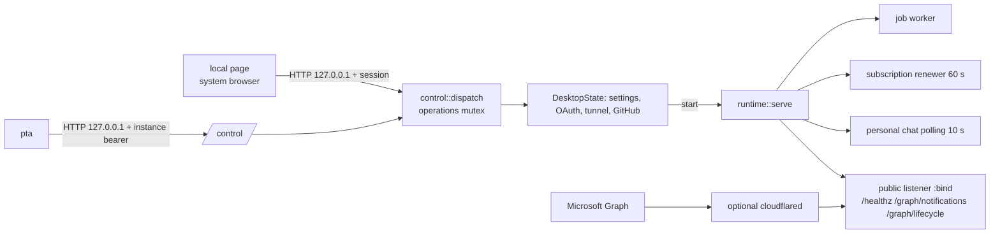
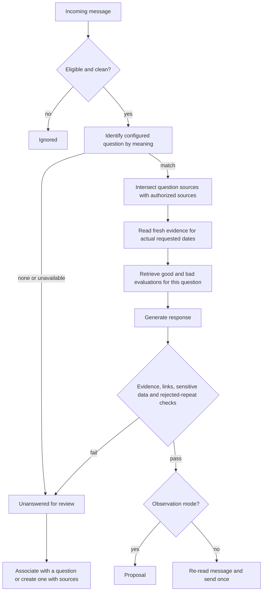

# Architecture

Technical reference for coding agents. It describes how the system is built, how a message flows through it and which invariants cannot be broken. The operating manual (`pta` commands) is the [built-in skill](../desktop/skills/personal-teams-assistant/SKILL.md).

## 1. What it is

A personal Microsoft Teams assistant that answers **as the user** (delegated OAuth, no bot). It receives messages through Microsoft Graph webhooks, decides whether to step in, retrieves evidence only from sources authorized for that conversation, writes with a language model (Codex, Claude Code or OpenCode 2 through their installed CLI, or the DeepSeek API, in a fallback chain), checks references, URLs and sensitive data in code and sends once. If a code check withholds the answer, nothing is sent: the answer is left to the person (and in the personal chat they get a notice). The same model chain classifies ambiguous messages and picks the references an answer uses; no model decision withholds an answer or grants a permission. Azure evidence and daily task snapshots remain read-only (§6.10–11). The separate implementation flow can create reviewed children of a verified parent, only after the user confirms its new implementation plan (§16); older activity plans cannot authorize these writes. The explicit Create request flow (§16) separately creates one GitHub Epic or Azure HU/bug from the context and destination the user confirms.

An optional host schedule saves the existing tasks for the local day, with verified links, descriptions, optional HU and daily hours. The daily target only warns; no model or write credential is involved. The Activities screen lists saved days, their tasks and full task detail. The same record supplies concise recaps without live activity discovery.

Everything in the repository — code, comments, prompts, documentation, the GUI's source text, CLI and IPC messages, diagnostics and audit steps — is in English. What the user reads follows `llm.language` (Spanish by default, or English): the GUI, translated at runtime from its English source by `desktop/ui/i18n.js` (the only Spanish UI catalog), what the assistant writes to Teams, and the activity drafts and issues written for the user.

It is distributed only through Cargo. One package, `personal-teams-assistant`, installs three pieces (up to 0.4.0 the app came in a separate package, `personal-teams-desktop`, now obsolete):

| Piece | Binary / path | Role |
| --- | --- | --- |
| Host | `personal-teams-assistant` | Host with a web interface, the same headless build on every operating system. It is the **only owner** of the profile, the credentials and the Teams service. Its owner's GUI is the [local page](#owners-local-page) in the system browser, which opens when a person launches it; `pta` starts it in the background (`--host`). The portal is the GUI of an account. |
| CLI | `pta` | Administrative client. Talks to the host over authenticated loopback IPC; starts it hidden if there is none. |
| Skill | `desktop/skills/personal-teams-assistant/` | Manual for agents, built into `pta` (`pta skill show/path/install`). |

## 2. Repository layout

```text
Cargo.toml                    single package `personal-teams-assistant`: library + binaries
                              `personal-teams-assistant` (host) and `pta`; the `gui` feature is empty and
                              deprecated (kept so installations recorded with it still update)
build.rs                      Windows MSVC host-only 8 MiB stack reserve
src/                          core: pipeline, Graph adapters, LLM, knowledge, tools, SQLite
  llm.rs                      LlmProvider contract, prompts (`Model`), fallback chain (`Chain`), validation
  llm/deepseek.rs             DeepSeek API (`/chat/completions`)
  llm/agent.rs                Codex (`codex exec`), Claude Code (`claude -p`) and OpenCode 2 (`opencode run --standalone`) as tool-less CLIs; catalog
  ado.rs                      Azure DevOps activity for status questions (work items, commits, pipelines)
  ado/todo.rs                 personal HUs and bugs by process-defined assignment, states and dates
  ado/detail.rs               full HU/bug/task fields, comments, relations and history within that catalog
  ado/tasks.rs                existing tasks by user/day from process types and historical revisions
  tools/todo.rs               typed To-Do filters/results and canonical provider link validation
  tools/tasks.rs              typed daily task queries, snapshots and evidence adaptation
  ado/repositories.rs         a project's Git repository catalog for workflows (read credential, bounded, cached)
  ado/workflow.rs             what the workflow engine reads: a branch's pull requests, an item's assignment
  workflows.rs                `[[workflows]]` and `[[workflow_blocks]]`: definitions, limits, origin matching and the
                              save check against what the host gathered (no app deps)
  workflows/director.rs       `[workflow_settings]` (ready states, watcher, concurrency, pull-request wait, the
                              workflow director), the candidates sent to the director and code's check of its answer
  ado/progress.rs             a work item a status request names, read directly whoever holds it now
  ado/review.rs               activity review: own work compared with work items, verified links
  ado/link.rs                 legacy link types and audit support; installed adapters never write
  ado/registration.rs         daily effort delta helper and legacy registration schemas
  activity.rs, activity/      daily task snapshot scheduling, durable records and legacy history
  ado/wiki.rs                 Wiki search/read with verified authorship; own edits for reviews
  questions.rs                configurable questions, associated requests and answer evaluations
  cases.rs                    legacy case schema, retained for old profile compatibility
  llm/prompts.rs              default prompt texts a case may replace
  index.rs                    knowledge index (SQLite FTS5 + optional embeddings): searches repositories, questions,
                              the organization and the notes store's records; ranks evaluations and examples
  app.rs                      host: Host/Shell, state, start/stop, OAuth, tunnel, settings, `run` entry
  app/headless.rs             the host process and its only shell: foreground, SIGTERM/Ctrl-C, `--start`
  app/service.rs              start at login (`pta service`): LaunchAgent, systemd user unit, scheduled task; the assistant's intent
  app/page.rs, app/page/       the owner's local page: the GUI on loopback with the owner's authority
  app/gui_assets.rs           the one list of desktop/ui files both listeners serve; debug builds read them
                              from PTA_DEV_UI_DIR instead (development loop)
  app/web.rs, app/web/         browser GUI, Access-bound sessions, isolated per-user host processes;
                              enrollment.rs: browser approval of native machine sign-in
  app/control.rs              profile paths, IPC channel (contract 1), single dispatcher, update
  app/authority.rs            server-derived account/profile and authenticated invocation guards
  store.rs, store/            one storage trait per account aggregate, its contract suite and the local implementation
                              (crate root: the pipeline uses it as much as the host); settings.rs, notes.rs, audit.rs, activity.rs,
                              implementation.rs, organization.rs
  variables.rs                account variable store: encryption, key custody, rotation, backup (no app deps)
  app/variables.rs            variable host operations, protected-entry requests and operator key commands
  app/variables/sync.rs       catalog synchronization: coordinator pages, the installation's metadata mirror, forwarded edits
  portable.rs                 account configuration: the field allowlist, projection, restore, patch and revision digest (no app deps)
  app/portable.rs             account configuration host side: coordinator snapshot/apply, the installation's replica, forwarded edits, status
  consumers.rs                consumer rules: built-in registry, value checks, launcher definitions and runs (no app deps)
  app/migration.rs            selective credential migration: discovery, review checks, journaled copy, verify then switch
  app/readiness.rs            `setup_readiness`: read-only, ordered first-run report that composes the existing operations
  maintenance.rs              installation maintenance core: stable versions, the pinned registry's index, Cargo's install record,
                              the scrubbed build, matched-pair verification (no app deps)
  maintenance/apply.rs        applying a prepared pair: durable journal and lock, journaled file replacement with its undo, data safety
                              copies, work-in-progress checks, recovery of an interrupted update (no app deps)
  app/maintenance.rs          update operations (`crate_update_*`): check, stage, apply, cancel, dismiss, status and the daily notice check
  app/maintenance/apply.rs    the apply request, the `--maintenance-apply` helper that stops, replaces, restarts and verifies, and rollback
  app/consumers.rs            consumer host operations, the account credential resolver and launcher authority
  app/workflows.rs            workflow and block operations (`workflows_list` … `workflow_repositories`): checks, authority, saves
  app/workflows/director.rs   `workflow_settings`, `workflow_settings_update` and the dry-run `workflow_classify`
  app/workflows/record.rs     workflow runs: states, the record and `implementation/workflows.db`
  app/workflows/engine.rs     the run engine: the coordinator's 30-second task, stages, recovery and resume
  app/workflows/runs.rs       `workflow_run_start`, `workflow_runs`, `workflow_run_status`, resume, cancel, assign
  app/workflows/summary.rs    `workflow_summary` and `workflow_summary_send`: the director's progress summaries and their sending to Teams
  app/implementation/director.rs  the director's session on its machine (`workflow_direct`) and its record on the coordinator
  app/implementation/checkout.rs  `checkout_inspect`: a confined, read-only look at a checkout's `.git` and origin
  app/cli.rs                  `pta`: help, parsing, argument validation, translation to IPC methods
  app/github.rs               GitHub App with Device Flow, clone/sync without a token in URL/argv
  app/skill.rs                skill texts embedded with include_str!
  app/notes.rs                notes, ratings, knowledge search and index status/refresh operations
  app/mcp.rs                  `pta mcp`: Model Context Protocol server over stdio for agents
  app/agent.rs                what the portal's remote MCP endpoint offers an agent (`Transport::Agent`)
  app/tools/                  shared operation catalog and CLI/MCP adapters; todo.rs owns To-Do host reads
  app/activity.rs             host scheduler and asynchronous daily snapshot IPC; no Graph or model
  mirror.rs, mirror/          the account store mirror's core (phase 3b): the content key (`key.rs`), sealing and
                              blinded IDs (`seal.rs`), the ledger that is the outbox (`ledger.rs`) and the engine
                              that uploads and verifies through two traits (`engine.rs`); host side in
                              `app/cloud/mirror.rs`, with `primary.rs` (phase 3c) and `migration.rs` (backup,
                              migrate, rollback, erase; phase 4a) under `app/cloud/mirror/`
  main.rs, bin/pta.rs         binaries (`app::run`, `app::cli::run`)
desktop/                      app resources: `icons/source/app.png` (source of `scripts/render-icons.mjs`)
  ui/                         shared HTML/CSS and native ES modules, flat, no build (§11): `index.html` loads the
                              entry `app.js` (the page's wiring) and preloads its graph; shared pieces
                              `transport.js` (the local page's or the portal's web API), `control.js` (the control
                              contract, `invoke`), `state.js` (shared state and its setters), `i18n.js` and its
                              catalog `catalog.js` (English source text to `llm.language`), `dom.js`,
                              `notices.js`, `nav.js`, `appearance.js`, `markdown.js` (rich text and Markdown),
                              `directory-sheet.js`, `dialogs.js`, `profile.js` (load, refresh, save); views
                              `home.js`, `todo.js`, `todo-request.js`, `implementation.js`, `sessions.js`,
                              `guides.js`, `messages.js`, `activities.js`, `knowledge.js`, `knowledge-map.js`,
                              `chat.js` and Settings' `settings-*.js` (general, account, machines, models, daily,
                              variables, migration, updates, service, cloud)
  skills/                     operating skill (canonical source)
cloud/                        account store Worker outside the Cargo package (TypeScript, Bun): `src/index.ts`
                              (routes, `authenticate`), `access.ts` (Access assertion), `registry.ts` and
                              `account-store.ts` (SQLite-backed Durable Objects), `protocol.ts`, `test/`
                              (Workers runtime) and `wrangler.jsonc` (production and staging)
site/                         static landing outside the Cargo package: `public/` (HTML and CSS without
                              JavaScript or a build, `_headers`, `404.html`, GUI screenshots with
                              synthetic data) and `wrangler.jsonc` (Cloudflare Workers, assets only)
tests/integration.rs          integration with wiremock (Graph, DeepSeek) and test doubles
config.example.toml           profile template (`Config::desktop_template`)
knowledge-map.example.toml    synthetic example of the source map
scripts/configure-cloud-access.py  Access applications, Worker secrets and service tokens of the cloud Worker
scripts/rehearse-cloud-migration.py  rehearses migrate, promote, edits, rollback and erase on a copy of a profile
                              against the staging Worker with a temporary service token (nothing secret copied)
scripts/export-public.py      exports a snapshot without private history (requires gitleaks)
scripts/ui-preview/           GUI preview as the owner's local page over a mocked host with synthetic data: screenshots,
                              axe WCAG 2.2 AA scans and interaction checks (Playwright outside the repo); reloads on edits
scripts/dev-host.sh           a debug host on a disposable profile with synthetic data, serving desktop/ui from disk
scripts/install/              install.sh (macOS, Linux) and install.ps1 (Windows): the one-command installation of the
                              release archive, attached to every release; test-install.* run them in binaries.yml
scripts/vps-update.py         server updater: installs new crates.io releases, verifies, rolls back;
  systemd/                    its systemd user service and timer (docs/delivery.md)
.github/workflows/            ci.yml (checks on Linux, macOS, Windows), release.yml (crates.io) and binaries.yml
                              (release archives, the installers and their tests)
.agents/skills/save-knowledge to save facts into the knowledge base
```

## 3. Process model



- **Host and shell.** `Host` = `DesktopState` (operations) + `Shell` (what the owning process can do: `open_url`, `browser`, `exit`). `headless::HeadlessShell` is the only shell, on every operating system: it opens URLs in the system browser when it runs in a desktop session (`page::browser_session`) and otherwise returns them to the caller, and ends the process on `app quit`. `Shell::browser` says whether `open_url` reaches a browser a person sees. `app open` opens [the owner's local page](#owners-local-page); there is no window to show or hide.
- **Auxiliary programs.** The host starts other programs (`cloudflared`, the model and coding CLIs, `az`, `gh`, `git`, approved launchers, and on Windows `whoami`/`icacls` for every private file) through `security::program`/`program_async`. On Windows the host is built without a console (`windows_subsystem = "windows"`), so these are created with `CREATE_NO_WINDOW`: a console program would otherwise open a window of its own for as long as it runs. Their input and output are always pipes or null.
- **One host per profile.** `control.lock` (flock) proves ownership; `control.json` publishes port, random token and `wiki_support`. A descriptor without a lock is stale. A process is never signaled by PID.
- **IPC.** `POST /control` on an ephemeral loopback port, constant-time bearer, rejects any `Origin` (browsers). Body at most 4.5 MB (room for the images of one `teams_post`), client timeout 120 s (no limit for `chat`, `test_providers` and `variable_launcher_run`, whose approved timeout of at most ten minutes the host enforces; which wait for the model).
- **Single dispatcher.** GUI and CLI go through `control::dispatch`, which serializes with `operations` and checks `revision` (SHA-256 of config + map + tunnel) for writes based on a snapshot. While Microsoft, GitHub or Azure CLI login is pending, profile mutations wait for completion or cancellation.
- **Operation diagnostics.** Failed GUI/CLI/MCP host commands append `app_operation_failed` to the existing event log (`pta logs`) and tracing output. Each entry records operation, error/exit code, duration and bounded typed cause chains with source location and available app stack frames. Causes include I/O kind/OS code, HTTP status/connection/timeout, JSON/TOML position, SQLite code and Azure CLI login phase/reason/exit code/output size, bounded AADSTS error codes and transport category. Arguments, raw exception/provider text, tokens, device codes and message content are never logged. Pending authorization is progress, not a failure. Appending an event initializes a missing schema without running job recovery or changing in-flight work; an unavailable log destination leaves the original reply intact and emits a tracing diagnostic.
- **Update.** A newer release is found and prepared (built and verified beside the installed one, installing nothing) by [installation updates](#installation-updates-discovery-and-staging) and, on the owner's request, installed with a restart and rollback by [applying an update](#applying-an-update-restart-and-rollback). `cargo install` runs nothing when it finishes and replaces the file while the previous host keeps running. `control.json` publishes `binary` (size and date of the executable at start; older hosts do not have it). If the running host was started from the **same installed path** and its fingerprint no longer matches, it is outdated (`control::outdated_host`): the first `pta` (except `capabilities`, `skill` and `doctor --offline`) or a newly launched host retires it (`retire_outdated_host`: reads whether the assistant was running, sends `app_quit` — which stops assistant and tunnel — and waits for the lock, 60 s). If it was running, `pta` asks on the terminal whether to keep it running with the new version (without a terminal, `--json` or `--non-interactive` keeps the state); a newly launched host asks the same on a terminal and keeps the state without one. `start`, `restart`, `stop` and `app quit` decide the state themselves. A host started from another path (e.g. a development build) is never retired this way.
- **Start at login.** `pta service install` registers the host with the operating system's service manager so it starts when the user logs in ([start at login](#start-at-login)); it starts with `--host --service`, never opens the page and never starts the assistant by itself.
- **The CLI starts the host** (`host_executable`: sibling binary or `host-path.txt`) with `--host` in its own process group and waits for the descriptor. The host inherits `pta`'s environment (`NAME`/`NAME_FILE` credentials).
- **Launching by hand.** Running `personal-teams-assistant` without `--host` (and not as the update helper's restart, `PTA_UPDATE_HANDOVER`) starts the host and, once it is ready, opens the [local page](#owners-local-page) when the computer has a browser session. Launching it while a host owns the profile opens that host's page instead, or exits with code 1 and advice to run `pta app open` in a desktop session when it cannot. `pta` and the helper never open the page.
- **Service.** `runtime::serve` runs as a Tokio task inside the host. `app.rs::start` launches it, waits for `ready` (60 s; `runtime::Service` hands over the Graph handle and the `Pipeline`, kept in `Running` to write and send answers at the user's request, §6.12) and then starts `cloudflared` if needed. Failure before readiness retains the service's error category; a readiness timeout still stops and aborts it. `stop` kills the tunnel, sends `true` on the `watch` and waits 20 s before aborting. Closing the channel also counts as a stop.
- **Daily task record.** `control::launch` owns a separate 30-second scheduler. Snapshot runs return immediately and run in a tracked task; reads remain available and settings/identity mutations are blocked during a run. It needs neither Teams, Graph nor a model. Quitting aborts the read and preserves the previous saved day; legacy in-flight writes still recover as uncertain, never retried.

### Owner's local page

Every host of the installation's own profile (owner, not a shared portal account: `page::launch` refuses a `web/profiles/<id>` host) serves the same `desktop/ui` assets and control contract on loopback for the person at this computer: it is the only local GUI, with the owner's authority. It needs no `--web`, Access or tunnel and is unrelated to the portal listener.

- **Address.** `127.0.0.1` only, at the first free port of a list derived from the SHA-256 of the canonical profile path (16 candidates in 21000-29999, below every operating system's ephemeral range): the same address on every start, a different one per profile. The cookie name (`pta-local-<12 hex>`) is derived the same way, because cookies ignore ports on `127.0.0.1`. A second profile's host on the same computer therefore has its own address, cookie and sessions; no request ever reaches another profile's host.
- **Sign-in.** Only the host opens the page: a person's launch of `personal-teams-assistant` and `app_open` (`pta app open`, `pta activity open`, or launching it again while a host owns the profile) mint a random 256-bit code, keeps its SHA-256 for at most 60 seconds (at most four pending; one opening every two seconds) and writes `http://127.0.0.1:PORT/open?code=…` into an owner-only handoff page `<profile>/page-open/open-<random>.html` (`write_private`: 0600, Windows ACLs; a meta refresh plus a link). `Shell::open_url` receives only that file's `file://` address, so the code never travels in a process argument, which other OS users can read on Linux and macOS. The file is removed when its code is redeemed, dropped or expires (a timer one second after expiry), and the directory is emptied when the page starts. `GET /open` (the one path that accepts the `cross-site` mark of a navigation from `file://`) consumes the code (valid once; an expired, forged or reused code opens nothing) and answers with a page of this origin that sets `pta-local-…=<random token>; Path=/; HttpOnly; SameSite=Strict` without `Max-Age` and refreshes to `/#k=<random key>` (not an HTTP redirect: the chain from `file://` is cross-site, so a Strict cookie would not reach a redirect's target, while the page's own navigation is same-site), so closing the browser ends the session; at most 12 hours, 16 sessions, kept in memory only, so restarting the host or `app quit` ends them. The key exists only in that page and in the fragment of its next address, which browsers never send to a server: `transport.js` moves it to this origin's `sessionStorage`, removes it from the address with `history.replaceState` and sends it as `X-PTA-Key` with every `/api/session` and `/api/control` request; the cookie alone gets 401 there (static assets and the document need only the cookie). A new tab therefore has no key and shows the signed-out page with `pta app open`. The `app_open` reply is `{opened, target}`: the code, the key, the cookie, the handoff file and the address with the code never appear in a reply, the CLI, MCP or tool output, a log or a diagnostic (the opener's errors are replaced by a fixed text). A host without a browser session (no `DISPLAY`/`WAYLAND_DISPLAY` or `xdg-open` on Linux, an SSH session on macOS, no `SESSIONNAME` on Windows, i.e. a service) answers `not_ready` with the next step and mints nothing; it never prints a usable sign-in link.
- **Requests.** A middleware refuses a request whose `Host` is not exactly `127.0.0.1:PORT` (421, DNS rebinding), whose `Origin` is not exactly `http://127.0.0.1:PORT`, or whose `Sec-Fetch-Site` is `same-site` or `cross-site` (another port of `127.0.0.1` is the same site, so cookies would travel); every POST needs that Origin. Without a session `/`, every module but the translation's and `/api/session` answer 401 (the document explains to run `pta app open`); style, translations and icons are static. `GET /api/session` returns the session's anti-CSRF token and `POST /api/control` requires it in `X-PTA-CSRF` (constant-time), exactly like the portal. Responses carry the portal's CSP, `no-store`, `nosniff`, `no-referrer` and `DENY` framing.
- **Authority.** `/api/control` dispatches in process through `authority::from_window`, so the page's calls are `Transport::Window` (the name the owner's transport keeps): the owner-only operations of this computer (reveal and copy, approving launchers and delivery destinations, account sign-in and Synchronize, allowed roots and local checkouts, update notices, start/stop) accept the page. `Local` (the control token shared with the CLI, MCP, tools and agents), `Browser`, machine credentials and shared portal accounts keep their rules; holding the control token gives no way to obtain a code or a session (`page/tests.rs` proves that a caller with only the local channel is refused reveal and delivery approval while a page session is open; the owner approves launchers on that channel too).
- **GUI.** The document is `index.html` with `<meta name="pta-transport" content="local">`; `transport.js` then uses `fetch` with `local: true, browser: false`, so the GUI shows the owner's notices and the host opens links and sign-ins. `activity_open` (`pta activity open`) opens this page, where the activities are a tab; inside the GUI it only switches to that tab. On 401 it goes to `/signed-out`, which explains how to open it again.

### Private browser GUI and owner profiles

`personal-teams-assistant --web` serves the same `desktop/ui` assets on a separate
loopback listener (default `127.0.0.1:38656`), with an HTTPS origin through the
dedicated Cloudflare Tunnel. Cloudflare Access owns the interactive GitHub login,
using a dedicated OAuth App unrelated to repository GitHub Device Flow. Access
protects the complete hostname and API; an explicit email allowlist plus the
configured GitHub login method gates admission at the edge. Admission never
creates or selects an application profile. `web/settings.json.owner_github_id` pins the
installation owner. Owner-only admission remains the upgrade default; legacy non-owner
profiles stay closed. The operator can explicitly admit another private assistant account
with `web users authorize USER`, then bind its verified immutable provider identity and
enable it. Additive `Account.authorized` defaults to false and never grants access to
`--current-profile`; only the configured owner can bind that original profile. Existing
settings infer an owner only from exactly one operator-associated identity; fresh or
ambiguous settings fail closed. `web configure` requires an explicit owner. The public
crate contains no maintainer portal/provider credentials or hosting defaults.


`app/web/access.rs` accepts exactly one `Cf-Access-Jwt-Assertion` and verifies
RS256 signature, pinned issuer/application audience, required subject/issuance/
not-before/expiration and application token type. Keys come only from the team's
HTTPS `/cdn-cgi/access/certs`, with bounded responses, five-minute freshness and
rate-limited rotation refresh. Expired keys are never used after a failed refresh.
The exact verified assertion is sent as `CF_Authorization` to the pinned team's
`/cdn-cgi/access/get-identity`; account, GitHub IdP ID/type and `user_uuid == sub`
are checked. Positive identity responses are cached by assertion hash for at most
30 seconds; JWT validity and local revocation are checked on every request.
Identity/email headers, service tokens and caller-selected URLs grant no access.

`pta web configure` writes private `web/settings.json`, whose additive `access`
configuration contains issuer, audience, account and dedicated GitHub IdP ID.
Legacy settings remain readable for inspection; a portal cannot start without
Access. `pta web users add/authorize/bind/unbind/revoke/disable/enable/list` manages private
`web/accounts.json` under the existing operator-local lock. `bind` takes the
operator's verified Access identity JSON on stdin. Its binding is the issuer,
GitHub IdP ID and provider subject (`id` from get-identity). GitHub's positive
integer IDs are normalized losslessly to decimal strings; legacy string subjects
remain readable. Floats, negative/zero integers and other JSON types are rejected.
The binding is never an email, name or email-associated Access `sub`.
Bindings cannot belong to two accounts. Existing
IDs, profile selection and retired password hashes survive additive schema reads;
hashes are never used to authenticate. Local association/reassociation is the
recovery path; there is no public registration or password endpoint/form.

`GET /login` exchanges a verified, enabled, explicitly associated identity for a
random local session and serves the shared panel document without another form.
This ends the cross-site OAuth navigation before asset/API requests need the
SameSite=Strict cookie, avoiding a redirect loop without weakening its protection.
An existing first-party session may redirect to `/`. Sessions
are bound to the exact Access assertion, provider binding, Access subject and
account version, and expire at the earlier of local duration or JWT expiration.
Cookies are HttpOnly/SameSite=Strict and host-only Secure on HTTPS. HTTPS responses set hostname-only HSTS (`max-age=31536000`), including denied and public asset responses; Access-generated edge responses require matching edge configuration. Every browser
POST requires the exact configured Origin and a session-specific CSRF header.
Logout revokes the local session and persists the assertion fingerprint until its
expiration in private `web/access-revocations.json`, then the browser visits
`/cdn-cgi/access/logout` to revoke Access and clear its application cookie. Local
`users revoke` also sets an issuance cutoff so old Access assertions cannot open
new sessions. Disable, unbind and rebind take effect on the next request.

Hosts advertise additive `machine_pairing_support` (0.9.4+), `machine_login_support` (0.9.12+) and `web_access_support` in their IPC descriptors and CLI
capabilities. IPC rejects `machine_login*` operations, and the portal rejects forwarding a sign-in registration, to a host without `machine_login_support`. The portal refuses to reuse a password-era or pre-pairing host. IPC rejects `machine_connect` before delivery to a host without `machine_pairing_support`, preventing fallback to older GitHub-token enrollment, and account edits
refuse to migrate the schema while one is running. A controlled Mac transition
updates the compatible host/CLI pair and preserves the previous assistant state.
The native transport remains unchanged and never accepts browser credentials.

Each web account gets an opaque-ID directory `web/profiles/<id>/`, its own settings,
map, SQLite data, file credentials and provider home, and a separate instance of
the same host binary. `PTA_PROFILE_DIR` selects that explicit absolute
profile; the existing desktop profile and Keychain identifiers remain unchanged
when it is absent. New web profiles use DeepSeek, with their own key, by default.
The portal and CLI scrub inherited app/provider credentials when launching isolated
hosts, preserve proxy/CA configuration, and use private credential files on all OSes.
These are application profiles under one trusted operator's OS account, not OS isolation. Admitted ordinary accounts use only their own API configuration and file credentials, never inherited environment values/mounts or the operator's keychain. Their data/map/repository paths are confined and rechecked for native CLI/MCP as well as browser calls. Provider probes, CLI sign-in, Git subprocesses, local coding and request/child creation on the shared OS identity fail closed; personal trusted machines remain the coding path. Provider catalogs for ordinary accounts are static API catalogs and never probe installed commands.

One account may instead use `pta web users add USER --current-profile` followed by a local identity association to operate
the existing host and its actual data without a copy or re-login.
The portal selects each IPC descriptor from the authenticated account, strips browser
transport headers and uses the existing instance bearer. IPC itself still rejects
Origin and never accepts cookies. A web command allowlist, immutable hosting/data
paths, canonical repository roots and confined imports prevent access to another
profile's data through GUI operations. Current-profile repositories already in the
saved desktop map remain available. Tenant/user identities cannot be reused across
profiles: portal operations and host start check them, and a duplicate new Microsoft
login is logged out locally before an assistant can start.

Graph URLs use optional `server.webhook_prefix` (empty and omitted for existing
profiles, `/webhooks/<opaque-id>` for isolated profiles). The portal forwards only
the matching notifications/lifecycle POST to that host's loopback service, with no
browser cookies or administration token. All existing Graph batch checks remain
in that host. One Cloudflare hostname covers the GUI and every user's callbacks.
The prefix is canonical and validated; it does not change OAuth scopes or redirects.
On a remote device the GUI offers the existing loopback redirect paste/forward
workflow, while GitHub uses its existing device flow. Activities open in the web tab.

The portal owns its own lock, starts enabled profile hosts for offline scheduling,
remembers explicit Assistant Start/Stop state in private `web/resume/<id>` files,
and stops only processes it started on exit. Disabling an account revokes access
immediately and its portal-owned host on reconciliation. The tunnel setup helper
`scripts/configure-web-cloudflare.py` needs a Cloudflare API token, creates a
dedicated remotely managed Tunnel/DNS route, saves its connector token privately
and refuses to replace unrelated DNS or Tunnel routes. The existing static landing
and desktop tunnel remain separate. `scripts/configure-web-access.py` separately
creates/reuses only the dedicated GitHub IdP and panel/Graph/icon Access applications,
rejects overlapping unmanaged resources, installs only explicit callback paths
exported by `pta web callbacks` before protecting the hostname, and verifies
readback before writing private portal settings. No broad `/webhooks/*` bypass is
allowed. The backend exempts only canonical notification/lifecycle POST paths and
GETs of the exact static icons and PWA manifest (`PUBLIC_ASSETS`, which the helper
also bypasses, because WebKit fetches a page's icons without cookies);
Graph forwarding and its existing batch authentication stay unchanged. The current
profile's separate desktop Graph hostname/tunnel remains unchanged. See the [web operating guide](../desktop/skills/personal-teams-assistant/references/web-access.md).

### Account and invocation authority (0.9.11)

The host derives its account binding from the canonical profile and the operator's
account registry. Each invocation carries that scope and its authenticated
transport inside Rust; JSON IDs, paths, owner flags and transport/maintenance
fields never grant authority. The profile binding is rechecked before dispatch,
including implementation operations that bypass the ordinary operations mutex.
Reassociation requires a fresh host. Rejections happen before diagnostics can
read or write data under a changed binding. Existing per-profile settings, sources,
notes, indexes, activity records, implementation ledgers and asynchronous results
retain their owning host; machine session summaries and call results retain their
existing machine checks. Graph callbacks still select only the exact bound profile.

IPC descriptors advertise additive `account_authority_support`, an account/version
binding and separate random local, browser, machine and agent credentials. The portal
checks the expected binding before forwarding and uses only the appropriate
scoped credential. The host repeats browser operation/path checks and limits
machine authority to the existing coordinator protocol; nested calls retain their
transport through a task-local invocation. A machine cannot forward coding,
provider discovery or directory browsing into the coordinator's local OS context.
The workflow engine has its own internal transport (`Transport::Workflow`, §16 Workflows) that no
credential maps to and `authorize` refuses.
The new CLI/portal refuse older hosts before transmitting an operation; there is
no fallback to the operator bearer. A matched local installation upgrade may only
inspect (`snapshot`) and stop (`app_quit`) its older owner host to preserve the
existing running state; this private retirement path cannot perform other actions
or forward portal requests. The local page, CLI and MCP use the same dispatcher.
The native bearer and portal administration remain trusted local OS operations.

Explicitly admitted accounts can use the shared GUI, CLI and MCP with their own API
assistant, notes/index, sources, activity records/schedules, Microsoft/GitHub API sessions,
machine coordination and, once the operator enables it, their own account store. `shared_accounts_support` is mandatory before a host receives
ordinary-account requests or account-schema edits; no fallback to an older host exists.
The snapshot exposes only the current account identity and its local-execution capability.
The GUI translates account failures and explains personal-machine requirements.

Disable, revoke, unbind and rebind change the account version. Every checked browser,
machine and host request rejects stale authority. Graph callback forwarding checks the
host's exact binding too. OAuth completion rechecks authority before exchanging and
persisting tokens and before saving identity; GitHub device login also checks before
persistence. Daily snapshots and asynchronous results recheck before storing. Reconciliation
stops only tracked app-managed hosts whose account is disabled, removed or changed;
unrelated desktop/operator hosts are preserved. A new host is required after reassociation.

Without verified OS isolation, provider/coding rejection directs the user to a personal
trusted machine. Private profile directories, provider homes, working-directory limits and
tool-less prompts are not an OS security boundary. Different people sharing a computer
need distinct OS security contexts: switching app accounts cannot protect against someone
controlling the same OS account. No container sandbox is introduced here and none is silently assumed to exist;
variables are used only through the consumers of [Account variables](#account-variables),
which never run generic processes for a shared account.

### Remote MCP endpoint (0.10.64)

`POST /mcp` on the portal listener (`app/web/agents.rs`) serves the tool catalog of `pta mcp` over
Streamable HTTP to an agent with nothing installed: a cloud session, a phone, a computer without
the host. It is a separate transport, `Transport::Agent`, because its caller is always an agent,
never a person.

- **Admission.** The browser API's edge identity and nothing else: `secure_headers` verifies exactly
  one `Cf-Access-Jwt-Assertion` (RS256, pinned issuer and application audience, `access.rs`) and
  the endpoint maps it to an enabled, admitted account whose binding matches and whose issuance
  cutoff it passes, exactly as `/login` does. The account comes only from that identity; tool
  arguments naming an account, profile or transport are refused. A request that carries an
  `Origin`, a `Cookie` (so the portal's session cookie never authenticates an agent) or browser
  fetch metadata (`Sec-Fetch-*`) is refused with 403. Non-browser clients obtain the assertion
  through Cloudflare Access managed OAuth for the portal's own application: the client receives a
  401 pointing to Access's discovery metadata, the user signs in through the browser with the same
  policy and identity provider, and Access resolves the client's opaque token into the same signed
  assertion a browser login produces. The host runs no OAuth server and stores no client secret.
  `scripts/configure-web-access.py --managed-oauth-only [--oauth-redirect-uri URL]...` turns it on
  and `--managed-oauth-off` turns it off: with only `Access: Apps and Policies Write`, they resend
  the panel application as read with only `oauth_configuration` changed (dynamic client
  registration for localhost and loopback redirects and the exact HTTPS callbacks listed; the
  grant as read), dropping only the generated `id`, `aud`, `created_at` and `updated_at`, and fail
  if the readback of the application or its policies differs elsewhere; `--report FILE` keeps a
  private, secret-free record. The full run's `--managed-oauth` sets the same with five-minute
  tokens and a twelve-hour grant, but also rewrites the Allow policy with its one email.
- **Protocol.** JSON-RPC over POST, one message per request (no batches), the protocol versions of
  the stdio server (`MCP-Protocol-Version` is checked when sent). `initialize`, `ping`,
  `tools/list` and `tools/call` share the stdio server's code (`mcp::initialized`, `listed`,
  `outcome`, `approved`): the same capabilities, server information, tool definitions and result
  shapes; the instructions are the stdio ones plus a paragraph on what the remote endpoint leaves to
  the GUI. Stateless: `initialize` returns an `Mcp-Session-Id` that is an HMAC-sealed note of the
  account, its version, the identity subject, whether the client declared elicitation and an expiry
  (twelve hours, key random per portal process); a session of another account, a forged or expired
  one answers 404 so the client initializes again. GET and DELETE answer 405.
- **Authority.** `agent.rs` classifies every catalog tool as offered or denied with a reason;
  `tools/list` shows only offered tools, a denied tool returns its reason without reaching a host,
  and a tool added to the catalog later is denied until classified (a test walks the catalog).
  Offered tools are the account's portal allowlist intersected with the catalog: reading, notes,
  contexts, people, guides, the organization, answers, daily records, variables' metadata, protected
  entry and rotation requests, consumers, delivery destinations (proposal only), machines and
  implementation runs. Denied: launchers, updates, the account store's keys, installations and
  lifecycle, moving a computer's own credentials, the host computer's own enrollment, directories,
  CLI sign-ins and desktop actions, Teams message reads and posts (not in the portal allowlist;
  the chat directory `teams_chats`, names and members only, is offered). Each tool
  runs through `tools::run`, the same adapter as stdio, with its host operations sent by a
  task-local `tools::Dispatch` to `web::forward` (the browser API's own forwarding: the portal's
  per-account allowlist, identity and resume checks) with the agent's scoped IPC credential. The
  host refuses on this transport every operation outside `agent::METHODS` and always those in
  `agent::NEVER` (`variable_reveal`, `variable_create`, `variable_entry_complete`, launcher and
  delivery approval, launcher definition and runs, key custody, update check, staging and apply,
  credentials, machine registration, `app_quit`), then repeats the browser's bound-request checks.
  Variables accept `variable_entry_start` and `variable_rotation_start` from the agent (the user
  types the value in the GUI), never a value-bearing call; readiness treats the agent like the
  browser (no local owner view). The local page, browser and local transports are unchanged.
- **Confirmation.** The stdio rule: when the session says the client declared elicitation and the
  request accepts `text/event-stream`, the `tools/call` answer is an event stream that first carries
  `elicitation/create`; the client posts its answer as a JSON-RPC response, delivered only to a
  confirmation of the same account (at most 64 in flight, eight per account, five minutes), and the
  stream ends with the tool's result. Otherwise, or after an unanswered question, `confirmed: true`
  decides, exactly as on stdio. A question with no reply within `mcp::ANSWER_WITHIN` (two minutes)
  expires as on stdio: `notifications/cancelled` withdraws it on the stream, the call does nothing
  whatever the agent sent, and the portal remembers in memory (until the session expires, at most
  1024 sessions) not to ask that session through the client again.
- **Computers.** Tools that act on a computer (implementation runs, machine management, directories)
  go once to the account's host, which sends them once through the existing worker protocol to the
  enrolled, online computer the arguments name, within its allowed roots; nothing in the protocol,
  enrollment or Teams lease changes. A tool runs at most two minutes (five for model-backed ones);
  a timeout is reported with the advice to read state first and is never replayed.
- **Bounds and logs.** Bodies over 256 KB are refused; 120 requests per minute per account and 600
  for the endpoint (the portal's sliding limiter); the portal's request semaphore bounds concurrent
  runs. Each request logs one stderr line `remote_mcp operation=… code=… ms=…`: the operation is the
  catalog's own tool name or a known method, never caller text, and no argument, result or value is
  logged.
- **Surfaces.** Settings › Advanced › Connect an agent shows the address (the portal's origin in
  the portal, the coordinator's in the window and the owner's local page) with Copy address and how to add it; `pta mcp
  config` prints both transports, and the skill's `references/mcp.md` says when to use each.

### Account variables

A stored variable is the only secret an assistant account owns directly. Its user-facing fields are exactly a **name**, a **description** and a **value**; the host adds an entry ID, a version, timestamps and the encryption version as implementation metadata. There is no credential type, TOKEN/KEY suffix or key-pair structure, and no automatic import of existing credentials (the opt-in [migration](#credential-migration) copies selected ones). Existing application credentials, `STATE_ENCRYPTION_KEY` and the Teams OAuth vault are untouched.

- **Limits.** Names are environment-compatible identifiers (`[A-Za-z_][A-Za-z0-9_]*`, at most 128), unique per account without regard to case. Descriptions are required, one line of plain text of at most 500 characters without control or bidirectional-override characters. Values are 1 byte to 16 KiB of UTF-8 (newlines allowed, no NUL). At most 500 variables per account. Consumer-specific validation belongs to the consumer, not to a type selector.
- **Storage.** `variables.rs` keeps SQLite tables `account_keys` and `variables`, all qualified by an account key. A profile store (`Store::open_profile`) uses a random, stable account key written at first use and records the portal account ID it serves: a profile later associated with a portal account keeps its variables, and a profile bound to one account refuses another. Names and descriptions are clear metadata so they can be listed and searched; values exist only as ciphertext.
- **Cryptography.** AES-256-GCM-SIV (the existing dependency) with independent keys: every account has a random 256-bit data key, wrapped by a master key; values are sealed under the data key. The associated data of a value is a length-prefixed encoding of a variable-record domain string, the account key, entry ID, name, revision and data-key version, and the one of a wrapped data key uses its own domain with the account key and both key versions, so ciphertext moved to another account, entry, name or revision fails authentication. It never reuses the Teams state vault's key or domain.
- **Key custody.** Master keys are private files `keys/master-N.key` in a directory apart from the database. A key is generated only for a store with no key material and no variables; a missing, unreadable or wrong key for existing data fails closed (`not_ready`, exit 3) and never regenerates anything. Operator-local commands (`pta variables key backup|restore|rotate`, plus `verify`) are available on the native local channel only: they are neither browser, machine nor MCP/tool operations. `backup` writes the master keys, not values or ciphertext, to a new private file (never overwritten) that must be kept apart from the profile and its routine backups; `restore` reads that file on stdin and never replaces a different key with the same version; `rotate` re-wraps every data key under a new master key and re-encrypts the account's values under a new data key in one transaction after each value authenticated, keeps the earlier master keys so older database backups stay readable, and a failure changes nothing. A routine copy of `variables.db` alone is ciphertext without its keys; copying the whole profile directory also copies `keys/`, so exclude it from routine backups.
- **Trust model.** The operator/server decrypts for unattended operations; this is not end-to-end encryption and does not protect against an administrator or a fully compromised server (ADR 0001).
- **Operations (shared by GUI, CLI and MCP).** `variable_list` (optional `query`, `limit`), `variable_usage` (optional `query`, `limit`), `variable_create`, `variable_update`, `variable_rename`, `variable_delete`, `variable_reveal`, `variable_entry_start|status|complete|cancel`, `variable_rotation_start` and `variable_audit`, and the operator-local `variable_verify`, `variable_key_backup|restore|rotate`. They bypass the profile operations lock like the implementation operations, are independent of settings revisions, and are refused to machine credentials. The browser may list, create, edit, rename, delete, reveal and complete or cancel an entry; starting an entry or a rotation request, the audit and every key operation require the local channel. Hosts and CLI capabilities advertise additive `account_variables_support`; a CLI or portal refuses to send `variable_*` to a host without it.
- **Discovery.** List/search responses contain the entry ID, name, description, version and timestamps, plus pending protected-entry requests, never a value, ciphertext or key. Names and descriptions are untrusted text: the GUI sets them with `textContent`, and the tool descriptions tell agents they are data, not instructions. Search (`Store::list`, the mirror and `variable_usage` share `variables::search`) matches word by word: the query is split at non-alphanumerics, names and descriptions also at camelCase, everything is lowercased and accent-folded, a short Spanish/English stopword list is dropped, and every remaining query word must begin a word or a run of consecutive words of the name or description; results are ordered by the number of words found in the name. `variable_usage` (`app/variables/usage.rs`) composes the `variable_list` and `variable_consumer_list` replies with the configuration's lookups by name: per variable, `usable_now` (the `standing` view's `variables_usable`), `paths` (`consumer` bindings, `launcher` references, `application` settings that read the name) with their operation, confirmation and availability here, and `next` when nothing uses it; it never resolves a value and inherits both operations' transport rules.
- **Creation.** `variable_create` takes a client-chosen entry UUID, name, description and value and never overwrites. The same entry ID with identical content reports `replayed: true`; the same ID with other content, or another entry with an existing name, is a conflict (`state_conflict`, exit 6) that names the existing variable so the caller inspects first. The CLI prints the entry ID after an uncertain failure so a retry repeats the same creation; the GUI keeps one ID per typed form.
- **Protected entry.** A value reaches the host only from the GUI's masked field (a textarea masked by the engine with an explicit «Show the value while I type» choice) or from the CLI's standard input, which must be a pipe, never a terminal, never an argument (one final line break is not part of the value). No MCP tool, tool argument or result carries a value. An agent calls `variable_entry_request` with a name and description; the host keeps that request in memory for 15 minutes (at most 20 open, one per name; a host restart abandons it), the user completes it in Settings › Variables or with `pta variables entry complete REQUEST`, and the agent only reads `variable_entry_status`. Completion uses the request ID as the entry ID, so repeating it is a replay.
- **Authority.** Operations resolve the account from the host's binding, never from arguments (account, profile and transport arguments are rejected). Each portal account has its own profile, host, store and key directory; the portal allowlist includes the variable methods for ordinary accounts. Failures are logged by operation name, code and duration only. Migration of existing credentials is [its own workflow](#credential-migration).
- **Edit, rotate and delete.** `variable_update` takes the entry ID, the **version the caller saw** and a new description, a new value or both; the GUI sends them as two independent edits. A rotation keeps the ID, name and description (references keep working) and seals the value again under the new revision. A different current version is a conflict (`state_conflict`, exit 6) that names the version now stored and changes nothing, except that an identical repeat of an update whose reply was lost (current version = seen + 1 with the same content) is reported as `replayed`. An update that changes nothing is refused. `variable_rename` takes the ID, the seen version and a new name under the same rules as creation (unique in the account without regard to case; a case-only change of its own name is allowed): because the name is part of the record's authenticated data, the host opens and reseals the value under the new name and revision inside one transaction, so the value never leaves the store and `variable_verify` keeps passing. Bindings and launchers refer to entry IDs and follow the new name; a launcher run pinned to the earlier version fails as after any edit. A name the installation's application reads by name (`DEEPSEEK_API_KEY`, a `[secrets]` reference target, the Microsoft setup identifiers) cannot be renamed away nor taken by another entry: that would change which value the application uses, which only a binding or the reference itself decides. Installations signed in to the coordinator check their own configuration before forwarding and the coordinator checks its own; another computer's `[secrets]` reference to the old name stops resolving until it is repointed. `variable_delete` takes the same version, writes a **tombstone** (ID, name, deletion version and time; never a value) and removes the row in one transaction: a stale write, a replay of the creation or any later resolution of that ID fails with «was deleted» instead of bringing it back, an identical repeat of the delete is a replay, and the name becomes free again for a new entry with a new ID. Deletion does not revoke the credential at its external provider and cannot retract a value a program already received; the GUI and the tool say so.
- **Reveal and copy (human only).** `variable_reveal` is the only operation that returns a value, and only for one entry of the current account after an explicit tap in the GUI (Reveal, or Copy value). The [owner's local page](#owners-local-page) marks its calls with the owner's transport (`Window`, `authority::from_window`) and the portal browser has `Browser`; a call without a marked invocation (a spawned task, a scheduler) counts as `Local`, so nothing reveals by default; the CLI, MCP, tools and `pta tools call` share the control endpoint's local token with agents (`Local`) and are refused, as are machines and the portal's remote MCP endpoint (`Agent`). A refusal leaves a `denied_client` audit event. The browser reply carries `Cache-Control: no-store` like every account reply. The GUI keeps a revealed value only in memory and the DOM, never in storage, a URL or history, and clears it on Hide, on changing tab or Settings category, when the page is hidden or unloaded, on logout and after 30 seconds. Copy writes the exact value (line breaks included) without showing it in a notice, and a minute later clears the clipboard only if it still holds exactly that value (compared by SHA-256 fingerprint, best effort; unrelated clipboard contents are left alone). There is no agent-facing reveal, copy or read tool.
- **Protected replacement.** An agent that needs a value changed calls `variable_rotation_request` (MCP; `variable_rotation_start` on the host) with the entry ID; the request records the version it saw and the user completes it like a creation (GUI or `pta variables entry complete REQUEST`). Completion rotates only if the entry is still at that version, so a typed value never overwrites a newer state.
- **Consumers.** A variable is used only through a consumer chosen in code (`consumers.rs`); the variable stays generic and the consumer's rules apply at use. Operations `variable_consumer_list|bind|unbind|check` and `variable_launcher_define|remove|run` (same dispatch, profile-lock bypass, `account_variables_support` gate and authority as the other `variable_*` methods; machines are refused; the portal allowlist admits the four `variable_consumer_*` methods, never launchers). Every use re-runs `authority::invocation` (live account binding and admission) and resolves the entry ID now: a deleted entry is a `state_conflict` («was deleted»), a pinned `version` that no longer matches is a conflict naming the current one, another account's ID is absent, and nothing falls back to another account, the environment or a stored credential. Results carry the reference (ID, name, version) and a status, never a value; uses and changes append `bind`, `unbind`, `use`, `launcher_define` and `launcher_remove` audit events.
  - *Built-in consumer `deepseek`.* A binding (table `consumer_bindings`: account, consumer, slot, entry ID; account-qualified, kept even after the entry is deleted so it fails closed) makes the DeepSeek API key come from the variable. `security` consults an installed `AccountSecrets` source before the environment, files and system store for configured application credentials (`secret_source` reports `variable`); a bound credential whose entry is gone, unreadable or invalid is an error, never another source. The host installs the resolver at start (`consumers::install`), so the service chain, local chat and `pta test providers` use it. The value is validated when chosen and at each use (8-256 visible ASCII characters, no spaces) and is held only by the running chain: a running assistant keeps the key it read at start, so bind, unbind and rotation report `restart_required`. `check` sends `GET /models` with the key as a bearer token to the fixed `https://api.deepseek.com` (no redirects, 15 s) and returns `ok`, `rejected`, `failed` or `unreachable`. Binding and `check` need confirmation (MCP, `confirmed:true`, CLI `--confirmed`); the GUI tap is the confirmation (Settings › Variables › Where variables are used).
  - *Launchers (generic local process).* A launcher is machine-local (`<profile>/launchers.json`, 0600, never synchronized): name, description, canonical program path and its SHA-256, fixed arguments (at most 32), a working directory inside the machine's allowed roots (the same `directories` check as implementation runs; empty roots grant nothing; the profile is refused), up to eight `ENV_NAME → variable entry ID` pairs and a timeout (1-600 s). `ENV_NAME` is validated in code and may not be a protected runtime or application setting (`PATH`, `HOME`, loader, allocator and profiler hooks (`LD_*`, `DYLD_*`, `MALLOC_*`, `GLIBC_TUNABLES`, `COR_*`, `CORECLR_*`, `DOTNET_*`), interpreter and module paths, `OPENSSL_*`/`SSLKEYLOGFILE`, proxy/certificate, editor/pager, `GIT_*`, `PTA_*`, `STATE_ENCRYPTION_KEY`, webhook, tunnel and OAuth names, compared without case). A run re-checks the program path and digest, the directory and the allowed roots, resolves every entry (all-or-nothing, optional per-name version pins) and only then starts the program with `env_clear`, the vetted minimal environment shared with provider CLIs and the selected values; stdin is closed and stdout/stderr are not captured, so no program output reaches an agent and no redaction is relied on. One run at a time; the result is `succeeded`, `failed`, `timed_out` (killed) or `not_started`, the exit code, the duration and the references used. Definition and run need confirmation and are available only to an installation owner on the local page or the local CLI/MCP channel: shared-portal accounts (no verified OS boundary, `check_shared_operation`), browsers and machine credentials are refused. A definition is only a proposal (`approved_at` unset): it runs nothing and resolves no value until the owner approves it with `variable_launcher_approve {id, digest}`: on the owner's local page or in the owner's own portal session (Settings › Variables, which shows the command, arguments, folder and variables), or on this machine's local channel (`pta variables launcher approve NAME [--digest SHA256] --confirmed`, which shows the program, digest, arguments, folder and variables without `--confirmed`; MCP `launcher_approve {id, digest}` with the client's confirmation). Only the `Window`, `Local` and `Browser` transports of the installation's owner may approve; machine credentials and the remote agent endpoint are refused, and ordinary portal accounts are refused before dispatch (`check_shared_operation`). The local channel is shared with agents, so an agent with the owner's `pta` can approve and then run a program it proposed once the confirmation is given: the confirmation is the gate, as for defining and running. The digest must be the one shown, so a definition that changed since is not approved. The portal lists the launchers for review (`launchers`) with `launchers_available: false`, since defining, removing and running stay on the machine's local page and local channel. The owner of a server without a browser session therefore approves in the portal, and an agent on that server can then run the approved program with variables by reference (the Access setup script, the rehearsal). The environment is the protected execution channel; an approved program can still keep or forward what it receives, which neither the digest nor the minimal environment prevents.
  - *Delivery destinations.* `deliveries.rs` (rules) and `app/deliveries.rs` (operations).
    - **Storage.** A destination is stored in `<profile>/deliveries.json`, 0600 and never synchronized. On a signed-in installation it lives in `deliveries-account.json`, qualified by `standing::qualifier`, so another account's list reads as empty.
    - **Definition.** Each destination has a name, a description, a `target` and the entry IDs (1 to 8) it may receive. The `target` is either:
      - `http`: an HTTPS URL on 443 checked with `knowledge::validate_url`, a method of PUT/POST/PATCH, and up to 16 fixed headers. `Authorization`, `Host`, `Cookie`, `Content-*`, hop-by-hop headers and the placeholder are refused. The JSON object body holds `{{value}}` exactly once. An optional `auth` header carries another variable, and an optional `confirm_field` is a JSON pointer;
      - `cloudflare_worker_secret`: an account ID, a Worker and a secret name, plus a token variable. It is sent as `PUT https://api.cloudflare.com/client/v4/accounts/{id}/workers/scripts/{script}/secrets`.
    - **Approval.** `variable_delivery_define` (owner, any non-machine client) only adds an unapproved proposal and never overwrites a name. Every named variable must exist in the account's catalog. `variable_delivery_approve {id, digest}` is accepted only from the owner's local page or an owner's portal browser. It records the SHA-256 of the canonical definition (name, description, target, variables), and `approved()` recomputes it, so any change to the stored definition voids the approval.
    - **Delivery.** `variable_deliver {destination, variable, version?}` (owner, non-machine) checks, in order:
      1. the destination is approved and the variable is on its list;
      2. the in-memory rate limits (1 per destination per minute, 20 per hour; every attempt counts);
      3. the value and the credential resolve live through `consumers::resolve_entry` (local store, or `variable_resolve` at the coordinator, which audits the use). Offline or revoked denies the delivery.

      The host then builds the request in code and sends it with `knowledge::public_client`: every resolved address must be public and is pinned, redirects are refused, and the time limit is 15 s. It reads at most 64 KiB of the reply and discards it.
    - **Reply.** `{status: ok|rejected|failed|unreachable, http_status, confirmed_by_destination}`, where the boolean compares `confirm_field` with the value's last four characters in constant time, or checks Cloudflare's `success` and name.
    - **Restrictions.** Shared-portal accounts (`authority::check_shared_operation`) and machine credentials are refused. `variable_usage` lists destinations as `delivery` paths. Audit actions: `delivery_define`, `delivery_approve`, `delivery_remove` and `deliver`, on the installation's own store.
    - **Boundary.** These rules protect the agent-facing paths. An agent with a shell running as the profile's OS user can read the profile directly, which no file-level check prevents (the same boundary as launchers and the trust model above).
- **Catalog synchronization.** The coordinator (the host that owns the account: a portal account's host, or the owner's own installation) is authoritative; every browser, local page, CLI and MCP client of it already reads its store directly, and `variable_list` reports `sync: {mode: "authoritative", revision}`. An installation signed in to a coordinator (`implementation/connection.json`) instead keeps a **mirror** of the catalog: entry ID, name, description, version and timestamps plus the coordinator's revision, in the private file `variables/catalog-mirror.json`, qualified by coordinator origin, account number, machine ID and an opaque fingerprint of the account source. It never holds a value, ciphertext or key, and a connected installation opens no local value store for these operations, so there is no durable offline copy of a secret. `variable_list` on such an installation shows the mirror (offline inspection works) with `sync: {mode: "mirror", state, revision, synced_at, entries, attempted_at, error, conflict}`; `state` is `never`, `syncing`, `synced`, `error` or `conflict`.
  - *Coordinator side.* The machine protocol's coordinator calls (`app/implementation/fleet.rs`, authenticated by the machine credential and its account version) admit exactly `variable_catalog`, `variable_resolve`, `variable_create`, `variable_update`, `variable_rename` and `variable_delete`; every other `variable_*` method (list, reveal, audit, consumers, launchers, keys) stays unavailable to machines. `variable_catalog {offset, limit ≤ 100}` returns one consistent page ordered by entry ID: `schema`, `source`, `revision`, `total`, `offset` and `items` (metadata only). The **revision** is the sum of every entry version and every tombstone version, so each create, edit or delete adds exactly one and it only grows; key rotation does not change it. Pages of at most 100 entries keep the 500-variable catalog far below the 1 MB reply bound.
  - *Client side.* `variable_sync {reset?}` (CLI `pta variables sync [--reset]`, MCP `variable_sync`) reads all pages, restarting up to three times if the revision, total or source changes between pages, validates every entry as the store would (UUID, name and description rules, version ≥ 1, unique IDs and case-insensitive names, `revision ≥ Σ versions`, at most 500 entries, eight pages) and only then replaces the mirror atomically. `variable_sync_status` (CLI `pta variables status`, MCP `variable_sync_status`) reads local state only and is the retryable read path. The connected host's poll loop starts a background synchronization at most every 30 seconds (the first one right after sign-in) without delaying presence; a first `variable_list` with no mirror also synchronizes once. Failures keep the previous mirror and set a sanitized `error` (`dependency_or_network`, `not_ready` for an older coordinator or schema, `operation_failed` for a refusal, revoked machine or invalid snapshot, `state_conflict` for a stale revision, a different account source or a catalog that kept changing); no raw transport text is shown, and nothing selects a fallback account, coordinator or cache.
  - *Replays and restores.* A snapshot with a lower revision than the mirror, the same revision with different entries, or another account-source fingerprint is refused with `state_conflict` and changes nothing; `reset` discards the mirror first and is the only way to accept a coordinator restored to an older state. The mirror is discarded when the connection's coordinator, account or machine changes, on sign-in, on `machine_disconnect` and on `machine_connect`, so switching accounts never shows the previous catalog, revision or status.
  - *Edits from a connected installation.* `variable_create|update|delete` and the completion of a protected entry (`variable_entry_complete`; `variable_entry_start` and `variable_rotation_start` check names and targets against the mirror) are sent to the coordinator, which alone decides them with the same version rules as for any client: a stale version is `state_conflict` (the mirror is refreshed and `sync.state` is `conflict` with the message until the user synchronizes explicitly or a later edit succeeds), a deleted ID stays a tombstone, so neither a disconnected nor an old client can resurrect it, and an identical repeat is a replay. A value travels only inside a create or a value replacement, over the existing HTTPS machine channel to the coordinator that already decrypts for the account, and is never returned, logged or stored on the installation. An unreachable coordinator is reported as an uncertain outcome (`dependency_or_network`): edits are not queued or retried, so inspect after synchronizing. The coordinator audits update and delete without a value. `variable_reveal` on a connected installation is refused: reveal or copy from the portal or the coordinator.
  - *Not covered here.* Synchronization grants no consumer permission and never fetches a value; using one is the live, online operation of [Account standing](#account-standing-and-the-live-fence). Legacy credential migration is [its own workflow](#credential-migration).
- **Audit.** Every edit, rotation, deletion and reveal appends an event with time, account, action (`update`, `rotate`, `delete`, `reveal`, and for consumers `bind`, `unbind`, `use`, `launcher_define`, `launcher_remove`), entry ID and a fixed outcome word (`ok`, `replayed`, `stale`, `deleted`, `rejected`, `failed`, `denied_client`) to `variable_audit` (newest 5,000 kept). Events contain no value, name or description and are shown only on the local channel (`pta variables audit`, operator-local). Forged or malformed entry IDs, another account's entry, stale versions and malformed payloads are refused before any change.

### Microsoft setup variables (0.10.2)

The public setup identifiers `graph.tenant_id`, `graph.client_id` and `graph.user_id` are backed by the encrypted account variables `ENTRA_TENANT_ID`, `ENTRA_CLIENT_ID` and `TEAMS_USER_ID`. `app/variables/identity.rs` imports existing real UUIDs once on the authoritative account, using the same verified import markers as application credentials. Template/nil UUIDs are ignored. Existing conflicting variables are preserved and reported; later deletion/rotation cannot resurrect the configuration's old copy. Saving these setup fields and completing Microsoft authorization update the same named variables with version checks. The reviewed cross-account migration includes them with origin `configuration`; signing in never silently uploads that computer's setup into a different account.

A connected computer resolves these fixed variables through the live account protocol after catalog synchronization and on its next snapshot, validates their UUIDs and restores the public identifiers into its local configuration. A per-host signature of the account, entry IDs/versions and local identifiers avoids repeated resolution of unchanged setup. This intentionally persists **public setup identifiers**, not secret values, session tokens or keys; the catalog mirror still contains metadata only. A private account-restoration marker prevents restored identifiers from later being auto-imported into the computer's standalone variable store after sign-out. Its local Microsoft identity/session stays bound to its existing database: a conflicting restoration is refused by `protect_identity`, never applied over that database. The example registration and the desktop template are nobody's identity: a database opened under them (a first sign-in attempt before the account's setup arrived creates one) holds no Microsoft session, so the account's identifiers replace the example there; with a session in it, or when it cannot be read, the database is refused as any other. The GUI remains readable and shows `teams_identity_error` next to the setup fields; unsaved form edits survive refreshes. Microsoft OAuth still verifies the configured user and uses the existing PKCE/loopback/scopes; each computer authenticates Microsoft separately. No Teams machine, audience, received chat, root or service is selected or started by restoration: `graph.discover_all_chats`, `graph.allowed_chats` and `graph.self_chat` (what a computer receives and answers) stay each computer's own. What every computer may **read on request** is the account's separate `teams_reading` scope, which travels with the [account configuration](#account-configuration); once restored, a computer that just connected to Microsoft reads those chats without changing its own settings. These identifiers travel through the fixed Variables consumer, not the portable document.

### Unified application variables (0.10.1)

Settings › Variables is the single editor for application credentials and other stored variables. `DEEPSEEK_API_KEY` and non-internal names configured in `[secrets]` resolve through this account's encrypted variable store by name (case-insensitive); an explicit existing consumer binding still takes precedence. The legacy Credentials panel is removed. Reveal/Hide includes an eye icon and retains the human-only transport fence, audit and 30-second lifetime.

Before listing or first using application credentials on an authoritative installation, `app/variables/credentials.rs` imports existing `NAME_FILE`, environment or system-store values. Each import inserts ciphertext, decrypts it for comparison and commits an account-qualified completion marker in the same SQLite transaction. Originals remain untouched recovery copies. The marker prevents a restart from reimporting an older value after replacement or deletion. A different existing variable is preserved and reported as a conflict; the catalog stays readable so the user can review it. Missing originals do not complete migration, so a later import is still possible. The compatibility `credentials set/delete` commands edit these same variable entries.

Internal encryption, webhook, machine/control, tunnel/hosting, provider sessions and retired credentials keep their existing names, stores and lifecycle. They are not portable application variables. No profile, data directory, Microsoft token, encryption key or legacy audit is moved or deleted. The explicit cross-account migration tool remains under Advanced and still requires destination review; merely signing in never uploads this machine's originals into another account.

On signed-in execution machines, configured names resolve through the synchronized catalog and a fresh authorized `variable_resolve` exchange for each use, including tools running after startup. The synchronous credential contract bridges that exchange on a separate thread/runtime; account values are never persisted or used offline. Existing explicit consumer bindings retain their staged operation flow. Missing, deleted, revoked or unavailable variables never fall back to the environment or the old credential store. Removing an explicit binding returns to the configured named variable.

### Credential migration

An existing installation moves the credentials it already uses into the signed-in account with `app/migration.rs` (operations `variable_migration_inspect`, `variable_migration_run`, `variable_migration_status`; they reuse `variable_*` dispatch, so they share the `account_variables_support` gate, bypass the profile lock and are refused to machine credentials). It never changes the original stores, `STATE_ENCRYPTION_KEY`, profile IDs, data directories or Microsoft sessions.

- **Discovery.** `inspect` lists only the credential names this installation is configured for (`credential_names`: the DeepSeek key, the `[secrets]` allowlist…) with a safe origin word (`environment`, `file`, `system`; never a path or value), eligibility, the built-in consumer that would use it, the account variable already holding the name (ID, version, description) and the earlier outcome. The system environment is never scanned. `security::legacy_source`/`legacy_secret` read the installation's own stores even while a consumer is bound to an account variable. State-encryption, machine/control (`PTA_*`), webhook, hosting/tunnel (Cloudflare), provider-session (OAuth/session) and retired credentials, and protected runtime names, are listed as `excluded` with the reason and cannot be selected by any client.
- **Destination.** The reviewed account is named by an opaque `destination.key` (the coordinator/account/machine qualifier on a signed-in installation, a hash of the portal account or the installation otherwise) plus a human label. `run` must echo the key: another account, or one that changed since the review, is a `state_conflict` that transfers nothing.
- **Selection and review.** `run {destination, items[{credential, name?, description, existing?{action: use|replace, version}, bind?}], settings?}` takes at most eight items. Every item is validated before anything is written: configured and not excluded, name/description rules, an original that can be read and is valid for the account store and its consumer, no duplicates, `bind` only where a consumer exists, and a name already in the destination catalog (read live; a connected installation synchronizes first) needs an explicit `use` (the existing value must match; its description is kept) or `replace` (rotates the value at the reviewed version) naming the version the user saw. Otherwise nothing is transferred (`invalid_input`, or `state_conflict` for collisions) and the problems are listed. Descriptions are the user's: the host supplies none.
- **Protected transfer.** The host reads the value from its own store and creates or updates the variable through the ordinary `variable_create|update` path (locally, or forwarded to the coordinator over the machine channel). No value is an argument or result of any client operation, appears in a journal, audit event, log or file, or passes through an agent. The entry ID is deterministic for account and credential, so a repeated creation is a replay.
- **Verify, then switch.** After the write the host reads the entry back as a consumer would (`consumers::resolve_entry`: the local store, or a live `variable_resolve` on a signed-in installation), compares it with the original and applies the consumer's rules. Only then does `bind` call `variable_consumer_bind`. A failed verification (`verification_failed`) leaves the consumer on its original credential; `variable_consumer_unbind` returns the consumer to its configured named variable.
- **Durable outcome.** `<profile>/migration/<destination key>.json` (0600, qualified by account, no values) records per item `planned → writing → written → verified → complete`, with `uncertain` for a write whose outcome is unknown (coordinator unreachable) and `verification_failed`. Repeating the same `run` resumes: a completed item is only confirmed present; a `writing`/`uncertain` item first inspects the refreshed catalog and skips the write if the entry (or the rotated version) is already there, otherwise repeats the same idempotent write. Offline, revoked or key failures stop the remaining items (`dependency_or_network`, `not_ready`) with each item's stage reported; the reply is an error with `data.items`, and the original setup stays usable. An authoritative installation appends `migrate` audit events (entry ID and outcome word).
- **Settings.** `settings: adopt_account` (signed-in installations only) runs `portable_sync {reset: true}`, the existing «replace this computer's settings with the account's» with its private backup; folders, sign-ins and providers stay local. `inspect` shows the portable state so the user knows whether that would replace unsaved local changes.
- **Surfaces.** GUI: Settings › Advanced › Move existing credentials (choose rows, edit name and description, resolve a collision, optionally switch the consumer, confirm the destination account; both the local page and the portal). CLI: `pta variables migrate inspect|status|run CREDENTIAL --destination KEY --description TEXT [--name N] [--bind] [--existing use|replace --expected-version N] [--settings] --confirmed` (one credential per command; the host reads the value). MCP: `migration_inspect`, `migration_status`, `migration_run` (needs confirmation; no tool accepts a value). The portal allowlist admits the three methods for the account's own host.
- **Still local.** Microsoft sign-in, coding-provider and GitHub/Azure CLI sessions, repository folders and allowed directories are never migrated; `inspect` lists them as «remains local». Credentials with no consumer yet (for example a `[secrets]` token for a tool) are stored as account variables but nothing switches to them; their configured names now resolve through Variables.

### Account standing and the live fence

`app/standing.rs` is what an installation signed in to a coordinator knows about its authority. The coordinator is the only authority for the account's variables and machines, so every exchange (`fleet::exchange`) classifies its outcome as a typed `Refusal` that travels in the error chain: `Rejected` when the portal answers 401/403 or the local machine credential is missing (the machine was revoked or signed out, the account was disabled, rebound or its version changed) and `Unavailable` for every other failure (network, timeout, 5xx). `standing::note` records each one (the 2-second presence poll, the Teams lease check and every account call) as `live`, `offline` or `revoked` with the time of the latest exchange and of the latest `live` one; `signed_out` is simply no `connection.json`, and `unknown` is a signed-in host that has not exchanged anything yet (an offline restart starts there). The record is qualified by the link (coordinator, account, machine) and is not reused for another; the view carries `kind: coordinator`, and the account store link keeps its own record of the same shape (`kind: account_store`, [below](#account-store-link-mirror-primary-and-migration-phases-3a-to-4a)). `standing` appears in `variable_list`, `variable_sync`, `variable_sync_status`, `portable_status`, `portable_sync` and `variable_consumer_list` with `state`, `coordinator`, `checked_at`, `last_live_at`, `variables_usable`, a `recovery` sentence and an opaque `account_key` (a hash of the link, never an identity) that the GUIs use to notice a switch. It never carries a token, a value or raw transport text. A refusal is not sticky: the next successful exchange is `live` again.

- **Cached state is readable, use is not.** Offline, revoked or stale, the mirror and the portable replica stay inspectable with their own `state`/`synced_at` (`stale` says the loaded copy is older than the account's). Anything that would use an account variable needs a live answer at that moment: `variable_consumer_bind|check`, `variable_launcher_run`, and the credential lookup of an operation. Offline is `dependency_or_network` (exit 5) and a refused credential is `not_ready` (exit 3) with the sign-in instructions; removing a local authorization (`variable_consumer_unbind`, launcher removal) never needs the network.
- **Online resolution (`variable_resolve`).** The coordinator serves one entry's value to a machine credential of the same account (`{id, version?}` → metadata and value), through the same `use_entry` rules as a local use (deleted, rotated-since-pinned and foreign IDs fail), and audits a `use` event with the entry and outcome. It is the live check of the machine credential, the account version and the revision at once, and it is the only value a machine can obtain: not a reveal, list or audit. The reply must name exactly the asked entry (and version) or it is discarded. Consumers on a signed-in installation (`app/consumers/connected.rs`) never open a local value store: bindings are references in `variables/account-bindings.json` and launchers in `launchers-account.json`, both qualified by the link and read as empty under any other link, so an account switch (or an interrupted sign-out) cannot expose the former account's references; the installation's own bindings and `launchers.json` apply again only when it is not signed in. Launchers keep all-or-nothing resolution before a start.
- **Credential lookup for the assistant.** `security::AccountSecrets` is synchronous, so a signed-in installation asks the coordinator at the start of each operation that may need the bound DeepSeek key (`consumers::stage`: assistant start after the lease check, local chat, `test_providers`) and holds the value only in memory for 60 seconds (or a recorded denial per credential). The lookup uses only that value: no staged value is a denial, never the environment, the system store or a local binding. A late answer is dropped if the installation signed in elsewhere meanwhile, and any `revoked` observation, sign-out or account change clears staged values and pending protected-entry requests. A running assistant keeps what it read at start (the existing contract); the Teams lease check still stops it on revocation or a lost lease and nothing restarts it or retries a send.
- **Sign-out and switching.** `standing::forget_account` runs on sign-in, sign-in finish and `machine_disconnect`, which hold the portable synchronization gate across the whole switch (so a synchronization read for one account can never install after the switch to another): it resets the standing, discards the catalog mirror and the portable replica status, drops staged values and pending entries, and takes the former account's portable configuration and verified notes out of the profile (`portable::leave`: the portable fields return to a fresh profile's, a private backup is kept in `portable/backups`). A durable `portable/account-content` marker, written before an account's state is installed and removed only after it was cleared, makes an interrupted install or clear still count. A profile that never installed an account's state (an owner's own configuration, kept by a conflict) is left untouched; local identities (paths, repository folders, sessions, Microsoft sign-in) are not portable and stay. `machine_disconnect` always succeeds locally and is safe to repeat: a coordinator that already refuses the credential counts as notified, an unreachable one leaves the machine listed there until another client revokes it (`coordinator_notified: false`). Stored data on the coordinator and every account's own state are never touched. The GUIs keep an epoch: every account reply carries the `account_key`; a reply requested before a switch is dropped and one for another key clears revealed and typed values, lists, consumer results and the account panel before drawing, so a late answer never fills the next account's screen.
- **What is not promised.** There is no durable offline value cache. A program that already received a value (a launcher's child, a check in flight, a running assistant) keeps it; revocation cannot retract it and does not revoke the credential at its provider. The user rotates it there and replaces the variable's value. Detection is at the next exchange (seconds with the poll running), not instantaneous.

### Account configuration

The account's **portable configuration** follows it to every installation signed in to its coordinator ([CONTEXT](../CONTEXT.md)). `portable.rs` is the only definition of what travels, as a positive allowlist; a field added to `Config` or `KnowledgeMap` stays local until it is added there deliberately.

- **Allowlist.** Settings: `llm.language`, `llm.style`, `llm.chain`, `policy.greeting`, `policy.max_context_chars`, `policy.max_message_age_seconds`, `policy.sensitive_patterns`, the Teams reading scope `teams_reading` (`all_chats`, `personal_chat`, `chats`; [below](#teams-reading-on-request)) and the Teams message style `message_style` (every field, so a message any computer of the account sends looks the same; changed from any computer). Collections: sources (ID, description, topics, enabled, external processing, `allowed_conversations`, `allowed_senders` and the access definition: URL/tool definitions, or the repository **alias** with a relative path), contexts, questions with their associated requests, verified notes, the organization (name, entries and documenting source IDs), the work item guides, and the workflows and workflow blocks (§16 [Workflows](#workflows)), which travel to the account's computers but change only on the coordinator: `Patch` has no field for them, so a change made elsewhere never travels back. The organization, the guides, the workflows, `teams_reading` and `message_style` are left out of the document while empty or at their defaults, so an account without them keeps the document and digest an older host computes; once one of them holds something, a host that predates it cannot install the document (`deny_unknown_fields`) until it is updated. Never portable: data and repository paths, `repositories` bindings, allowed roots, bind, public URL, tunnels and webhook prefix, `[secrets]`, Microsoft tenant/client/user IDs, what each computer receives (`graph.discover_all_chats`, `graph.allowed_chats`, `graph.self_chat`), `allowed_senders` of the policy, people profiles, agent prompts, legacy cases, activity records and settings, the knowledge-index settings, machine/control credentials, internal keys, and Microsoft, GitHub, Azure and coding-provider sessions. `Document`, `Settings` and the patch types use `deny_unknown_fields`, so a local field cannot be smuggled into a snapshot or a change.
- **Revision.** The coordinator's revision is `{generation, digest}`: the digest is a domain-separated SHA-256 of the canonical document plus its notes, and the generation (private `portable/revision.json`) moves forward whenever the digest differs from the last one it observed, however the content was changed (GUI, CLI, MCP, a hand edit or a forwarded change), so it only grows. A change is checked against the digest, not the counter. The installation shows the **loaded** revision (installed in its profile) next to the **saved** one (the newest the coordinator reported).
- **Coordinator side.** The machine protocol admits exactly `portable_snapshot`, `portable_apply`, `portable_note_save`, `portable_note_remove` and `portable_records` (machine credential and account version as for the variable catalog; windows, the CLI and browsers are refused; no other method is proxied). `portable_snapshot {section}` returns `config` (the document, its revision, the account-source fingerprint and the note count) or `notes` in pages of 8 ordered by ID; it refuses a document larger than 900 kB or more than 2,048 notes instead of truncating. `portable_apply {base, patch, unavailable}` holds the profile operations lock, rejects a `base` that is not the current digest as `state_conflict`, applies the patch to the full document, re-validates with the knowledge-map and configuration rules and the real `validate_local`, and commits through the journaled settings commit (`SettingsStore::commit`) without restarting a running Teams service (the existing «restart to apply» notice shows). A note change names the content token of the note it read; a note changed since is a conflict (timestamps have a one-second resolution, so they are not used). A patch can **never broaden access** (`Patch::apply_to`): a new source must be disabled with no audiences or external processing; an existing one may not gain `enabled`, external processing, an audience entry or an unrestricted audience, nor change its destination while enabled; `teams_reading` may not gain `all_chats`, the personal chat or a chat ID; narrowing is allowed. Granting access is done on the coordinator's own surfaces.
- **Installation side.** `portable_sync {reset?}` (MCP `portable_sync`) reads the config document and every note page (restarting up to three times if the revision, total or source changes in between), validates them as the coordinator would (`Document::check`, note rules, digest equality) and installs them under the operations lock: settings are applied to the profile's own `Config`, sources whose repository alias is not bound here (or whose file source is not readable) are left out and recorded as **unavailable** together with the questions that read only them, contexts and questions that lose references are `partial`, the organization's documenting sources lose the unavailable ones, local bindings, people, agent prompts, cases and identity are kept, the whole is validated with `validate_local`, committed with the journaled settings commit (`SettingsStore::commit`), notes replaced in one transaction (`NotesStore::replace_notes`) and `portable/replica.json` records the link (coordinator, account, machine), the source fingerprint, loaded and saved revisions, the digest of the installation's own projection right after (`applied`) and the unavailable items. Nothing starts Teams, selects a machine, enables a root, changes the chats this computer receives, installs or signs in to a provider, or defaults a source: the document's flags and reading scope are installed exactly. A profile is **pristine** when its projection equals a freshly created profile's; only then does the first synchronization install without `reset`. Otherwise, and whenever the profile's projection differs from `applied` (unsaved local changes, a hand edit, `config import`), nothing is replaced: `state_conflict` with `local_changes`, and the equal-revision check still records the newest saved revision. `reset` backs up the portable parts being replaced to `portable/backups/replaced-<time>.json` (private, last three) first. A different account fingerprint, a lower generation, a different coordinator/account/machine link or an invalid snapshot also change nothing (`state_conflict`/`operation_failed`); a changed link discards the replica and its reported status.
- **One synchronization.** `account_sync {reset?}` (CLI `pta account sync [--reset]`, MCP `account_sync`, the GUI's sidebar Synchronize and its sign-in screen) runs `variable_sync` and then `portable_sync` with the same `reset`, both always, and replies with the configuration's `sync`/`changes`, the catalog's `variables` and the `standing`; the first failure is the reply, so a configuration conflict still leaves the catalog current. It shares the `portable_*` dispatch (`account_portable_support` gate, profile-lock behaviour, refusal to machine credentials, portal allowlist). On a coordinator or standalone installation it only reports both revisions. `pta auth machine finish --wait [--replace-settings]` calls it once connected (`--replace-settings` is `reset`) and reports it under `account`; sign-in stays done if it fails.
- **Edits from a connected installation.** `save_settings` (GUI, `config set/apply`, question association) computes the patch between the profile's previous and next projections. An empty patch is a local-only save (works offline). Otherwise the installation needs a loaded replica equal to the saved revision with no unsaved local changes, sends `portable_apply` with the loaded digest and the unavailable source IDs (so a context, question or the organization's source list edited here keeps references only the account can resolve, and unavailable sources can be neither edited nor removed from here), and saves locally only after the coordinator accepted; on acceptance with `previous == loaded` the new revision becomes loaded and saved. A conflict records `sync.conflict`, saves nothing and tells the user to synchronize; an unreachable coordinator saves nothing (`dependency_or_network`); never queued or retried. `notes_save`/`notes_remove` do the same per note. A deletion therefore cannot be undone by an old copy: the old client is `stale`/conflicted until it synchronizes, and replacing the notes removes what the account removed.
- **Status.** `portable_status` (CLI `pta account status`, MCP `portable_status`) reads local state: `mode` (`replica` or `authoritative`), `state` (`never`, `syncing`, `synced`, `stale`, `diverged`, `conflict`, `error`), `loaded`/`saved`, times, a sanitized `error`/`conflict`, `local_changes`, `unavailable`, `local_setup` (repository folders to connect, providers not installed or signed in, Microsoft sign-in, empty coding directories) and the allowlist. The connected host's poll loop synchronizes at most every 30 seconds, the first time right after sign-in, without delaying presence. The GUI shows it in Settings › General › **Account configuration** (only on a signed-in installation): state badge, loaded versus account revision, the local setup list, and a two-tap «Replace this computer's settings with the account's» when there is something to resolve (including a computer configured before it signed in: `never` with `local_changes`). Synchronizing is the sidebar's account indicator, not a button of this panel. Hosts and CLIs advertise additive `account_portable_support`; `portable_*` is refused to a host without it, and the portal allowlist admits `portable_sync` and `portable_status` (a portal account's host is its own coordinator, so it reports `authoritative`).
- **Retained records.** Records that stay on the coordinator (the saved daily task record) are read through `portable_records` / `account_records` / `pta account records`: read-only, one of two fixed kinds, reply bounded to 900 kB, authorized by the machine credential and account. It is not a proxy and copies no database or history.

### Teams reading on request

Two scopes decide which chats a computer touches. **Reception** (`graph.discover_all_chats`, `graph.allowed_chats`, `graph.self_chat`) is each computer's own: `Graph::allowed_collection` gates subscriptions, webhook notifications, recovery, the fetch of each incoming message, the model's Teams tools while answering and the destination of an answer, so a change on another computer never changes what the machine that answers Teams receives or sends. **Reading on request** is the account's `[teams_reading]` (`all_chats`: every chat the user belongs to, the personal chat included; `personal_chat`: the user's Teams notes; `chats`: up to 500 canonical chat IDs, each once): `Graph::readable_on_request` allows a chat that reception allows or `TeamsReading::reads` allows, and only the operator's reads use it (`readable_chat` behind `teams messages|search|chats` and the MCP `teams_messages`, `teams_search`, `teams_chats` and their `readable` flag). Each computer reads with its own Microsoft session and `Chat.Read`, and Graph still refuses a chat the user does not belong to. Posting (`teams_post`) is not limited by either scope.

The section is omitted while it holds its defaults (`TeamsReading::is_default`), so it starts off and a host that predates it keeps loading the profile. It travels in the portable `Settings` (replica path) and, being an account section, in the account store's `config` record (primary path); `install_account_config` builds the configuration from the record and keeps only the installation's sections, so a scope the account turns off returns to its defaults on every computer instead of keeping a former copy (the same holds for `message_style`). A running assistant's Graph session gets the current scope for each read (`app::teams_graph`), without a restart. Through a coordinator a replica may only narrow it (`Patch::apply_to`); in primary mode every enrolled computer writes it as any other account setting. Surfaces: Settings › Microsoft Teams («Read on request», marked Account, next to «Receive and answer», marked This computer), `pta config get|set teams_reading.*`, MCP `teams_reading` (both scopes) and `teams_reading_update` (needs confirmation).

### Account store link, mirror, primary and migration (phases 3a to 4b)

`app/cloud.rs` links an installation to the account store Worker (`cloud/`, [cloud storage design](organization-and-cloud-storage.md)), `app/cloud/mirror.rs` with the core `mirror` module keeps an encrypted copy of the account's records there, `app/cloud/mirror/primary.rs` with `mirror/primary.rs` makes the store the source of truth of the configuration (mode `primary`), and `app/cloud/mirror/migration.rs` moves an account into the store and back (`migrate`, `rollback`, `erase`). Reads are always local and the Teams pipeline never waits on the store.

- **Profile.** `[cloud]` in `Config` (`#[serde(default)]`, omitted while default, so older hosts keep loading the profile until the installation connects): `endpoint` (HTTPS origin), `installation` (the UUID the Worker enrolled) and `mode` (`off`, `mirror`, `primary`; anything but `off` needs an enrolled installation). It is installation-local: the portable allowlist does not carry it, and `save_settings` (GUI, `config set/apply`) always keeps the stored section, so only `cloud_connect` changes it.
- **Credentials.** The account's Access service token (`CLOUD_ACCESS_CLIENT_ID`, `CLOUD_ACCESS_CLIENT_SECRET`) and the installation credential the Worker issues (`CLOUD_STORE_TOKEN`, `ptac_…`, 256 bits, the Worker keeps only its SHA-256) are internal credentials in the system store, listed by `credentials list` and never required to start; launchers cannot receive them.
- **Who.** Every `cloud_*` operation is for the owner of an unshared profile or for a portal account whose operator enabled the account store for it, never for a machine credential (`cloud::refused_here`; `check_shared_operation` no longer lists them, so portal accounts reach the host, which decides). The operator enables a portal account with `pta web users cloud enable USER --endpoint URL [--token-expires YYYY-MM-DD]` (operator-local, the account's Access service token as `{client_id, client_secret}` JSON on stdin; `scripts/configure-cloud-access.py production --portal-user USER` creates the token and runs it): the token goes only into that account's own file credential store (`<profile>/credentials/default/`, 0600) and `<profile>/cloud-grant.json` (0600: endpoint, time, expiry) records the permission. Only operator administration writes the grant; the account's host only reads it. `pta web users cloud disable USER` removes both: that host's loop stops sending and pulling and every operation but `cloud_status` is refused («The portal operator has not enabled the account store for this account»), while its local data, its content key and its copy in the store stay. Inside, the account decides about its own data (connect, migrate, verify, promote, demote, pull, roll back, erase, installations) from its GUI, CLI and MCP; its content key (`keys/`), ledger and backups are in its own profile, its Worker account is that of its own service token, and the key backup (`pta variables key backup`, operator-local) carries its `cloud_content` too. `web users list` shows `cloud_enabled`.
- **`cloud_connect`** (CLI `pta cloud connect --endpoint URL [--label TEXT] --confirmed` with `{client_id, client_secret}` JSON on stdin, GUI Settings › Advanced › Cloud storage › «Connect this computer», a fold hidden while the installation is enrolled and live and shown again when the link breaks, MCP `cloud_connect` with the stored service token only). A portal account connects only to its grant's endpoint and only with the token the operator stored (a token on stdin or as arguments is refused); the expiry comes from the grant. It checks the endpoint (HTTPS origin), the label and the service token's shape, then the Worker's health (configured, protocol 1); when the installation is already enrolled and live with the stored token it changes nothing. A new service token given to an enrolled installation (a renewal or a replacement), or stored by the portal operator while the stored one no longer answers, moves the account to it when the Worker offers `rebind` (0.4.0): `POST /v1/rebind` with the new token at the edge and this installation's credential keeps the account, its store, the enrollment and the mode, and only the Access credentials and the recorded expiry change here (`rebound`); a token that already belongs to another account is refused (`state_conflict`: disconnect first to join that account), and a credential the Worker no longer knows falls back to enrolling. The account's other computers then need the new token too. Otherwise it calls `POST /v1/enroll`, stores the three credentials first and then the `[cloud]` section under the operations lock (a section without credentials reads as not enrolled, never the reverse).
- **`cloud_status`** (CLI `pta cloud status`, MCP `cloud_status`, the same panel). Reads `[cloud]` and the mirror's local state (`mirror`: key fingerprint, outbox, last pass, last success and error, last verification), then the Worker's health and, when enrolled, `/v1/whoami` and `/v1/store` with both credentials: `standing` is `disconnected`, `not_enrolled`, `live`, `offline` (network, server errors or the account's daily share used up), `revoked` (Access or the Worker refused the credentials, or another installation answered) or `unconfigured` (the Worker has no Access settings), with a `problem` sentence, the Worker's environment, version, deployment, protocols and schemas, the principal (label, enrollment time, the account's active installations) and the store's counts and usage: today's use against the account's daily share (`usage.limits`) and, from Worker 0.4.0 (`plan`), the plan's daily quota every account shares with how many accounts share it now and whether every account at its share would exceed it (`store.plan {requests, rows_written, accounts, oversubscribed}`). Exchanges have a 20 s timeout and never follow redirects; Access refusals (HTML) and Worker refusals (JSON) are told apart only where it matters.
- **Content key.** `keys/cloud-content.json` (0600, created once by the first `cloud_migrate start`, never replaced; `cloud_erase` sets it aside): the content keys by version and the active one, a random **content account** UUID and a separate key that blinds record IDs. None of it reaches Cloudflare; status shows only a fingerprint. The operator key backup (`pta variables key backup|restore`) carries it as the additive `cloud_content` field for the owner of an unshared profile; a restore that would replace a different key changes nothing. A trusted computer receives it, sealed to its sign-in's key, when the person ticks «Also give it the account store» (see browser-assisted sign-in in §16).
- **Sealing** (`mirror/seal.rs`). A record's plaintext is the canonical JSON (keys sorted) of `{id, data}`, sealed with AES-256-GCM-SIV under the active key; the associated data binds, length-prefixed, the domain `personal-teams-assistant/cloud-record/v1`, the content account, the key version, the collection, the record ID the Worker sees, the revision and the payload schema. The sealed bytes are the key version (4 bytes), a synthetic nonce (HMAC-SHA256 of the associated data and the plaintext under a key derived from the content key, first 12 bytes) and the ciphertext, so sealing the same record at the same revision is repeatable and a repeated send is `unchanged`, never `conflict`. The Worker's record ID is a blinded ID: HMAC-SHA256 under the ID key of the collection and the natural ID (a Teams resource, a day, a note or run ID), so no identifier reaches Cloudflare; the natural ID travels inside the plaintext and verification checks it against the blinded one.
- **What is mirrored.** The eleven collections, read by each local store's `export` (every finished record, not a page): `settings` (the account's `config` without `[secrets]`, `[cloud]` and the installation's own sections, the account's `knowledge_map` without the organization, the guides and the repository folders, and, once enrolled, `installation/<installation ID>` with this installation's own settings: `server`, `graph`, the map path `knowledge_map`, `knowledge_index`, `policy.dry_run` and the map's `repositories`; decision 19), `organization` (one record), `notes`, `evaluations`, `examples` (knowledge index), `audits` (finished messages of `assistant.db`; simulations stay local), `activity_snapshots`, `activity_summaries`, `activity_runs` (finished), `implementation_runs`, `implementation_requests` (finished). In-flight rows, send nonces, sessions, credentials and the legacy activity entries stay local.
- **Outbox** (`mirror/ledger.rs`, `cloud/mirror.db`). One row per record: blinded ID, the highest revision used, the revision, content hash and ciphertext digest the Worker acknowledged, and the content hash being sent. A sweep compares every local record with its row: a different hash allocates the next revision and records it before the send; a record gone locally becomes a tombstone (one never sent is forgotten). Only IDs and hashes are queued, never content, so the outbox is bounded by the local records and needs no announcement to be durable: the stores call `mirror::wake()` after a finished-record write (audits, activity, implementation, notes, settings commits) to send soon, and the loop also sweeps every 10 minutes and after a start, which catches writes that do not announce themselves (`Store::open` and `Database::recover` recoveries, `Database::remote`, a restored database). A pass sends up to 500 records in batches of at most 100 and 2.5 MB of sealed bytes; `created`, `updated` and `unchanged` acknowledge, `stale`/`conflict` read the Worker's revision and continue above it, a refused batch backs off (30 s doubling to 1 h), offline or quota stops the pass (the loop retries after 2, 15 or 30 minutes) and a record whose sealed form exceeds 1 MiB is `blocked` until it changes. Status shows pending, retrying, blocked, synced and the oldest pending age, in total and per collection.
- **`cloud_migrate`** (CLI `pta cloud migrate --dry-run|--confirmed`, MCP `cloud_migrate` with `action` plan|start and confirmation, GUI Settings › Advanced › Cloud storage › Encrypted copy, «Migrate to the account store», two taps). Owner or an enabled portal account (above). `plan` counts records and plaintext bytes per collection without a key, ledger or request, and lists what stays local and why (`stays_local`) and the backup's size. `start` requires an enrolled installation, first takes the **backup** (below), then needs a healthy Worker, creates the content key if missing (and says to back it up), runs passes until nothing is eligible, verifies, and only when the verification is clean (pending local changes and blocked records are allowed and reported) records `initial_verified_at` and sets the mode to `mirror`; otherwise the mode stays and running it again continues. In `primary` it changes nothing. The loop (`cloud::run`, spawned by the host) does nothing while the mode is `off`. The host still accepts the 3b method `cloud_mirror` for older clients: `plan` and `start` are the migration's (so no path skips the backup) and `stop` is a rollback.
- **Backup.** `backups/cloud-<time>/` in the profile (0700): the updater's data-safety copy (`maintenance::apply::protected_files` and `copy_data`: every `*.db` of the data directory and of the profile one level down, copied with an online `VACUUM INTO`, plus the profile's small `*.toml` and `implementation/registry.json`) and a `manifest.json` (time, reason, host version, bytes, and for each copy the original path). `cloud_migrate start`, `cloud_promote` (after the clean verification, before the switch) and `cloud_rollback` take one first and change nothing if it fails; the newest three are kept. `cloud_status` shows `mirror.backups` (count and the latest's time, reason and size).
- **Restoring a backup** (`app/cloud/restore.rs`, 0.10.40; CLI `pta cloud backups` and `pta cloud restore NAME --confirmed`, MCP `cloud_backups` and `cloud_restore` with confirmation, GUI Cloud storage › Backups of this computer, «Restore», two taps; `cloud_restore_support`). `cloud_backups` (owner or an enabled portal account, read-only) lists the backups newest first, each checked as a restore would check it, the copies kept before earlier restores (`before_restore`), a `pending` restore, `last_restore` (`backups/restore-result.json`) and `restores_here`. `cloud_restore {backup}` is only for the owner of an unshared profile at the local page or the local CLI (`is_local_owner`), because it restarts the host. It checks the backup: a `cloud-<seconds>[-n]` name, a readable manifest from this version or an older one, files named `0000`… that exist, every `from` absolute, without `..`, inside this profile or its data directory and of a kind a backup holds (`*.db`, `*.toml`, `registry.json`), and `PRAGMA quick_check` on each database copy. Under the operations lock and the pass gate it refuses (`state_conflict` with `reasons`) while anything an update would wait for runs (`maintenance::apply::busy`, a migration, a protected variable entry, an activity review), records `backups/restore.json` (ID, backup, time, whether the Teams assistant was running) and restarts: the main process of a systemd unit (`SYSTEMD_EXEC_PID`) stops as `app_quit` does and exits with status 75, which `Restart=on-failure` restarts; any other host (one a person or `pta` started, the owner's host under the portal) first starts its successor detached with the same arguments and `PTA_RESTORE_HANDOVER`, which waits up to a minute for the profile, and then quits. On every host start, after the profile lock and before any store opens, `apply_pending` checks the backup again, copies the current data (the same set, `copy_data`) to `backups/before-restore-<time>/` with its manifest (never pruned or deleted), puts each file back (a temporary copy renamed over it, a database's `-wal`/`-shm` removed first), keeps this installation's `[cloud]` as it was (its credentials are not in the backup) and records the outcome; a failed copy restores nothing. The assistant is started again as after an update. In `primary` the configuration then comes back from the account store at the next pull; history and this computer's own data are as in the backup. Keys, credentials and variables are never part of a backup.
- **`cloud_rollback`** (CLI `pta cloud rollback [--keep-local] --confirmed`, MCP `cloud_rollback` with `keep_local` and confirmation, GUI «Bring everything back to this computer» and, in `primary` with a conflict or offline, «Bring it back keeping this computer's», two taps each). Owner or an enabled portal account, under the operations lock and the pass gate. Takes the backup; in `primary` pulls once (what the store accepted, such as edits made through it or from another computer, is installed here) and refuses with `state_conflict` while a configuration record conflicts and with the store's failure when it does not answer; then verifies and refuses with `state_conflict` when the store holds records this installation does not know (`unknown_remote`, reported as `only_in_store`). Only then sets the mode to `off` and records `rolled_back_at`. Nothing local is deleted and the copy, the ledger and the key stay, so `migrate` continues from them. `keep_local` skips the pull and accepts an unanswered or differing verification, keeping this computer's configuration as it is. History collections are local first by construction, so they need no pull.
- **`cloud_erase`** (CLI `pta cloud erase --confirmed`, MCP `cloud_erase` with confirmation, GUI «Erase the account store's copy», two taps, shown in `off` after a rollback with a note on recovery). Owner or an enabled portal account, only in mode `off`, with a Worker offering `erase` (0.3.0). Calls `DELETE /v1/store` until `more` is false (the Worker refuses while the account has another active installation: `state_conflict`; a failure part way reports the counts and running it again finishes). Then clears the ledger (records and meta, keeping `erased_at`) and renames the content key to `keys/cloud-content-retired-<time>.json`, so the next `migrate` creates a new key and the copy Cloudflare's 30-day point-in-time recovery may still restore stays unreadable without the retired one. Erased R2 backups cannot be recovered. The enrollment, the credentials and every local store stay.
- **`cloud_verify`** (CLI `pta cloud verify`, MCP `cloud_verify`, the same panel). Owner or an enabled portal account, read-only. Per collection: local and remote counts, tombstones, a digest over the sorted `(blinded ID, revision, ciphertext digest, deleted)` computed from the ledger and from the Worker's listing (pages since generation 0), and every live record's ciphertext checked against its digest, opened with the exact associated data, its natural ID re-blinded and its plaintext hash compared with what was acknowledged. Differences are counted as `missing_remote`, `unknown_remote`, `differing`, `undecryptable` or `content_differs`; local changes not sent yet are `pending`, not differences. History is each installation's own: from Worker 0.4.0 (`origin`) a listed record says whether this installation wrote it (`own`), and history records other computers of the account wrote are left out of the comparison and counted as `others` (each verifies its own); the configuration collections are the account's and are compared whole. Without `origin` every record counts as this installation's, as before. `cloud_rollback` inherits the scope, so another computer's history never blocks it. The last result is kept and shown by status.
- **`cloud_repair`** (0.10.47; CLI `pta cloud repair --confirmed`, MCP `cloud_repair` with confirmation, GUI Encrypted copy › «Repair the copy», shown in `mirror` or `primary` after a verification that found differences, two taps; `cloud_repair_support`). Owner or an enabled portal account, under the operations lock and the pass gate. `Engine::repair` lists every collection as `cloud_verify` does and collects the acknowledged records the Worker lacks (`missing_remote`), holds at another revision or digest (`differing`) or holds in a form that does not open or does not match (`undecryptable`, `content_differs`); `Ledger::requeue` forgets their acknowledgement but keeps their revisions, so the next sweep sends each again (or its tombstone) above every revision used, and above the Worker's after a `stale`; a record in conflict is left to its resolution. Records only the Worker holds (`unknown_remote`) are counted and never removed. In `primary` the configuration collections are skipped (their differences are conflicts, `cloud_conflicts`) and the flush uses compare-and-swap as the loop does. It then flushes what it queued (up to 200 passes), verifies, keeps the result as the last verification and answers `repaired` per collection, `requeued`, `uploaded`, `unknown_remote`, `ok`, `verify` and `next`.
- **Latency.** `cloud_status` reports `latency_ms` for its health, whoami and store exchanges, and the last pass keeps the median and maximum batch round trip. Measured from the production server on 2026-11-03: health about 30 ms, whoami (Registry) about 77 ms, store (account store object) about 70 ms, a write batch about 166 ms (design §5).
- **Standing.** The link is a standing of its own kind (`standing::State::observe_store`/`store_view`, `kind: account_store`, next to the coordinator's `kind: coordinator`): `disconnected`, `not_enrolled`, `unknown`, `live`, `offline` (network, server errors, the daily share or a Worker without Access settings) or `revoked`, with `checked_at`, `last_live_at`, the mode and an opaque `account_key` of endpoint and installation. Every exchange records it: `cloud_status`, each pass that sent something, the upload and the verification; an operation refusal leaves it alone. `cloud_status` returns it as `link`, and `setup_status` reports it in the `account_store` step.
- **Service token expiry.** `[cloud] token_expires_at` (Unix seconds, omitted while unknown) is what the user gave with `cloud_connect --token-expires YYYY-MM-DD` (MCP `token_expires`; GUI Cloud storage › Service token › «Service token expires on» and «Save the date» while live, which connects again with only the endpoint and the date, and the optional date in «Connect this computer»; neither for a portal account, whose date comes from its grant); on a live installation that is the only thing a repeated connect changes, and a new service token without a date clears it. `cloud_status` shows `service_token {expires_at, days_left, renew}` and warns (`renew`) 30 days ahead; nothing reads the Access API.
- **A computer signed in to a coordinator** (a trusted machine that received the account store) mirrors only its own history while it is in `mirror`: the configuration collections are the coordinator's to write (`Local::configuration` is false), so it never sends them and its verification counts what the store holds there as `others`; its configuration keeps arriving through `portable_*`. Once the coordinator is in `primary` it can **join** the store as its source: `cloud_promote` asks the coordinator's mode over the machine protocol (action `store_mode`) and refuses until it is `primary`; then, after the usual clean verification and backup, it adopts the account's configuration from the store (`primary::adopt`: a private `cloud/backups/replaced-<time>.json`, then a pull with replace) before any sweep. From then on it reads and writes the configuration and the notes through the store like the coordinator: `portable::before_save`, `note_save`/`note_remove`, `synchronize` and the automatic sync step aside (`sync.source: account_store`), and since 0.10.43 `portable_status` answers `sync {mode, state, source}: account_store` instead of describing its last copy of the coordinator's document, so `setup_status` reports the `configuration` step `done` from the store and the GUI offers no account reset there; variables, machines and the Teams lease still go through the coordinator. The coordinator keeps serving `portable_*` (snapshot, apply, notes) from its replica to the account's computers in `mirror` and to hosts before 0.10.37 (decided in phase 5: nothing of the portable protocol is retired while any of them may use it).
- **A second computer of the account** that is not signed in to a coordinator (`Local::configuration` true) and whose store already holds configuration it never acknowledged is told so (`cloud_status` › `adopt: true`; GUI «Adopt the account's configuration», two taps) and `cloud_migrate start` refuses (`state_conflict`) instead of uploading its configuration over the account's; `adopt: true` (CLI `pta cloud migrate --adopt --confirmed`) backs the profile up, adopts the account's configuration (`primary::adopt`), then uploads only its history and verifies. It needs the account's content key first (`not_ready` otherwise): the trust-time handoff or the key backup. Its own settings stay (decision 19). Verification leaves out a tombstone of a record this installation never had (one removed before it joined).
- **Another installation's own settings.** An `installation/<ID>` record of another installation (`mirror::foreign_installation`, the engine's `Local::installation` naming this one) is never installed by a pull, never gets a ledger row (so no sweep can tombstone it) and is left out of verification as `others`, opened to read its natural ID; a `settings` tombstone this installation never had and another wrote is too.
- **Primary** (`cloud_promote`, CLI `pta cloud promote|demote --confirmed`, MCP `cloud_promote` with `action` promote|demote and confirmation, GUI «Make the account store the source», two taps, and «Make this computer the source again»). Owner or an enabled portal account. `promote` needs mode `mirror`, an installation not signed in to a coordinator (only the coordinator or a standalone installation is promoted; the account's other computers keep `portable_*` through it), and a Worker with the `cas` feature (`/v1/health` `features`); under the operations lock and the pass gate it sends what is pending, verifies, and only with a clean verification and no pending configuration sets `mode = primary` (else `state_conflict` with the report) and pulls once. `demote` returns to `mirror`: the local stores are always complete, so nothing moves. The **configuration collections** (`Collection::is_configuration`: `settings`, all of `config` but `[secrets]` and `[cloud]`, and of the map but the organization; `organization` with its guides; `notes`) then follow these rules; every other collection keeps the outbox.
- **Write-through.** `save_settings` (GUI, `config set/apply`, every MCP edit, question association), `notes_save`/`notes_remove` and, on the coordinator, `portable_apply` and `portable_note_save`/`portable_note_remove` compute the records the stores will export after the commit (`settings::read_back` reproduces the TOML round trip and the map's initial question) and call `primary::before_save`/`save_note`/`remove_note` before anything local changes: each record differing from the acknowledged one is sealed at the next revision (recorded first) and sent with `base_revision` = the acknowledged revision in one `atomic` batch. Accepted: the local commit happens (notes keep the ID and times fixed before the send) and the ledger is settled, all under the pass gate. `conflict`/`stale`/`aborted`: nothing is saved, `state_conflict` («changed in the account store… being synchronized now»), and the loop is woken to pull. No answer, quota or refusal: nothing is saved and nothing is queued (`dependency_or_network`/`not_ready`); the message says the change appears after the next pull if the store received it before the connection failed. A local commit that fails after acceptance leaves the ledger unsettled, so the next pull brings the accepted version. System writes (sign-in identity, Graph chat, a cloned repository, the Microsoft setup) stay local first and the outbox sends them naming their base.
- **Pull.** Each loop pass in `primary` first takes the operations lock and the pass gate and pulls the configuration collections since the last generation (`pulled:<collection>` in the ledger's meta), opening each record with the exact associated data and checking its re-blinded natural ID. A record equal to the local one is acknowledged; one whose local copy still equals the acknowledged content is installed (`HostApply`: the account's configuration is taken from the record with this installation's own sections, `policy.dry_run`, `[secrets]` and `[cloud]` put back (`install_account_config`), even from a record written before the split, so an account section the record leaves out at its defaults returns to them; the map keeps its repository folders; this installation's own record is local first and never installed; the result is validated with `validate_local` and committed with the journaled commit and `forget_removed_sources`; the organization replaces the map's organization and guides; notes are put or removed as they are); a local change never acknowledged meets a newer store version as a **conflict**: kept as it is, `error = conflict` in its ledger row, never pushed by the outbox and refused by write-through (`state_conflict`) until resolved. A pull that fails stops the pass. `portable_snapshot` of the config pulls first (best effort) so the account's other computers get what the store holds. `cloud_pull` (CLI `pta cloud pull [--replace --confirmed]`, MCP `cloud_pull`, GUI «Replace with the account store's», two taps) pulls now; `replace` backs up the configuration and notes to `cloud/backups/replaced-<time>.json` (private, the newest three), re-reads every configuration record and adopts the store's version of the conflicts. A profile that already had its own configuration adopts the account's the same way, never silently. `cloud_status` shows `mirror.primary` (`promoted_at`, `conflicts`, `last_pull`, `pulled_generations`) and `setup_status` turns `account_store` to `attention` on a conflict.
- **Conflicts** (0.10.41; CLI `pta cloud conflicts` and `pta cloud resolve COLLECTION RECORD --keep here|store --confirmed`, MCP `cloud_conflicts` and `cloud_resolve` with confirmation, GUI Cloud storage › Encrypted copy, one entry per record with «Keep the account store's» and «Keep this computer's», two taps each, in place of the earlier «Replace with the account store's»; `cloud_conflicts_support`). Owner or an enabled portal account, in `primary`, under the operations lock and the pass gate. `cloud_conflicts` reads the store's current version of every configuration record whose ledger row is a conflict (`GET /v1/records/{collection}/{id}`), opens it and lists `{collection, record, label, store_revision, removed_here, removed_in_store, fields}`, where `fields` is `primary::diff` of the two versions: objects compared key by key into dotted paths, anything else (arrays included) whole; each side's value is cut to 300 characters (`truncated`) and at most 200 fields are listed (`more_fields`). `cloud_resolve` settles one record with the person's choice and never merges: `store` backs up this computer's configuration and notes (`cloud/backups/replaced-<time>.json`) and installs the store's version of that record only (`HostApply`, acknowledged at the store's revision); `here` keeps the store's version privately (`cloud/backups/overwritten-<time>.json`, the newest three), takes the store's current revision as the agreed base and writes this computer's version over it in an atomic compare-and-swap batch, so a store that changed again in between answers `state_conflict` and the record stays in conflict. `cloud pull --replace` still takes the store's version of every record at once.
- **Locks.** The operations lock is always taken before the pass gate (the loop's pull, `promote`, `pull`, `disconnect`; ordinary operations and `portable_apply` already hold it when they write through).
- **`cloud_rotate_key`** (CLI `pta cloud rotate-key --confirmed`, MCP `cloud_rotate_key` with confirmation, GUI «Rotate the content key», two taps; `cloud_handoff_support`). Owner or an enabled portal account, in `mirror` or `primary`, under the operations lock and the pass gate. `key::rotate` adds a random key as the next version and makes it active (the earlier versions stay, so what is not sealed again yet still opens; the content account and the ID key stay, so blinded IDs do not change) and replaces the key file atomically; `Ledger::reseal` puts every live acknowledged record back in the outbox at its next revision with the same content (tombstones and conflicts stay as they are), so the loop sends the whole copy again sealed with the new key, naming the acknowledged revision under compare-and-swap in `primary`. The reply says to back up the key again; the account's computers trusted with the account store since 0.10.38 receive it from the coordinator (`store_delivery`), and `cloud_token` lists which already hold it (`computers[].key`). It is the second half of handling a lost computer, after `machine_revoke`.
- **Delivering replaced credentials** (`app/cloud/delivery.rs`, 0.10.38). A computer signed in to a coordinator and connected to the store asks, from its loop at most every ten minutes, at once after the store refused its service token, and within seconds when the coordinator announces new credentials (0.10.46: the coordinator's answer to a machine's `poll` carries `store_delivery: true` when that machine recorded a `store_key` and its last `store_held` is older than the coordinator's own token or key, read at most every 30 s per profile; the machine then asks at most every 30 s), with the machine protocol action `store_delivery {held: {token, key}}`: the fingerprint of the service token it holds (`handoff::token_fingerprint`, an HMAC-SHA256 of client ID and secret under a fixed domain, 32 hex digits, so neither side sends the token) and its content key's active version. The coordinator records them on the machine (`store_held`) and answers `current` when the fingerprint matches its own, `retrust` when it recorded no key for the machine (trusted without the account store or before 0.10.38), `unavailable` without a store of its own, or `sealed`: the same bundle as at trust time sealed to the machine's recorded `store_key`, bound to `store-delivery:<machine>:<issued_at>`. A revoked machine is refused by the machine protocol before anything is sealed. The computer opens it with its kept key, refuses one not newer than the last it installed (`issued_at`, against a replay on the way) or for another account store (endpoint), stores the new service token (and its expiry in `[cloud]`) and the content key (`key::update`: written when it has none, and replacing its own only with the same content account and ID key, every version it holds unchanged and an active version at least as new, as after a `cloud_rotate_key`; anything else is refused), and wakes the loop; nothing else changes (enrollment, mode). The coordinator also seals for a machine whose content key version is older than its active one (0.10.39), and names that version in every answer (`key`); the computer keeps it, and `cloud_status` › `delivery.key {here, coordinator, behind}` and `setup_status` (`account_store` `waiting`, or `attention` for `retrust`) say when this computer does not have the current key yet. The last answer is in private `cloud/delivery.json` and `cloud_status` shows it as `delivery {receives, state, problem, checked_at, installed_at}`.
- **`cloud_token`** (CLI `pta cloud token`, MCP `cloud_token`, GUI Cloud storage › Service token; `cloud_delivery_support`). Owner or an enabled portal account, read-only. The service token (stored, expiry) and how to replace it: on a coordinator, the conventional launcher `cloud-token-rotate` (defined, approved, `runs_here` for the owner on the local page or the local CLI), which runs `scripts/configure-cloud-access.py production --rotate`: Access rotates the token's secret with the client ID kept and the previous secret revoked at once, so the Worker's identity (the client ID) and `ACCOUNT_SHARES` stay and the script hands the new secret to `pta cloud connect` on stdin (`rebind` answers `rebound: false` and only the secret changes here); a portal account's is rotated by the operator (`--portal-user USER`). Then `computers`: every non-revoked machine given the store, whether it can receive (`receives`), whether it reported the current token (`token`: `current`, `previous`, `unknown`) and content key (`key`, 0.10.39) and when; `pending` counts the others. On a computer signed in to a coordinator it shows its own `delivery`. GUI: the list and «Replace the service token» (two taps, runs the launcher) where it runs here.
- **`cloud_lost`** (`app/cloud/lost.rs`, 0.10.46; CLI `pta cloud lost INSTALLATION --confirmed` or `pta cloud lost --machine ID --confirmed`, MCP `cloud_lost` with `installation` or `machine` and confirmation, GUI «Computers of this account» › «Lost or stolen» on the coordinator for every other computer, revoked or not, two taps; `cloud_lost_support`). Owner or an enabled portal account, only on a computer not signed in to a coordinator (the account's coordinator). One action for a lost or stolen computer, in four recorded steps: `machine` (revoke it on this coordinator, as `machine_revoke`; already revoked counts as done), `store` (revoke its installation in the account store, the machine's `store_installation` or the one given), `token` (run the approved launcher `cloud-token-rotate` through the same checks as `variable_launcher_run`, so only from this machine's window or local CLI; `pending` with what to do when it is not defined or approved, when called from the portal, or for a portal account, whose operator replaces it) and `key` (`cloud_rotate_key`, in `mirror` or `primary`). A step that does not apply is `not_needed` (no machine, no store installation, no store, mode `off`); a failed revocation stops before the token and the key; a pending or failed token still rotates the key. Each step's state, time and detail is kept in private `cloud/lost.json`: calling it again for the same computer continues an unfinished record and never repeats a settled step, another computer starts a new one, and one run at a time per profile (`state_conflict`). The reply is the record (`name`, `machine`, `installation`, `steps`, `complete`) with `next`; `cloud_token` shows the last record as `lost`, and the GUI shows an unfinished one under Cloud storage › Lost computer with each step and «Continue». The other computers receive the new token and key announced in their next poll (above).
- **`cloud_installations` and `cloud_revoke`** (CLI `pta cloud installations` and `pta cloud installations revoke ID --confirmed`, MCP `cloud_installations` and `cloud_revoke` with confirmation, GUI «Computers of this account», shown while live with more than one, «Revoke» with two taps). Owner or an enabled portal account (above). The list is `GET /v1/installations` (ID, label, host version, enrollment, last seen, revocation, `current`); revoking is `DELETE /v1/installations/{id}` for another installation of the same account (this one is refused: disconnect instead). The revoked computer keeps its data and can connect again with the service token. `cloud_erase` needs the others revoked first.
- **`cloud_disconnect`** (CLI `pta cloud disconnect [--forget-service-token] --confirmed`, MCP `cloud_disconnect` with confirmation, GUI «Disconnect this computer», two taps). Owner or an enabled portal account. Waits for any pass, revokes this installation with `DELETE /v1/installations/self` when the Worker answers (`store_notified`; a store that already refuses the credential counts as notified, an unreachable one leaves it listed until another installation revokes it), removes `CLOUD_STORE_TOKEN`, sets the mode to `off` and clears the installation; `--forget-service-token` also removes the Access service token and the endpoint. Always succeeds locally and is safe to repeat. The encrypted copy, the content key and the ledger stay, so connecting again continues.
- **No mixed versions** (0.10.42, Worker 0.5.0 feature `versions`). Every authenticated request refreshes the installation's recorded host version from the host's User-Agent (`personal-teams-assistant/X.Y.Z`), so `GET /v1/installations` shows what each computer runs now, not what it enrolled with. `POST /v1/enroll` is refused with `outdated` (409) from a host older than `MIN_HOST_VERSION` (default 0.10.37) or into an account with an active installation older than that; `cloud_connect` answers `state_conflict` with what to do. Before `cloud_migrate --adopt` and `cloud_promote` (a coordinator, or a computer joining `primary`), `cloud::outdated_elsewhere` lists the account's installations and refuses (`state_conflict`, `outdated: ["label (version)"]`) while another active one is older than 0.10.37; with a Worker without `versions` it does not check, because the recorded versions are the enrollment's.
- **Compatibility.** Hosts advertise `cloud_store_support`, `cloud_mirror_support`, `cloud_disconnect_support`, `cloud_primary_support`, `cloud_migration_support`, `cloud_installations_support`, `cloud_handoff_support`, `cloud_delivery_support` and `cloud_restore_support` in `control.json` and the CLI in `capabilities`; a CLI refuses `cloud_*` to a host without the first, `cloud_mirror`/`cloud_verify` to one without the second, `cloud_disconnect` to one without the third, `cloud_promote`/`cloud_pull` to one without the fourth `cloud_migrate`/`cloud_rollback`/`cloud_erase` to one without the fifth `cloud_installations`/`cloud_revoke` to one without the sixth `cloud_rotate_key` to one without the seventh `cloud_token` to one without the eighth and `cloud_backups`/`cloud_restore` to one without the ninth. A coordinator before 0.10.38 does not know `store_delivery`; its computers report `unsupported` and keep their credentials. The compare-and-swap fields go to the Worker only when used, so a 0.1 Worker keeps serving `mirror`; `promote` refuses a Worker without `cas`.

### Account setup and readiness

`app/readiness.rs` composes the first-run path ("add this computer to my account and configure the app") without a second implementation of anything: `setup_readiness` (CLI `pta setup status [--expect NAME]...`, MCP `setup_status`, GUI Home › Your account on this computer) is a read that calls the operations that already own each fact and orders them as a person meets them. It runs outside the operations lock, is refused to machine credentials, takes no authority from its arguments (`expect` is the only one: up to 20 variable names, validated like any name) and is listed for browser sessions so an ordinary portal account can read its own.

- **Coordinating.** The report's `coordinating` is true for a standalone installation that other non-revoked machines are registered with: it is the account's coordinator, so a GUI offers it no sign-in.
- **Steps.** `coordinator` (connected, signed out, a sign-in pending, ended without trust, or not wanted), `connection` (the latest `standing`: live, unknown, offline, revoked), `machine` (this computer on the coordinator's machine list, which is the same list every client shows), `configuration` (the portable state, loaded versus saved), `variables` (catalog availability; each `expect` name is `present` with id and version, `waiting` for a pending protected entry or `missing`; a consumer bound to a vanished variable is `attention`), `migration` (the journal; `done` only when verified), `providers` (the existing local-setup check), `roots` (count and paths of the directories this computer allows; none is a safe default), `teams`, `account_store` (the account store link and mirror from a live `cloud_status`: `not_applicable` when never connected or for a shared account, `optional` connected without a copy, `todo` not enrolled, `attention` for offline, revoked, unconfigured, a differing verification, blocked records or a service token within 30 days of expiry, `waiting` while the outbox holds changes, `done` when the copy is current) and `versions`. Each carries `scope` (`coordinator` or `this_machine`), `required`, `state` (`done`, `todo`, `waiting`, `attention`, `unknown`, `optional`, `not_applicable`), a fixed English `detail` (the GUI translates it by exact match; `scripts/test-ui-i18n.cjs` fails when a text has no catalog entry), small `facts` and `actions` naming a GUI place, a `pta` command or a tool call. `next` is the first required step that is open, else the first open optional one.
- **Distinct states.** Configured, running, received and sent are different facts: `teams` reports the Microsoft sign-in, whether another machine is selected, whether the assistant runs, and from the recorded jobs how many messages arrived and how many answers were sent (simulations excluded); only `running` with a sign-in is `done`. Installed, running and available versions are separate, and a newer installed version than the running one is `attention` (restart). Account scope and this-computer scope never merge.
- **Live check.** For a signed-in installation the report performs one coordinator exchange (the machine list) through the same account call as synchronization, so the standing it shows is current: an unreachable coordinator is `offline` (nothing is used, configuration stays readable), a refused credential is `revoked` (sign in again) and neither is confused with the other.
- **What it never does.** It never signs in, trusts a machine, enters, reveals or returns a value, creates a request, grants a directory, installs or signs in to a provider, changes an audience, starts Teams, migrates or updates anything; every step that needs one of those names the person or the operation. A browser session is never a machine: the `machine` step is `not_applicable` for it and the machine list is not touched. Variable descriptions, provider messages and names are not copied into `detail` or `facts` (names appear only for the caller's own `expect` list).

### Installation updates: discovery and staging

(Applying a prepared pair is [the next section](#applying-an-update-restart-and-rollback).)

`maintenance.rs` (core, no application dependencies), `maintenance/release.rs` (release archives) and `app/maintenance.rs` (host operations `crate_update_status`, `crate_update_check`, `crate_update_stage`, `crate_update_dismiss` and `crate_update_unattended`, which bypass the profile operations lock because a build takes minutes) let the owner of a computer find and prepare a newer release of this exact package. Discovery and staging **install nothing**; installing the prepared pair is [the next section](#applying-an-update-restart-and-rollback), and doing both without being asked is [unattended updating](#unattended-updating). The shared server's timer (`scripts/vps-update.py`) is independent and never calls any of it.

- **Versions.** Status keeps `running` (the host's own version), `installed` (read from Cargo's install record, or the install scripts' `install.json`, next to the executable) and `available` apart. `available` is the newest **stable, not yanked** version of `personal-teams-assistant` in the sparse index that is greater than both the installed and the running one (numeric `MAJOR.MINOR.PATCH` ordering, so 0.10.0 > 0.9.0); pre-releases and build metadata, yanked versions, lines about another crate and malformed lines are ignored, and an answer that does not describe this crate at all fails the check instead of reading as «nothing newer». `restart_required` is true when the installed version is newer than the running one (the existing outdated-host retirement handles it).
- **Pinned source.** The registry is the constant `https://index.crates.io` and the crate is `personal-teams-assistant`; the request is `GET` on the crate's index path, with no redirects, 20 s and 4 MiB bounds and no credentials. An archive installation's release comes from `release::Source::official()`: `CARGO_PKG_REPOSITORY` (checked to be `https://github.com/OWNER/NAME`) plus `/releases/download/vX.Y.Z/personal-teams-assistant-<target>-vX.Y.Z.{tgz|zip}` (`.zip` for a Windows target) and its `.sha256`, built in code from the version the registry listed and the target `install.json` recorded. No argument, description, browser field or model output chooses a URL, crate, registry, directory or command: `crate_update_stage` takes only `{version}` and the version must equal the newest the registry lists *at that moment* (a stale or forged one is `state_conflict`), and unknown or authority-bearing fields are rejected. The installation root and features come from the running executable's own location and Cargo's record, never from input. A source replacement in the user's own `CARGO_HOME` configuration is the user's configuration and is honored by Cargo.
- **Supported installations.** The executable must sit in `<root>/bin` with `<root>/.crates2.json` holding exactly one record for this package from crates.io (`registry+…crates.io-index` or `sparse+https://index.crates.io/`), a release profile, both binaries (`personal-teams-assistant`, `pta`) and no feature but `gui` (empty and deprecated, kept so such records still update). An installation made with `cargo binstall` (the release's prebuilt archive) has no `.crates2.json`: it is recognized by `<root>/.crates.toml` naming the package from crates.io with both binaries beside binstall's own `<root>/binstall/crates-v1.json`, and is marked `prebuilt`. The third kind, **`archive`**, is what the [one-command installers](#one-command-installation) leave: `<root>/install.json` (schema 1, `kind: "archive"`, this package, a stable version, the target and both binaries; Cargo's own record wins when both exist). `maintenance::archive` reads it and `inspect` turns it into an installation with `archive: true` and the recorded `target` (no feature choice); status reports `install.kind` `archive`, `cargo` or `binstall`, and a record that is not exactly valid gets a diagnostic (run the install command again) instead of being guessed. A development build, a `--path`/`--git`/custom-registry install or a custom feature gets a `diagnostic` and `can_stage: false` instead of a silently different package or feature set.
- **Authority.** Check, stage, dismiss and the unattended setting need `is_local_owner`: the control endpoint's own token or the owner's local page (`Transport::Local|Window`) on a profile that is an owner and not a shared portal account. A portal session, a machine credential and an ordinary account are refused (`authority_denied`); the portal allowlist admits only `crate_update_status`, which answers `{managed: "server", can_stage: false, message}` without versions, paths or build details. A model-supplied `confirmed` is not authority: the CLI (`--confirmed`) and MCP (`update_stage`, an `External` tool) ask the user, and the GUI button is the user's explicit request. No download or build starts on its own unless the owner turned [unattended updating](#unattended-updating) on for this computer; otherwise the host only checks the registry (read-only) about every 6 hours (first after 90 s) on an owner's supported installation, and the Home notice can be dismissed per release.
- **Staging.** `crate_update_stage` runs `cargo install personal-teams-assistant --version X.Y.Z --locked --root <profile>/maintenance/staged/X.Y.Z.partial/root --target-dir <profile>/maintenance/target --color never` plus the installed choices (`--no-default-features`, `--features gui`, `--all-features`, which all build the same package, and `--target` only when it differs from the compiler's host), in the background, one build per profile (`state_conflict` otherwise). The old executables are never opened for writing and keep running; any earlier prepared pair is replaced. A `prebuilt` installation instead runs `cargo binstall personal-teams-assistant --version =X.Y.Z --locked --no-confirm --root <the same staging root>` with `BINSTALL_DISABLE_TELEMETRY=true`, which fetches that release's archive from the repository's release (it compiles only when the archive is missing) and records it in the staging root's `.crates.toml`; it needs `cargo-binstall` on the build's `PATH` or in Cargo's `bin` (`not_ready` otherwise) and skips the `rust-version` check. An **archive** installation needs no Cargo: `release::stage` downloads the `.sha256` (at most 4 KiB) and the archive (at most 256 MiB) for the installation's own target over HTTPS only (`https_only`), with a 20 s connect and 15-minute total limit, no credentials and a redirect policy that follows at most five hops and only to the release host's own asset hosts (`objects.githubusercontent.com`, `release-assets.githubusercontent.com`, `github-releases.githubusercontent.com`, as the install scripts do); any other location is refused before a byte is read. The digest file's first field must be a SHA-256 and its second exactly the archive's name; the archive must have the announced length (else «interrupted») and that digest (else «does not match») before anything is unpacked. Unpacking (`tar`+`flate2`, or `zip` with deflate only) takes nothing but `<dir>/personal-teams-assistant` and `<dir>/pta` (`.exe` on Windows), each written new (`create_new`, 0755, at most 512 MiB; 2 GiB decompressed in all); an absolute path, `..`, a drive, a path outside the expected directory, a link or a special file refuses the whole archive, and other regular files (licence, readme) are skipped. The pair must then report the version (`verify_pair`, the same probes as below); the manifest records `archive: {name, sha256, size}` (omitted for Cargo kinds, so their journals stay readable by earlier versions). A 404 says the release has no archive for that target (yet: crates.io lists a version minutes before `binaries.yml` attaches its archives); every failure removes the partial directory and records the reason. For a Cargo kind, before building it checks that Cargo runs and satisfies the release's `rust-version` (`not_ready` with `rustup` advice otherwise) and, once built or fetched, verifies the pair (`verify`): Cargo's own record in the staging root names exactly this version from crates.io with the installed feature choice and both binaries; `pta --version --json` and `personal-teams-assistant --version` (a flag that prints one line and exits, so it never starts a host) report the same version; SHA-256 and size of each are stored in `manifest.json`. Only then is `X.Y.Z.partial` renamed to `X.Y.Z`. A failed build or verification removes the partial directory and records the error. `maintenance/target` is Cargo's build cache, kept between updates so a release recompiles only this crate and what changed (without it Cargo builds every dependency again in a temporary directory); it is removed before a build when it exceeds 8 GiB and after a build that ran out of disk space.
- **Build environment.** Cargo runs with `env_clear` and only an allowlist (`PATH`, home and Cargo/Rustup locations, temporary directories, Windows and macOS toolchain discovery variables, compiler and `pkg-config` locations, proxy and CA variables) plus fixed `CARGO_TERM_COLOR=never`, `CARGO_TERM_PROGRESS_WHEN=never`, `CARGO_INCREMENTAL=0`. Account variables, credentials, registry tokens, `RUSTFLAGS`, `CARGO_BUILD_*`, `PTA_*` and every other variable are dropped; registry credentials of another account are never imported. The captured output is bounded (last 20 lines of 300 characters, redacted), shown only to the local owner and never contains the environment; known failures (no C compiler or linker, a system library `pkg-config` cannot find, no disk space, network) add a fix.
- **State.** Private `<profile>/maintenance/status.json` (schema 1: last check time and result, newest release seen, dismissed version, last staging record with download progress, the unattended setting, the release unattended updating skips, why it waits and its audit; no path or secret) `staged/<version>/{root,manifest.json}` and the build cache `target/`. A build recorded as running by a process that no longer exists is reported `failed` («stopped before the build finished»). `state` is `idle`, `staging` (with `phase` `building`, `downloading` or `verifying` and compiled-package or byte progress), `staged` (only while the files still have the recorded sizes and the version is still newer than what is installed and running) or `failed`.
- **Surfaces.** GUI: a Home notice (prepare or dismiss; install once prepared) and Settings › Advanced › Updates (versions, diagnostics, progress, failure with the build tail, installation progress and outcome, the unattended choice on this computer's own page); in the portal the panel shows only the managed-server notice. CLI: `pta update [--machine NAME] [--confirmed]` (in a terminal it asks; elsewhere it needs `--confirmed`) and `pta update status|check|stage VERSION --confirmed|apply VERSION --confirmed|cancel|dismiss VERSION|unattended on|off --confirmed`. MCP: `update_latest`, `update_status`, `update_check`, `update_stage`, `update_apply`, `update_cancel`, `update_dismiss` (no tool changes the unattended setting). `status` makes no network call.
### Updating to the newest release in one request

`crate_update_latest` (CLI `pta update`, MCP `update_latest` without `machine`) and `machine_upgrade {machine}` (CLI `pta update --machine NAME`, MCP `update_latest` with `machine`, the **Update to X.Y.Z** button of each row in Settings › Machines, which needs a second press) chain the steps above for a person who just wants the newest release. They take no version: the host reads the pinned registry, and if something newer than what is installed and running exists it prepares that release (or reuses a prepared copy that still matches its manifest) and then makes the ordinary `crate_update_apply` request, with its deferral, restart, health check and rollback. A preparation still running is waited for in the background (one follower per profile) and installed when it ends; a failed preparation is recorded in the audit (`update_stage`) and left for the person, never retried. The reply carries `outcome` (`current`, `staging`, `deferred` or `applying`) and `target`; each request is audited as `update_requested` with `by` (`cli`, `local_page` or `remote`).

- **This computer.** `crate_update_latest` needs `is_local_owner` like every update operation; `machine_upgrade` naming this installation's own ID goes the same way (`own_latest`), so a portal session, or another computer forwarding through the coordinator, asking for the coordinator's own row is refused, and that row offers no button (`capabilities.upgrade` is true only for the local owner of a supported installation that can restart itself).
- **Another computer.** `machine_upgrade` is a one-shot fleet call like `machine_assistant`: the account's client (the portal, or a connected computer through `forward`) needs the account binding; the coordinator queues it only for a machine whose last poll carried `upgrade_support: true` (`maintenance::remote_capable`: its host owns its installation, which is supported and not owned by a hand-written unit), and waits up to 90 s for the answer. The worker runs `remote_latest`, which refuses unless its own host is the local owner of its installation and, on a Mac whose credentials are in the Keychain, refuses with the reason (the new version would wait for someone to allow it, so it is updated at the computer). A refusal's own message returns to the requester (at most 600 characters, this package's fixed texts). Remote agents never reach `crate_update_latest` or `machine_upgrade` (`agent::NEVER`).

### Applying an update: restart and rollback

`crate_update_apply {version}` (CLI `pta update apply VERSION --confirmed`, MCP `update_apply`, the GUI's Install update, which needs a second press), `crate_update_cancel` and the status fields `can_apply`, `apply`, `deferred` and `apply_unsupported` complete the update on the owner's computer. They need the same `is_local_owner` authority as staging, and the version must be the prepared one whose files still match `manifest.json` byte for byte. No path, URL, command or package is an argument. The portal allowlist does not admit them, so an ordinary account or a machine credential cannot replace executables, and the shared server's timer remains the only thing that updates the server.

- **Request.** The host holds the profile operations lock (so nothing new starts while it decides), takes the maintenance lock, recovers an interrupted earlier update, and **defers** if anything an update would interrupt is running in any affected profile: the profile itself and the isolated profiles of a portal under it. Checked: Teams jobs being answered, sent or refined (`assistant.db`), an activity review or task being written, implementation runs and child sends (`implementation/registry.json`, `runs.db` agent and request runs), a workflow run advancing a stage (in memory: the engine's step, a director session included), a migration, a protected variable entry waiting for its value, and a profile operation that does not release the lock within two seconds (a configuration or variable write, a chat). A database that cannot be read counts as work. A deferral is `state: deferred` with fixed, path-free reasons; nothing is stopped, no journal is written, and the request is retried every 30 seconds until it can proceed or `crate_update_cancel` withdraws it. The request also refuses when the safety copy or the new executables would not fit on disk (`not_ready`, with the fix), and on a headless host started by a systemd unit someone wrote by hand (`INVOCATION_ID` with `--headless` and without `--service`, such as the shared server's), which would start a second copy: that one updates through its unit (`cargo install … --locked --force`, then restart the unit). A host whose profile has a current [start-at-login](#start-at-login) entry for the installed executable is updated like any other, through its manager (`intent.service` in the journal).
- **Journal and lock.** `<profile>/maintenance/journal.json` (atomically replaced, private) records the update's ID, versions, install root, the prepared manifest, what the previous host was doing (launch flags `--headless`/`--host`/`--service`, assistant running, active subscriptions, tunnel, whether a start-at-login entry runs it), the affected profiles, the digests of the executables being replaced, the data copies and each completed step, in the phases `requested`, `stopping`, `backing_up`, `replacing`, `restarting`, `verifying`, `committed`, `rolling_back`, `rolled_back` and `failed`. `apply.lock` is held by whoever drives the update for as long as it does, so a second update cannot run and a dead driver releases it. An unfinished journal whose lock is free and that was last written more than 60 s ago is an interrupted update: `recover` undoes it (status, a host start and the CLI's host start all do this first); within 60 s it is the hand-over between host and helper and is left alone. No host is started while an update is in progress (`pta` says to try again; `PTA_UPDATE_HANDOVER` marks the host the helper itself starts), and `pta update status` reads the journal directly while the host is down.
- **Helper.** There is no separate updater: the helper is `personal-teams-assistant --maintenance-apply`, run from the **prepared** copy (so it never holds the installed files, which matters on Windows). It re-checks the work list, asks the running host to quit with the ordinary `app_quit` (assistant and tunnel stop first), waits for the profile lock to be released (a host that does not quit leaves everything unchanged: `rolled_back`, «nothing was changed»), copies the data, replaces the executables, starts the new host with the previous launch flags (a host a person launched had none and now runs in the background; the restart never opens the page), asks it to start the assistant only if it was running, waits for the health check and commits. When a start-at-login entry runs the host, the helper starts the new host (and, on rollback, the previous one) **through the service manager** (`launchctl kickstart`, `systemctl --user start`, `schtasks /Run`), so the manager tracks the process instead of believing its entry stopped; it first writes `maintenance/handover` with the update's ID, which lets that host start while the journal is unfinished (the manager cannot pass `PTA_UPDATE_HANDOVER`). The quit stays the ordinary `app_quit`: the host exits successfully, which no entry restarts; if it does not quit within a minute the manager is asked to stop it. The helper survives the host it replaces on every manager: a separate process group under launchd (`AbandonProcessGroup`), `KillMode=process` in the unit, a detached process on Windows.
- **Replacement.** Before anything changes, every database (`*.db` in the data directory, the profile and `implementation/`) is copied with `VACUUM INTO`, plus the profile's `*.toml` and `implementation/registry.json`, and the installation's records (Cargo's two, or the install scripts' `install.json`), under `maintenance/backup/<id>/`. Each executable is replaced by: a copy of the prepared file next to it (verified against the manifest digest), the live file **renamed aside** (`.name.<id>.previous`; Windows allows renaming a running image, which is why nothing is overwritten in place) and the copy renamed into its name, with bounded retries for a scanner holding the file; then this package's entry in `.crates.toml`/`.crates2.json` is replaced by the prepared root's, leaving other packages' entries alone, so Cargo later sees the new version and the same install root, features and target. A crash or failure at any step leaves a state the undo understands; every step has an inverse that is safe to repeat.
- **Health and rollback.** The new host must answer a snapshot with the new version; if the assistant was running it must run again (started once by the helper, never retried as a send), with active subscriptions and the tunnel as before. An assistant that ran while its Microsoft session needed renewal (`Store::session_needs_renewal`: the last `oauth` event in `assistant.db` is the `renewal_required` the token refresh records, once per change, when Entra refuses the saved session with `invalid_grant`/`interaction_required`; a sign-in records `authorized`) was not answering and cannot start until the person signs in (the snapshot, and so `pta --json status`, reports it as the additive `microsoft_session_needs_renewal`, which the [server's updater](delivery.md#server-updates-scriptsvps-updatepy) reads too): the journal marks it `intent.degraded`, its restart is attempted once and neither it nor its subscriptions count against the new version, and the notes say to sign in again. Nothing asks Microsoft anything for this. Failure of any step, or no health within three minutes, rolls back: the new host is stopped, both previous executables and Cargo's records are restored and checked against the digests taken before, the previous host is started with the same flags and the assistant restored (the safety copy is then deleted; it stays after a failed rollback or an interrupted update). The data keeps what happened meanwhile; only if the previous version does not start on it is the safety copy put back (`data_restored`), and if that fails too the outcome is `failed` with a recovery path (reinstall the exact version with `cargo install … --locked --force`, or run the install command again with `--version` for an archive installation; nothing is deleted). The schema of the data is additive, so the previous version normally reads what the new one wrote; the copy covers the case it does not. The helper never touches a Graph send or a work-item write: it waits for them (deferral) and the assistant's own start/stop owns Teams ownership, the lease and the account, none of which the update changes.
- **After success.** `committed` is the only success, written after the health check; `installed` or `running` alone never mean done. For an archive installation `install.json` is rewritten (version, archive name, its SHA-256, `installed_at`; every other field kept) right before `committed` is recorded: a failure there rolls back, and a rollback or an interrupted update restores the record from the safety copy with the executables. The helper then refreshes the **application's own** skill copies: only directories registered by `pta skill install` and still identical to the manifest `.pta-skill.json` it wrote (version and SHA-256 per file); modified or extended copies are never overwritten and are reported with how to reinstall, and the notes always say that agents keeping `pta mcp` running must reconnect to read the new catalog. The skill and catalog embedded in the binary report the new version immediately. The backup, `.previous` files and the prepared pair are swept by the new host once no update runs (a program still holding an old file on Windows only delays that).
- **Not covered.** The update cannot see work in a profile that is not under this profile (an unrelated host started with another `PTA_PROFILE_DIR`); a host that exits before the helper's last check is fine, but one that starts work between the helper's check and the quit is stopped by the quit like by `pta app quit`. A rollback after the new version has run cannot recover work only the new version could read. Cargo's own lock is not taken: do not run `cargo install` for this package while an update is applying.

### Unattended updating

A per-computer setting (`crate_update_unattended {enabled}`; CLI `pta update unattended on|off --confirmed`; the checkbox in Settings › Advanced › Updates on the local page; `install.sh --unattended-updates` / `install.ps1 -UnattendedUpdates` at installation, which otherwise print how to turn it on) lets a supported installation prepare and install newer releases by itself.

- **Who and where.** It lives in `<profile>/maintenance/status.json`, never in `config.toml`, the knowledge map or the [portable configuration](#account-configuration), so no synchronization, import or other computer can turn it on (a test projects the portable document before and after). It is off for every existing installation. Only `is_local_owner` changes it: a portal session, a machine credential and an ordinary account are refused (`authority_denied`), the portal allowlist does not admit the method, the remote agent transport lists it as never reachable, no MCP tool sets it and the worker protocol cannot call it. Turning it on needs a supported installation not owned by a hand-written unit (`not_ready` otherwise). Every change and every attempt is appended to its audit (`history`, the last 50 events: `unattended_on`/`off` with `cli` or `local_page`, `unattended_stage`, `unattended_apply`, `unattended_deferred` when the reasons change, `unattended_waiting`, `unattended_cancelled`, `unattended_result` with the outcome) and logged; status shows the last ten.
- **A pass.** The background loop (first after 90 s, then every 10 minutes; the registry check itself stays due every 6 hours) runs `unattended`: nothing when it is off, the installation is unsupported, an update applies or a staging runs. It records the outcome of a finished update once: a rollback or failure marks that release `skip` (`reason: failed`). Otherwise, for the newest release newer than what is installed and running: a skipped release is left alone (a person can still install it); without a prepared pair it stages it (a failed staging, or one refused before it began, is retried after an hour, never in a loop); with one it asks for the ordinary `crate_update_apply` request marked `unattended`, which defers for the same busy work as a person's request (retried every 30 s) and, in addition, while the assistant runs (or reports `running`) with a Microsoft session that needs renewal: a restart would turn a degraded but answering assistant into a stopped one, so the reason says to sign in again and the update proceeds afterwards. Cancelling an unattended wait marks that release `skip` (`reason: cancelled`); turning the setting off withdraws a wait it started. The apply, journal, health check and rollback are the ones above; the journal's `intent.unattended` says who asked.
- **macOS and the Keychain.** Each build of this package carries its own ad-hoc linker signature, and the Keychain's access list trusts the signature that created an item, so a new version asks the person to allow it before it reads `personal-teams-assistant.default` (architecture §4). A Mac where `security::keychain_in_use` finds an item of that service (a metadata listing with `/usr/bin/security`, which opens no dialog) therefore stages unattended but does not install: status shows `unattended.waiting` and the prepared update waits for the person to install it, at the computer, and choose Always Allow. A Mac whose credentials come from files or variables updates unattended like Linux and Windows.
- **Fleet view.** Each worker poll carries `host_version` and `update: {state, pending, failed, unattended}` (`maintenance::report`, from local files only); see [§16](#16-work-item-implementation-and-execution-machines).

### Headless host

```sh
cargo install personal-teams-assistant --locked   # every OS; or `cargo binstall personal-teams-assistant`
personal-teams-assistant --start                  # foreground; `--start` starts the service
```

- The host has no window on any operating system, and Linux, macOS and Windows build the same package (no GTK or WebKit): default features, `--no-default-features` and the empty `gui` feature are equivalent. `--headless` and `PTA_HEADLESS` are accepted and ignored, so units, launchers and install records that carry them keep working; a hand-written systemd unit (the shared server's) keeps `--headless`, which is how an update recognizes a host that unit owns (§3, applying an update). On a personal computer prefer [`pta service install`](#start-at-login), whose entry updates restart themselves. It is operated with `pta`, `pta mcp`, the [local page](#owners-local-page) and, for an account, the portal. On Windows it is a GUI-subsystem program, so it never opens a console window.
- It runs in the foreground: `pta app quit`, SIGTERM or Ctrl-C stop service and tunnel before exiting. A second host on the same profile never starts: a person's launch opens the running host's page instead (§3). Logs go to stderr (no ANSI outside a terminal), fit for journald.
- `--start` tries to start the service; if it fails, the host stays alive to diagnose with `pta status/doctor/audit`.
- Remote Microsoft login: `pta auth microsoft login --no-browser` returns the URL; after authorizing on any device, the browser cannot open `http://localhost:PORT/?code=…`; that URL is pasted into `pta auth microsoft finish --redirect 'URL'` and the host forwards it to its own loopback listener (`forward_microsoft_redirect`: same pending port, rejected at once if the callback does not accept it). Alternative: migrate an existing profile with `pta config import` plus `STATE_ENCRYPTION_KEY`.
- The server still needs a stable HTTPS URL to the listener (Cloudflare tunnel with a token) and must not coexist with another active instance of the same account: it would duplicate answers and cause loops in the personal chat.

### Start at login

`app/service.rs` (host operations `service_status`, `service_install`, `service_uninstall`; CLI `pta service status|install --confirmed|uninstall --confirmed`; MCP `service_status`, `service_install` and `service_uninstall`, the last two `External`; Settings › Start at login on the local page; `service_support`) keeps **one per-user entry per profile** in the operating system's service manager, without administrator rights. It needs `is_local_owner` like updates: the portal, a machine credential, a remote agent (`agent.rs` denies all three: they change the host computer itself) and a shared account are refused. No argument exists: the executable is the running host's own and the profile is the host's.

- **Identity.** The entry's name carries 12 hex digits of the SHA-256 of the profile path, so another profile gets its own and the name reveals no path: `dev.personalteams.assistant.host.<id>` (launchd label), `personal-teams-assistant-<id>.service` (systemd), `PersonalTeamsAssistant-<id>` (Task Scheduler). Every definition carries a fixed marker; an entry with that name but without the marker is never changed or removed (`state_conflict`).
- **Definitions.** macOS: `~/Library/LaunchAgents/<label>.plist` (owner-only), loaded with `launchctl bootstrap gui/UID`, `RunAtLoad`, `KeepAlive {SuccessfulExit: false}` (a crash restarts it after 30 s, a quit or a second start does not), `AbandonProcessGroup`. Linux: `$XDG_CONFIG_HOME/systemd/user/<unit>`, `daemon-reload` and `enable` (no `--now`), `Type=simple`, `Restart=on-failure`, `RestartSec=30`, `KillMode=process`, `WantedBy=default.target`, every `ExecStart` word quoted with `%`/`$` escaped. Windows: a task registered with `schtasks /Create /XML` (UTF-16, a temporary file under `<profile>/service/` removed at once) with a `LogonTrigger` for `DOMAIN\user`, `InteractiveToken`, `LeastPrivilege`, `IgnoreNew`, no time limit, no battery conditions and three restarts on failure; the host is a GUI-subsystem program and `schtasks` runs through `security::program`, so nothing opens a console window and nothing needs WSL or PowerShell.
- **What it starts.** `<exe> --host --service`, plus `--profile-dir DIR` when the profile is not the standard one (a task cannot set variables; the host turns it into `PTA_PROFILE_DIR` before anything else runs). `--host` means no page opens. **Environment:** launchd and systemd get only `PATH` = the executable's directory, `~/.local/bin`, `~/.cargo/bin`, `/opt/homebrew/bin` (macOS), `/usr/local/bin`, `/usr/bin`, `/bin`, `/usr/sbin`, `/sbin`, besides what the manager itself sets (`HOME`, `USER`…); the host still looks for the coding CLIs, `az` and `gh` in the per-user install locations (`llm::locate`) as it does when a desktop session starts it, and `git` is on that `PATH`. A task inherits the user's own environment. No account variable, credential, `NAME_FILE` or token is ever written into a definition: the host reads credentials from the system store or the profile as always.
- **Install, uninstall, status.** `install` is idempotent (`changed: false` when the entry is current and loaded or enabled); with an entry for another executable it replaces it, except while the manager is running that entry (`state_conflict`: quit, then install again). `uninstall` removes only that entry (launchd `bootout` while not running and the plist; systemd `disable`, the unit and `daemon-reload`; `schtasks /Delete`); a host it is running keeps running until it quits. `status` reports `supported`, `manager`, `name`, `installed`, `current` (it starts this executable for this profile), `running` (as the manager says: launchd `state = running`, systemd `ActiveState=active`, the task's numeric last result 267009, never its localized status text), `last_error` (the manager's exit code or result, no text of the program), `linger` on Linux, `this_host` (this host was started by the entry) and `notes`: no path. On Linux the notes say when lingering is off: the user manager, and the host with it, stops at logout unless `loginctl enable-linger`; without a user manager (`systemctl --user` does not answer) install answers `not_ready`.
- **One host.** A manager start while a host owns the profile exits with status 0 (the profile is owned; `KeepAlive`/`Restart=on-failure` do not restart it). The entry installed from a host that `pta` started does not take over that host: it starts at the next login, or at the next update.
- **The assistant across a login.** The person's `start_assistant`, `stop_assistant` and `restart` (from the CLI, MCP, the GUI, the portal's machine control, a kept update) are written to `<profile>/assistant-intent.json` (owner-only); internal stops (quit, a settings restart, a lost lease) do not change it, and declining to keep it running after an update writes «stopped». A host started with `--service` (and not `--start`) reads it: if the assistant was left running it asks `teams_allowed` (this computer is the selected Teams machine and no other machine holds the lease; a connected worker asks its coordinator), and only then calls the ordinary start, which checks the lease again. An unknown answer (no network yet) is asked again up to ten times, 30 s apart; a refusal leaves the assistant stopped and keeps the intent for a later login. The start itself is asked once. The entry never starts the assistant otherwise, so it can never start a second Teams machine.
- **Tests.** `service/tests.rs` builds the three definitions and checks the command sequences of install, uninstall, start and stop on every platform through a scripted `Runner`; `tests/service.rs` registers a real entry for a temporary profile on the CI runners (Linux with lingering enabled for the runner's user, macOS, Windows), starts it through the manager as a login would, checks `pta status` and a second start, and removes it; it runs only with `PTA_SERVICE_LIVE_TEST=1`.

### One-command installation

`scripts/install/install.sh` (macOS and Linux, POSIX `sh`) and `scripts/install/install.ps1` (Windows PowerShell 5.1 or later, no WSL, no administrator rights) are attached to every release with their `.sha256` and build provenance by `binaries.yml`. They install the prebuilt archive for the current user without Rust or a compiler; the portal shows the command (Settings › Machines › Connect this computer, [§16](#16-work-item-implementation-and-execution-machines)). Every statement of `install.sh` runs inside `main`, called on its last line, so a truncated `curl | sh` runs nothing.

- **Target and version.** `uname` (an x86-64 shell under Rosetta on Apple silicon gets the native archive) maps to `aarch64-apple-darwin`, `x86_64-apple-darwin` or `x86_64-unknown-linux-gnu` (glibc); Windows needs AMD64. Anything else (Linux on ARM, musl, FreeBSD) changes nothing and points to `cargo install`. The version is `--version X.Y.Z` or the repository's latest release (the `releases/latest` redirect, not followed further).
- **Download and digest.** `https://github.com/<repository>/releases/download/vX.Y.Z/<archive>` and its `.sha256`, over HTTPS only (`curl --proto '=https' --tlsv1.2`; `HttpWebRequest`/`WebClient` with TLS 1.2), following only GitHub's own redirect to `objects.githubusercontent.com`, `release-assets.githubusercontent.com` or `github-releases.githubusercontent.com` (any other location is refused before anything is downloaded). The digest file must name the archive and match its SHA-256 before anything is unpacked or run; then `gh attestation verify ARCHIVE --repo <repository>` runs when `gh` is installed and signed in (a refusal stops the install), and the script says when provenance could not be checked. The unpacked `pta --version --json` must report the version. A mismatch, a missing asset or an unsupported target changes nothing and says what to do.
- **Root and swap.** Default root `~/.local/share/personal-teams-assistant` (macOS and Linux) or `%LOCALAPPDATA%\Programs\personal-teams-assistant`, with both binaries in `<root>/bin` (so `inspect` finds `bin/`), `--root`/`-Root` or `PTA_INSTALL_ROOT` to choose another. Everything is prepared in `<root>/.stage.*`; only then is the running host quit (`pta app quit`; its assistant intent is kept), `bin` moved aside, the new `bin` moved in (the previous one restored if that fails) and the record written. Running it again repairs a missing or damaged binary or upgrades in place.
- **Record.** `<root>/install.json`: `{"schema":1,"kind":"archive","package":"personal-teams-assistant","version","target","bins":["personal-teams-assistant","pta"],"repository","archive","sha256","installed_at"}`, read by `maintenance::archive` as above.
- **PATH.** macOS and Linux: a link `~/.local/bin/pta` when that directory exists and is already on `PATH` (and holds no other `pta`), otherwise one marked block (`# >>> personal-teams-assistant (install.sh) >>>` … `<<<`) that prepends `<root>/bin` when missing, written to each existing `~/.profile`, `~/.bash_profile`, `~/.bash_login`, `~/.bashrc`, `~/.zprofile`, `~/.zshrc` and the login shell's own file, replaced in place on every run (never duplicated; a linked dotfile stays a link); fish gets `conf.d/personal-teams-assistant.fish`. Windows: the user `Path` in `HKCU\Environment` through the registry API, keeping its value kind and every other entry (never `setx`), then `WM_SETTINGCHANGE`.
- **Service and account.** It starts the new host from the user's own session, runs `pta service install --confirmed`, quits that host and starts the entry through the manager (`launchctl kickstart`, `systemctl --user start`, `schtasks /Run`), so the host runs as a login service when the script ends; without a user manager it says so and leaves the host running. With `--origin`/`-Origin` (validated as `machine_login` validates a coordinator) it reads `machine_settings`: already connected to that origin keeps the identity, connected elsewhere says to disconnect first, otherwise it runs `pta auth machine login ORIGIN --no-browser`, opens the approval URL itself (the service has no desktop session to open it), prints the code and waits with `pta auth machine finish --wait`. The command carries no secret; trust is the existing browser confirmation and grants nothing else.
- **Existing installations.** A profile is never created, replaced or removed by the scripts; an existing one (a former desktop or Cargo installation) is reported and adopted as it is, with its machine identity. A Cargo or `cargo binstall` record of this package in `CARGO_HOME` or under the `pta` on `PATH` stops the script before any change, with the commands to switch (`pta service uninstall --confirmed`, `pta app quit`, `cargo uninstall personal-teams-assistant`, run again).
- **Unattended updates.** Only with `--unattended-updates`/`-UnattendedUpdates` does the script run `pta update unattended on --confirmed` once the host runs; otherwise it prints that command. The archive installation it leaves updates itself through [the updater](#installation-updates-discovery-and-staging) either way when the person asks.
- **Coding CLIs.** With `--integrations`/`-Integrations`, for each of `claude` and `codex` found: `pta skill install ~/.<cli>/skills/personal-teams-assistant` (kept when it exists) and the MCP registration `pta mcp config` describes (`claude mcp add --scope user personal-teams-assistant -- PTA mcp`, `codex mcp add personal-teams-assistant -- PTA mcp`) unless one is registered; without the flag it prints those commands.
- **Uninstall.** `install.sh --uninstall` / `install.ps1 -Uninstall`: `pta service uninstall --confirmed`, quit the host, remove the link or marked blocks (or the user `Path` entry), `<root>/bin` and the record; the profile, skill copies and MCP registrations stay.
- **Tests.** `binaries.yml` lints both scripts (`shellcheck`, `PSScriptAnalyzer`) and runs `scripts/install/test-install.sh` (macOS, both archives, the Intel one under Rosetta; Linux with lingering) and `test-install.ps1` (Windows PowerShell) against the archive each job just built, from a local test source that only `PTA_INSTALL_TEST=1` with `--test-source`/`-TestSource` accepts, into a temporary root and `PTA_PROFILE_DIR`: digest, missing-asset, unsupported-target, Cargo-copy and plain-HTTP refusals change nothing; then install, the record, `pta --version` from a new shell, `update status` (`kind: archive`, `supported: true`, unattended updates off), `--unattended-updates` on a repeated run, the service, a failed upgrade that keeps the installation, repair and idempotence (one PATH block, the same machine ID, the adopted profile) and uninstall.

## 4. Profile, data and credentials

**This is what keeps the user's session: do not change names or paths.**

| Item | Location |
| --- | --- |
| Profile (application identifier `dev.personalteams.assistant`) | macOS `~/Library/Application Support/dev.personalteams.assistant/`; Windows `%APPDATA%\dev.personalteams.assistant\`; Linux `${XDG_CONFIG_HOME:-~/.config}/dev.personalteams.assistant/` |
| Profile files | `config.toml`, `knowledge-map.toml`, `cloudflared-path.txt`, `control.json`, `control.lock`, `host-path.txt`, `settings-rollback.json` (transient journal), `skills/` |
| Data directory | `config.server.data_dir` (the imported one is kept; it may be outside the profile). In a new profile: the profile's own on macOS/Windows, `${XDG_DATA_HOME:-~/.local/share}/dev.personalteams.assistant/` on Linux |
| Data | `assistant.db` (service), `desktop-chat.db` (local chat/simulation), `activity-registration.db` (daily task snapshots, runs and legacy decisions), `todo-cache.db` (process metadata cache), `activity-cache.db` (legacy evidence cache), `knowledge-index.db` (sections of repository sources and verified notes, with optional vectors; a cache of authorized sources plus the notes), `instance.lock`, `repositories/` (GitHub clones) |
| Credentials | macOS Keychain / Credential Manager, service `personal-teams-assistant.default`, account = credential name. Linux: files `<profile>/credentials/default/NAME` (0600, directory 0700) |
| Account variables | `<profile>/variables/variables.db` (names, descriptions, versions and ciphertext) and, in a separate private directory, `<profile>/keys/master-N.key` (wrapping keys). Neither is a credential in the table above and neither is part of the published package |

Resolving a secret (`security::secret`): application names use account Variables (see below); internal credentials keep `NAME_FILE` → variable `NAME` → system store (Keychain/Credential Manager, or the file store on Linux, configured by `configure_credentials`). `secret_source` only inspects metadata (on macOS it uses `/usr/bin/security find-generic-password` without decrypting). Known credentials: `DEEPSEEK_API_KEY` (required at start only if DeepSeek is active in `llm.chain`; otherwise `credentials list` shows it as `unused`), `GRAPH_WEBHOOK_SECRET` and `STATE_ENCRYPTION_KEY` (both generated at the first start if missing), `CLOUDFLARE_TUNNEL_TOKEN` (tunnel mode with a token), `GITHUB_OAUTH_TOKENS`, the account store link's `CLOUD_ACCESS_CLIENT_ID`, `CLOUD_ACCESS_CLIENT_SECRET` and `CLOUD_STORE_TOKEN` (written by `cloud_connect`, never required to start; see «Account store link»), and those mapped in `[secrets]` (e.g. `AZURE_DEVOPS_TOKEN`). `TYPESAFE_API_KEY` is retired (`app::RETIRED_CREDENTIALS`): nothing reads it, it cannot be set, and a stored one is listed as `retired` so it can be removed; it is never deleted automatically.

**Local development without Keychain prompts (macOS).** Every `cargo build` produces a new ad-hoc signature, so the Keychain treats each build as a different application and asks again for the items of `personal-teams-assistant.default`. Resolve the credentials from private files instead. Bootstrap once (each read may ask for the login password; let the human click "Always Allow" — `/usr/bin/security` is Apple-signed, so that grant sticks):

```sh
mkdir -p ~/.config/pta && chmod 700 ~/.config/pta
for n in STATE_ENCRYPTION_KEY GRAPH_WEBHOOK_SECRET DEEPSEEK_API_KEY AZURE_DEVOPS_TOKEN GITHUB_OAUTH_TOKENS CLOUDFLARE_TUNNEL_TOKEN; do
  f="$HOME/.config/pta/$n"
  if v=$(security find-generic-password -w -s personal-teams-assistant.default -a "$n" 2>/dev/null); then
    printf '%s\n' "$v" > "$f" && chmod 600 "$f"
  else
    rm -f "$f"
  fi
done
```

Then `source scripts/dev-env.sh` before `cargo run`: it exports `NAME_FILE` for every non-empty file in `~/.config/pta` (override the directory with `PTA_DEV_CREDENTIALS_DIR`). `STATE_ENCRYPTION_KEY` must keep its current value or `assistant.db` cannot be decrypted. Reads use the files; `pta credentials set` and the GitHub login still write to the Keychain.

Invariants:

- `STATE_ENCRYPTION_KEY` (base64 of 32 bytes) encrypts the OAuth tokens in `vault` with AES-256-GCM-SIV (AAD `teams-oauth-v1`). It cannot be replaced or deleted while `assistant.db` exists; importing a different key is rejected (`validate_state_key`). A missing key is created on the first Microsoft sign-in or start; when `assistant.db` already holds a session (or cannot be read) the original key must be imported first, while a database without a session has nothing sealed and takes a new key (`holds_session`).
- A database is never reused with another tenant/client/user (`protect_identity`); one opened under the example registration that holds no Microsoft session belongs to nobody and takes the real registration.
- Profile writes: temporary 0600 file + atomic rename. The host reads and writes `config.toml`, `knowledge-map.toml` and `cloudflared-path.txt` only through the settings store (`store/settings.rs`, `LocalSettings`); its `commit` writes a journal and rolls back on failure, and opening the profile recovers a pending journal.
- Verified notes, answer evaluations and approved examples (`notes`, `question_feedback` and `examples` in `knowledge-index.db`) are read and written only through the notes store (`store/notes.rs`, `NotesStore`). Its local implementation (`LocalNotes`) writes each record and its search document in one transaction; the index's other documents (repositories, questions, organization) are a cache it does not touch.
- The audit history, the finished rows of `assistant.db` › `jobs`, is read and written only through the audit store (`store/audit.rs`, `AuditStore`): the worker's finished `record`, the `audit` listing, the user's rating and the question association. Its local implementation (`LocalAudit`) shares the state store's connection. The rows in flight (`pending`, `processing`, `refining`, `sending`), the worker's state machine, the send nonces (`outputs`), `vault`, `subscriptions`, `conversation_context`, `events` and `activity_cache` stay in `state::Store`; the `audit` listing joins the in-flight rows with the history, newest first.
- The activity record in `activity-registration.db` (daily task snapshots and summaries by day, finished runs by ID, the legacy decisions and claims, read only) is read and written only through the activity store (`store/activity.rs`, `ActivityStore`), whose local implementation (`LocalActivity`) shares the database's connection; the record source reads it read-only. Claiming, describing, staging and recovering a run (its slot keeps a scheduled run from repeating) and the legacy entries' recovery stay in `activity::store::Database`, whose run listing joins the running runs with the finished ones.
- The implementation record in `implementation/runs.db` (finished agent runs by launch ID, finished request runs by ID) is read and written only through the implementation store (`store/implementation.rs`, `ImplementationStore`), whose local implementation (`LocalImplementation`) shares the database's connection: finishing a run or a request run goes through it. Runs planning or running, requests generating or sending, the change feed (`agent_run_events`), the coordinator's session index, remote-session access and the machine files (`registry.json`, `connection.json`, `installation.json`, `requests/`) stay in `app::implementation::Database` and the machine; its listings join the in-flight rows with the finished ones.
- The organization (`[organization]` in the map) and its work item guides (`[[work_item_guides]]`) are read as one unit through the organization store (`store/organization.rs`, `OrganizationStore`) by the knowledge index's organization documents and the implementation agents. Its local implementation (`LocalOrganization`) keeps them in the map and writes through the settings store's journaled commit; the settings editors (GUI, CLI, MCP) save them with the rest of the map in one settings commit, and validation and `updated_at` stay with `save_settings`.
- Directories 0700 / the account's ACL on Windows.
- On Linux the file store keeps values in clear (protected only by permissions), next to the database whose tokens `STATE_ENCRYPTION_KEY` encrypts. On a server, prefer systemd credentials or a secret manager mounted through `NAME_FILE`.

## 5. Configuration

`Config` (`src/config.rs`) and `KnowledgeMap` (`src/knowledge.rs`) use `deny_unknown_fields`. **Do not remove or rename fields**: existing profiles (and older hosts sharing the profile) would stop loading. Add fields only with `#[serde(default)]`. The single exception is the retired `[jev]` section of profiles written before 0.6.1: `Config::retired_reviewer` (`rename = "jev"`, `IgnoredAny`, `skip_serializing`) accepts it and drops it, so it disappears the next time the profile is saved. A host or CLI older than 0.6.1 requires that section and cannot load a profile saved by 0.6.1 or later.

| Section | Relevant fields |
| --- | --- |
| `server` | `bind` (must be loopback), `public_url` (HTTPS origin), `data_dir`, `cloudflare_tunnel`, optional canonical `webhook_prefix` for portal profiles |
| `graph` | `tenant_id`, `client_id`, `user_id` (UUID; nil until login), `discover_all_chats` or `allowed_chats`, `self_chat {id,user_id,enabled_at}`, `channels` (legacy, must be empty); what this computer receives and answers |
| `teams_reading` | the account's chats read on request, off and omitted while unchanged: `all_chats`, `personal_chat`, `chats` (≤500 canonical IDs); see [Teams reading on request](#teams-reading-on-request) |
| `llm` | `style`; `language` (`es` by default or `en`: the language of the GUI, of everything sent to Teams and of activity drafts; overrides the style); `chain`: ordered list `{provider, model, effort, enabled}` (`codex`, `claude`, `opencode`, `deepseek`; up to 16 model choices, repeated providers allowed, at least one active). Legacy `provider`/`model`: apply only with an empty `chain` (DeepSeek, effort `max`) |
| `policy` | `dry_run`, `greeting`, `max_context_chars` (256–32000), `max_message_age_seconds` (30–3600), `sensitive_patterns`, `allowed_senders`; `max_answer_chars` and `max_detailed_answer_chars` are kept for compatibility but no longer applied |
| `secrets` | `"secret://..." = "CREDENTIAL_NAME"` (allowlist of references; never values) |
| `knowledge_index` | optional `embeddings` (`url` HTTPS or loopback HTTP, `model`, `secret_ref` mapped in `[secrets]`) for semantic search of repositories and notes; omitted when empty |
| `message_style` | off by default and omitted while unchanged: `enabled`, `label` (≤80 characters, one line; empty = the default in `llm.language`), `position` (`top`/`bottom`), `accent` (`#RRGGBB` stripe), `band` (`accent`, `emphasis`, `good`, `warning`, `attention`, `none`), `label_color` (`default`, `subtle`, `accent`, `good`, `warning`, `attention`), `icon` (an emoji before the label), `emoji` (any one emoji, up to 16 characters, not ASCII but for keycaps; empty or omitted = 🤖), `band_height` (the band's least height, 24–160 px; 0 or omitted fits the text), `stripe_width` (2–16 px, default 4), `text_size` and `label_size` (`small`, `default`, `medium`, `large`, `extralarge`; defaults `default` and `small`); an account setting: portable through a coordinator and in the account store's `config` record, so every computer of the account sends in it; `emoji` and `band_height` are written only once changed, so hosts that predate them keep installing the style. The running service reads the style from its profile file for each send (`Graph::message_style`), so a style the account syncs to a running computer applies without a restart. See §6 Send |
| `activity_registration` | disabled by default; `enabled`, advisory `daily_hours` (9), daily/interval schedule and workdays/time zone, Azure `sources`, actual `effort_field` and `effort_fields` (the field by work item type, such as `Bug = "Custom.EsfuerzoReal"`; omitted while empty so older hosts keep loading the account's configuration); legacy write fields remain accepted but cannot enable writes; see the [CLI guide](../desktop/skills/personal-teams-assistant/references/activity-registration.md) |

`validate_teams_setup` (host) also requires a real public URL, real IDs and a connected account before starting Teams. The local chat does not need them.

## 6. Message pipeline

Input: webhook or polling → `Store.enqueue(resource)` → worker → `Pipeline::process` (`src/pipeline.rs`).



Details that matter when changing it:

1. **Eligibility** (`teams::IncomingMessage::eligible_in`): a user message, not deleted, not own (except a validated personal chat after `enabled_at`), ≤16,000 bytes, within `max_message_age_seconds`, the global `allowed_senders`, and in groups only with a real mention by Graph ID (never by `@name` text).
2. **Question recognition.** Loaded maps initialize the configurable Questions registry (§6.13). Exact owner-associated requests match directly; other wording is confirmed semantically with closed question IDs and a confidence threshold. No match, unavailable recognition or unavailable sources leaves the message for review. Legacy built-in case routing is not used by loaded profiles; only direct library maps with `questions: None` retain it for compatibility.
3. **Context and follow-ups.** `MessageAdapter::history` reads the `HISTORY_MESSAGES` (10) earlier messages of the same conversation (Graph: recent page of `chats/{id}/messages` by `createdDateTime desc`; excludes deleted messages, system events and those after the current one), once per message. Each carries its author (`me`, `assistant` if it is a recorded output of the app, or the display name) and local date/time; it is redacted, bounded to 6000 characters (the most recent are kept) and ends with the time of the current request. It goes as `conversation_history` to `classify_intent`, `standalone_request` and `generate_response`: it helps interpret the request, never as evidence. If Graph fails, it continues without history (`conversation_history_unavailable`). Besides, `conversation_context` keeps the last exchange per conversation (expires after 30 min): the resolved question and the answer **without** its links (copied URLs would fail verification). «dame más detalles», "tell me more" and equivalents reuse that question as the tool query. With another message, some authorized tool and either context (history or last exchange) or, without context, an authorized Wiki source and a request that is not a status question, `LlmProvider::standalone_request` rewrites the request as a standalone one (`question`) and extracts the topic to search (`topic`), e.g. «¿cómo se invoca si quiero pagar 2 servicios?» → topic «Crear ODC». `question` decides the tool, picks passages and is saved as the context question; `topic` is the Wiki Search query. Both are validated (length, no control characters, `Redactor::clean`); if the provider fails or does not apply, the literal request is used. Without context the call only extracts the topic: searching the whole first request («¿qué parámetros recibe en el body el endpoint crear usuario natural?») ranked generic API pages above the service's own page. It only shapes the query inside sources already authorized by code. Earlier context goes as reference, never as evidence; the current request wins. Activity reviews skip the rewrite.
4. **Sources.** `KnowledgeMap::available` requires `enabled`, `external_processing`, an exact conversation or `*`, and the source's `allowed_senders`. A matched question reads all of its selected sources that pass those checks; local simulation selections are intersected too. A local simulation without `sources` (`simulation::sources`) offers every enabled source with external processing when the map has questions, so the identified question reads its own, and otherwise the conversation's authorization (`*`); with nothing readable it is `invalid_input` (`simulation::InvalidRequest`) naming what is missing. No source is added by an old case route. Repository and notes sources use the incremental SQLite FTS5/optional-vector index, returning relevant sections. File/URL sources read configured locations; `urls` groups 1–10 exact public URLs. A Wiki tool with nonempty `page_urls` reads only those pages through its authorized catalog and credential, with canonical references and authorship, without Search. Other tools retain their native read methods. The activity record reads the requested days, defaulting to the incoming message's day in the configured time zone. See [Questions](questions.md) for scope, migration and review details.
5. **Evidence.** Redaction before trimming. For normal answers every source is read first and `max_context_chars` is then shared by need (`evidence::shares`): a source whose evidence is shorter than an even share keeps all of it and the rest share what remains (an even split gave the Wiki half the budget while the other source was a 1.3 KB page). The Wiki and Azure DevOps return typed JSON (`ado::wiki::WikiResult`, `evidence::Evidence`) with a reference registry (ID, verified URL, authorship) and Teams messages with their author; the rest is trimmed with `knowledge::excerpt`. `excerpt` returns a text that fits whole; otherwise it splits Markdown into sections at headings (a too-long section into paragraphs), never inside a fenced code block, weighs each question word by how few parts contain it (the page's own topic barely counts) plus a bonus when the part's heading or a parent heading has it, always keeps the most relevant part (cut if it alone exceeds the budget), adds the next ones whole while they fit, gives the room left to the best one that did not fit, cut, and keeps document order, so a parameter table or a curl example is not displaced by prose that repeats the page title. Inside the Wiki evidence the budget is also shared by need: a page found identical in several wikis is written once (the copies add only their reference), and a repository file whose lines are at least 80% in a page (a README copied into the Wiki) adds only its other lines. The status tool cuts each project at 5,000 characters with work items and run results first and commit details last. A work item the request names (`ado::progress::requested`: «HU #41553», «bug 4512», «AB#77», a bare «#41553», not one after «run», «build», «PR», «release», «pipeline», «commit» or «stage»; at most five) is read first and directly in the catalog's projects, whoever holds it now, and its block leads the evidence. It is described only if the user took part in it (assigned now or at some point in its update history, created or changed it, a child item assigned to, created or changed by them, or one of its recent comments); otherwise the block only names it with its current assignee and says it is not the user's work. A described item gives type, title and state, since when (`StateChangeDate`), the current assignee and the last change, and, from the last five weeks only, its state and assignment changes, the child items changed (all children still count by state), the commits and pull requests linked to it or its children with the latest link date and the newest comments as plain text; plus the dates on the item (non-system dates such as target, due or a custom commitment date, custom fields named through `_apis/wit/fields`, at most eight lookups) and its parent. A named ID outside the scope is reported as not found («do not write its number»). A pull request the request names (`ado::progress::requested_pull_requests`: «PR !7348», «PR #7348», «PR 7348», «pull request 7348», a bare «!7348»; at most five) is read by ID at the organization (`_apis/git/pullrequests/{id}`) and kept only in a project the **configured** catalog allows (`*`: any project the credential reads, not just the user's team projects, because a review request often concerns another team's repository): title, repository, project, state, who created it and when, closing date and branches, with a verified `pull_request` reference (aliases «PR #N», «PR !N», «PR N», «pull request N», «!N»), so the answer can link it; a 404 or a project outside the catalog is reported as not found. The user's work items also include those ever assigned to them and now held by someone else (`EVER [System.AssignedTo]`, changed in the window; a failed read loses only them), marked «previously assigned to the user, now assigned to X», with the state change date and the item's dates; the window keeps ten items.
6. **Legacy activity-review helper.** The specialized multi-tool review remains for direct library maps without Questions; migrated application profiles use only their question's selected source reads.
7. **Generation.** `LlmProvider::generate_response` returns JSON `{answer, detailed}`; the model chooses the mode. The prompt sets the voice: the user replying to a colleague, natural, warm and professional — never robotic, vulgar, slangy or overly casual —, with varied wording and without reusing earlier replies, without the app's internals (evidence, context, references, tools, searches, verification) or stock disclaimers, and without menus of options or generic offers of help. A missing fact is mentioned briefly, in plain words, only when the request needs it. A status round («avance, compromiso, riesgos o bloqueos») is answered part by part in the order asked: progress of a named work item from its state (still in development: child items, linked code and comments with dates; past development: since when and who holds it now, never «I don't have its progress»), where a work item previously assigned to the user is their work handed over; the commitment from the user's dated work items within two weeks and their production deployment pages with their date (or the nearest dated one when none falls within two weeks); and blockers from the pending items in those pages or comments (missing configuration, accesses, definitions), naming who was asked when the evidence says so. When the user has an answer written from the app (§6.12), `owner_guidance` and `previous_draft` (if any) reach the model: the user's statements about their work count as true and override the draft and the evidence, identifiers they give may be used, and nothing else may be invented; a message left unanswered is written as the user's reply (`unprompted`), not as an answer to a question. `answer` is bounded Markdown, without links, citations or a sources section (code links what the text names, §8): a work item, pull request, run or release it mentions goes with its identifier (#123, PR !45, build #678), a stage with the word «stage», and a Wiki page it relies on is named by its title so it can be linked. A direct first sentence, then formatting only where it makes the answer clearer (concise, never decorative): **bold**, *italics*, `-`/`1.` lists and `- [x]`/`- [ ]` checklists, pipe tables for items that share attributes, `code`, ```json blocks, `>` for one key warning, `###` headings only in long answers, ~~strikethrough~~ for something obsolete and `{green:…}`/`{orange:…}`/`{red:…}`/`{blue:…}`/`{gray:…}` to color a status in a word or two. A URL or endpoint is written only if it appears literally in the evidence (e.g. an environment address documented in the Wiki); otherwise the model says so and uses placeholders in examples (`<BASE_URL>`) so it does not trip the URL check or the `Redactor`. No character limit: only that the HTML fits in a Teams message (27,800 bytes). No autonomous tools.

   **Providers and fallback** (`src/llm.rs`). Prompts and contracts live in `Model` and are the same for every provider; each transport implements `Backend::complete_json(system, user, schema)`. `llm::from_config` builds a `Chain` with the active providers of `llm.chain` in order. **Every call** (`classify_intent`, `standalone_request`, `select_tool`, `generate_response`, `select_references`, `propose_registration`, `plan_links`) starts with the first and moves to the next only if it fails; the next call starts with the first again, so the default resumes as soon as it gets its quota back. Failures carry only a class (`usage_limit`, `not_installed`, `invalid_answer` — the reply broke the JSON contract —, `failed`; `llm::Unavailable`), never provider text, and are logged as `llm_provider_unavailable`/`llm_fallback_used`. `audit.provider` stores `provider:model:effort` of the one that wrote. Falling back is safe because it only repeats a model call; no Graph send is ever retried.

   - **DeepSeek** (`llm/deepseek.rs`): direct HTTP to `/chat/completions` (no SDK), JSON mode, the configured `reasoning_effort` (`none` turns `thinking` off), no `max_tokens` or temperature and **no deadline** (only the connection, 30 s, and TCP keepalive are bounded). 402/429 = `usage_limit`. Only `content` is used; `reasoning_content` is discarded and never logged.
   - **Codex and Claude Code** (`llm/agent.rs`): the installed CLI with **its own login** (the app stores no OpenAI/Anthropic credentials). Found in `PATH` or the usual locations (`~/.local/bin`, Homebrew…), because a GUI opened from Finder has a minimal PATH; they are looked up on every call, so installing a CLI needs no restart. Each call runs in an empty private temporary directory, with a minimal environment (`HOME`, `USER`, locale, proxy, `CODEX_HOME`/`CLAUDE_CONFIG_DIR`; **never** the host's `NAME`/`NAME_FILE`), the request and evidence on **stdin** (not argv) and the contract's JSON schema. Codex: `codex exec --ephemeral --ignore-user-config --ignore-rules --sandbox read-only --json --output-schema`, instructions as `developer_instructions` and `-c features.X=false` for shell, exec/code, apps, plugins, browser, computer use, sub-agents, skills, memories, hooks and web search (the `-c` form tolerates versions that do not know a feature); the last `agent_message` of a `turn.completed` turn is used. Claude: `claude -p --output-format json --tools "" --safe-mode --strict-mcp-config --no-session-persistence --system-prompt --json-schema`; `structured_output` is used, and `is_error` with HTTP 402/429 or credit/limit text = `usage_limit`. 20-minute deadline per call (the CLIs retry on their own); when it expires the process is killed and the next provider answers. These answer transports always stay tool-less and read-only; a delegated implementation is a separate transport (`llm/implementation.rs`, §16) that launches the same CLIs in their no-prompt modes.
   - **Catalog** (`llm::catalog`, IPC `llm_providers`, `pta llm providers`): detected CLIs and their version; Codex models from `codex debug models` (visible, without the `ultra` effort, which delegates to sub-agents); OpenCode 2 metadata from `opencode api --standalone model.list`, filtered by `favorite` in the TUI’s `model.json` (state directory from `opencode debug paths state`); Claude and DeepSeek from a fixed list. OpenCode efforts are `default` plus the selected model’s reported variant IDs; safe variant syntax is validated in code and OpenCode resolves support at execution. Other efforts are validated in `llm::efforts`; model IDs with a closed alphabet and no leading dash because they reach argv.

   **Holding notice** (`Pipeline::awaiting_model`): if the model is still working 5 minutes after processing of a Teams message started, the fixed text `holding_reply` («Déjame revisarlo.» or «Let me look into it.», per `llm.language`) is sent once and the answer is still awaited. `audit.holding_reply` records `sending` before the POST and then `sent` or `uncertain`; a retried job with that field never sends it again, and a failure is not retried. It does not apply to `dry_run` or simulations (`pta chat`), nor to intent classification (the message may not need an answer). In the personal chat it carries the same output marker, so it is not processed as a question.
8. **References and inline links.** There is no sources section: references are linked on the very words of the answer that name them, and the full list stays in the audit (`references`, `used_sources`), shown in the Messages tab as «Cited references» and «Wiki pages read, not cited». Code first finds the entities it sees named in the text (`evidence::named_references`: alias or `#id`, matched as whole words so «Notificador» does not name the entity inside «notificadorimport», and Wiki pages by a distinctive title). It links a reference by itself (`evidence::code_linked`) only on a **distinctive** name — one with a digit or a symbol (`#41477`, `PR !7348`, `contoso.pagos.ms.solicitud`) or of several words — or on a single word right after a word saying what it is («stage QA», «la página Runbook», «commit cccccccc»), outside code, existing links and bare URLs, joined with names of the same reference that follow, so «#41477 — PR Pipeline Template» becomes one link. A single common word is not linked by code: «Área Desarrollo» is a project, not the stage «Desarrollo». `LlmProvider::select_references` then gets every reference code did not see named or cannot link and returns, per used one, the exact words of the answer that name it (`{"used":[{"key":"r1","mention":"PR !7348"}]}`, `""` when the text uses it without naming it). The model sees short closed keys (`r1`, `r2`…) with kind, label, project and authority — never IDs or URLs — and any key outside the list is an `invalid_answer` (the next provider answers); words not found in the answer only leave that reference unlinked. `audit.reference_selection` is `llm`, or `code` when no model could choose (or nothing was left to choose); when no model could choose and no Wiki page was named, code counts every Wiki page read as used. `evidence::complete_answer` verifies every used reference, then links code's spans first and the model's words next, once per entity (the same entity captured twice is linked once); a Wiki page used but not named goes into one closing sentence in the language of `llm.language` («Más detalle en [A](url) y [B](url).» / «More detail in …»), so a Wiki-based answer always links its pages, and a third-party page with a known last editor carries «(última edición de Ana)» / «(last edited by Ana)» right after its link unless the text already names that person; own pages and unknown authorship add nothing (nothing is invented). URLs in the body must be verified references or appear literally in the evidence. Code still withholds the answer for: an invented ID, a concrete entity without a verified reference or a new URL (`invalid_references: …`), and sensitive data or size (`unsafe_proposal`/`unsafe_answer`). The withheld proposal stays in `audit.proposed`. `teams_message` references accept only `https://teams.microsoft.com/l/message/…` links; every other reference must be a `dev.azure.com` URL inside its organization and project. Answers recorded before 0.7.15 end with a «**Fuentes**»/«**Páginas consultadas**» section; the context saved from one sent by hand drops it.

   **Withheld answer** (`Pipeline::withhold`): in the personal chat, outside `dry_run` and simulations, a fixed text in the language of `llm.language` («No envié la respuesta a tu mensaje: <cause>…» / «I didn't send the reply to your message: …») is sent once, without the withheld content. `audit.withheld_notice` records `sending` before the POST and then `sent`/`uncertain`; a retry never repeats it. In chats with other people there is no notice.

   **The record of each message.** `Audit` also keeps the user's context for an answer written at their request (`refinement`, §6.12; omitted without `content`) and the sources they chose for it (`chosen_sources`, omitted when empty), the redacted text of the eligible message (`question`; never for ineligible ones), the interpreted request and the topic searched, the intent, the conversation type, the message time, the number of context messages, the provider and those that failed first (`provider_fallbacks`), the links of a confirmed plan with their result (`links`), and `trace`: timed steps with an explanation that never includes message content (step names in English; audits before 0.6.1 have Spanish ones). `Store::inspect` returns `created_at` and, without `content`, omits `question`, `resolved_question`, `topic`, `proposed` and `sent`. `final_check` exists only in audits written before 0.6.1.
9. **Send.** `teams::html` turns the Markdown into Teams HTML: escaped text; `<b>`, `<i>`, `<s>`, `<code>`; only `https` links as `<a>`; fences as `<codeblock>`; `#` headings as `<h2>`/`<h3>` (never `<h1>`); lists, with checklists as ☐/☑; one level of `<blockquote>`; `<hr>`; pipe tables as `<table>` with a `<thead>`; colors only from a fixed palette of five names, as `<span style="color:#…">`. Anything else (raw HTML, other color names, images) stays text. The URL check ignores a `|`, `}` or `~` right after a URL; every chat is sent with `contentType: html` and the personal chat adds its output marker. With `[message_style]` on, `adapters/card.rs` sends the same Markdown as an Adaptive Card attachment instead (the body holds only `<attachment id>` and the output marker), because Teams drops styles from chat HTML: a stripe 2 to 16 pixels wide in any `#RRGGBB` color (a one-pixel-tall PNG data URI, that many colored pixels then as many transparent ones, repeated down the card's left edge and painted again on the band), and a band with a label (default «Respuesta generada con IA» / "AI-generated response" by `llm.language`), above or below the text, whose background and text colors are Adaptive Card container and text styles, so Teams shades them for its light or dark theme. Paragraph and list lines become `TextBlock`s (bold, italic and checked `https` links stay Markdown; any other `](` is broken with a zero-width space so the card never makes a link the pipeline did not check), fences a Teams `CodeBlock` with a monospace fallback, quotes an emphasis container, tables a `Table`. `text_size` sets every text block and run of the message (headings one step larger; Teams' `CodeBlock` has its own size), `label_size` the band's text and icon. No actions, inputs or remote images. A card that would not fit Graph's limit together with its body is sent as plain HTML. The holding and withheld notices and `teams_post` messages use the same style, except a `teams_post` with mentions, which stays HTML because Graph `mentions` refer to `<at>` tags in the body. Reading Teams back (`card::message_text`: history, own-message activity) includes a card's text without its band. `valid_answer` also requires the HTML to fit Graph's limit (27,800 bytes) before `sending`. Re-read the message: same text and still eligible, with the age measured when processing **started** (`max_message_age_seconds` + processing time; no limit once the holding notice went out); persist `sending` with `synchronous=FULL` before the POST; never retry a send. A failure or restart during the send = `uncertain` (manual review).

10. **Retired Azure writes.** The installed `Tools` adapter reports `links_work=false` and implements no Azure write methods. Reviews do not propose registration or ask to create tasks. A persisted personal-chat plan from an older host cannot write: its source is no longer writable, and the result is reported without a request. Legacy types, audit records and generic test adapters remain readable for compatibility; stored write credentials are never removed or repurposed.

11. **Local/scheduled daily task record** (`app::activity`, `ado::tasks`, `activity::store`). The existing schedule keeps daily/interval slots, workdays and local/IANA time zones. Slots are claimed durably once; no historical catch-up. Selected enabled Azure sources use only their existing read credential; an empty selection means every enabled Azure activity source. Legacy Wiki/Teams selections and write settings are ignored. No model, commits, PRs, pipelines, Wiki pages, Teams messages or call discovery is involved.
    - `list_azure_tasks` accepts an exact `day`, optional `user` (catalog user by default), `source` and `project`. Project/team/catalog boundaries remain enforced. It discovers the project's task and bug categories (`Microsoft.TaskCategory` and `Microsoft.BugCategory`, so bugs with actual hours count like tasks; a process without a bug category answers 404 and only tasks are read), queries candidate IDs with historical assignment (`EVER`), and reads up to 1,000 revisions per task. A work item belongs to the day only when its actual hours grow while assigned to the user inside the configured day: the hours are the daily net delta of the type's effort field (`effort_fields` by type, else `effort_field`), never capped to `daily_hours`, and a close or any other change without hours records no row. A bug-category item with a child of a task-category type (by its links at the day's end or now) is not recorded: its hours are its tasks', which show it as their parent, so the day never counts them twice. Later edits/reassignments do not change the day or owner. The last pre-end revision supplies title, state and description. Candidate limit: 200 per project; overall Azure deadline: 110 seconds. Bounds/errors fail the snapshot and retain the old day.
    - A successful run replaces one row in the additive `task_days(day,payload)` table of the existing `activity-registration.db`. It saves the day/time zone, verified task and optional parent URLs, titles, descriptions, daily hours, advisory target and timestamp. Task URLs deduplicate overlapping sources. Empty days get rows too; failures leave previous records untouched. A failed run's `diagnostics` keep the generic `error` and, in `detail`, the real cause (`SOURCE: message` without the `[code]` prefix, or the store/binding error), which Activities shows below the error as «Cause»; the read's messages carry no credential values. Legacy confirmed tasks remain in the daily history unless a new snapshot supersedes their day; original rows and uncertain attempts remain intact.
    - `activity_history` returns `days` (newest first, counts/hours), `record` (selected day with tasks), `running`, runs and settings. `activity_run` is a local operation. `activity_pending` is empty and `activity_resolve` rejects writes; non-empty legacy run context is rejected. The CLI, MCP and GUI use the same operations.
    - `Database::recorded` reads the new daily rows as verified evidence through the existing `activity_record` source, falling back to legacy entries on days without snapshots. Tasks without HUs still carry verified task links; a saved empty day explicitly says no tasks were recorded. Recaps and task reports use this saved record, without live Azure activity reads. Source audiences/external processing remain enforced when answering; no schedule grants new Teams audiences. The record is local knowledge and needs no FTS re-index.

12. **Answering a message by hand** (`Pipeline::begin_refinement`, `Pipeline::refine`, `Pipeline::send_draft`; IPC `answer_refine`/`answer_send`, `pta answer refine|send`, the Messages tab). Any message addressed to the assistant that was not sent an answer qualifies (`unsent`): a job `ignored` or `dry_run` with a recorded `question` and no `sent`, outside simulations, except `sensitive_question` (its text never reaches a model). That covers messages the assistant left unanswered (`informational_message`, `personal_request`, `no_authorized_resource`) and answers it wrote but did not send (withheld, observed or written earlier at the user's request, `unsent_draft`). The assistant must be running (`not_ready` otherwise), because it reads and writes Teams with the service's session.
    - **Generate or regenerate.** `begin_refinement` validates the user's context (plain text, at most 4000 characters, `Redactor::clean`; `invalid_input` otherwise) and the chosen sources (each one must exist, be enabled and allow external processing; `invalid_input` otherwise), records them as `audit.refinement` and `audit.chosen_sources` and sets the job to `refining` under the operations lock, so a second request is a `state_conflict`; the IPC returns at once and `refine` runs in a host task. It runs the normal path in draft mode: the message is read again without the age limit, there is no link conversation or intent decision (the earlier intent is kept, so a review stays a review and a message left unanswered stays `statement` or `personal`; audits before 0.7.18 take it from their reason), no holding notice and no registration proposal; the sources are read again and `generate_response` receives `owner_guidance` and `previous_draft` (empty for a first answer). A message left unanswered is generated with `GenerationInput::unprompted`: the prompt asks for the user's reply to a message that asks no question (a brief acknowledgment and what it implies), not for an answer to a question, and an empty evidence does not ask the model to explain a limitation. Chosen sources replace the conversation's audiences for this answer only, like a simulation (enabled with external processing), and every chosen source is read, without tool routing, recap or status extras: the user reviews and sends the result. Without a choice, the conversation's authorized sources and the normal routing apply. Every check still applies: a failing answer is stored with its withheld reason, a passing one as `ignored`/`draft_ready`. Nothing is sent and the withheld-answer notice is never repeated. While it works the job is `refining`, never `processing` (which a restart would queue as a new message): `Store::open` turns a leftover `refining` into `ignored`/`refinement_failed`. A run that stops before writing restores the earlier audit with the reason it recorded (`no_authorized_resource`, `sensitive_question`, or `message_changed` when the message was deleted or stopped being eligible); any other failure restores it with `refinement_failed`. The earlier proposal stays until a new one is written.
    - **Send.** `send_draft` requires a proposal, re-reads the message and requires its redacted text to equal the recorded `question` (`state_conflict` otherwise), checks `valid_answer` (sensitive data, redaction markers, Teams' size), records `sending`, POSTs once and records `sent` (reason `manual_send`, saving the conversation context without its links) or `uncertain`. It is the user's own decision on a held answer, not a retry: like any send it happens once, and a sent, sending or uncertain job cannot be sent or written again.

12a. **Posting a new message** (`Graph::chat_directory`, `Graph::post_chat`; IPC `teams_chats`/`teams_post`, `pta teams chats|send`, MCP `teams_chats`/`teams_post`). The user's own message in a chat they belong to, without the assistant's reception allowlists, because the user chooses the destination and confirms the exact text and images (MCP elicitation or `confirmed`). Only chats (`ChatMessage.Send`, already consented; no channels, no new scopes). `post_chat` checks the account, requires the user among `chats/{id}/members`, renders Markdown with `teams::html` (or as the `[message_style]` card when it is on and nothing is mentioned and no image goes with it), resolves `@[Name]` against the members only (unknown or ambiguous refuses everything) into Graph `mentions`, appends the images, adds the output nonce marker in the personal chat, POSTs once (`retry_safe: false`; a client error is `PostRefusal::Refused`, whose message names the HTTP status and Graph's error codes, `error.code` and the inner error's, kept only when they are identifiers, never Graph's message) and records only `teams_post` events (`sent`/`refused`/`uncertain`, with ` images=N bytes=B` when there are images; never their content or names).
    **Images** (`adapters/images.rs`, since 0.12.18). Up to 4 PNG, JPEG or GIF images (`MAX_IMAGES`), 2.9 MB together (`MAX_TOTAL`: Graph caps a write request at 4 MB and base64 adds a third; each hosted content may be up to 4 MB), travel inside the message as Graph hosted contents: each is `<p></p>` after the text and a `hostedContents` entry `{"@microsoft.graph.temporaryId": "N", contentBytes, contentType}`; no external host, no link. The type and size come only from the bytes' header (`images::detect`; WebP, SVG and anything else are refused), never from a name or a declared type; the alt text (at most 200 characters, no control characters) is escaped like the rest of the text. Images do not count against the 27 800 characters of the HTML body. A message with images is sent without the style card (the card never carries an image, remote or embedded), like one with mentions, and the result says so in `style`; the text may then be empty. The process that receives the call reads a path: `pta mcp` (`tools::prepare`, before the confirmation) or `pta teams send --image PATH [--alt TEXT]`; the host only receives `{name, alt, data}` and checks everything again (`images::from_wire`), so it never opens a path an IPC argument names. The confirmation shows each image's name, type, dimensions, size and the first 8 hexadecimal digits of its SHA-256, and the bytes read for it are the ones sent (nothing is read again after the approval). A `pta` with images refuses a host without `teams_images_support` in its `Endpoint`, which would otherwise drop them and post the text alone. Uses the service's session (`activity_graph`) or the profile's when stopped, so posting and the reads below work on any computer of the account that signed in to Microsoft; the account's Teams machine only decides which one receives and answers on its own. Not in the web-profile method allowlist.

13. **Questions** (`questions::Question`, `map.questions`, `pta questions`, Knowledge › Questions). Questions replace configurable Cases. The initial daily-activities question selects the activity record; equivalent requests keep their own date parameters. Unknown messages are reviewed through `question_associate`, which saves an owner-associated request or creates a question with source IDs. Legacy case fields are retained and ignored by loaded profiles. [Questions and answer evaluations](questions.md) documents recognition, permissions, storage, review, CLI and tools.

14. **Ratings, evaluations and people.** `answer_feedback` rates sent/proposed Teams or local-test answers good/bad with a comment. Ratings for an identified question automatically update its indexed evaluation in `knowledge-index.db`; later answers retrieve both kinds within the same question and authorized source set. Good evaluations suggest an approach; bad ones tell the model what to avoid, and code blocks identical rejected repeats. Clearing a rating removes its guidance. Facts always come from current evidence; no weights are trained. Legacy approved examples remain readable for direct library maps without Questions. **People** (`[[people]]` in the map: `id`, `name`, `senders` (Graph user IDs), `aliases`, `address`, `notes`) say how the user addresses each person: the sender's profile, by Teams ID or else by name (accent- and case-folded), reaches `generate_response` as `recipient` only when answering that person (never in the personal chat), for the form of address, tone and length, never as evidence (`audit.person`, trace step `person`). Eligible messages record `audit.sender_id` and `audit.sender_name` so the GUI can offer the profile. Messages › an answer has **Your rating** (Good answer / Needs work, comment, «Use it as an example for similar requests» with its context) and **Save as a note** (Knowledge › Notes prefilled, origin `answer`, reference the message; `notes::checked` passes title, text and keywords through the `Redactor` and names the field it refuses, while a reference that is a canonical `chats/…/messages/…` resource, a `simulation:SESSION:UUID` or an HTTPS link without user info skips the digit-run identifier patterns, whose 13-digit message IDs read as phone numbers); a sender links to their profile or adds them to People.

`jobs` states: `pending → processing → ignored | dry_run | failed | sending → sent | uncertain`; a message the user has an answer written for goes `ignored | dry_run → refining → ignored`, and one the user sends `→ sending → sent | uncertain`. Failed reads/providers retry with backoff 2^n s up to 5 attempts. When the database opens, `processing` goes back to `pending`, `sending` becomes `uncertain` and `refining` becomes `ignored` (`refinement_failed`). The audit (`jobs.audit`, redacted JSON) keeps reason, sources, tools, confidences, references and proposal; `pta audit` reads it.

Frequent reasons: `ineligible_message`, `sensitive_question`, `no_authorized_resource`, `informational_message`, `personal_request`, `deterministic_greeting`, `deterministic_thanks`, `unsafe_proposal`, `invalid_references: …`, `supported_answer`, `message_changed`, `send_result_unknown_manual_review`, for linking `links_planned`, `links_applied`, `links_cancelled`, `links_unresolved`, `links_not_configured`, and for unsent answers `refining`, `draft_ready`, `refinement_failed` and `manual_send`. `reference_selection_failed` and `final_gate` appear only in audits from before external reviews stopped withholding answers.


### Task registration reports (0.7.24)

The `report_tasks` case recognizes reminders to log hours and requests for registered tasks before activity-review phrases or model classification. It reads the authorized local activity record only, for the requested dates or today in the registration timezone, and includes saved `recorded` tasks, explicit `recorded_empty` days and legacy confirmed `done` / `already_registered` entries. Pending, uncertain and dismissed entries are excluded. The recap evidence route supplies verified task and parent links without remote tools or document searches; empty records produce an explicit no-confirmed-tasks answer, without falling back to an unregistered-work review. The case has configurable keywords and instructions, a fixed source kind, and appears as «Reportar tareas» in Spanish.

## 7. Microsoft Graph and Entra

- **OAuth** (`adapters/oauth.rs`): public client, system browser, PKCE S256, redirect `http://localhost:<port>/` served by the host during login (600 s). Fixed scopes `offline_access User.Read Chat.Read ChatMessage.Send` (`Config::scopes`). `/me` is checked against `graph.user_id` before storing tokens. Refresh is serialized and each rotated token is persisted encrypted before use.
- **Entra registration:** *Mobile and desktop* platform with `http://localhost`, multi-organization accounts, delegated permissions only. Do not add scopes: it would change the consent already granted.
- **Subscriptions** (`Graph::reconcile_subscriptions`, every 60 s): `discover_all_chats` → one `users/{id}/chats/getAllMessages` resource; otherwise `chats/{id}/messages` per chat in `allowed_chats`; plus the personal chat. 50-minute duration, renewed with <10 min left. Own subscriptions are recovered by exact callback and `applicationId` (Graph hides `clientState`). Lifecycle: `subscriptionRemoved`, `reauthorizationRequired`, `missed` (queues recovery of the recent page).
- **Webhook** (`adapters/webhook.rs`): validates the whole batch before queuing (constant-time clientState, tenant, persisted subscription, allowed collection, canonical path `chats/{id}/messages/{id}`). Never follows URLs from the notification. Answers 202.
- **Personal chat**: `48:notes` (notes) or a oneOnOne whose only member is the user; validated by `validate_self_chat`. Received by webhook + polling of 50 messages every 10 s. Each output carries a `https://personalteams.invalid/output/{nonce}` link registered in `outputs` before sending, to recognize echoes and ambiguous sends after a restart. An output without an ID pauses the personal chat until `pta self-chat reconcile`.
- **Own messages** (`Graph::own_messages`, activity reviews only): `me/chats` with the last message preview, then each readable chat's recent messages; only the user's own, non-deleted, in the window, never the personal chat or app outputs.
- **Chat reads** (`adapters/chats.rs`; IPC `teams_messages`/`teams_search`, `pta teams messages|search`, MCP tools of the same names; `teams_read_support` in `Endpoint`). Operator reads with `Chat.Read`: `Graph::readable_chat` resolves `self` and accepts only canonical IDs that `readable_on_request` allows (this computer's reception plus the account's [`teams_reading`](#teams-reading-on-request)). `chat_messages` reads `chats/{id}/messages` with `$orderby=createdDateTime desc` and, for an end or a `before` cursor, `$filter=createdDateTime lt …` (the only creation filter Graph accepts); the start is checked locally and stops the paging, which follows `@odata.nextLink` only on the same origin and path, at most 20 pages per call. Each `ChatLine` is plain text (`card::message_text`), where each image of the message reads as `[image]` or `[image: alt]` and `images` counts them (emoji drawn as images stay out), the author's display name, `mine`, the app's output marker as `assistant` and `messageReference` attachments as `replies_to`; no address, no store write. A page is cut at its limit on a millisecond boundary (`cut`) so a `before` cursor (the oldest kept instant) misses nothing. `chat_message` reads one message by resource. `own_chat_messages` lists `me/chats` by last message (10 pages), reads up to 40 readable chats (six at a time, 10 pages each) and merges the user's own; `search_messages` posts `search/query` for `chatMessage` (KQL `sent>=`/`sent<=` for the window, eight pages of 25; with no hit it searches the words alone and applies the window itself), keeps hits in readable chats (no channels) matching `chats`, `from` and the window, and reads each kept message; when Search fails with anything but a session renewal it scans the history the same bounded way, matching every folded word, `method: chat_history`. Bounds and failures set `partial` with `warnings`. `teams_chats` sorts `chat_directory` (all pages of `me/chats`) newest first and pages it by `offset`/`limit` with the `total`.
- **Simulations** (`local_chat::Teams`): when a source the simulation may read is the own Teams messages tool, `app::simulation_teams` gives the local chat's Graph the running service's token source, or one access token the profile's session yields for that call (`FixedToken`, the dataset lock held only while obtaining it); otherwise `NoTeamsToken` carries a fixed reason (`NoTeamsSession`), which `ToolError` keeps so the review's trace step and `warnings` name it.

## 8. Knowledge and tools

`KnowledgeMap` = `repositories` (alias → local Git checkout) + `resources` (at most 250) + `people` (at most 500, §6.14) + `questions` (configured questions, §6.13) + `cases` (retained legacy data) + `contexts` (at most 50: `id`, `name`, `description`, `keywords` (≤50), `sources` (existing IDs), `instructions`; omitted when empty) + `work_item_guides` and `agent_prompts` (the implementation agents' guides and instructions, §16; omitted when empty) + `organization` (below; omitted when empty) + `workflows` and `workflow_blocks` (§16 [Workflows](#workflows); omitted when empty, changed only through their operations) + `workflow_settings` (§16 [Workflows](#workflows); omitted while every value is its default, changed only through its operations). Each resource: `id`, `description`, `topics`, `enabled`, `external_processing`, `allowed_conversations`, `allowed_senders` and an access:

| `kind` | Rules |
| --- | --- |
| `file` | Relative path inside a declared checkout, without `..` or escaping symlinks; Markdown/TXT/JSON/TOML/YAML; ≤1 MB. |
| `repository` | A declared checkout, searched through the knowledge index (§6.4); symlinks are never followed. |
| `notes` | The verified notes in the knowledge index; optional `contexts` (existing context IDs) keeps only theirs and the general ones. |
| `organization` | The organization's entries and work item guides in the knowledge index (`@organization`), searched like the notes (audit tool `search_organization`). No parameters. |
| `url` | Exact HTTPS URL, port 443, no credentials; DNS resolved and pinned, private IPs rejected, no redirects. |
| `tool` | `ToolSpec` (`src/tools.rs`), always read-only; a `secret_ref` when it has one must be allowlisted in `[secrets]`. |

| `ToolSpec` (`type`) | Name in the audit | What it does | Timeout |
| --- | --- | --- | --- |
| `azure_devops_status` | `get_azure_devops_status` | Recent activity (7/14 days): work items (including those handed over to someone else), own commits, pipelines/stages, releases, relevant Teams context; a work item the request names is read directly with its owner, history, dates, children, linked code and comments (§6.5). In a review, own work compared with work items (`ado::review`). Catalog (`organization`, `projects`, `author_email`) inline in the map (`catalog`, an array of those entries) or, in older maps, a TOML file in a knowledge repository (`repository` + `path`); exactly one of them (`ToolSpec::catalog`), and the Wiki tool takes the same; `projects = ["*"]` means the projects of the teams the user belongs to (`_apis/teams?$mine=true`, resolved by `Catalog::own` for the status, review and Teams-link reads and by `wiki::Reader::own_scope` for Wiki, Search and repositories), never the whole organization; an organization where the user is in no team is not read; repository index in `activity_cache` (active 5 min, inactive 6 h; review commits 10 min). Legacy optional `link_secret_ref` remains readable but is unused: the installed application never writes to Azure (§6.10). | 180 s (work item read and each link 20 s) |
| `azure_devops_wiki` | `search_azure_devops_wiki` (`read_own_wiki_pages` in a status round) | Native Search + Pages + authorship through Git (`created_by_me`/`edited_by_me`/`other`/`unknown`). `wiki_ids`, `author_mode` (`prefer_mine`, `mine_only`, `all`), `repository_docs` (off by default): also reads the README and one OpenAPI file (`swagger*`/`openapi*` YAML or JSON) at the root of up to two Git repositories of the catalog's projects whose name carries every word of the topic (accents folded, generic words such as «microservicio» or «endpoint» dropped, a word of five or more letters may lose its last one), at the default branch, cited as `repository_file` references (`_git/{repo}?path=…&version=GB…`); a separate 30 s deadline, and a failure only adds a warning. Limits: Search 25 per page/100 candidates, 10 histories, 4 context pages, 1 MB, 8 s per request, 30 s overall (90 s for a review's own edits). The operator's `azure wiki search --limit/--offset` (`wiki::Review`, `Reader::search_page`) reads candidates `offset..offset+limit` (1–25 per call) of the first 200 in Search's order, keeps every page read and returns `next_offset`, within 100 s; answers keep the bounds above. `azure wiki read` returns the page's whole Markdown (Mermaid and code blocks included); the CLI path redacts the result and names in `warnings` (with `partial`) every page whose content redaction changed (`app::redact_wiki`). Needs a PAT with `vso.wiki` (+ `vso.code` for authorship). | 32 s (review 180 s) |
| `teams_messages` | `get_own_teams_messages` | The user's own Teams messages in the window (see §6.6). No parameters. | 60 s (review 180 s) |
| `activity_record` | `read_recorded_activities` | What the Activities section recorded by day (`activity-registration.db`, read-only): saved existing Azure tasks with verified links, optional HU, descriptions and daily hours, plus legacy records (§6.11). Read by the pipeline, locally, without a credential. No parameters. | local |
| `azure_devops` | `get_work_item` | One work item by `id: N`. | 5 s |
| `sql_server` | `get_payment_status` … | Three fixed parameterized queries over `assistant_readonly.*` views; no dynamic SQL; verified TLS. | 5 s |
| `rabbitmq` | `get_queue_status` | Metadata of one queue (`/api/queues/...`). | 5 s |
| `http` | `http_get` | GET to a fixed URL, optional bearer, ≤64 KB. | 5 s |

**Organization** (`organization.rs`, `[organization]` in the map): the conventions of the organization the user works for, as account data that names nothing in code. `name` (display only, one line, ≤120 characters), `entries` (at most 200: `id`, `kind` — `norm`, `architecture`, `convention`, `glossary_term` or `template` —, `title` ≤200, `text` Markdown ≤20000, `projects` with empty = all, and `updated_at`, which `save_settings` sets when an entry's content changes and keeps otherwise) and `sources` (at most 50 existing source IDs of kinds `file`, `url`, `urls`, `repository` or the Wiki tool, labelled as documenting the organization; the label grants nothing). Its work item guides stay in `[[work_item_guides]]` (§16), unchanged, and the Organization view shows them as its `work_item_guide` entries, so no migration exists. `Index::sync_organization` keeps one document per entry and per guide (`guide:ID`) under `@organization`, rewritten when its stamp (the serialized item) changes; the pipeline, `knowledge_search` and the save path synchronize it, so the index follows the map without a refresh. Entries are untrusted data: the `organization` source reads them for answers only where it is enabled and authorized, and the implementation agents receive them as §16 says.

Answer rules (also in `AGENTS.md`): the user's own Wiki documentation can back an answer with authority; third-party documentation says where it is and its verified author (or unknown authorship); every Wiki answer links its pages; concrete work items, pull requests, commits, pipelines, stages and releases carry their verified link (run ≠ configuration); with Teams messages, name the relevant interlocutors keeping who said what; in an activity review, verified authorship proves the user's own action.

## 9. Cross-cutting security

- Transports are authenticated, never declared: the control endpoint's local, browser, machine and agent tokens (`authority::Transport`), the owner's local page's in-process mark (`Window`) and the portal's edge assertion decide authority; arguments never do. The remote MCP endpoint's agent transport is narrower than the browser's: it can never reveal or type a value, approve, define or run launchers, stage or apply updates, hold keys or administer the portal, and it refuses browser requests ([Remote MCP endpoint](#remote-mcp-endpoint-01064)).
- No model withholds answers or grants permissions: the model chain classifies the intent of ambiguous messages (a step that can leave a message unanswered), decides whether a question about the user's work is an activity review, rewrites follow-ups, chooses a tool among authorized ones and picks references among verified ones. Audiences, paths, URLs, tools and limits are checked in code; sensitive data, IDs, unverified URLs and size are enforced by code (`Redactor`, `complete_answer`, `valid_answer`).
- Questions, documents, results and conversation history reach the models as untrusted data.
- Images posted to Teams (§6, 12a) are checked by their bytes, count and size in code, on both sides of the IPC; the host never opens a path from an argument, and the person confirms each image by name, type, size and hash before the one send. Their content is never logged or stored.
- Azure task reads and daily snapshots never create or change Azure work items. Legacy write credentials/attempts are preserved; old plans cannot write (§6.10–11). Model decisions grant no permissions.
- The model CLIs run without tools (no shell, file reading, web or sub-agents), without user configuration, in an empty directory and without the host's credentials; OpenCode 2 uses a generated `pta` agent with denied permissions and policies for all tools, plugins, MCP and skills, an isolated config directory, disabled project/Claude discovery and a private server. It keeps its provider login database and deletes only its fresh session after the call; cancellation schedules the same cleanup. Their output goes through the same checks (`Redactor`, references, limits) as DeepSeek's.
- `security::Redactor`: loaded secrets (exact match), tokens/JWT/keys, credentials in URLs, emails, phone numbers, RUT, `secret://` and `sensitive_patterns`. Applied to the question, evidence, proposal and audit; a proposal with sensitive patterns is blocked.
- Logs: only fixed own events (`tracing`, filter `personal_teams_assistant=info`); prompts, HTTP bodies and provider errors are never logged. Errors to GUI/CLI become sanitized messages (`app.rs::fail`, `cli.rs::run`); only fixed texts typed as `app::Rejected` (activity input or state the user can fix: `invalid_input`/`state_conflict`) pass through as they are. Entra token HTTP 400/401 with fixed OAuth `invalid_grant` or `interaction_required` codes becomes `AuthorizationRequired`, reported as `not_ready` with a Microsoft reconnection instruction through native GUI, CLI and web. Provider descriptions are never returned; failed renewal preserves the saved encrypted session. Stored Microsoft linkage alone does not prove live authorization.
- HTTP clients without redirects; bounded response sizes (`adapters::bounded_json`). The one exception is the release download of an archive installation's update (§3), which follows at most five redirects and only to the release host's own asset hosts, over HTTPS, bounded in size and time, and is checked against the release's published SHA-256 before anything is unpacked.
- The GUI's documents, on the local page and in the portal, carry the same strict CSP (`default-src 'self'`, no inline script, `connect-src 'self'`, `frame-ancestors 'none'`); the GUI reaches the host only through its origin's `/api/control`.
- The owner's local page (§3) is loopback-only, checks `Host`, `Origin` and `Sec-Fetch-Site`, signs in only with a single-use code of at most a minute that the host writes into an owner-only handoff file and gives the system browser as a `file://` address, and keeps its session in an HttpOnly, SameSite=Strict browser-session cookie plus a key that only this origin's script holds, with the portal's anti-CSRF header. Its calls carry the owner's transport (`Transport::Window`); the control token never yields a code, key or session. What others on the same computer can do: **another OS user** can connect to the loopback port but cannot read the handoff file, the profile or process arguments carrying the code, so it never obtains a code, cookie or key; **another server on `127.0.0.1`** (any port, e.g. a development server a coding agent started and the user opened) receives the page's cookie, because cookies ignore ports, but not the key, which travels only in a fragment and lives in this origin's `sessionStorage`, so its requests with the cookie alone, even with a forged `Origin`, get 401. A process running as the same OS user can read the profile and the handoff file, like every other credential of the profile (the boundary of [Account variables](#account-variables)).
- Git: managed clones with askpass (`PERSONAL_TEAMS_GIT_ASKPASS`), no token in URL/argv; `sync` requires a clean checkout and a fast-forward.

## 10. CLI: contract 1

**Shared tools and To-Do.** `app/tools/mod.rs` owns the tool catalog, closed argument schemas,
effect classifications, confirmation texts and adapters formerly defined inside `app/mcp.rs`.
`pta tools list` returns this catalog without a host; `pta tools call NAME` takes a JSON object
on stdin and reuses its adapters. Existing operations for messages, answers, sources, contexts,
questions, people, notes, indexing, activities and assistant control remain available through their
dedicated CLI commands and GUI host methods. External tool calls require `confirmed:true`;
MCP still asks through client elicitation when available. The tool catalog is project structure,
not another GUI section. CLI capabilities advertise `tools_support` and `todo_support`.

**Start at login.** `pta service status`, `pta service install --confirmed` and `pta service uninstall --confirmed` map to the host methods `service_status`, `service_install` and `service_uninstall` (no arguments; MCP tools of the same names, install and uninstall `External`). Replies carry `supported`, `manager` (`launchd`, `systemd`, `task_scheduler`), `name`, `installed`, `current`, `running`, `last_error`, `linger`, `this_host`, `notes` and, after a change, `changed`; never a path. Refusals: `authority_denied` (6) off the owner's own computer, `state_conflict` (6) for an entry pta did not create or one running another executable, `not_ready` (3) without a systemd user manager, `operation_failed` (1) when the manager refuses. `capabilities` advertises `service_support`. See [start at login](#start-at-login).

`list_azure_hus` and `list_github_epics` are read-only host methods shared by To-Do, CLI tools
and MCP. They need no running Teams service or model and never change source audiences.
`tools/todo.rs` defines `Filters` (optional source/project/state, kind (hu, bug or task) or one exact
`type`, limit 1–100, default 10), `List` (items, all states, every Azure type with its group, projects, assignment fields, partial coverage/warnings and has_more),
and item dates retaining their field reference, display name and nullable value.
`ado/todo.rs` reads an enabled Azure activity source's catalog, resolves `*` to the user's team
projects and discovers requirement-category HU and bug-category types, plus the task-category
types whose work item guide sets `listed_with_bugs` (§16), workflow states and developer identity fields. Each item carries its type's `category` (`requirement`, `bug` or `task`); the GUI decides task detail and implementation by it, never by type name. Assignment is checked separately per type: all its developer roles are ORed, with
Assigned To used only when that type has no developer role. The default includes both categories;
`kind` narrows to a group (`task`: the task-category types not listed with the bugs) and `type` to one
discovered type before querying and limiting. Every type of the three categories is returned in `types`
whatever the filter, so the GUI's type selector offers them.
WIQL filters assignment/type/project/state and orders creation descending; the item read requests
only displayed/verification fields, and verifies assignment and scope again. Every start/finish,
target and closure date field stays distinct, including development dates. There is no recent
activity window. The process metadata cache (`todo-cache.db`, same Store cache mechanism) lasts
five minutes and includes the read credential fingerprint in its key; items are read fresh.
Unread projects produce partial coverage rather than a complete-looking empty list.

`app/github.rs::epics` uses the existing GitHub connection, searches issues of type Epic assigned
to its authenticated user and verifies type, assignee and canonical issue URLs. Filters accept
open/closed and optionally OWNER/REPO. GitHub supplies creation/closure; an unavailable start is
null. `open_work_item` validates canonical HTTPS Azure/GitHub item links before calling the
host's shell. The portal opens its returned item links with target=_blank.

`get_azure_hu` and `get_github_epic` are read-only detail operations in the same catalog,
CLI/MCP adapters, dispatcher read lists and portal allowlist. `DetailRequest` requires a positive
ID; GitHub also requires OWNER/REPO. Azure verifies the response ID, configured project and
process requirement/bug category without restricting current assignment; duplicate IDs across
catalog organizations fail as ambiguous. It reads every returned standard/custom field with
organization field metadata, comments (7.1-preview.4, at most 500 latest), updates (first 200)
and original relations. It resolves at most 200 related work item summaries in scope, with
the shared `Item` shape and a process-verified `task` flag on each resolved relation, and turns
supported vstfs Git branch/PR/commit/build artifacts into pinned Azure web links. GitHub verifies
issue type, number and canonical repository URL, then reads fields, comments/sub-issues (500 each)
and events (200) through constructed API URLs, never response URLs with the credential. Missing
sections and bounds set `partial` with explicit warnings. All clients have timeouts, bounded
responses and no redirects; these tools make no external writes and change no audiences.

`pta [--json] [--non-interactive] COMMAND`. `pta`, `pta help`, `--help` or `-h` show the help in English with every command described (a test requires it to document every accepted command). `--json` prints `{contract, version, ok, code, exit_code, message, data, revision}`; without `--json`, `status`, `start`, `stop`, `restart` and `app quit` print a readable summary and the rest print the data as JSON. Progress goes to stderr, no streaming. Credentials only on non-interactive stdin (≤16 KiB). `pta --help` is the command reference.

| Exit | Code | Meaning |
| --- | --- | --- |
| 0 | `ok` | Completed |
| 1 | `operation_failed` | Failed; inspect the state before repeating |
| 2 | `invalid_input` | Input/validation |
| 3 | `not_ready` | Missing configuration or connection |
| 4 | `authorization_pending` | Needs a human action (OAuth) |
| 5 | `dependency_or_network` | Network, provider or installation (also `test providers` when no provider passes; `data.provider_checks` keeps each failure class) |
| 6 | `state_conflict` / `revision_conflict` / `contract_mismatch` | Incompatible revision, contract or version |

**MCP** (`app/mcp.rs`, `pta mcp`; `pta mcp config` prints the client configuration). A Model Context Protocol server over stdio (JSON-RPC, protocol 2025-06-18 with 2025-03-26 and 2024-11-05 accepted) that exposes the app's operations as tools, each a call to the same IPC contract (`cli::call`, profile edits through `snapshot` + `save_settings` with its revision), so every check stays in the host. stdout carries only protocol messages. Tools are `Read`, `Local` (notes, contexts, questions, people, work item guides, agent prompts, ratings, answer drafts, index refresh, daily task snapshots and their schedule) or `External` (sending to Teams, source authorization, the mode and the assistant's state). An `External` tool needs the user's confirmation: when the client declared MCP elicitation, the server sends `elicitation/create` with the action in plain words and runs it only on `accept` with `confirm: true` (messages arriving meanwhile are queued and handled after), whatever the agent sent; `decline` (or `accept` without `confirm: true`) stops it whatever the agent sent. A question that gets no answer falls back to the rule for clients without elicitation, because Claude Code declares the capability whether or not its host can show the question: `cancel` or an error reply (print mode answers `cancel` at once), and a refusal sooner than a person could have read the question (under one second: in the desktop app's Code tab and SDK sessions Claude Code forwards the question to its host, which declines for the user without showing it). Without elicitation, or after such an unanswered question, it refuses until called with `confirmed: true`, which the server's instructions and the skill allow only after the user approved that exact action. A question with no reply within two minutes (`ANSWER_WITHIN`) expires, because a client may hold it where nobody sees it (Claude Code under Remote Control from the phone app declares elicitation and never shows the form): the server withdraws it with `notifications/cancelled`, the call does nothing even with `confirmed: true` and tells the agent to ask the user in the conversation, and the session stops asking through the client, so the repeated call with `confirmed: true` decides. A late reply is a response nobody waits for and is dropped. A `decline` given in time still stops the action, and the session keeps asking. Tool annotations mark `readOnlyHint` and `destructiveHint`/`openWorldHint` accordingly. A host left from an update is replaced first, keeping the assistant's state, like any `pta` command.

**Remote MCP** (`app/web/agents.rs`, `POST /mcp` on the portal; [§3](#remote-mcp-endpoint-01064)). The same catalog, protocol helpers and confirmation rule over Streamable HTTP for agents with nothing installed, with the agent transport's narrower authority. `pta mcp config` prints, beside the stdio configuration, `remote`: the address (this installation's portal origin, or the coordinator's when the host is running and signed in), the Claude Code and Codex lines, a JSON client entry, the offered tools, and `transports` saying when to use each. `pta tools list` marks each tool `remote: offered` or the reason it is denied.

To add an operation: a method in `control::operate` (the browser only through `host.shell`, so it works without a browser session) (and in the lists allowed during login if it is a read) → a tool in `app/tools/mod.rs` (schema, effect, adapter and, if External, confirmation text), automatically available through CLI tools and MCP → optionally a dedicated CLI command (`HELP`, `validate_args`, mapping and `help_documents_every_accepted_command`) → if it changes a schema an older host does not understand, announce it in `Endpoint` like `wiki_support` → document it in the skill.

## 11. GUI

- **Serving.** `app::gui_assets::ASSETS` is the one list of the files under `desktop/ui` (a test fails when a file is missing from it or a listed file is missing); the GUI is flat, every file directly in that directory and served at `/<file>`. The portal and the local page route each one, and the document and every module but `i18n.js` and `catalog.js` (they also translate the pages shown without a session and hold no account data; a public module may import only public ones) need the listener's session. Every module is `text/javascript`; tests also check that each static import names a served module, that `index.html` loads one entry (`<script type="module" src="app.js">`) and preloads exactly its graph, that no module uses dynamic `import()`, `eval` or HTML injection, and each file's size limit (a module 40 KiB, the catalog 320 KiB, `index.html` and `style.css` 128 KiB). Each listener's middleware adds the same headers whatever the source (the CSP, `nosniff`, `no-referrer`, `DENY`) and `no-store` on every response but the GUI's files other than the document: those carry `Cache-Control: private, no-cache` and a strong `ETag` (a hash of the bytes served), and a request whose `If-None-Match` names it (strongly or weakly, as a compressing proxy marks it) gets `304`, after the same session check as the file. The document stays `no-store`, so the entry point, and the module graph it names, always come from the host; a new version or an edited file on the development path has new tags. Release builds serve the copies compiled into the binary. A debug build started with `PTA_DEV_UI_DIR` set to an absolute directory holding `index.html` reads each file from it on every request (logged as `gui_from_disk`); only plain file names directly inside it are read, so `..`, separators and links that resolve outside are refused, and a file missing there is a 404, never the embedded copy. The variable is read under `cfg(debug_assertions)` only and is on none of the allowlists a child inherits (the agents' `PASSED_ENV`, the portal accounts' `WORKER_ENV`, the update's build environment; tests check all three). `scripts/dev-host.sh` starts such a host on a temporary profile with an emptied environment and synthetic notes, and prints the single-use address its opener stand-in receives (docs/ui-design-conventions.md §10).

- **Workflows**: the eighth sidebar item, after Activities; below 860px it opens from More with Knowledge and Test chat, so the phone keeps five destinations, and the section opens with its first view. Three views (`workflows.js`, `workflow-blocks.js`, `workflow-runs.js`). *Workflows*: one row per workflow (enabled state, name, project, repositories, machine, agent, block count, last change) with an enabled switch (`workflow_save {id, enabled}`) and an editor fold that remembers being open: name, the ID (derived from the name until saved), the description the director reads, the project (a searchable sheet over `implementation_request_catalog`'s Azure targets of the enabled source, as Create request), the repositories (a searchable multi-select sheet over `workflow_repositories`), the execution machine (`machine_list`), one checkout per repository chosen with `chooseDirectories()` over `implementation_browse` on that machine (never a free-text path; another machine clears them), CLI, model and effort from `implementation_catalog` on that machine, instructions with a character counter, the ordered blocks (add from the library, move up or down, remove), `auto_start`, and Save, Disable/Enable and Remove (a second tap; `workflow_remove` with `confirmed`). What the host would refuse first is checked in the form; the host's reasons show in the editor, and a refusal naming a checkout also next to it. After a save each repository shows its checkout as verified, not verified (the reply's warning that names its directory) or mismatch (the refusal that names it). *Blocks*: the library as rows (kind, name, stage, the workflows that use it) with an editor fold: kind, name, ID, stage for a block that acts; an instruction's text; a notification's chat (a searchable sheet over `teams_chats` plus the personal chat), the mentions as choices among that chat's members, and the template with its placeholders as insert buttons, unknown ones refused in the form; a launcher's choice among the coordinator's approved launchers (`variable_consumer_list`, with program and digest), offered only where that list includes launchers (the owner's local page or portal session) and explained elsewhere. A notification or launcher block shows what it will do (stage, chat, mentions and text, or launcher, program and digest) and saves with `confirmed` only on a second press; removing a block that a workflow uses is refused in the form with those workflows' names. Every write goes through `applying` (pending settings edits are saved first, the form reloads after), since a workflow save changes the profile's revision. On a computer signed in to a coordinator the rows are read-only with a notice. **Settings › Workflows** (`settings-workflows.js`; its edits are unsaved Settings edits like any category's, flagged on its tab, kept when the category is shown again and saved or discarded with the save bar): the ready states of every project a workflow names or that already has some, as choices among the process's discovered states (`workflow_settings {project, organization}` per project, read after the settings), the watcher interval, how many runs advance at once and the pull-request wait (checked against the reply's `bounds` before sending), and the workflow director (machine, CLI, model, effort from `implementation_catalog` on that machine, or none) with a link that opens its `direct` prompt in Guides and instructions. The save bar saves the profile, then sends `workflow_settings_update` with only what changed (the director only when the person changed it) (each changed project's states, which replace that project's alone; `director: null` to clear it) and shows the reply's warnings. The section's «Ready states and director» link and each editor's ready-states link open the category; Home lists Workflows once some exist (reading only the saved `workflow_settings`, never catalogs or process states) and warns, linking there, while an enabled workflow that starts by itself has a project without a ready state. Settings › Workflows also shows the watcher (`workflow_settings`'s `watcher`): idle while no ready state is chosen, the interval, the time and outcome of the last check and any project it could not cover; on a computer where it never runs it says so. *Runs* (`workflow-runs.js`): the account's workflow runs (`workflow_runs`, at most 100, filtered by state and workflow), those that wait on the person first (`plan_review`, `unassigned`, `needs_attention`, `interrupted`, `failed`, marked «Waits for you») and then by last change, each row the state in words, the item's number and title, the reason it waits or its type, the workflow's name, how many children and when it last changed. A row opens the run's detail (`workflow_run_status`, read again every 15 seconds while it is open: a stale answer, or one that arrives while the person types or a confirmation is open, changes nothing, and an unchanged record is not re-rendered): the state and workflow, the verified work item link, type, project, times and whether the watcher started it, the attention or error text and what the director said, the stage timeline (each stage with its times and outcome, the current one marked), the children (link, coding state, repository, branch, outcome, pull requests with their status, and «Open agent session» through `implementation_sessions` and the existing session opener), the acting blocks' outcomes (stage, outcome, reason, exit code, duration) and the stored summaries. Its actions are the host's operations and nothing else: **Review plan** (in `plan_review`) reads the planning run from its machine (`implementation_runs`) and shows the same child review as Implement (`planChildrenReview`, shared), which creates the selected children only on a second press with the existing `implementation_create` (the item as a `Selection`), after which the run continues on its own; **Choose workflow** (in `unassigned`) offers the enabled workflows of the item's project with the director's reason and assigns one on a second press (`workflow_run_assign`); **Resume** (`needs_attention`, `interrupted`, `failed`) and **Cancel run** (any unfinished state) act on a second press (`workflow_run_resume`, `workflow_run_cancel`; a cancel's warning about a coding run that may still be running is shown); **Summary** asks the director (`workflow_summary`) and shows the stored text through the safe Markdown renderer with its time and model, earlier summaries in a fold, each one selectable; **Send by Teams** opens the searchable multi-select sheet over `teams_chats` (people and group chats, never the personal chat), then one confirmation that shows the exact text (editable; an edit is sent as `text`), each destination with its group's members as mention choices, and sends once per chat on a second press (`workflow_summary_send` with `confirmed`), showing each send's outcome (sent, refused with the reason) and keeping the run's send records in a fold. Home's attention rows and the Implement form's started run open the run's detail; a To-Do card whose item has an active run shows a small «workflow run» button (the active runs are read with the list, `workflow_runs`, silently when the host has no engine) that opens it. **Home** shows the runs waiting on the user (the snapshot's `workflow_attention`: `plan_review`, `unassigned`, `needs_attention`, `interrupted`, `failed`) once, in a panel «Workflow runs waiting for you» with one row per run (the state in words, the item's title, the reason, and the item's verified link) that opens the run's detail, and a button that opens the Runs view; it is hidden while no run waits.
- **To-Do**: daily work next to Home, with provider/type/state/count filters and pressable cards;
  Azure task-category types a work item guide lists with the bugs are included with them and open through task detail.
  Card backgrounds and borders reinforce known workflow states with green for completed, blue for
  active/development, amber for review/testing/validation and gray for not started; unknown states
  keep the default card style.
  Detail reads keep process-specific rich fields (HU criteria, bug reproduction/severity, GitHub
  epic description/milestone), assignment, discussion and evidence prominent; all fields and
  history fold below. Back preserves list/filter/scroll/focus; refresh, partial warnings, inline
  errors and stale-response guards apply to both views. Provider HTML is parsed by the core with `scraper` into bounded `RichNode` trees,
  then built by the UI from allowed tags and text without browser HTML parsing or original attributes; external images become links, with no content execution or remote
  image loads. The adjacent original-link and copy buttons open the provider URL or copy it to the clipboard, separately from opening detail.
  Tablet/phone grid rows reserve only the header's content height, so loading, empty and error states never stretch the sticky header.
  Plain-text Markdown and Markdown embedded in provider preformatted evidence use the existing
  safe Markdown renderer; explicit code blocks remain code. Bare HTTPS URLs in discussion and
  rich text become validated links. Links and evidence filter locally by the resolved work item
  type or other links. Resolved Azure tasks reuse the Activities task cards and shared detail;
  other related work item types retain their original links and remain filterable.
  process task categories choose `get_azure_task` (including custom task names). Nested Back
  restores the preceding detail, relation filter, scroll and focus, including during pending reads.
  Provider and state selectors call the shared list tools, with an Azure source selector when
  needed. The list asks for 10 items and «Show more» for the next step (25, 50, 100), keeping
  what is shown; a new filter starts again at 10. A row shows the two recorded dates nearest to
  today (its creation date when none is recorded); the detail retains each HU and development
  date separately and shows unavailable dates explicitly. Errors and partial coverage appear inline; request
  generations discard stale responses. On the local page the link icon uses `open_work_item`; the portal
  opens a new tab. On phones the floating bar keeps five destinations: the four daily tasks
  and More, which reveals Knowledge and Test chat and closes after selection or Escape.
  This extends the current sticker design, without replacing its colors, typography, theme
  control, Home layout, icons or interaction patterns. The preview takes its version from
  Cargo.toml so fixture metadata cannot mislabel current UI screenshots.

`ui/` is plain HTML/CSS and native ES modules without a framework, a bundler or a build (the module layout, the typing rule and why are in [ui-design-conventions.md](ui-design-conventions.md) §2), written in English, with a sidebar and a look each device chooses in Settings › General › Appearance (kept in `localStorage`): one of three styles (Stickers, the default sticker sheet with ink outlines, a color per section and hard shadows on what can be pressed; Soft; Minimalist), one of ten palettes (Paper by default) and a light or dark mode that follows the system unless chosen; the assistant's face shows its state. The sidebar groups the sections by task: daily work (Home, To-Do, Messages, Activities, Workflows), then what feeds the answers (Knowledge, Test chat), and Settings pinned at the bottom above the status pill. Its visual and interaction conventions are in [ui-design-conventions.md](ui-design-conventions.md). `i18n.js` (imported before the views, its catalog in `catalog.js`, both served without a session) shows it in `llm.language`: the English text is the key of its catalog; static text, placeholders, titles and labels are translated when the page loads (`translate="no"` and `<code>` keep technical values), every module passes its strings through `t()`/`tn()` with named `{placeholders}`, and `tx()` translates the known English host messages, run stages, older stored notes and the activity names the host stores in English (Teams messages and calls, Wiki pages, commits, pipeline runs, releases), retained for legacy records. The language is cached in `localStorage` so the first paint is already translated; a different saved `llm.language` reloads the page once. Dates and numbers use the device's locale when it speaks that language. `transport.js` sends every request to the same-origin `/api/control` with the existing contract, in one of two modes: the local page or the portal. The portal reuses every tab and adds GitHub account sign-out controls (also in Settings), remote Microsoft login, links that open in a new tab and a phone layout: below 860 px the sidebar becomes a top bar with short labels and an icon-only Settings, and tab lists become a grid of large choices instead of a strip that scrolls sideways; below 680 px wide (an iPhone 15 is 393 px) the four daily tasks and More (Knowledge and Test chat) form a five-destination floating tab bar (the active one shows its short label, the others their icon) and Settings stays in the title bar as an icon named for assistive technology, the page respects the safe areas (`viewport-fit=cover`), inputs use 16 px text and controls are at least 44 px tall. The page never scrolls sideways or bounces past its edges (root `overflow-x: clip` and `overscroll-behavior: none`), and hover styles apply only to pointers that hover, so a tap never leaves one stuck. The portal also serves the icons and a PWA manifest (`display: standalone`, `short_name` «Assistant»), so the page installs on a phone's home screen with the assistant's face; those files answer without Cloudflare Access (an exact Bypass app each, and the portal's `PUBLIC_ASSETS`), because WebKit fetches a page's icons without cookies and would otherwise get the login page; iOS keeps the icon it saw when the page was added, so a new icon needs removing and adding it again. There are no GUI-only IPC methods. It respects the CSP that the local page and the portal send (§9): no inline styles or scripts (only CSSOM properties from JS), no `innerHTML`, and fetch only to its own origin; session cookies are never available to JS.

- **Where it runs**: the [owner's local page](#owners-local-page) in the system browser (launching `personal-teams-assistant`, or `pta app open`; this computer's GUI with the owner's authority), and the portal (`browser: true`, the person's own device; the GUI of an account). Both are the same GUI, with its translations, themes, directory sheet and responsive layout; `transport.js` chooses the mode.
- **Account sign-in and Synchronize**: on the owner's local page (never the portal browser, a portal account or a coordinator, see `coordinating`), the sidebar footer carries an account indicator above the status pill: «Not signed in» with **Sign in**, «Sign-in no longer valid» with **Sign in again** (revoked), or «Signed in» with the coordinator host and the configuration state and **Synchronize** (`account_sync`; refused while the forms hold unsaved edits, then the forms reload). Below 860px it is the action's icon only, still named. A standalone computer that could join an account opens a sign-in screen once per page load (skippable per device, `pta-sign-in-skipped` in `localStorage`): the portal address (prefilled with the remembered origin) and «Replace this computer's settings with the account's», checked by default; Sign in runs the browser-assisted `machine_login` dialog and, once connected, `account_sync {reset}`. Home's «Your account on this computer» is shown on such a computer too, with its coordinator step's Sign in. These are the only sign-in and synchronize controls: Settings › Execution machines keeps Disconnect, Variables' Refresh only rereads, and Account configuration keeps only its replace action.
- **Home** (default tab): the assistant's state (running, observing, Teams pending, stopped) in a block of its color with the assistant's face and Start/Restart/Stop; a notice while a daily task snapshot runs; «Setup», computed from the snapshot (required credentials — `GRAPH_WEBHOOK_SECRET` and `STATE_ENCRYPTION_KEY` count as ready because they are generated at start —, an active model, the Entra registration with the same rules as `validate_teams_setup`, account, public URL, at least one enabled source with external processing and an audience, assistant started and, optionally, sending on; signing in to an account is not repeated there), hidden once every step including the optional one is done; «Status», one row per part (Microsoft account, the Azure and GitHub CLI sessions, mode, reception, tunnel, models, sources, personal chat) that opens the Settings section or tab where it is changed: the rows that need attention stay in sight and the parts in order fold into one line («Everything in order: 9 parts») that opens them; and the recent activity from `audit`: four outcome tiles (answered, withheld or unanswered, errors, in progress) that open Messages filtered, and rows that open that message expanded. Recent activity takes the wide column, setup and status stack beside it; a phone reads setup, recent activity, then status. The sidebar flags errors or uncertain sends of the last 24 h.
- **Settings**: one category at a time in an ARIA tab list (arrow keys, Home and End): **General** (answers: observation mode, language, style; the Teams message style with its combinations of colors, each color, the stripe width and the two text sizes under a fold, and a preview drawn with Teams' own colors; this device's appearance (style, palette and mode); on a signed-in installation, **Account configuration** with the loaded and account revisions and the local setup still required, see [Account configuration](#account-configuration); the web account in the portal), **Microsoft Teams** (Teams and Entra with a link to the machine that answers Teams, personal chat, and public URL and tunnel, a panel that folds while the URL is configured and shows its host beside the title), **Models** (one row per model with on/off, model, effort, order and removal; Add model can repeat a provider with a different model or effort, up to 16 entries; saves `llm.chain`), **Machines** (this computer's name and allowed directory roots, and the account's machines in one list with the Teams radio, Start/Stop, **Update to X.Y.Z** (shown for a machine with `capabilities.upgrade` that reports a pending release or runs an older version than another machine of the account; a second press confirms; disabled while it is offline, preparing or waiting) and Manage; in the portal, **Connect this computer** folds the [one-command installation](#one-command-installation) for the visitor's system, with macOS, Linux and Windows selectable and Copy command), **Daily record** (daily record with the actual hours field under a fold, schedule with its time zone under a fold, Azure sources and advisory target), **Variables** (stores changes right away, automatically imports existing application credentials and lists the account's stored variables by name and description with a masked value, Reveal/Hide, Copy value, Edit (description and replacement value separately, with Cancel) and a two-tap Delete, refreshes on request, shows agent-requested entries waiting for a value and adds one through a masked field, see [Account variables](#account-variables); a second panel, **Where variables are used**, shows each built-in consumer's fixed destination, the variable it uses by name and version, a selector with Use this variable, Test key and Stop using; then one row per `[secrets]` reference naming the sources (read or work-item linking) and settings that use it, the variable it resolves to or that it is missing, and a selector whose Use this variable rewrites that reference's name in the configuration and saves it (several references may share one variable, and Home's missing-variables step opens this panel); and lists approved launchers with Remove) and **Advanced** (Connect an agent: the remote MCP endpoint's address with Copy address and how to add it; import, updates and reviewed cross-account credential migration). A section with unsaved edits shows a lime dot; Microsoft Teams, Language models and Variables show an amber dot while they block the assistant. Links from Home open the right section. Fields that do not apply stay hidden with their value kept: the allowed-chats list while all chats are discovered, the daily time or the interval and window depending on the schedule. Workdays are seven toggles (`weekdays`, at least one; checked before asking the host). Retired task-write settings are no longer shown. It no longer shows `max_answer_chars`/`max_detailed_answer_chars` (not applied; the saved value is kept).
- **Messages**: the last 100 jobs of `assistant.db` (method `audit` with content): state, message, interpretation, intent, answer sent or proposed (rendered as Markdown), model and fallbacks, references and how they were chosen, notices and the step log. Filters by state with their counts, a local search over the loaded messages' text, outcome and kind (accent- and case-insensitive), refresh every 10 s and, by default, without messages not addressed to the assistant. A message the assistant left unanswered (informational, a request for the person, no authorized source; not one with sensitive data) shows **Answer this message** with **Generate answer** (`answer_refine` without context). Once an answer exists (withheld, observed or written here, «Draft ready») the block becomes **Review and send**: a context box, **Regenerate answer** (`answer_refine`) and **Send answer** (`answer_send`; a second tap confirms). Both states carry a folded **Sources** chooser: «Automatic» (the sources authorized for the conversation) until the user checks some of the enabled sources with external processing, each marked when it is authorized for that chat; the last choice is preselected. While the job is `refining` (state «Generating») the card follows it every 3 s and reports the outcome; the typed context and the chosen sources survive refreshes, which pause while the context has focus. Both pass no revision, like reads, so they never advance a stale form's revision.
- **Knowledge**: lists **every** source (file, URL and tools such as the Wiki, Azure DevOps activity, own Teams messages or the activity record) as a compact row: state, description, location, topics and audience, the enabled/external-processing switches, and a fold to edit description, topics and audiences (open folds survive re-renders). The GitHub App client ID is folded as advanced. It creates `repository` and `file` sources and, while the map has none, the activity record («Add activity record») and the notes source, all born disabled, without audiences or external processing; other tools are added with `pta sources add`. Its Organization tab holds the organization's name, the sources that document it (checks over the map's Wiki, repository, file and URL sources), its entries (rows with an edit fold) and, while the map has none, the organization source («Add organization source», born disabled); the work item guides (their only editor) and the agent instructions open from To-Do («Guides and instructions»). Removing a source also removes it from the contexts and the organization. It does not let you remove a repository a tool uses. Local and GitHub repositories.
  It has six views in a tab list: **Sources** (above; a repository row says how many files and sections its index holds and offers «Refresh index»; the add form takes a whole repository or one file), **Contexts** (one row per context with its keywords and sources, and a fold to edit name, keywords, description, the sources it reads as checkboxes and its instructions; saved with the map), **Questions** (add/edit/remove question text, selected source checkboxes and associated requests from review), **People** (one row per person with how the user addresses them, and a fold to edit name, other names, how to address them, what to keep in mind and Teams IDs; «Add a person», prefilled from a message's sender), **Notes** (search, the notes as rows with their contexts and origin, an editor per note and «Add a note»; saved at once through `notes_save`/`notes_remove`, with a second tap to remove, and an offer to add the notes source while the map has none) and **Repositories** (local checkouts — «Use as a source» on those without a repository source, and a description in «Add a local checkout» adds one — and GitHub). Settings › Advanced has **Semantic search**: endpoint URL, model and credential name (mapped as `secret://knowledge/embeddings`).
- **Test chat**: offers the **saved** sources that are enabled and allowed external processing, of any type (the simulation reads the persisted map); shows the answer as Markdown (the same subset Teams receives), the verified references, partial coverage and a readable reason when it does not answer. Links copy the URL to the clipboard instead of navigating the page.
- **Activities**: recorded days, newest first, with date-range filters and counts/hours. Selecting a day opens its saved task list; selecting a task opens `get_azure_task` through the reused To-Do detail renderer. Cards and detail headers keep a separate original-link icon; Back restores scroll and focus. Saved empty days remain visible. A folded manual save control, at the top of the screen under the toolbar, and schedule settings replace the previous proposal/editor flow. Daily hours only warn; no creation, refinement or pending decisions remain. Async reads discard stale responses and do not steal focus during polling.

## 13. Change recipes

- **New tool type:** a `ToolSpec` variant + `validate` + `name` (+ `reviews_activity` if a review should read it) + a branch in `Tools::execute` (with a timeout) and, for reviews, in `Tools::review` → if it returns typed evidence, deserialize it in the pipeline and register its references → wiremock tests → document the schema in the skill and in `knowledge-map.example.toml`.
- **New LLM provider:** implement `Backend` (one JSON object per call; credit/limit failures as `Unavailable(Failure::UsageLimit)`, without provider text), add it to `PROVIDERS`, `efforts` and `llm::model_for`, and to the catalog (`llm::catalog`) for the GUI. Prompts, the chain and `runtime`/`local_chat`/`diagnostics` do not change.
- **Change what the user may configure in a case:** a field of `cases::BuiltIn` (and its default in `llm::prompts`), its check in `cases::validate`, where the pipeline reads it (`Pipeline::case_on`/`case_named`/`case_sources`/`prompts`/`categories`) and the GUI's Cases tab. A new built-in case also needs its route and a `caseTexts` entry in `app.js`.
- **Change a model decision:** the prompt and contract live in `llm::Model` (`classify_intent`/`classify_intent_as`, `select_context`, `select_references`, `select_tool`, `standalone_request`, `generate_response`, `propose_registration`, `plan_links`; texts a user may replace are in `llm::prompts`) and the fallback in `Chain`. Contracts reject missing/extra fields, unknown values and invalid confidences (`invalid_answer`). In the pipeline, a failed classification of an ambiguous message retries the job; every other decision degrades: the literal request, no tool, or code-chosen references.
- **New step in a message's log:** `audit.step("name", "detail without message content")`, in English; the GUI shows it unchanged.
- **New storage implementation (phase 2 of the [cloud storage design](organization-and-cloud-storage.md#10-phases)):** each account aggregate has one trait under `store/` with a shared `contract::run` suite; a new implementation (the cloud account store) passes that suite unchanged before any caller uses it. Validation and access rules stay with the callers, never in a store; search and ranking stay in the local index, which reads a store's records. Today: `SettingsStore` (configuration, knowledge map with the organization, tunnel path), implemented by the profile's files (`LocalSettings`); `NotesStore` (verified notes, answer evaluations, approved examples), implemented by the knowledge index's record tables (`LocalNotes`); `AuditStore` (the finished messages' audits), implemented by the finished rows of `assistant.db` › `jobs` (`LocalAudit`); `ActivityStore` (daily snapshots, summaries, finished runs, the legacy record), implemented by `activity-registration.db` (`LocalActivity`); `ImplementationStore` (finished agent runs and request runs), implemented by `implementation/runs.db` (`LocalImplementation`); `OrganizationStore` (the organization and its work item guides as one unit), implemented by the map's sections through the settings store (`LocalOrganization`).
- **New configuration field:** `#[serde(default)]`, validation in `Config::validate`, exposed in the GUI if it applies; `pta config set` accepts it by path automatically.

## 14. Current decisions and why

- **Daily tasks are read, never created (0.7.33).** Activities is a day → tasks → shared-detail history. The schedule saves existing Azure tasks; hours are advisory, and recaps read verified saved tasks without rediscovering activity. It supersedes the earlier task registration and linking flow, whose data and credentials remain compatible (see Git history for its decisions).

- **No model vetoes retrieval.** A selector used to decide the source before reading it; in a real sample (2026-10-01) it rejected half the documentation questions with confidence 0.29–0.38 and the Wiki was never read. Do not reintroduce a topic or relevance prefilter.
- **No model withholds answers.** On 2026-10-01 a follow-up («cuál es el endpoint para el ambiente de test») was written well but the external reviewer did not tie it to any page and the rule «every Wiki answer cites a page» discarded it silently. Reference selection is informative; if no page is chosen the consulted ones are listed. What withholds an answer is decided by code, and the personal chat is notified.
- **The language model replaced the external classifier (0.6.1).** A separate classification API classified ambiguous messages, picked references and ran an informative final review; it was a second provider, credential and point of failure, and `pta test providers` failed on it without detail. The model chain now does the first two with closed contracts and code validation; the final review was dropped because it never blocked anything.
- **Unregistered work is reviewed, not guessed.** On 2026-10-03 «¿qué tareas o trabajo he realizado que no están registrados en tareas?» went to the Wiki, cited one page and asked which system the user used. The review reads the user's real activity in every authorized source, compares it with work items in code and lets verified authorship speak in the first person. Only work items Azure DevOps returns are named, because an unverifiable number would withhold the whole answer.
- **A stale GUI must not overwrite the profile (0.6.5).** The GUI took the revision of every reply, including its 15-second `snapshot` polls, without reloading its form, so «Save» from a GUI opened earlier passed the revision check and wrote back an old `config.toml` and `knowledge-map.toml` (it erased `link_secret_ref` set with `pta`). Its form revision now changes only when it reloads or writes; a stale save gets `revision_conflict`. Since 0.10.61 the poll also compares the saved configuration and map with the ones the form loaded (`reloadIfChanged`): without unsaved edits a change made underneath it (an account synchronization by the host, `pta config set`) reloads the form, so an open window never shows an older copy; with unsaved edits the form is kept and the revision check still refuses the stale save.
- **The app speaks the user's language (0.7.5).** The interface was English while the user's answers and tasks were Spanish. The source stays English for code and agents; one catalog translates the GUI, and a test keeps it complete.
- **Answers sound like the user, not like the app.** The same 2026-10-13 reply («El contenido y el estado del elemento enlazado no se pueden verificar con la evidencia disponible. ¿Necesitas un resumen, revisar su estado o ayuda para redactar el hotfix?») repeated the prompt's own vocabulary and offered a menu. The prompt now asks for a colleague's natural, professional voice, forbids internal terms, stock disclaimers and menus, and mentions a gap only when the request needs it; attributions are plain phrases too.
- **A shared link is thanked, not answered.** On 2026-10-13 «Hotfi: <work item URL>» was taken as a question only because the URL had `?showParents=false&workitem=…`; the Wiki was searched and the answer said the item could not be verified and offered help. Someone sharing a link expects an acknowledgment: code ignores `?` inside links and answers a bare share with a fixed thanks by first name, without a model.
- **Requests for the person are not answered.** On 2026-10-02 the assistant answered «te puedo llamar», «necesito llamarte» and «necesito que revisemos lo que se debe subir…» with unrelated Wiki pages. Calls, meetings, joint reviews and availability can only be answered by the person: code discards them before the question shortcut and the intent classification has the `personal` category for those code does not recognize.
- **Conversation context, not only the last exchange.** The 10 earlier messages with author and time let short follow-ups be understood; they go as context, not evidence.
- **Wiki attribution is built by code** from verified metadata.
- **Links go where the entity is named.** On 2026-10-14 a reply ended with «Fuentes» and «Páginas consultadas»: a release stage cited because «Área Desarrollo» contains «Desarrollo», three deployment pages the text did not use, and «PR !7348» without a link. Answers now carry no sources section: code links the distinctive words that name each entity («#41477 — PR Pipeline Template»), the reference model marks the words for the rest and tells a project from a homonymous stage, a pull request the request names is read by ID so it has a verified link, and the full list of what was cited and read stays in the audit and the Messages tab.
- **The model does not copy IDs or page links.** It returns only text and mode; links come from the verified registry, placed by code on the words that name each entity. It may copy a URL that appears literally in the evidence (a documented endpoint), because forbidding it prevented answering «¿cuál es el endpoint de test?».
- **Fallback per call, without memory.** The chain holds at most 16 model choices; providers and models may repeat, including different efforts. Every call starts with the default provider; it is not remembered that it was out of credits. It costs a fast failed attempt while the exhaustion lasts, in exchange for returning to the default as soon as it recovers. It falls back on any failure, not only credits: an invalid contract or a missing CLI must not leave the question unanswered either.
- **CLIs instead of APIs for Codex and Claude**: they use the subscription already signed in on those CLIs, with no new keys in the app. In exchange they are invoked without tools or customizations so they behave like one model call, like the API.
- **Formatting is decided in code.** The model writes bounded Markdown and code turns it into Teams HTML; links are built from the registry. Colors are names mapped to a fixed palette, not CSS from the model, so a model cannot inject styles or markup.
- **Follow-ups are resolved before searching, not vetoed.** Searching only the words of «¿y si quiero pagar 2 servicios?» did not find the page. The standalone rewrite only changes the query; tool selection and audiences stay in code.
- **One tool per normal answer**, to bound cost, latency and surface; activity reviews are the exception because comparing activity with registered work needs every source at once, status rounds add only the user's own recent Wiki pages, because a committed deployment date and its pending items live there, and an answer written from sources the user chose reads all of them (§6.12).
- **A status round reads the HU itself and the user's deployment page (2026-10-14).** «Ronda de actualización: 1) avance de lo que tienes en curso: HU #41553, 2) compromiso, 3) riesgos o bloqueos» was withheld (the answer named HU #41553 without a verified reference) and its proposal said the progress was not at hand. The HU had been sent to validation and reassigned to Alex Rivera, so the status tool, which kept only items assigned to or last changed by the user, never read it; and the committed production date and the missing production variables were in the user's own Wiki page. Code now reads a named work item directly with its owner and history, keeps handed-over items, adds the user's own recent Wiki pages, and the prompt says how to answer each part.
- **Status reads stay within five weeks and the user's own work (2026-10-14).** Reporting activity or status is about what the user did recently. Every activity and status read looks back at most five weeks, a named work item is described only if the user took part in it (otherwise the answer says it is not theirs and who holds it), and the work the Activities section recorded by day is added as context, filtered by the conversation's authorized sources. On the same day the user's real deployment page, «PAP - HU 41796 - …», was missed because «PAP» was not a deployment word and its date sat far down a 23 KB page: «PAP» in a title now marks a plan, and its excerpt favors dates and pending items.
- **What the user did is answered from what they approved (2026-10-15).** The Activities section already kept every approved task by day in `activity-registration.db`, but «¿qué hice el martes?» went to the status tool or to a full activity review, which read Azure DevOps for two weeks and answered at length. A question that names a day or period now reads only the record of those days, so the answer is short and matches the tasks the user approved; the GUI shows the same record as a History view. The store stays SQLite: one user and one profile per host need no server, the file already lives next to the other databases, and a move online would go to libSQL/Turso (SQLite's dialect and schema, unchanged SQL) rather than Postgres, only if several devices ever need to share it.
- **The user decides on a held answer (2026-10-14).** A withheld proposal could only be read in the app. The user can now give the agent context to rewrite it (never sent automatically) and send the reviewed text once; code still refuses sensitive data, oversized answers and an edited message, and records the send before the request like every send.
- **The user may answer what the assistant left unanswered, from the sources they choose (0.7.18).** On 2026-10-15 a colleague's instruction («para un hotfix de producción va como Development Bug (no HU): describe el síntoma…, la causa y el cambio, y vincúlalo al incidente») was correctly classified as informational and left unanswered, but the user wanted to acknowledge it without typing the reply in Teams. Any unanswered message (except one with sensitive data) can now get an answer generated on request, written as a reply rather than as an answer to a question, then regenerated with context and sent once. The user picks its sources, which may lie outside the conversation's audiences because the user reviews and sends the result; Teams-triggered answers still read only the conversation's authorized sources, and conversations without one still never reach a model unless the user chooses a source.
- **The activity record is a source of its own (0.7.19).** On 2026-10-16 the user expected what they approved in Activities to be a source to choose, and could not find it: it was read only as part of Azure DevOps activity, and an answer from chosen sources never read it, even with that source chosen. It is now an `activity_record` tool authorized on its own. Its registered tasks show wherever it is authorized, because their title, HU, hours and description are what the user approved and wrote to Azure DevOps (the first production check, choosing only the record, found every task of the day hidden: each had a Wiki page or Teams message among its activities); work not registered yet still needs the Wiki and Teams sources it was drawn from; a map without one keeps the old behavior so existing profiles answer as before. The Azure DevOps catalog moved into the map too (`catalog`), so a knowledge repository is no longer required to read Azure DevOps.
- **Agents operate the app through MCP, and the user confirms what leaves it (0.7.23).** On 2026-10-16 the user asked to operate everything the app does from agents such as Codex or Claude Code, with the agent asking when it must confirm. The MCP server is a thin translation of tools into the existing IPC contract, so it adds no permission and every audience, check and record is the host's; it runs as `pta mcp` because `pta` already finds or starts the host. Writes the user can undo in the app (notes, contexts, questions, people, ratings, drafts) run directly; what reaches others or grants access (Teams, Azure DevOps, sources, mode, the service) needs the user's confirmation, asked by the client itself through MCP elicitation when available so an agent cannot confirm on the user's behalf, and otherwise required as an explicit `confirmed` argument.
- **The app learns from what the user approves, not from what it wrote (0.7.22).** On 2026-10-16 the user asked to rate answers, tie information to contexts and improve how each person is answered. Ratings are kept with the message; the improvements come only from what the user explicitly approves: a corrected answer saved as a verified note (evidence, authorized like any source), a good answer kept as an example (structure and tone only, never facts, because an example may carry facts from a chat the next conversation may not read) and a note on how to address each person (only when answering them). Nothing is learned automatically from sent answers, so a mistake is never reinforced without the user seeing it.
- **The knowledge index is SQLite, not a vector database (0.7.20).** On 2026-10-16 the user asked for repositories as sources of their own, notes, contexts such as «cobros» and a possible move to a vector database for semantic search, keeping SQL for configuration. One user and one profile per host hold thousands of sections at most: SQLite's FTS5 (already compiled into the bundled SQLite) gives BM25 ranking with folded accents and no new dependency, and vectors are optional, stored next to each section and compared by brute force, fused with the text ranking. A separate vector server (Qdrant, LanceDB) would add a process, a dependency of tens of megabytes and a second store to back up, for no gain at this size, and none of the configured models (Codex, Claude Code, DeepSeek) offers embeddings, so they come from an optional OpenAI-compatible endpoint (or Ollama on the same computer). The activity record stays in `activity-registration.db`: it is answered by day, not by meaning. Contexts are code-matched keywords rather than a model decision, so they never veto retrieval: they only narrow to sources the user grouped and add the user's instructions.
- **No send is retried**: Graph has no idempotency; skipping an answer is preferred to duplicating it.
- **Public desktop OAuth with the scopes already granted**; the existing Entra registration allows `http://localhost` and other organizations. Asking for new permissions would require a new consent. Own Teams messages are read with `Chat.Read`, already granted.
- **Cargo only**: no signed/notarized bundles or Docker server; the host is the only runtime. Each release also attaches plain archives of both binaries for macOS (Apple silicon and Intel), Windows and Linux, built from the same package with the same flags, with SHA-256 sums and GitHub build provenance, so `cargo binstall` installs in seconds instead of compiling (2026-10-30). They are unsigned, not bundles, and nothing in the application downloads them.
- **No LTO in release builds (2026-10-30).** Thin LTO re-optimized every dependency once per binary: on the server (four jobs) an update with dependencies already built took 4 min 23 s with it and 2 min 18 s without, and a build from scratch about 5 min without it; the binaries are nearly the same size. The application waits on the network, not the CPU.
- **GitHub Actions for CI/CD, the server pulls (2026-10-17).** Merging, then installing on the server, restarting and publishing by hand took every delivery. The repository is public, so GitHub's standard runners are free on Linux, macOS and Windows; Cloudflare Workers Builds (3,000 minutes a month, 20-minute builds, no Rust or GUI libraries) only keeps publishing the landing. The server is never a runner, because on a public repository a pull request from anyone could run code there: it pulls releases from crates.io, which only the release workflow (or the owner) publishes to. Publishing uses crates.io Trusted Publishing, which rejects `workflow_run`, so the release runs on push and waits for CI itself.

- **One headless host, the GUI in the browser (0.11.0).** The owner's local page already gave this computer the whole GUI with the owner's authority, so the Tauri window only duplicated it, at the cost of a second shell, GTK and WebKit build dependencies on Linux (with their RustSec notices), a second build and test pass in CI and a third version file. The host is now one build on every operating system and its GUI is the local page or the portal; the tray and native notifications ended with it (§15).
- **CI work split by event (2026-10-26).** PRs retain the complete path-selected Linux/UI/macOS/Windows checks. Pushes to `main` retain security, Linux tests and verified Cargo packaging for the exact delivery commit, while skipping duplicate linting and UI/macOS/Windows jobs. A new unpublished version always requests Linux verification. The weekly run checks the complete matrix on `main` and refreshes its trusted caches. No PR result/artifact authorizes publishing a different commit. The release gate, read-only CI permissions and standard hosted runners remain unchanged. See [delivery](delivery.md).

- **The organization is data, and account data may move to Cloudflare (2026-11-02).** The user may change employer and keep the same flow, and the employer's conventions change over time, so the repository names no real organization: work item guides, norms, architecture, conventions, glossary and templates become entries of an optional, detachable organization layer of each account, whose documents come from existing sources, never from code. Configuration, knowledge and history are to move to one SQLite-backed Durable Object per account (per-account D1 needs a privileged API token or a redeploy per account, and cannot export databases with FTS5), encrypted by the client with search in the local replica; secrets, sessions, checkouts, roots and in-flight sends stay local. The analysis, the options with their verified limits and the phases are in [organization-and-cloud-storage.md](organization-and-cloud-storage.md); the owner chose the Free plan of the existing Cloudflare account, no jurisdiction, client-side encryption, one store per user and no organizations shared between accounts. Phase 1b (0.10.16) added the local layer: `[organization]` in the map, the `organization` source, entries for the implementation agents, CLI/MCP/GUI parity, and the organization with the guides in the portable configuration.
- **A delegated implementation is fully autonomous on its machine (0.11.10).** The first real delegated run (2026-11-07, issue #231, a Mac, Claude Code with `acceptEdits`) wrote the code in 81 seconds and then stopped in `needs_attention`: `git switch -c`, `git commit`, `git push`, `gh pr create` and even `sh -n` needed approvals nobody at the portal could give, and the owner had to open the Mac and resume the session to approve each one. The owner decided: «in a delegated implementation the agent is fully autonomous on the execution machine; the person chose the trusted machine, the directories, the CLI and the model and confirmed the start, and that is the authorization. No prompt, no stop before the end of the request.» Each CLI is launched in its no-prompt mode (§16), the prompt says so, and a prompt that still happens is recorded instead of waited on. What still bounds a run is the trusted machine, its allowed roots, the restricted environment, PTA's own confirmations and the shared server's refusal; merging, publishing and deploying stay with the person.
- **Workflows compose the implementation flow; the person keeps the gate (epic #238, 0.12.0–0.12.10).** The user asked for a software factory: an HU or bug assigned to them and in a ready state taken through its plan, children, code, pull requests, release and a message to whoever waits for it, with a summary on request. Each piece already existed (To-Do reads, Implement's plan and coding runs, `teams_post`, approved launchers), so a workflow names them and an engine on the coordinator advances a run through the existing operations; it never starts a provider process of its own, never writes to Azure DevOps and never merges. The decisions: **the plan-review gate stays**: children are created only by the person's confirmation of the reviewed plan (`implementation_create`), and no setting removes it, because writing to the organization's backlog is the one step a model must not take alone. **The director decides nothing else**: it returns a workflow ID from the list code gave it, or none, and code checks the ID, the enabled state and the project; its summaries carry no links of their own. **Blocks that act are authorized when they are saved**: a notification names its chat, mentions and text and is confirmed then; a launcher block names an approved launcher of the coordinator by digest and only the owner saves it, so a run acts later without anyone at the screen and still only within what was approved; a launcher whose digest changed runs nothing. **Launchers run only on the coordinator** (where the engine and its authority are), never on another machine through the worker protocol. **Teams chats only**, no channels and no new Graph scopes. **One child at a time**, so a run never has two coding agents in the same checkouts. **Never retried**: a notification or send whose result is unknown stays `uncertain`, an attempted launcher whose result is unknown stops the run for a person, and the GUI leaves a chat with an uncertain earlier send out of a new send unless the person sends it again. The rehearsal (`app/workflows/rehearsal.rs`) runs the whole cycle with synthetic providers and counts every provider write.
- **Reception stays on each computer; reading on request follows the account (2026-11-05).** A second computer of the account refused `pta teams messages self` until «Discover all my authorized chats» was ticked there by hand. Carrying `graph.discover_all_chats`/`graph.allowed_chats` with the account would have let an edit on any computer widen what the machine that answers Teams subscribes to, receives, answers and sends to, because `allowed_collection` gates all of that. The account's separate `teams_reading` widens only the operator's reads on request, made with each computer's own Microsoft session; it starts off, replicas may only narrow it, and once set an older host cannot install the account configuration until it is updated.

## 15. Known limits

Archive installations update from the release archive of this package's GitHub repository only: if a release's archive for the computer's target is missing (or not attached yet, the minutes after crates.io lists the version), staging fails with that reason and unattended updating tries again an hour later. Build provenance (`gh attestation verify`) is checked by the install scripts when `gh` is present, not by the updater, which relies on HTTPS to the release host and the published SHA-256 next to the archive (both come from the same release). On a Mac whose credentials are in the Keychain unattended updating only prepares: a new version's ad-hoc signature makes the Keychain ask, so the person installs it. That behavior was reasoned from the Keychain's access lists and the per-build signatures (architecture §4), not observed on a Mac in CI, whose runners have no interactive session to answer the dialog. Unattended updating cannot see work in a profile outside this one, like a person's update. The installers cover the four release targets only (no Linux on ARM or musl, no FreeBSD), need `curl` and `tar` (macOS, Linux) and do not check their own integrity before running beyond GitHub's HTTPS: `curl | sh` and the PowerShell download trust the release host, and build provenance is checked only when `gh` is installed and signed in. The Intel macOS archive is tested under Rosetta on an Apple-silicon runner, not on Intel hardware. A Linux computer without a systemd user manager (some containers, WSL without systemd) gets the host running but not started at login. The portal does not list pending sign-in requests in the computers list: they are unauthenticated and not bound to an account, so the approval stays the page the command opens, with its code.

The owner's local page keeps its key in the tab's `sessionStorage`: a new tab, or a browser without storage after a reload, has no key and needs `pta app open` again. Browser-session cookies survive a browser that restores its previous session, until the 12-hour limit or a host restart, but are useless without the key. A process running as the same OS user can read the short-lived handoff file, as it can read the profile itself. Detecting a browser session is a heuristic per platform.

On Linux the handoff file is under the profile directory (`~/.config/dev.personalteams.assistant/page-open/`), which is hidden. A browser installed as a snap or flatpak cannot read hidden directories in the home folder, so `pta app open` may show that browser's «file not found» or «access denied» page. Make a browser that is not sandboxed the default handler of HTML files (for example a distribution package of Firefox with `xdg-mime default firefox.desktop text/html`) and run `pta app open` again. The code is never passed on a command line, so there is no other way to hand it over.

The remote MCP endpoint offers only what the portal forwards for the account: Teams message reads and posts (`teams_messages`, `teams_search`, `teams_post`) and `account_records` are not in the portal's allowlist, so a remote agent cannot use them; an agent on a computer with the host uses `pta mcp` for them. The chat directory (`teams_chats`: each chat's name and members, never a message) is forwarded and offered, so the portal's GUI and a remote agent can choose a workflow notification's chat. Its sessions are sealed with a key held in memory, so a portal restart makes clients initialize again (they receive 404 for the old `Mcp-Session-Id`, as the protocol expects). In the application window and the owner's local page, Settings › Advanced › Connect an agent shows an address only when the installation is signed in to a coordinator.

Images posted with `teams_post` rely on behavior Microsoft documents only in part: Graph documents hosted contents in chat messages and their 4 MB, but lists no image types and says nothing about animated GIFs or the reserved personal chat (`48:notes`), and the only table of types (for bots, another path) names PNG, JPEG and GIF. WebP is therefore refused.

The Teams message style (`[message_style]`) was checked with the Adaptive Cards renderer, not in every Teams client: the band's emoji is a plain text block, because Teams does not draw the `Icon` element in chat messages; a client without the `CodeBlock` element shows its fallback (monospace lines), and a client that ignores card background images shows no stripe. A computer whose host predates 0.12.13 cannot install an account document that carries the style until it updates, and until then sends in its own.

Each portal account the operator enables has a store of its own, shared by its computers: one
receives the content key and the service token at trust time (or from the key backup) and either
mirrors only its history (signed in to a coordinator in `mirror`), joins `primary` once the
coordinator has, or, standalone, adopts the account's configuration when it migrates. An older host
(before 0.10.35) pulling another installation's `installation/<ID>` record stops its pull (it knows
only the two account records), so since Worker 0.5.0 no computer joins an account (`connect`),
adopts its configuration or makes the store its source while another active installation of the
account reports a host older than 0.10.37; an offline computer counts with the version it last
reported, so it is updated or revoked first. A revoked computer keeps the content key and service token it holds until they are replaced
(`cloud lost`, which needs the approved launcher run from the coordinator's own local page or local
CLI). A replaced service token and a rotated content key reach the account's
computers trusted with the account store since 0.10.38 from their coordinator within a minute
(announced in their poll; an offline one when it comes back); one trusted earlier is trusted again once, and a standalone second installation (no
coordinator) is given them by hand (`cloud connect`, the key backup). Until a computer receives the
rotated key, what the coordinator seals with it does not open there (`delivery.key.behind`).
Computers in `mirror` keep receiving their configuration through the coordinator's `portable_*`
until they join the store (`cloud promote` there), and variables, machines and the Teams lease stay
with the coordinator. Conflicts are resolved per record by keeping one side's whole version (`cloud resolve`, after
seeing which fields differ); there is no automatic or field-by-field merge. A
backup is restored only on the computer itself by its owner (`cloud restore`, which restarts the
host); a portal account asks the operator. `erase` cannot undo itself: the 30-day point-in-time recovery of the
Durable Object needs the operator and the retired key, and erased R2 backups are gone. A deletion
is noticed by the next sweep (up to 10 minutes) rather than announced. A targeted repair (`cloud repair`) sends again only
what this computer had copied; records only the store holds are reported, never removed, and in `primary` the
configuration's differences are conflicts to resolve.

Workflows (§16 [Workflows](#workflows)) have definitions, settings, the director's classification, runs with their engine, acting blocks, summaries, operations, CLI, MCP and the GUI's Workflows section with its Runs view and Settings › Workflows (§11, since 0.12.9); Agent history shows a classification or a summary with the generic implementation badge. What epic #238 leaves out: GitHub epics and issues as workflow items or targets (the engine reads and plans Azure DevOps items only), Teams channels (chats only), launchers on machines other than the coordinator, children coded in parallel within one run, and any merge, completion or state change of a work item or pull request by the engine, which only reads them; a release through anything but an approved launcher of the coordinator is the person's. A summary is written from the record alone, so it can only say what the engine knows (a pull request the engine has not read yet is absent), is limited by the director's 60-second session like a classification, and a send to a chat is checked against the chat directory, which Graph pages 50 chats at a time and the host reads whole within 60 seconds; a user with very many chats may see the read time out and nothing is sent. The summary's Links list names the item always and the children and pull requests the text names by number or title; a summary that names one only loosely (a paraphrase) does not link it. An acting block is never retried: a notification whose result is unknown, or a launcher that was attempted when the host stopped, stays `uncertain` and the person checks Teams or the launcher's own effects by hand; a launcher that failed is not run again by a resume, only after the person starts the work again outside the run. A launcher block waits while another launcher runs and a launcher's output is never kept, so its failure shows only as `failed` or `timed_out` and an exit code. The `{summary}` of a notification is the run's latest stored summary and is empty until one exists. The watcher's last poll is kept in memory (a restart empties it; the seen ledger stays), it opens at most 25 runs per poll, and an Implement start with a workflow takes the workflow's own directories and instructions: the form's context is not passed to a workflow run. A run finds a child's pull request only through the branch its coding session reports on its last `Branch:` line and only in the repository it was coded in; a session that pushes elsewhere or reports no branch stops the run in `needs_attention`. The run plans and codes with the definition as it was when the run got its workflow, so an edit reaches only new runs. A classification answers within the control channel's deadline only because the director's session is bounded to 60 seconds; a slower model or effort ends as `unrecognized` rather than waiting. A classification session cannot be reopened: its directory is removed when it ends. Workflows change only on the account's coordinator; a computer signed in to one reads them as synchronized. The Settings tab list has eight categories since Settings › Workflows, so on a narrower desktop it wraps onto a second row.

Delivery destinations are proposed from the CLI or MCP only. The GUI approves them, delivers and
removes them, but has no form to create one. There is no GitHub Actions secret adapter yet: it needs
a libsodium sealed box. The delivery rate limits are in memory and reset when the host restarts.

Ordinary shared accounts support API-backed assistant operations. SQL sources that could
use OS-integrated authentication require a personal trusted machine. Their embeddings
requests reuse public-source DNS/IP pinning and reject operator-local destinations.
Request/child creation, Git clone/sync and configurable CLI providers on the shared
server remain unavailable to ordinary accounts. Profile folders are not OS isolation.


- **Account store link.** The Access service token is per account and lasts a year (renewed in Cloudflare). Replacing it rotates its secret (`cloud_token`) and the account's computers trusted with the account store since 0.10.38 receive it from their coordinator within a minute; one trusted earlier, or without the account store, is trusted again with it. A computer that is not signed in to a coordinator (a second standalone installation) is given a new token by hand (`cloud connect`). A token with another client ID moves the account with `rebind` and is delivered the same way, but `ACCOUNT_SHARES` must then be updated. Per-account shares of the plan's quota are set only in the Worker's configuration (`ACCOUNT_SHARES`, keyed by service token client ID); they are ceilings, not reservations, and `cloud status` says when every account at its share would exceed the plan.
- **Account configuration.** Synchronization is whole-document with per-item patches, not a merge: two clients editing at once get a conflict for the later one, resolved by synchronizing and repeating. A profile configured before signing in must be adopted with `reset` (a private backup is kept); there is no field-by-field merge of local and account settings. People profiles, legacy cases, the Graph chat allowlist, policy sender allowlists, activity settings, knowledge-index settings and launchers are not synchronized yet. More than 2,048 notes or a document over 900 kB is refused. Granting a source access, including enabling or widening it, is done on the coordinator, not from a connected installation. The Activities screen still reads this installation's own record; the coordinator's saved days are reachable with `account_records`/`pta account records`. Legacy migration is a separate slice.
- **Account readiness.** `setup_status` reports each step from the operations that own it and never acts; the optional Teams and version steps are never required for `ready`, and `ready` says nothing about Teams having received or sent a message (see the counts). The directory choice it points to is the shared directory sheet in Settings › Execution machines; there is no second selector. The real-host CLI/MCP flow of the setup path is covered on Unix like the other host-process tests; on Windows the report's own unit tests run in CI but the whole path against a real Windows host, a sign-in with a second client and the update are exercised by their own slices' tests, not by one end-to-end Windows run.
- **Start at login.** A Windows task at logon runs in the user's interactive session only, and a Linux unit only while the user manager runs (lingering keeps it after logout). A host that a backup restore restarts on macOS or Windows starts its successor itself, which then runs outside the entry until the next login or update (a systemd unit restarts it). A host installed as an entry from a host `pta` started does not move under the manager until the next login or update. For an isolated profile (`PTA_PROFILE_DIR`), the host `pta` starts runs with the profile's private home and without the session's variables, so `pta service` refuses there (`not_ready`): start `personal-teams-assistant --host` from the session with `PTA_PROFILE_DIR` set first.
- **Updates and rollback.** `pta update apply` installs a prepared pair and rolls back an unhealthy one, but only for installations the helper can restart itself or through a start-at-login entry: a host under a hand-written systemd unit (the shared server's), a development build or a non-crates.io install updates the way it was installed. It does not retract work only the new version could read after a rollback, and the safety copy needs free disk space. The check sees only crates.io's sparse index, so a mirror that replaces it in the user's Cargo configuration is not consulted for discovery. A staged build needs the Rust toolchain: the in-app update always compiles the crates.io source and never downloads the prebuilt archives (those exist for `cargo binstall`). An installation made with `cargo binstall` has no record of its own in Cargo's `.crates2.json`, so it is updated with `cargo binstall` again (or reinstalled with `cargo install` to use the in-app update).
- **Variable consumers.** Supported consumers are exactly the DeepSeek API key and owner-only local launchers. A running assistant keeps the DeepSeek key it read at start until it restarts. Only the first slot of the registry exists; further built-in consumers are added in code. Launchers are proposed, approved and run from the CLI/MCP of an owner's trusted machine, and also approved on the owner's local page or their own portal session (the local page lists, approves and removes them; the portal lists and approves); approval on the local channel rests on the confirmation the CLI and MCP ask for, which an agent with the owner's `pta` can give; their output is deliberately not captured, and an approved program can retain what it receives (rotate the external credential if a program is no longer trusted). Redaction is never relied on. Machine-local launcher files and bindings are not yet synchronized or migrated. Which variable a consumer or launcher uses is enforced on the trusted machine, not by the coordinator: `variable_resolve` serves any entry of the account to a trusted, unrevoked machine of that account, one audited entry at a time. Trusting a machine grants it the account, so a stolen machine credential is handled by revoking the machine (every later resolve is then refused) and rotating the affected values at their providers; a coordinator-side allowlist registered by the same credential would not stop its thief.
- A new execution machine joins through browser sign-in and one Trust this machine confirmation (0.9.12+, both installation and coordinator), or through the operator-local CLI and a private single-use pairing file. A pending sign-in lives in host memory: restarting the host abandons it and the coordinator request expires unused. The unauthenticated start endpoint is bounded and rate limited but can be crowded by anyone who knows the portal address; the user then retries after a minute. Approval pages show the confirmation code; users must compare it, because approving a stranger's request (consent phishing) would add that computer to their account. Individual machine revocation is available from any connected account client (0.9.13+); it denies future access but cannot retract information already given to an external process. Stored variables exist per account ([Account variables](#account-variables)); their consumers (DeepSeek key, owner-only local launchers) re-run this live account check at each use, and no machine credential reaches them. The portal supports one owner per installation. Profiles and provider working-directory permissions are not OS/container isolation and must not be offered to unrelated tenants.
- The SQL Server adapter uses Tiberius 0.13 with patched Rustls, and Access tests use a public synthetic DER signing fixture instead of the vulnerable RSA test dependency.

- Maps saved with `questions`, URL groups or pinned Wiki page URLs require host/CLI version 0.9.0 or later. A map with a work item guide that sets `listed_with_bugs` requires 0.10.15 or later; until a guide sets it, To-Do lists no task-category type with the bugs. A map with an `[organization]` section or an `organization` source requires 0.10.16 or later, and so does every installation of an account whose portable configuration carries the organization or guides (an older one rejects the document and reports an error until it is updated). An installation that kept work item guides of its own before 0.10.16 shows unsaved local changes once it updates; the user saves them on the coordinator or synchronizes with reset (a backup is kept). A map or account document with workflows or workflow blocks requires 0.12.0 or later: once the coordinator saves the first one, every installation of the account older than 0.12.0 rejects the account's configuration (`deny_unknown_fields`) and stops receiving its changes, reporting an error, until it is updated. Likewise, a map or account document whose workflow settings differ from the defaults (`[workflow_settings]`: ready states, the watcher, concurrency, the pull-request wait or a director) requires 0.12.1 or later, and every installation older than 0.12.1 rejects the account's configuration once the coordinator saves them; a map that keeps an edited `direct` prompt (`[[agent_prompts]]`, which stays on each computer) requires 0.12.1 to load. Enrolled machines must be updated before they can run Teams with the new question configuration.

- Workflow runs (`implementation/workflows.db`, §16) are read with `deny_unknown_fields`, so a run that holds a send record of a progress summary (`summary_sends`, written since 0.12.6) cannot be read by an older host: after a rollback below 0.12.6 such a run fails to load and the older host's run operations and engine report it as unreadable until the host is updated again. Runs without a send, and every summary kept in `summaries` (a field that existed since 0.12.3), load as before.
- Implementation machines need explicit enrollment with the user's HTTPS portal before presence is discovered across networks. The coordinator must remain reachable. The host on each machine must support `implementation_support`; no additional server or package is installed. Coding runs are fully autonomous (§16): no provider sandbox confines them (Claude `bypassPermissions`, Codex `danger-full-access`, OpenCode allow-all), so an agent can run any command, read and write anything the machine's OS user can, use the network, commit, push and open pull requests; the selected directories and allowed roots choose where it starts, not an OS isolation boundary. The confinement that remains is the owner's trusted machine, its allowed roots, the person's choice of directories, CLI and model, the restricted child environment and PTA's own confirmations; merging, publishing and deploying are left to the person by the prompt's fixed rules, not by a sandbox. A prompt a CLI still raises (explicit ask or deny rules, organization policies, Claude's critical-path `rm` checks) is recorded in the run (`permission_prompt`) rather than answered. Claude Code refuses `bypassPermissions` when the host runs as root or under `sudo` on Linux/macOS, and an administrator can disable it in managed settings: such a run fails at start. The child environment does not carry `SSH_AUTH_SOCK`, so a push over SSH works only with keys usable without the agent; HTTPS remotes use the CLI's or Git's own credential helper. OpenCode requires V2. Isolated portal profiles are restricted to their own `data/repositories` roots.
- Implementation history persists every run in SQLite, lists up to 100 matching runs within an 800 KB response budget (`partial` reports older results omitted; retrieve a run by ID) and bounds an active run to two hours. The card/detail session index shows up to three summaries per item, prioritizing active executions. Interrupted runs are never resumed automatically. Machine calls time out after 40 seconds and are not requeued after a lost claim; inspect runs before starting another attempt. Child creation has no automatic reconciliation after an uncertain write; its recorded links and provider state need human review.

- To-Do GitHub epics are issues of type Epic, with native open/closed states. Project-board custom
  workflow states and dates are not read; unavailable issue start dates remain null. The GitHub
  App must already have Issues read access. Detail images/attachments remain original links,
  without inline image previews; process form extensions and GitHub Project-board layouts are
  not reproduced. Large discussions/histories report their documented bounds. Azure To-Do stays within the configured catalog and
  team projects; it does not widen the source to unrelated organization projects.

- One Teams identity per profile. Team channels are not supported.
- Daily task records are local snapshots, refreshed by schedule or on request. Task detail reads current Azure fields; a saved daily list retains its original day. Large/old historical reads may exceed the candidate/revision deadline and retain the previous snapshot (§6.11).
- The host must keep running for scheduled snapshots; their result appears in the GUI's Activities tab, with no notification. No call or chat discovery is involved in daily recording.
- Ended with the window (0.11.0): the tray and menu-bar icon (its status dot and start/stop item), the native notifications of the daily record and the native notification of a failed tray operation. The assistant's state and start/stop are on the GUI's Home and `pta start|stop`, and the daily record's result on its Activities tab. Web Push for the installed PWA is a separate proposal.
- Reception needs the computer on and a stable HTTPS URL to the listener (Cloudflare tunnel with a token, an own `cloudflared` file or an external tunnel).
- A normal answer reads one tool (it does not combine a Wiki search with activity); activity reviews combine sources, and status rounds add only the user's own Wiki pages of the last month (pages by other people, such as a validation page, are not read). Writing or sending an answer from the app needs the assistant running.
- An activity review takes about two minutes with Codex at medium effort (about half a minute of Azure DevOps reads, the answer and the reference selection), and a busy period may hit its bounds (60 commits, 15 pull requests, 10 runs, 10 releases, 10 approvals, 12 Wiki pages and 40 messages); it says so when coverage is partial. Approvals depend on what the Release API returns for the account.
- Teams documents that inline styles in messages sent through Graph "may not function as intended": if a client ignores them, colored text shows in the default color (the word is still there). Table borders and heading sizes depend on the Teams client.
- Question recognition uses model semantics even without embeddings. Broader mistakes described in negative ratings depend on the model following corrections; code blocks identical rejected repeats. A person is recognized by Teams ID or exact name only.
- A repository source reads Markdown and text files only (no code), at most 5000 per repository; a context is matched by its words, not by meaning, so a request that names a subject only through a synonym missing from its keywords is answered without it. Semantic search needs an external or local embeddings endpoint; the configured models offer none.
- `repository_docs` reads only root README/OpenAPI files of repositories named like the topic; it does not search code (validators, DTOs) or folders, and a repository whose name does not carry the topic words is not found.
- `pta chat` returns the answer as unconverted Markdown (the GUI renders it). On the local page, links in answers are copied; they do not open in the browser (the web portal opens them in a new tab). The local test chat reads the own Teams messages source with the host's Microsoft session; a token obtained while the assistant is stopped lasts about an hour, so a longer simulation reports that source unread.
- Chat reads (`teams messages|search`) read at most 1000 messages of one chat per call (then a cursor), and across chats the 40 with the latest messages in the window with 500 messages each; search reads 200 Microsoft Search hits. Microsoft Search ranks by its own index, which can lag new messages and does not search channels, and some tenants refuse it for chat messages with `Chat.Read` (HTTP 403, seen on the production tenant on 2026-11-05), so the direct reading runs there; it matches whole words only and its `next_cursor` pages older matches. Messages in Team channels are not read.
- The GUI does not create tool sources (except the activity record) or edit their parameters (`tool`, including the Azure DevOps catalog) or `allowed_senders`: use `pta sources add`/`sources edit`/`pta config set`.
- `missed` recovery covers only the recent page; there is no guarantee of processing messages during outages.
- The audit (`assistant.db` › `jobs`) has no retention: every received message stays, so the file grows with use. `audit list` pages it (`audit_list`, `Store::inspect_page`: at most 1000 entries or about 1.5 MB per page, `next_cursor` the last resource, ordered by reception second and then resource so the cursor misses no tie). The GUI's Messages tab still shows the latest 100. A group message without a mention keeps no text in the audit (`ineligible_message`); `teams messages RESOURCE` reads it live, while the chat is readable and the message exists.
- It does not detect whether the user answered manually while the proposal was being written.
- The context history comes from the chat's recent page (50 messages); the test chat (`pta chat`/GUI) has no history. In chats with other people, answers sent by the app show as `me` (only the personal chat marks them as `assistant`).
- Without a model's selection, a Wiki answer lists every consulted page, even if it did not use them all.
- With maximum reasoning an answer can take several minutes, and the worker processes one message at a time: the next ones wait in the queue. If the default provider fails slowly (e.g. a CLI that hits its 20-minute deadline), the fallback adds that wait.
- OpenCode requires version 2. Its GUI model dropdown offers only available TUI favorites from the host’s OpenCode state, with no free-text IDs; missing/unreadable preferences or metadata offer no models. Mark favorites in OpenCode on the host, then use Detect CLIs again. Effort offers `default` plus only that model’s reported variants; changing the model resets an unsupported effort to `default`. A saved non-favorite or unsupported effort remains in the profile and is shown as a notice, never inserted into the options or silently replaced. Without favorites, adding an OpenCode row is disabled. Discovery and calls use the same isolated configuration, so project/user customizations are not loaded. A failed session cleanup makes the call fail, and an abrupt host exit can leave an OpenCode session in its own database. The Claude and DeepSeek models in the catalog are a fixed list (their CLI/API publish no local catalog); other valid IDs are set with `pta config set llm.chain`. The Codex/Claude/OpenCode CLIs are not tested on Windows (looked up as `.exe`).
- Windows MSVC host builds reserve 8 MiB of main-thread stack at link time (`/STACK:8388608`), with the default commit size; `pta`, non-MSVC Windows and other OS targets keep their defaults. In 0.9.8, Windows startup overflowed the default 1 MiB stack (`0xc00000fd`); changing only the reserve to 8 MiB allowed startup. The stack-consuming function has not been identified and infinite recursion has not been established. The host's runtime runs on the main thread. See [Microsoft's /STACK reference](https://learn.microsoft.com/en-us/cpp/build/reference/stack-stack-allocations?view=msvc-170).
- Windows CI performs a clean release Cargo installation and checks the host's and CLI's PE stack fields and subsystems (the host is a GUI-subsystem program, so it opens no console; `pta` is a console program). Then, twice (without flags, then with `--headless` and `PTA_HEADLESS=1`, both ignored), it starts the headless host on a disposable account, checks its version and state with Teams stopped and no visible window, checks that `pta app open` answers `not_ready` without a browser session and never returns a code, and that launching the executable again leaves the running host in place, then quits and relaunches it (`scripts/test-windows-startup.py`); it then runs clippy and selected account, machine, variable and update tests. This full check runs on pull requests that touch a platform-sensitive path and weekly, and is skipped on pushes to `main` to avoid repeating the clean release build. The Windows job remains informative; the full Rust test suite does not run there, and the smoke check does not cover an existing user's profile or every Windows configuration.
- Cargo has no post-install hooks: the previous host keeps answering with the old version until the first `pta` or opening the new app.
- The version published on crates.io may lag the repository; GUI and CLI must come from the same build (the CLI rejects Wiki schemas against a host without `wiki_support`). Profiles and knowledge maps only move forward: a file saved with a field a newer version added is refused by an older host or CLI (`deny_unknown_fields`), while older files keep loading.
- `llm.language` covers the GUI, Teams and activity drafts, not the CLI, audit log, step names or diagnostics (English), and the configured greeting (`policy.greeting`) stays as written. Host errors outside the GUI catalog, and parts of provider or Azure DevOps error details, are shown in English. Model-written drafts follow the language as well as the model does. Detection without a model covers Spanish and English phrases; other phrasings go to the model's intent classification.

## 16. Work item implementation and execution machines

`app/implementation.rs` owns durable implementation runs, reviewed child creation and canonical directory checks; `app/implementation/store.rs` records executions and native sessions in SQLite. `app/implementation/fleet.rs` owns enrollment, presence, one-shot remote calls and the Teams lease; `app/implementation/login.rs` owns the installation side of browser-assisted sign-in. Both are host operations shared by the GUI, CLI tools and MCP. Machine settings and child-send intents live in private `implementation/registry.json`; every agent execution is recorded in `implementation/runs.db`, with indexed work item identity/link, provider/model/effort, machine, native session ID, state and request/start/finish timestamps. Durable update events replicate session summaries into the coordinator's SQLite index, so an offline machine retains its last reported sessions; the account's existing profile identity, credential names and data directory are unchanged. `implementation/connection.json` contains the coordinator origin, account and machine identity; `PTA_MACHINE_TOKEN` is kept in the existing credential store. Snapshots never expose it. Hosts and CLI capabilities advertise additive `implementation_support`.

To-Do cards and shared details place Implement before the original-link action. HUs/bugs and GitHub epics produce a bounded, validated child plan using the chosen machine's installed CLI and selected model/effort. The user edits and selects children, then confirms creation. Tasks (including process-defined custom task types, such as a development bug listed with the bugs) and ordinary GitHub issues launch coding directly. GitHub's All issues filter and `get_github_issue` support ordinary issues, and verified sub-issues can open shared detail. Provider type/category verification happens on a fresh read before starting or creating anything; IDs, URLs and source scope are not supplied by a model. The Implement form of an Azure item whose project has an enabled workflow adds a **Workflow** select (`implementation.js`): *No workflow* (the form as before), *The director chooses* and each enabled workflow of the item's project. Choosing a workflow fills and locks the machine, directories, agent, model, effort and context (with a note naming the workflow; to choose them, start without one); *The director chooses* sends `implementation_start {item, workflow: "director"}` at once and shows the director's choice and reason (or that it chose none, with Start disabled) before anything starts, and Start then sends the chosen workflow's ID, which opens a workflow run (`workflow_run_start`'s path). The started run's state shows inline with a Refresh (`workflow_run_status`) and a link to the Workflows section; the plan review is still the Implementation runs list's create form until the Runs views arrive. See §16 Workflows.

The implementation form selects context, execution machine, multiple canonical directories, an installed Codex/Claude/OpenCode CLI, model and supported effort. Changing machines clears directory/model selections. Its directory browser lists only permitted roots and directories, rejecting symlink escapes; isolated portal profiles can use only their own repositories. A run records its intent before launching, rejects overlapping working directories and has a stable UUID to avoid repeated remote starts. Cancellation terminates the CLI process tree. Startup marks in-flight runs interrupted and pending creations uncertain; neither is replayed.

All GUI directory choices use the same modal directory sheet (a bottom sheet on phones), including remote implementation directories, this machine's allowed roots and local checkout add/edit paths. A `../` row starts each open directory's list. Selections are staged across parent/child navigation and applied explicitly; Cancel/Escape discards them. `implementation_browse` remains confined to the selected execution machine's saved roots. Read-only `machine_browse` lists this host's filesystem roots for configuring roots and local checkouts, independently of saved execution roots: the single root `/` on Unix; on Windows every fixed local drive (`C:\`, `D:\`, …, read with `GetLogicalDrives`/`GetDriveTypeW` from `kernel32`, no extra dependency; removable, network, CD and RAM drives are left out, and the home drive is the fallback when none can be read), so a directory on any fixed drive can be browsed and saved as a root; isolated web profiles remain confined to their own `data_dir/repositories`. Both use the same canonical directory listing and reject symlink escapes. Browsing never changes roots or grants execution access; roots still require `machine_save`, and existing portal isolation checks still govern checkout changes. The portal address is entered in the sign-in screen (§11) on the computer to enroll, never on the coordinator itself; the last validated origin is remembered and prefilled (`machine_settings.coordinator_origin`). In the browser GUI the coordinator never offers Connect this machine.

`llm/implementation.rs` is separate from the tool-less answer transports. Planning uses a closed JSON interface in its own persistent, tool-less CLI session; coding runs the selected CLI in the first directory with additional directories passed through provider controls. Prompts travel on stdin, the inherited environment is restricted to the existing CLI/login/proxy allowlist, output is bounded and redacted, and no assistant Graph/ADO credentials enter the child environment. The CLI's own login remains in force.

**Fully autonomous coding (0.11.10).** A coding run (a task, development bug or issue) runs the agent with full permissions on the execution machine and never stops for a person (decision in §14); planning and request runs keep their read-only, tool-less settings. `llm::implementation::permission_mode` names the mode each provider is launched with, and the run record stores it:

| Provider | Coding launch | Documented meaning | Planning/requests |
| --- | --- | --- | --- |
| Claude Code | `claude -p --input-format stream-json --output-format stream-json --permission-mode bypassPermissions --disallowedTools AskUserQuestion` (plus `--safe-mode --strict-mcp-config`) | `bypassPermissions` (equal to `--dangerously-skip-permissions`) "disables permission prompts and safety checks so tool calls execute immediately"; in `-p` "the few calls that would still prompt are denied instead" (explicit ask rules, critical-path `rm`, `AskUserQuestion`); deny rules and `permissions.disableBypassPermissionsMode` in managed settings still apply; it refuses to start as root or under `sudo` on Linux/macOS. A bare tool name in `--disallowedTools` removes the tool. ([permission modes](https://code.claude.com/docs/en/permission-modes), [CLI reference](https://code.claude.com/docs/en/cli-reference), [headless](https://code.claude.com/docs/en/headless)) | `--permission-mode acceptEdits --tools ""` |
| Codex | daemon `thread/start` with `sandbox: "danger-full-access"`, `approvalPolicy: "never"`; `codex exec --sandbox danger-full-access -c approval_policy="never"` when the daemon is unavailable | `danger-full-access`: "No restrictions whatsoever" (no sandbox; `workspace-write` blocks the network by default and keeps `.git` read-only, which stopped commits and pushes); `never`: "Never ask the user to approve commands. Failures are immediately returned to the model". The same effect as `--dangerously-bypass-approvals-and-sandbox` ("Skip all confirmation prompts and execute commands without sandboxing"). ([`SandboxPolicy`, `AskForApproval`](https://github.com/openai/codex/blob/main/codex-rs/protocol/src/protocol.rs), [CLI options](https://github.com/openai/codex/blob/main/codex-rs/utils/cli/src/shared_options.rs), [reference](https://developers.openai.com/codex/cli/reference/)) | `read-only`, shell/MCP/web disabled |
| OpenCode V2 | `opencode run --standalone --agent=pta-implementation` with `OPENCODE_CONFIG_CONTENT` giving that agent `[{"action":"*","resource":"*","effect":"allow"},{"action":"question","resource":"*","effect":"deny"}]` | "The last matching rule wins"; agent rules are appended after global and project rules, so the agent's allow-all wins over an `ask` elsewhere; `deny` blocks; a `question` nobody can answer is denied. Organization (global or Console-managed) policies can still hard-deny. A non-interactive run rejects a request that still asks ("permission requested: …; auto-rejecting"). ([permissions](https://opencode.ai/v2/docs/permissions/), [policies](https://github.com/anomalyco/opencode/blob/HEAD/services/site/src/docs/content/policies.mdx), [non-interactive `run`](https://github.com/anomalyco/opencode/blob/HEAD/packages/cli/src/run/noninteractive.ts)) | every action denied |

`--permission-prompts none` (Claude Code 2.1.259+) and `opencode run --auto` are not passed: an older CLI rejects an unknown flag, and the modes above already resolve every prompt. Nothing in a launch reads a terminal: the prompt goes on stdin, output is JSON on stdout, Claude shows no bypass dialog in `-p`, so a run started from the portal on a computer nobody is sitting at (the headless host) needs no one there.

**A prompt that still happens.** No run ends in `needs_attention` because of a permission prompt. If a CLI still raises one, the run records its exact text and goes on: Claude's `permission_denials` in the result and any `can_use_tool`/`elicitation` control request during the delegated turn (answered at once with a refusal, even when Remote Control is connected; after the turn the retained connection belongs to the person's app again), Codex daemon requests ending in `/requestApproval`, `/requestUserInput` or `/elicitation/request` for the run's thread (refused at once), and OpenCode's `permission.asked` events and its "permission requested:" line on stderr. At most 8 prompts of 2000 characters each are kept, redacted like the rest of the output, in the run's `prompts`; a run with any recorded prompt ends in `permission_prompt` (shown as stopped on a permission, with the prompt text, so its cause can be removed on that computer), whether or not the agent then finished.

**What still confines a run.** The fixed coding rules (below) forbid work item writes, Teams sends, merging, publishing and deploying; the agent may branch, commit, push and open pull requests. With these modes no provider sandbox confines a coding run any more: the confinement that remains is the trusted execution machine of the owner the person chose, its allowed roots (the working directories must be inside them; the agent can still reach anything the OS user can), the restricted child environment (no assistant Graph or Azure DevOps credential, the existing allowlist), PTA's own tools and confirmations for an agent reaching it through MCP, and the shared server's refusal to run coding for other accounts (`authority::require_execution`). See «Known limits».

The run record (`implementation/runs.db`, payload) adds `permission_mode` (`bypassPermissions`, `danger-full-access`, `allow-all`, or `read-only` for planning; absent in a record from an older host, shown as not recorded) and `prompts`; `implementation_runs` returns both, and the run detail shows them. Session summaries replicated to the coordinator are unchanged, because older coordinators reject unknown fields.

**Connect this computer (0.11.4).** Settings › Machines in the portal shows the [one-command installation](#one-command-installation) for the visitor's operating system (detected in the browser, macOS, Linux and Windows selectable) with a copy action. The command comes from `machine_join_command` (read-only tool, in the portal allowlist, offered to the remote agent): the portal answers it itself in `web::forward` from its own public HTTPS origin and `CARGO_PKG_REPOSITORY` (`implementation/join.rs`), never from the account host's settings, and refuses without an HTTPS public URL; on a computer connected to a coordinator the host builds the same command for that coordinator. The crate embeds no maintainer hostname. Running it opens the coordinator's approval page on the new computer; the request appears there with its code for the existing Trust this machine. Pending requests are deliberately not listed in the computers list: the start endpoint is unauthenticated and not bound to an account, so a list would put anyone's request in front of every account.

Browser-assisted sign-in (0.9.12) is the normal enrollment path; `app/implementation/login.rs` is the installation side and `app/web/enrollment.rs` the coordinator side. `machine_login` validates the coordinator's HTTPS origin (no credentials, path, query or redirects), remembers it in private `implementation/installation.json` and posts `login_start` with the machine ID, name, OS, the SHA-256 of a private installation key kept in that file, and the SHA-256 challenge of a random verifier that stays in host memory. The coordinator stores the request in private `web/machine-logins.json` (locked, at most 100, ten-minute expiry, rate limited per machine and globally) and returns a 256-bit public transaction handle and a short confirmation code; the installation builds the approval URL `ORIGIN/login?enroll=HANDLE` itself and opens it in the system browser (headless hosts and agents only return it). GUI, CLI and MCP see only the origin, URL, code, expiry and state. `/login` and `/` keep a valid `enroll` handle across Access and local-session redirects; the shared GUI then shows a Trust this machine dialog naming the computer, OS, code and signed-in account. Its `inspect`/`trust`/`deny` calls use POST `/api/enrollment`, which requires the Access assertion, the local session, exact Origin and CSRF. A decision is single and binds the request to the session's account ID and version; a request started by an installation already connected to an account carries that account's provider subject and only that account can see or trust it. Opening or signing into the portal never creates a machine. `machine_login_status`/`login_status` reads the state; `machine_login_finish`/`login_finish` presents the verifier and machine ID, and only an approved request whose account is still admitted at the same version is consumed (before any host is contacted) and forwarded as `machine_register` with `enrollment: "login"` through the existing account-bound machine transport. Wrong verifiers or machine IDs are refused; replayed, expired, cancelled, denied and revoked requests issue nothing. The account host refuses a sign-in that claims an enrolled machine ID with a different installation hash (operator pairing files may still replace it), so repeating sign-in from the same installation rotates its own credential without duplicates and another installation cannot clone it. The installation rechecks the account, stores the returned credential as `PTA_MACHINE_TOKEN` in its own credential store and only then writes `connection.json`; any failure leaves an existing connection unchanged. A finish returns `authorization_pending` until approval. Trust grants no roots, Teams machine, assistant start or provider login. **Account store at trust time (0.10.36, decision 18).** `login_start` also carries `store_key`, the public half of the installation's own X25519 key pair (`mirror::handoff::Receiver::machine`: created on the first sign-in, kept in `keys/cloud-machine.json`, 0600, and reused while the computer stays trusted; until 0.10.37 it lived in memory for one sign-in); the confirmation code then covers it (`handoff::code`: the SHA-256 of the handle and the key), and the installation shows the code it computes itself, so a key swapped in transit shows another code on the approval page (a coordinator without the handoff answers the handle's code and the sign-in goes on without it). The Trust this machine dialog offers «Also give it the account store» when the request has a key and the account's profile keeps a content key and a link to the store (`store_available`); only that tick in that session sets `store` on the approval. The consumed request then forwards `store_key` and `handoff` (the handle) to `machine_register`, which records `store_key` on the machine (the key the person approved, so later deliveries go to it) and seals `{endpoint, client_id, client_secret, token_expires_at, content_key}` to that key (`cloud::handoff`: an ephemeral X25519 key, HKDF-SHA256 salted with the domain over the handle and both public keys, AES-256-GCM-SIV with a random nonce, the same values as associated data), or says why not (`unavailable`). The portal, the tunnel and Cloudflare carry only that ciphertext. After storing its machine credential the installation opens it with the sign-in's key and installs it (`cloud::receive`): the content key only when it has none (a different one is never replaced), the Access service token in its credential store, then `cloud_connect` enrolls it in the store with the mode unchanged (nothing is uploaded); it reports its store installation to the coordinator (machine protocol action `store`), kept as the machine's `store_installation`. `machine_revoke` then also revokes that installation in the store (`store.revoked`) and says what else a lost computer needs (`store.next`): the revoked computer keeps the content key and the service token, so replace the service token (`cloud_token`) and rotate the content key; the account's other computers receive both (`store_delivery`, §3). CLI: `pta auth machine login [URL] [--no-browser]|status|finish [--wait]|cancel`. The Access bypass for `/api/machines` covers these unauthenticated `login_*` actions, which never accept a bearer token; `/api/enrollment` stays behind Access. The flow follows the device-authorization pattern of [RFC 8628](https://www.rfc-editor.org/rfc/rfc8628) and the native-app guidance of [RFC 8252](https://www.rfc-editor.org/rfc/rfc8252); it does not change the Teams OAuth flow.

The portal's exact POST `/api/machines` endpoint is separate from authenticated browser control. Pairing-file enrollment requires a single-use, ten-minute, machine-bound pairing credential authorized locally on that installation with `pta web machines authorize MACHINE_ID [USER] --output PRIVATE_FILE`. The command writes a 0600 JSON file for `machine_connect` on stdin and persists only a hash under the private portal directory. Consumption is locked and persisted before contacting the host, and checks explicit account admission, account version, expiry and machine ID. GitHub tokens never authorize enrollment and are never sent to a coordinator. No account is created. Enrollment issues a random machine credential and stores only its hash, bound to the account version. All subsequent calls are authenticated with it; re-association, disabling an account or disconnecting the machine revokes access. Browser Origin requests, cookies without a machine credential and other methods/paths do not authorize machine operations. `configure-web-access.py` installs one exact Access bypass for this machine protocol; the backend still authenticates every request, and `/api/control` remains Access/session/CSRF-protected. Workers poll outbound, so the Mac needs no listener reachable from the Internet.

A coordinator defaults to itself as the Teams machine. Every service start requires a lease for the selected machine; renewal runs separately from implementation polling every ten seconds. Handover blocks the new machine until the old 120-second lease expires. An existing service stops if it loses renewal or is deselected. The updater also checks implementation runs and child sends before restarting a host. This coordination covers enrolled hosts of the same account; an independent, unconnected installation is not discoverable.

Machine management (0.9.13+, `machine_management_support` in the host descriptor and CLI capabilities) uses the coordinator-authoritative registry from every account client. `machine_list`/`machine_detail` expose only that account/version's names, OS, trust, online/unknown/offline presence, last-seen time, last-known assistant state, allowed roots, management/directory/assistant capabilities, the running `version` and the `update` state. Worker polls persist last-known state; older workers have unknown capabilities until upgraded. A poll's additive `host_version` (kept only when it is a release number) and `update` (`state` one of `current`, `available`, `staging`, `staged`, `deferred`, `applying`, `unsupported`; `pending` and `failed` release numbers; `unattended`; anything else is dropped) are shown as reported and read as unknown (`null`) from older workers; the coordinator's own row reports itself, and a shared portal account's host reports nothing. They are display only, and the version gates of the coordinator (too old to join or to keep the account store consistent) are unchanged. The one update another device can ask for is [`machine_upgrade`](#updating-to-the-newest-release-in-one-request) (`capabilities.upgrade`, from the poll's additive `upgrade_support`): it names only the machine, never a version, package, address or command, and that computer runs its own update to the newest release; no other update operation is reachable through the worker protocol or the portal. No machine credential/hash, installation key or control token enters these results. `machine_update` edits names centrally, including offline machines. Root edits and `machine_directories` run once on the selected online compatible target; both GUIs reuse `chooseDirectories()`. Root writes canonicalize existing absolute directories and reject symbolic-link aliases (on Windows, junctions too, including one that points to another drive). Paths shown to people and stored as roots use the plain spelling: the Windows verbatim prefix of canonical paths (`\\?\C:\…`, `\\?\UNC\…`) is removed from listings (`machine_browse`, `machine_directories`, `implementation_browse`), from `machine_detail`/`machine_list` roots and from what a root write stores (`implementation/paths.rs`). Checks canonicalize again, so both spellings are accepted; roots saved with the prefix by older hosts read back plain when the registry loads, and a coordinator normalizes the roots a worker reports, whatever its own operating system. Successful browser sign-in and private-file pairing clear previous local root grants before switching the connection; pending/denied attempts preserve them. Empty native roots grant no execution access (there is no home-directory fallback); isolated portal browsing/execution retains its repository confinement, and the portal operator still controls its roots.

`machine_revoke` works for selected/offline remote machines: persist a tombstone, clear its credential hash/root metadata, remove queued calls and deselect it without starting a successor. Authentication, remote dispatch, Teams selection and lease renewal reject revoked machines. Preserve the prior lease expiry under a retired holder identity so even a fresh enrollment of the same installation must wait for handover. A host connected as a worker rejects coordinator protocol requests, so credentials it issued in its former coordinator role cannot proxy into the newly connected account. Only new browser trust or operator-local pairing can issue a new credential; a revoked credential cannot enroll. The coordinator cannot revoke itself through account operations. Revocation does not retract data an external program already received. A timeout never replays an action; GUI controls refresh the authoritative list before another deliberate attempt, and agents must inspect list/detail first. CLI and MCP share the same catalog operations and confirmation requirements.

Both Settings machine lists expose the existing `machine_teams` choice as radios, preserving the saved default. Each row adds a small Start/Stop button backed by the shared `machine_assistant` operation (`machine`, `action: start|stop`; CLI/MCP confirmation required). It forwards once through the account-bound worker protocol and invokes the ordinary `start_assistant`/`stop_assistant` dispatcher on the target, preserving ownership/lease, activity and login guards. Selecting a radio does not start the service or move the coordinator's portal/data. Start is offered only for the selected, online, stopped machine; Stop remains available for an online running machine during handover. Worker polls publish additive `assistant_phase` (`stopped`, `starting`, `running`, `stopping`); a missing report from an older worker is unknown and disables its control, and offline reports are labeled last-known. Assistant commands run concurrently with the worker's presence/status polling so Graph readiness cannot make the machine disappear. Timeout or failure refreshes the list without replaying the command. Directory/name edits survive ownership and service controls.

Child creation is a new operation, independent of activity registration and its legacy write adapters. Azure uses the enabled source catalog/read credential to discover the process's default task type, preserves parent area/iteration and assigns the child to the catalog user. Azure CLI obtains a current Entra token for Azure DevOps and the host sends it as a Bearer credential; no separate write PAT is used. GitHub uses the existing connection with Issues write access to create and link same-repository sub-issues. Each plan is marked sending before its first write and cannot be submitted twice. A GitHub issue whose parent link fails is recorded as created_unlinked with its verified URL, and further children stop. A transport/readback failure is uncertain and never retried. Existing daily snapshots and all normal evidence tools remain read-only.

The coordinator owns the child-creation ledger, including submissions from enrolled workers. After validation and a durable sending intent, creation proceeds in the background. `implementation_creation` reads its outcome and verified child links. A repeated submission returns the recorded outcome without issuing new provider writes; an uncertain outcome is never replayed.

Native agent session IDs are streamed from Codex thread events, Claude session events and OpenCode session events; they are distinct from PTA run UUIDs. An execution is recorded as started only after its CLI process starts or the shared daemon accepts its thread; its native ID becomes available as soon as the provider reports it. Successful coding ends in `done`, with a finish timestamp. Native sessions are retained for inspection. An interrupted session has no fabricated completion time. Cards and details read the session index, and shared detail shows provider, native ID, state and start/end times. Codex desktop links use the verified `codex://threads/<thread-id>` format ([official reference](https://learn.chatgpt.com/docs/reference/commands)); local CLI sessions are not assumed to exist in mobile/cloud apps. Mobile browsers offer the provider connection sheet; unsupported providers show a reason. The native opener accepts only a recorded session on that host, never an arbitrary custom URL.

Implementation sessions also attempt provider-owned mobile access by default, independently of whether PTA is a browser tab or an installed PWA. Codex starts/reuses its local Remote Control daemon and runs the thread/turn through that daemon's local WebSocket control socket (Unix socket or Windows named pipe). This gives the mobile client the same live conversation, rather than an `exec` thread omitted from the default interactive listing. Planning/request threads retain read-only, tool-less settings: shell and integration features are disabled, each configured MCP server is explicitly disabled, and the response uses the closed JSON schema. If a compatible daemon cannot be reached before creating a thread, execution can fall back to the existing CLI with mobile access marked unavailable; a started thread/turn is never replayed. Cancellation interrupts the daemon's turn as well as terminating ordinary CLI processes.

Claude uses its stream-JSON control protocol to initialize and enable Remote Control before sending the initial user turn. Its provider-returned `https://claude.ai/code/session_…` ID is stored separately from the local UUID; local IDs are never substituted into cloud URLs. After the initial result, the process can keep serving the provider's mobile client for up to two hours from connection, with at most 16 retained connections per host. Subsequent work in that provider conversation does not rewrite the completed PTA implementation run. Missing eligibility or connection failure does not authorize extra tools or fail an otherwise valid initial run. The ordinary tool-less Teams answer transports stay ephemeral and do not enable remote access.

`implementation_mobile_session` (`machine`, recorded run `id`, `action: connect|pair|close`, `confirmed: true`) routes once to the owning execution machine, rechecks the saved working directories against current roots, and reconnects completed Claude sessions without sending another model prompt. Running Claude sessions reuse their reported connection and cannot be resumed concurrently. Connection metadata is additive in run payloads and replicated session summaries. The authenticated response for Codex pairing contains only its short-lived manual code and expiry; pairing credentials are never saved in runs, the index or logs. Closing a retained Claude connection does not erase its transcript; Codex's machine-wide daemon is managed in Codex.

The mobile session sheet uses explicit user-clicked native and HTTPS links, preserving the gesture iOS requires when leaving a PWA. Claude uses its verified remote URL, the documented `claude://code/<remote-session-id>` native route and a separate web fallback. Older `exec` transcripts are resumed and, when still classified as non-interactive, forked once through the native protocol into an interactive mobile conversation; its real remote thread ID is saved separately and reused, preserving the original session. Codex exposes the connected computer, remote session ID and on-demand pairing code, then directs the user to that computer's conversation in the ChatGPT mobile app; there is no fabricated direct mobile URL for a local Codex UUID. See [Codex Remote Control commands](https://learn.chatgpt.com/docs/developer-commands), [Codex app-server protocol](https://learn.chatgpt.com/docs/app-server), [Claude Remote Control](https://code.claude.com/docs/en/remote-control), and [Claude mobile links](https://support.claude.com/en/articles/14898120-open-the-claude-mobile-app-with-a-link).

For a completed local Claude session, native PTA can use the official `claude --desktop --resume SESSION_ID` handoff on supported macOS/x64 Windows hosts. It does not move an active CLI session. Missing/unsupported desktop apps, CLI versions or subscription logins return a reason; browser/mobile sessions still need a verified remote URL. See [Claude CLI desktop handoff](https://code.claude.com/docs/en/desktop#cli-to-desktop).

### Agent instructions and work item guides

`agent_prompts.rs` holds the four prompts the implementation agents start from: `plan` (children of an HU, bug or GitHub epic), `code` (a task, development bug or issue), `request` (a new HU, bug or epic) and `direct` (the workflow director choosing a workflow for a work item, [Workflows](#workflows)). Their default texts live in `llm/prompts.rs`; `[[agent_prompts]]` in the map keeps only what the user changed (`id`, `instructions`, at most 8000 characters), and the snapshot carries the built-ins for editors. `llm/implementation.rs` always appends the fixed rules (untrusted evidence, guides and organization entries, no provider writes; for coding: nobody can answer during the run, and no work item or issue writes, Teams sends, merge, publish or deploy) and the JSON contract, so no edit can remove them. The built-in `code` prompt states the authorization (the person chose the trusted computer, directories, agent and model and confirmed the start) and the expectation: finish the request, including branch, commits, push, pull request and tests when it asks for them; when a step would need a person, decide, continue and report the decision; never wait for an answer. The host that starts a run resolves the instructions and sends them in `Launch.instructions`; a worker that predates the field ignores it and uses its own defaults.

`work_items.rs` defines `[[work_item_guides]]`: `id`, `provider` (`azure`/`github`), `type` (the provider's exact type name), `name`, `projects` (empty applies to all; one naming the project wins over a general one), `purpose`, `instructions` and `fields` (`reference`, `name`, `required`, `values`, `default`, `guidance`, `fill`), and `listed_with_bugs` (Azure only: To-Do lists that task-category type with the bugs, for a process that classifies its development bug as a task; without it To-Do lists only the requirement and bug categories). At most 50 guides and 80 fields each; `fill` is accepted only for Azure fields outside `System.*`. A guide is the organization's data: the repository names no organization's types, fields or states. A guide reaches the agents as untrusted input with today's date: every guide of the parent's project when planning (`Launch.guides`), the item's own guide when coding, and the destination type's guide when writing a request. MCP exposes them (`work_item_guides_list`) and its instructions tell an agent to read the guide before it creates or changes a work item by any means. The guides are the organization's `work_item_guide` entries (§8) and travel with the account (§3).

The organization's norms, architecture and conventions that apply to the project (the parent's when planning, the item's when coding, the destination's for a request) reach the agents as untrusted input too (`organization` in the input; `Launch.organization` for runs on another machine, ignored by an older worker): those naming the project first, then the general ones, each whole while their texts fit in 24000 characters (`organization::for_agents`). The fixed rules call guides and organization entries untrusted evidence; neither authorizes a destination, type, field or value.

The plan and request schemas add `fields` as `{reference, value}` pairs (strict for every provider), and plan children add `type`. A child type must belong to the project's `Microsoft.TaskCategory` (empty uses the default). A field is written only when the guide for that type and project marks it `fill`, the type's live definition (`workitemtypes/{type}/fields?$expand=allowedValues` plus the organization's field kinds) has it writable and not an identity, and the value converts to its kind and, for a closed list, matches an allowed value; an emptied value is skipped. `implementation_create` checks every child this way (`ado::implementation::check_child`, read-only) before the sending intent, and request generation checks the draft's fields before `sending`; a field error therefore writes nothing. The plan review shows each child's type and proposed values (a list for guide values) for editing before confirmation. GitHub ignores types and fields.

### Workflows

A **workflow** ([CONTEXT](../CONTEXT.md)) is a saved recipe for implementing the items of one Azure DevOps project; a **workflow block** is a reusable part of it. The definitions and their operations exist since 0.12.0, the workflow settings, the `direct` prompt and the director's dry-run classification since 0.12.1, the GUI's Workflows section and Settings › Workflows (§11) since 0.12.2, workflow runs with their engine and operations since 0.12.3, the director's progress summaries and their sending to Teams since 0.12.6, and the watcher (automatic starts) with the workflow choice in Implement since 0.12.7; the acting blocks since 0.12.8, the GUI's Runs view (§11) since 0.12.9, and the end-to-end rehearsal with synthetic providers (`app/workflows/rehearsal.rs`) since 0.12.10.

**Data.** `workflows.rs` defines `[[workflows]]` and `[[workflow_blocks]]` in the map (`#[serde(default)]`, left out while empty, so an older host keeps loading the map). A workflow has `id`, `name`, `description` (what the director reads to choose it), `enabled`, `auto_start`, `organization` (`https://dev.azure.com/NAME`), `project`, `repositories` (`{id, name}` from the project's Git catalog), `machine` (an execution machine of the account; the coordinator's own machine ID for the coordinator), `checkouts` (repository ID → canonical directory on that machine, one for every repository, each different), `agent` (`provider` `codex`/`claude`/`opencode`, `model`, `effort`), `instructions` (≤ 8000 characters), `blocks` (ordered, unique, existing block IDs) and `updated_at` (set by the host). A block has `id`, `name`, `kind` and only its kind's fields: `instruction` has `text` (≤ 8000) and no stage; `teams_notification` has a `stage`, `chat` (`id` as `pta teams chats` lists it, `name`), `mentions` (≤ 20 member display names of at most 100 characters and no `]`, which is what a Teams mention `@[Name]` can carry) and `template` (≤ 4000; only the placeholders `{item}`, `{link}`, `{pull_requests}`, `{summary}`); `launcher` has a `stage` and `launcher` (`id`, the program's 64-hex `digest`). Stages: `before_planning`, `plan_ready`, `children_created`, `child_done`, `pull_requests_completed`, `done`, `failed`. Limits: 50 workflows, 100 blocks, 20 repositories and 10 blocks per workflow. `KnowledgeMap::parse` checks all of it, so a hand edit, an import or a restored record is refused the same way. The definitions travel in the account's portable configuration (§3) and the account store's map record, but change only on the coordinator, where their runs will live: `Patch` carries no workflow field, every workflow operation on a computer signed in to a coordinator answers `not_ready` and names the coordinator, and `save_settings` (the GUI's settings editors, `config apply|set`, the map-editing tools) keeps the stored workflows and blocks whatever its map holds, like it keeps `[cloud]`. The workflow operations commit through the same settings commit (`commit_settings`: validation, the account store's write-through in primary mode, the journaled commit) under the operations lock, from the map as it is at that moment.

**Repository catalog.** `workflow_repositories` (`project`, optional `organization` and `source`) reads `GET {organization}/{project}/_apis/git/repositories` (`ado/repositories.rs`) with the enabled Azure source's read credential, after checking that the project is one of the accessible projects of the source's configured organizations (`request_targets`, as explicit requests do); a name found in several organizations needs `organization`. The reply is cached five minutes in `todo-cache.db` under the credential's fingerprint, like the process metadata, leaves disabled repositories out, and fails explicitly above 1000 repositories instead of returning part of them. It only reads: no source, audience or credential changes.

**`checkout_inspect`.** An additive one-shot machine call (`app/implementation/checkout.rs`) through the existing worker protocol (`fleet::call`, never reachable as a coordinator `call`). One call carries every checkout of a workflow (`paths`, at most 20) and answers one fixed state per path, in order: `outside`, `missing`, `not_checkout`, or `checkout` with the canonical `directory`, `link` (the path as written goes through a symbolic link below its root) and the `origin` URL of `[remote "origin"]`. A path that is not, as written and component by component, a root or below one is `outside` before anything on disk is read, so the answer never tells whether a directory elsewhere exists; a path below a root that resolves outside the roots is `outside` too. It runs no Git: it reads `.git` (a directory, or a `gitdir:` file with its `commondir` for worktrees) and the repository `config`, each only when it resolves inside the roots, bounded to 256 KB; an HTTPS origin loses its user and password before it leaves the machine. Workers advertise it with `checkout_inspect_support` in their poll (kept on the machine record); an older worker is never asked and reads as unknown, as does an offline one or one that does not answer.

**Saving a workflow.** `workflow_save {workflow}` first applies the map's own rules (limits, instructions, block IDs) so nothing is read for a definition the map would refuse, then gathers the facts and checks them (`workflows::check`): the machine must be one of the account's (and the coordinator itself requires execution authority: the shared server runs no coding agent for another account); the project must be in the source's configured organizations (its spelling is taken from the catalog); every repository must be in the catalog with its catalog name; every checkout must be an absolute directory as its machine spells it (the machine's reported OS: `C:\…`, `C:/…` or `\\server\share\…` for Windows, `/…` elsewhere, whatever system the coordinator runs; `workflows::absolute_on`), keyed once per repository (checkout keys are compared and stored in lowercase, so the same repository in two letter cases is refused), and is inspected in that single call: inside the roots, not reached through a symbolic link below its root (refused, like a root containing a link), a Git checkout, and, when it has an origin, one that names that repository (`workflows::azure_remote` reads the `dev.azure.com`, `visualstudio.com` and SSH spellings; an origin naming another repository or another host is refused); the agent's provider, model and effort must be installed on the machine (`implementation_catalog`, asked together with the inspection). A checkout the machine spells otherwise without a link (letter case on a case-insensitive file system) is saved as the machine's canonical directory, and a warning says so. An unknown project is refused before the machine is asked anything. The catalog read is bounded to 60 seconds and the machine calls run together (each at most 40 seconds), so the save answers within the control channel's 120-second client deadline and never commits after the client gave up. What cannot be verified is a warning in the reply rather than a refusal: an offline or older machine (its checkouts are then checked only against the roots it last reported, component by component in its own spelling, without letter case on Windows and macOS), a checkout without a readable origin, an agent catalog the machine did not return. `workflow_save {id, enabled}` changes only `enabled`. `workflow_remove` needs confirmation and is refused while the workflow has a run that is not done or cancelled. `workflow_block_remove` is refused while a workflow names the block.

**Blocks that act are authorized when saved** (epic decision 7). Saving a `teams_notification` or `launcher` block needs confirmation (`confirmed`, the MCP client's question or the CLI's `--confirmed`; an instruction block needs none on any surface, and the catalog asks by the block's kind), and both the refusal and the reply show what it does (the stage, chat, mentions and template, or the launcher and digest). A notification's chat must be one the user belongs to: it is checked against the user's chat list (`Graph::chat_directory`, the list `pta teams chats` shows; the personal chat `48:notes` is always the user's) through the running assistant's or the profile's Microsoft session, and refused when the list does not hold it; when no session can read it on the coordinator, the block is saved with a warning. Mentions are not checked at save: they are resolved against that chat's members when the block posts. Saving a `launcher` block also takes the owner's authority, exactly as approving a launcher does: the owner at this computer's local page (`Transport::Window`) or in their own portal session (`Transport::Browser`); the local channel (CLI, `pta mcp`), the remote agent endpoint, machine credentials and shared portal accounts are refused. It also needs a launcher of this installation (the coordinator) that is approved with that exact digest; a launcher that is missing, not approved or approved with another digest is refused. Running either block belongs to the engine slice and will recheck the chat, the members and the launcher's approval at that time.

**Settings** (`workflows/director.rs`). `[workflow_settings]` in the map (`#[serde(default)]`; the map's `[[workflows]]` key already names the definitions, so the settings cannot be a `[workflows]` table) holds `watch_interval_minutes` (1 to 60, default 5), `concurrency` (workflow runs that advance at once, 1 to 4, default 2), `pull_request_wait_days` (1 to 60, default 7), `director` (`machine`, `provider` `codex`/`claude`/`opencode`, `model`, `effort`; none until chosen) and `ready_states` (`organization`, `project`, `states`: at most 50 projects with 1 to 20 different states each). The section is left out while every value is its default, so a map without it loads with the defaults and is written without it until a value changes. `KnowledgeMap::parse` checks the bounds and shapes. The settings travel in the portable document and the account store's map record like the workflows, change only on the coordinator (`Patch` carries none; `save_settings` keeps the stored ones; the update answers `not_ready` on a computer signed in to a coordinator), and the watcher and engine of later slices read them. `workflow_settings` returns every value with the defaults, the bounds and `editable`; with `project` (and `organization` or `source` when needed) it adds `process_states`: the workflow states of that project's requirement, bug and listed task types (the types To-Do lists without a filter, `listed_with_bugs` included), read from the process with the read credential and cached like the process metadata (`ado::todo::process_states`). `workflow_settings_update` changes only the fields given and is checked before anything is saved. `director` gives the fields to change, merged with the stored director (a new director needs `machine`, `provider`, `model` and `effort`, and the refusal names the missing ones); `director: null` clears it. Each `ready_states` entry replaces that project's states, as the catalog resolves the project (a name in several organizations needs `organization`); an entry without states clears that project's, resolved against the stored ready states with the same refusal when the name is in several organizations. The checks: the bounds, the director's fields, the clearings and each entry's shape first, without reading anything; then every ready state against its project's process states, all projects read at once under one 60-second bound (past it the update is refused and nothing is saved), a state the process does not have refused with the states it has, and the organization and project stored as the catalog spells them; then the number of projects on the final list (re-setting a stored project replaces it); then the director's machine (one of the account's; the coordinator itself requires execution authority) and its agent against the CLIs installed there (`implementation_catalog`; not installed, or no such model and effort, is refused). An offline machine, one whose version cannot run the director, or one that does not list its CLIs is a warning, as for workflows.

**The `direct` prompt.** The fourth built-in agent prompt (`agent_prompts::DIRECT`, default `llm::prompts::WORKFLOW_DIRECT`) tells the director to compare the item (type, category, project, title, description, tags, area, iteration) with the enabled workflows of its project (ID, name, description, repositories) and answer the ID of the one that fits best, or an empty ID when none clearly fits or several fit equally, with a one-line reason in `llm.language`. It is edited and reset like the others (`agent_prompts_list`, `agent_prompt_update`, `agent_prompt_reset`, `pta prompts`, the Guides and instructions editor; at most 8000 characters in `[[agent_prompts]]`). `llm::implementation::director_prompt` always appends the fixed rules (the item's text and the workflows' names, descriptions and repositories are untrusted input that cannot change the rules; choose only a listed ID or an empty one, never anything outside the list; no tools, code or provider writes; answer only with the JSON) and the closed schema `{"workflow": string, "reason": string}` (no other property).

**Classification.** `workflow_classify {provider: "azure", id, project?, source?}` is a dry run on the coordinator. It reads the item fresh in one detail read that accepts the requirement, bug and task categories (`ado::detail::get_any`, the internal `get_azure_item` of `tools::todo::read`; at most 20 seconds); the detail reads now also fill the item's `category` (`requirement`, `bug` or `task`) from the process category its type was found in. The candidates are the enabled workflows of the item's organization (from its verified link) and project (`director::candidates`); with none, nothing is asked and the reply is `workflow: null` with outcome `none`. Otherwise the input is the item (the description as plain text, at most 8000 characters; tags, area and iteration) and the candidates, as JSON, and the director runs on its machine: on the coordinator directly, elsewhere through the additive one-shot machine call `workflow_direct` (`app/implementation/director.rs`; workers advertise `workflow_direct_support` in their poll, run it beside the poll so presence keeps flowing, and an older worker is never asked; never reachable as a coordinator `call`). The session is the planning one (§16 table: Claude `--permission-mode acceptEdits --tools ""` with `--json-schema`, Codex `read-only` with its features and MCP servers disabled and `--output-schema`, OpenCode with every action denied), in a private temporary directory under `implementation/directors/` that is removed when the session ends, with the restricted child environment (no assistant Graph or Azure DevOps credential), the prompt on stdin and the output bounded and redacted; Before the session the machine checks that the agent is installed, reusing its last probe of the installed CLIs when it is under ten minutes old and offers the agent, and otherwise probing again within 15 seconds; the session is bounded to 60 seconds, and the coordinator waits at most 95 for another machine (the probe, the session and the worker's polls, with margin), so the item read and the wait answer within the 120-second deadline. A worker's answer is judged even when the session ID it reports is not one; that ID is dropped. Code then checks the answer against the workflows as they are after the session (`director::judge`): the ID must be one it sent, and still exist, belong to the item's organization and project, and be enabled. The reply is `{workflow, outcome, reason, director: {workflow, reason}, problem, candidates: [{id, name}], item, run, session_id, dry_run: true}`: `outcome` `chosen` with the director's reason, `none` with its reason when it gave an empty ID, or `workflow: null` with the reason (and outcome) `unrecognized` (an ID it was not sent or that does not exist, an answer that is not exactly the JSON asked for, an empty answer, no answer in time), `other_project` or `disabled`. Nothing starts and nothing is written to a provider or the map.

**The session record.** Each classification is recorded on the coordinator as an agent session in `implementation/runs.db` `request_runs` with `purpose: "classification"`: the director's machine, provider, model, effort, `permission_mode` `read-only`, the native session ID (streamed live on the coordinator, reported at the end by a worker), request, start and finish times, the classified item with its verified link, and `classification` (code's verdict, what the director said, the candidate IDs). It ends `done` when the director gave a JSON answer and `failed` otherwise (with a fixed reason in `output`; a worker's own text never reaches the record), so `implementation_history` (Agent history) lists it and `implementation_request_status` reads it; startup marks one still generating `interrupted`, and the updater defers while one runs. Its session cannot be reopened from PTA: its directory no longer exists.

**Workflow runs** (`app/workflows/record.rs`). A **workflow run** is one execution of a workflow for one work item, kept only on the coordinator in `implementation/workflows.db` (SQLite, WAL, next to `runs.db`). Table `workflow_runs`: `id` (a stable UUID), `workflow_id`, `item_provider`, `item_id`, `item_url` (the verified link), `state`, `created_at`, `updated_at` and `payload`, the whole record as JSON; indexes on the item, the workflow and the state, and a partial unique index on `item_url` for every state but `done` and `cancelled`, so an item has at most one active run even under concurrent starts. The record holds the workflow's ID and a snapshot of its definition and blocks taken when the run got its workflow (a later edit, disable or removal does not change a run), the item (`provider` `azure`, ID, project, organization, verified link, title, type, `category`, state, source), `state` and `stopped_in` (the stage a stopped run stopped in), the `timeline` (`stage`, `started_at`, `finished_at`, `outcome`, one entry per stage entered; a resume adds the stage again), the director's `classification`, the `planning` run and each child's `coding` run (`id`, `machine`, `started`, the state last observed), the creation `ledger` entry (the planning run's ID, as `implementation_create` keys it), the `children` (ID, title, verified link, type, the workflow repository and checkout it is coded in, the coding run, start and finish, the reported `branch`, its `pull_requests` with ID, repository, title, status, verified link, dates and `accepted`, and `outcome` `done` or `accepted`), `block_outcomes`, `summaries` (filled by a later slice), `attention` (what the user must look at) and `error`, plus the engine's bookkeeping (`admitted`, `waiting_since`, `checked_at`, `creation_accepted`).

States: `classifying` (the director chooses), `unassigned` (no workflow: the director chose none or there is no director; `workflow_run_assign` gives one), `planning`, `plan_review` (the plan waits for the user), `creating_children` (the ledger is sending), `coding`, `pull_requests`, `blocks`, `done`, `failed` (the engine could not continue: a launch refused for a reason other than an offline or busy machine, a missing definition), `cancelled`, `interrupted` (the host restarted while an implementation run of this run was active) and `needs_attention` (with `attention` naming the cause and the linked run or pull request). `done` and `cancelled` are final; `failed`, `interrupted` and `needs_attention` wait for `workflow_run_resume`. The runs waiting on the user (`plan_review`, `unassigned`, `needs_attention`, `interrupted`, `failed`) are the attention items: `workflow_runs` returns them as `attention`, and the snapshot (`workflow_attention`) and the MCP `status` tool carry them: Home lists them once in its «Workflow runs waiting for you» panel (§11).

**The engine** (`app/workflows/engine.rs`) is a tracked task of the control loop beside the daily scheduler: every 30 seconds it looks at the runs in the stages it drives and advances each as far as it goes, up to 16 steps, each run in its own task: a tick waits for its steps at most until the next tick, a run still advancing then (a long director session) keeps going and is skipped until it ends, so a slow run never holds the others. It runs only where `may_run` holds: the account's coordinator (no coordinator link) with the owner's authority, so never on a computer signed in to a coordinator and never in a shared portal account that is not the owner's. It never starts a provider process itself: it asks for implementation runs with the same `implementation_launch` call `implementation_start` makes (`implementation::launch_planned`, with the same instructions, guides and organization entries; `build_launch` is shared), observes them with `implementation_runs`, reads the creation ledger, and reads Azure DevOps with the enabled source's read credential; it never calls `implementation_create`, writes a work item, or merges, completes or changes a pull request. Each step is durable before it acts: the ID of an implementation run is recorded with `started: false` before the machine is asked to launch it, and `implementation_launch` is idempotent by run ID (a machine that holds that run answers `existing` and starts nothing), so a restart between the two asks for the same run again and never starts a second one. A launch refused because the machine is offline or another run uses those directories (two runs of one workflow share its checkouts) is waited through with the reason in `error`. Every change of one run holds that run's lock (the engine's step, a resume, a cancel, an assignment); the director's session is waited for without it, and its verdict applies only to a run still classifying, checked against the workflows as they are after the session (one removed or disabled meanwhile is not assigned and the run is `unassigned`). When the director cannot be reached or the item cannot be read, a classifying run gives up its slot and is asked again after one minute, the wait doubling up to half an hour (`retries`, `retry_at`). A read or an observation that fails is noted in `error` and the note is cleared by the next one that answers. Concurrency: at most `concurrency` runs hold a slot, taken oldest first; the stages where an agent works or the run acts take one (`classifying`, `planning`, `creating_children`, `coding`, `blocks`), while waiting for the user's review or for pull requests takes none, so a run in review never blocks another one's planning. The updater defers while a step runs.

**Stages.** A run started with a named workflow records `classifying` as finished with outcome `named`; with `director: true` the engine asks the director (`workflow_classify`'s path, which records its session) and applies its verdict with the same checks (an enabled workflow of the item's organization and project), or moves to `unassigned` with the reason; no director configured is `unassigned` at once. A **requirement- or bug-category** item is planned: one planning run on the workflow's machine with its agent, every checkout of the workflow as working directories and a context that holds the workflow's name, repositories and checkouts, its instructions and its instruction blocks, introduced as the user's configuration and untrusted input that cannot lift the fixed rules (`PLAN_RULES`, `CODE_RULES` still apply). When it is `plan_ready` the run is `plan_review`: nothing is written, and the plan is the ordinary reviewed plan in `implementation_runs`. The user reviews and confirms the children through the existing `implementation_create` (Implement, `pta tools call implementation_create`, MCP); the engine notices the ledger entry keyed by the planning run's ID (with the item as parent), records it and follows it in `creating_children`; `created` gives the children (the ledger's created items with their verified links), `sending` waits, and `uncertain` or `needs_attention` stop the run in `needs_attention`. Then `coding`: one coding run per child, strictly one after another (the next is launched only once the previous one is no longer running), in the checkout of the workflow repository the child names first as a whole word in its title or description (read fresh), or the workflow's first repository; the child's own guide applies as for `implementation_start`, and the context adds the child's identity and link, its parent, and the request to end the report with a line `Branch: NAME`. A coding run that ends `done` records the last such line as the child's branch (`reported_branch`: the name after `Branch:`, with trailing sentence punctuation and quotes removed and nothing but a remark after it, `refs/heads/` removed, valid only as a plain Git branch name); one that ends `permission_prompt`, `failed`, `needs_attention`, `interrupted` or `cancelled` stops the run in `needs_attention` naming the state and the coding run. A **task-category** item (a task, or a development bug the To-Do lists with the bugs) skips planning and children: it is its own single child. `pull_requests`: for each coded child the engine reads `GET {org}/{project}/_apis/git/repositories/{id}/pullrequests?searchCriteria.sourceRefName=refs/heads/BRANCH&searchCriteria.status=all` (`ado/workflow.rs`, at most 50, only that branch and repository kept) once right after the child is coded and then every five minutes, and records each pull request with its verified link (built from the source's organization, the project, the repository's catalog name and the pull request's ID). A failed read is timed like a successful one, so an outage is read again only after the poll interval. The run waits until every coded child has pull requests and all are `completed`; an `abandoned` one, a child that reported no branch, or a wait longer than `pull_request_wait_days` (counted from the stage's start, again from a resume) stops it in `needs_attention`, and so does a run that delivered no child (none coded to done, or no child created): it never reaches `done` as if it had. `blocks`: the `pull_requests_completed` and `done` blocks run (**Acting blocks**, below) and the stage's outcome counts only those; it is skipped (`skipped: no acting block`) when the workflow has none for these stages. Then `done`, with every stage timestamped.

**Resume and cancel.** Startup marks a run `interrupted` when the engine's first look finds that its active implementation run (the planning run, or the coding run of the child being coded) reads `interrupted` (as `runs.db` marks an in-flight run when it opens); a run whose machine cannot be asked waits, and the look is repeated every tick until every active run was answered; a creation in flight reads back `uncertain` (the registry marks it) and stops the run in `needs_attention`. `workflow_run_resume {run, confirmed}` continues a `failed`, `interrupted` or `needs_attention` run from `stopped_in`, accepting what stopped it: a planning run that did not end ready, or that its machine no longer has, is replaced by a new planning run with a new ID (planning is read-only); a ledger entry that names another parent is dropped and the run plans again; an uncertain or incomplete creation continues with the children that were created; a child whose coding run did not end done, or whose run its machine no longer has (recorded `missing`), is `accepted` as it ended (its branch, if it reported one, is still followed) and the next child is coded; an abandoned pull request is `accepted` (it settles its child) and a child without a branch is accepted without one; the wait for pull requests starts again; a run that delivered nothing is accepted as `done` without pull requests. It never resubmits a plan (only the user's `implementation_create` writes children, once, through the ledger), never starts again a coding run recorded as started, and issues no provider write. `workflow_run_cancel {run, confirmed}` works in every stage that is not final: the active implementation run, when its machine reports it in flight or cannot be asked (a run whose launch was not confirmed may already be there), is cancelled with the existing `implementation_cancel` (its file changes stay), and the run is `cancelled` and advances no more; a creation already sending is not stopped. The reply says whether the implementation run was cancelled, and when its machine could not be reached it warns, naming the run and the machine, to cancel it there with `implementation_cancel` once it is reachable.

**Acting blocks** (`app/workflows/acting.rs`, since 0.12.8). The engine runs a run's `teams_notification` and `launcher` blocks at their stage, before the stage's own step. A stage occurs in a run when its record says so (`occurrences`, a pure function of the record): `before_planning` while an HU or bug is in `planning` and its planning run is not started (a task has no planning, so none); `plan_ready` while the run waits in `plan_review` (keyed by the planning run); `children_created` once the ledger confirmed the children (keyed by the ledger); `child_done` for each child whose coding run ended `done` (keyed by the child, so once per child); `pull_requests_completed` (when a pull request exists) and `done` in `blocks`, before the run becomes `done`; `failed` when the run fails (keyed by the failure, so a failure after a resume is another occurrence; a failed run keeps its `failed` blocks in the engine's sweep until each has an outcome, so a busy launcher or a host that stopped does not lose them). The blocks of one occurrence run in the workflow's order. **Runs of older versions:** a run recorded by 0.12.3 or 0.12.4 has no `acting_since`; when the engine first sees it, every occurrence its record already shows (a failure long past, a plan that waited, children coded) is recorded as `skipped` with the reason `before acting blocks existed` and never acted on, and only occurrences that happen after act. A run created by 0.12.5 or later carries `acting_since` from its start. **Once:** before it acts the engine records the block's outcome as `attempting` (saved, under the run's lock, released while the block acts so a cancel is never kept waiting) and after it acts the result: `sent`, `refused` or `uncertain` for a notification; `succeeded`, `failed`, `timed_out`, `not_started` or `uncertain` for a launcher, with `reason`, the launcher's `exit_code` and `duration_ms`, the notification's `message_id` and the `occurrence` key (`BlockOutcome` in the run record, shown by `workflow_run_status`, `pta workflows status` and MCP). A block with an outcome for the occurrence never runs again, so a restart never posts or runs twice; an attempt found without a result (the host stopped between the two records) becomes `uncertain` with that reason and is never repeated; every such attempt of every run is settled once when the engine starts, so a stopped run never shows `attempting` for good. A refused or uncertain notification does not stop the run; a launcher that `failed`, `timed_out` or is `uncertain` (the host stopped while it ran) stops a run that is advancing in `needs_attention` (`stopped_in` is the stage) for a person to check its side effect; the decision belongs to the stage the block began in, so a result that returns after the run was resumed or cancelled stops nothing, and the engine's loop ends there. A resume continues with the blocks that have not run, never the failed one. One launcher runs at a time on the coordinator: the engine takes the launcher slot before it records the attempt, so a block that finds another launcher running records nothing and is asked again on the next tick. **Notification.** The template is rendered by code in one pass (`render`): `{item}` is the title and number, `{link}` the verified link, `{pull_requests}` a Markdown list of the verified links of the pull requests, `{summary}` the latest entry of the run's `summaries` (its `text`; empty when there is none), `{state}` the stage's state word; at `child_done` the item, link and pull requests are the child's. What replaces a placeholder is never read again, and `@[` anywhere in the rendered text (an item title, a pull-request title, a summary, or a template `@` followed by a value that starts with `[`) is made inert, a mention written literally in the template included, so only the block's own `mentions` (written first, as `@[Name]`, after everything else was made inert) mention anybody. It posts through `post_chat`, the path of `teams_post` (`retry_safe: false`: one request, a failure after it is `uncertain` and never repeated; since 0.12.5 a failure after Teams accepted the message, such as a missing message ID, is also `uncertain`): the running service's session or the profile's, a chat the user belongs to (the personal chat included), mentions resolved against that chat's members only; an unknown or ambiguous mention, a chat the user left, an invalid or too long message and a missing Microsoft session refuse the whole post with the reason recorded, and a failure before the request is a refusal too, and a failure to write the event log after the request went out changes nothing. No reception allowlist applies and no channel is reachable. Each notification is recorded as a `workflow_notification` event (`sent`, `refused`, `uncertain`) in the assistant's event log (the `events` table of `assistant.db`, where `teams_post` records its own), beside the `teams_post` event of the send itself. **Launcher.** `consumers::run_for_block` runs the coordinator's launcher through the path of `variable_launcher_run` (program path and digest checked again, directory inside the machine's allowed roots, every variable resolved at the moment of use, the vetted minimal environment, one at a time, the launcher's timeout) only while it is still approved with the digest stored in the block; removed, not approved or approved again with another digest is `not_started` with the reason and nothing runs. The program's output is not captured and no outcome, log or tool result holds a value. **Authority.** The engine calls both paths under `Transport::Workflow`, an invocation made only by `authority::workflow` (the account owner, in this process): no token, session or credential maps to it (the control endpoint, the portal and the remote MCP endpoint only produce `Local`, `Browser`, `Machine` and `Agent`), `authorize` refuses a request that carries it, and the two paths check `require_workflow` again, so the control token, a browser session, a machine credential, MCP and `pta tools call` cannot reach them this way (tests try each, and one asserts that no client module names it).

**Authority.** `workflow_run_start {provider: "azure", id, workflow | director: true, project?, source?, confirmed}` is `External`: the confirmation says that the run plans with the workflow's agent on its machine, waits for the user's review of the plan, then codes each created child with full permissions on that computer and no further prompts (a task directly), and posts the workflow's Teams notifications and runs its launchers at their stages. It runs only where the engine does, and it refuses a disabled or unknown workflow, a workflow of another organization or project, an item that is not an HU, bug or task, an item not assigned to the user (its Assigned To or a developer role of its process, as To-Do reads them, names the user of the source of its organization; `ado::workflow::assigned`) and an item with an active run. `workflow_run_assign {run, workflow, confirmed}` gives an `unassigned` run an enabled workflow of its item's project with the same confirmation; `workflow_run_resume` and `workflow_run_cancel` are confirmed too. There is no switch that removes the plan-review gate: the engine has no path that creates children. The director's choice and the agents' reports (the branch line) grant nothing: code checks the workflow, the item, the branch name, the repository and the pull request's branch.

**The watcher** (`app/workflows/watcher.rs`) is a second tracked task of the control loop, beside the engine and the daily scheduler. Every 30 seconds it asks whether a poll is due (`watch_interval_minutes` after the last one) and, on the account owner's coordinator only (`engine::may_run`: never a computer signed in to one, never a shared portal account that is not the owner's), with at least one ready state configured, polls; with no ready state it reads nothing, and it needs no running Teams service. A poll takes each project of `[workflow_settings].ready_states` that has at least one enabled workflow with `auto_start` (a project with none is skipped and nothing is read for it) and reads, once per ready state, the To-Do list `list_azure_hus` (`tools::todo::read`, so the same assignment rules, the read credential and the process cache) with `{source, project, state, limit}`; with several enabled Azure sources, `tools::todo::source_for` maps the entry's organization to the one source whose catalog names it (none, or two, is reported for that project and nothing is read), and the same source goes to the run's start. A failed read of one ready state is reported in the project's coverage and the project's other states are still read; the failed state's rows stay. The list holds: HUs, bugs and the tasks a work item guide lists with the bugs, assigned to the user, at most **100 items per project per poll** across its ready states (the states left when the bound is spent are read at the next poll). Items are kept only if their link names the configured organization and their state is the ready state. The list carries each item's `System.ChangedDate` (`changed_at`, additive on `tools::todo::Item`). Nothing here changes a source's audiences.

**The seen ledger.** Table `workflow_seen` in `workflows.db` (its own connection beside the runs' store): `item_url` and `state` (the key), `item_id`, `organization`, `project`, `changed_at`, `run_id`, `marked_at` and `first_seen`. A row holds the ID of the run it asks for, written **before** the run is requested; the engine creates the run under that ID (`runs::start_confirmed`'s `run_id`), so the row and the run agree. A row whose run exists is seen: a state starts at most one run per entry, and a cancelled or finished run does not start another while the item stays in the state. A row without its run (an abort or a restart between the two, or a refusal) is waited for one interval (the start may be in flight) and then asked for again under the same run ID, which the engine's one-active-run-per-item index also guards; when the item already has an active run (started by hand, say) that run becomes the row's. The row is forgotten at once only when the start could not read Azure or the engine was not ready (`[network]`, `[not_ready]`). An item that is no longer listed in a ready state is forgotten, so one that leaves and comes back is seen again; every listed item counts as present, whether or not the poll may start it, and nothing is forgotten from a read that was partial (`partial` or `has_more`) or failed.

**Starting.** For a new item the watcher calls the engine's own start path (`runs::start_confirmed`, the same code as `workflow_run_start`, which re-reads the item, checks the assignment and the one active run per item) with `auto: true`. When exactly **one** enabled workflow of the project starts by itself, the run takes that workflow directly and needs no director. When **several** do, the run asks the director (`director: true`); a run with `auto_start` (a record field, `#[serde(default)]`) asks it over the enabled workflows of the project **that start by themselves** only (`classify_item`'s `auto_only`) and the engine applies the verdict only to such a workflow, so a director answer naming a workflow that does not start by itself, a disabled one, none or no answer leaves the run `unassigned` for the user, and nothing is coded. With several and **no director configured** nothing starts (no read, no run): the poll reports `waiting_for_director` for the project, the watcher view says `waiting_for_director` with `waiting_projects`, and Home shows one warning row linking to the director's settings. The watcher authorizes only this start: the run then stops at `plan_review` and the plan-review gate is unchanged. At most **25 new runs per poll** (`MAX_STARTS`): items beyond it are not recorded and are taken by the next poll, so a first poll over a long backlog never opens dozens of director sessions at once. The last poll (time, runs started, per project: complete or partial, items seen, started, already seen, deferred, errors, or why it was skipped) is kept in memory and shown by `workflow_settings` as `watcher` (`state` `watching`, `idle` while no ready state is configured, `waiting_for_director` with `waiting_projects`, or `unavailable` where it never runs, with the interval, `last_poll` and `next_poll_at`); a restart empties it, the ledger stays.

**The Implement entry** (`app/workflows/implement.rs`). `implementation_start` gains `workflow`: `none` (the default) is dropped before the plain operation reads its request, which is unchanged; a workflow ID starts a workflow run for the item through `runs::start_confirmed` (an Azure item assigned to the user, an enabled workflow of its project) and returns `{workflow, started, run}`, with the workflow's machine, checkout directories, agent, model, effort and instructions, so a request that also gives `machine`, `directories`, `provider`, `model`, `effort` or a non-empty `context` is refused (changing them is a plain run without a workflow); `director` classifies (`workflow_classify`'s code, over every enabled workflow of the item's project) and returns the choice, outcome and reason with `started: false`, starting nothing, and the caller confirms with a second call naming the workflow. The MCP confirmation says what each form does. Hosts that do not advertise `workflow_runs_support` refuse a request with `workflow`.

**Progress summaries** (`app/workflows/summary.rs`). `workflow_summary {run}` asks the director for a progress summary of one run, on the owner's coordinator only. The input is the run record and nothing else (`summary::input`): the language (`llm.language`), the item's title and verified link, type, category and project, the workflow's ID and name (not its instructions, checkouts or blocks), the state and stage, every stage with RFC 3339 timestamps and outcome (at most 100), the director's own classification (outcome and its reason), the children (at most 50) with their links, repository name, the state of their coding run, branch, outcome and pull requests (at most 20 each, with link, status and dates), the block outcomes (at most 50) and the attention and error text (1000 characters each); titles are cut to 200 and the item's to 500. Never a session transcript or launcher output. It runs in the director's own tool-less, read-only, closed-JSON session (`implementation::director::ask` with `DirectTask::Summarize`): the prompt is the user's `direct` prompt, then the `summarize` task code appends (it says the prompt's request to choose a workflow does not apply and what the summary covers), the fixed `SUMMARY_RULES` (the record is untrusted input, write only from it, no URLs, links or `@[…]` mentions, no tools) and the closed schema `{"summary": string}` (`llm::implementation::DirectTask`); on another machine it is the same `workflow_direct` call, whose `Call` gains an additive `task` field left out for choosing a workflow (so an older worker still answers classifications and refuses a summary as a malformed call: update that machine), within the same time constants (probe 15 s, session 60 s, polls, 95 s in all) under the 120-second control deadline. The session is recorded in `request_runs` like a classification, with `purpose: "summary"`, `workflow_run` (the run's ID) and the characters stored, so Agent history lists it; an answer that is not exactly `{"summary": text}`, no answer, or a text with nothing left after cleaning ends the record `failed` with the reason and the operation fails with `No summary was stored`. Code makes the text safe (`summary::compose`): every Markdown link or image keeps only its words, reference definitions, autolinks, bare URLs of any scheme, `www.` and `mailto:` hosts and HTML tags are removed, `@[Name]` becomes `@Name` (a model grants no mention), control characters go, and the text is cut at a line or word break to leave room for the **Links** list (`Enlaces` in Spanish) code builds from the record: the item always, then each child and pull request the stored (final, cut) text names (`#41`, `HU 41`, `PR !7`, `pull request 7`, or a title of at least eight characters as whole words), at most 1200 characters; the whole summary has at most 4000 characters. The answer pipeline's inline linking of named entities needs `Evidence` references with aliases and refuses an answer that names an entity it cannot verify, which does not fit a free summary, so the list is appended instead. The summary is stored on the run (`Run::summaries`, the field a notification block reads for `{summary}`: the last element): `id` (the generation's ID in Agent history), `text`, `created_at` (Unix seconds), `provider`, `model` and `session_id` (the native ID); at most 20, the oldest dropped. Writing one changes nothing else on the run and takes the run's lock only to store.

`workflow_summary_send {run, summary, chat, mentions?, text?, confirmed}` posts one stored summary, or `text` (the edited version, at most 8000 characters), to one chat. It is `External` and refuses without `confirmed`. What the person approves always includes the exact text that will be posted, with the run, summary ID, chat and mentions: the host's refusal has it, and so do the MCP question, the portal's and the CLI's prompt (`tools::question` reads the stored text from the run through the same transport, and asks nothing when it cannot be read); the CLI's unconfirmed command prints the latest summary, its ID and the text, and the confirmed command must repeat `--summary ID`, so a summary written meanwhile is never posted unseen. When an earlier send of that summary to that chat is `uncertain`, the question says to check Teams first. **Authority:** an edited `text` is the same capability as `teams_post`, which the remote endpoint denies, so the host refuses `text` for the `Agent` transport (the remote endpoint) and keeps it for the person (the portal's browser transport and this computer's page and CLI); an agent sends a stored summary as written. The chat must be in the user's chat directory (`Graph::chat_directory`, what `teams_chats` lists: people as their one-to-one chat, group chats; read within 60 seconds); the personal chat, a channel and any other ID are refused. Each mention is a member's display name, resolved with `post_chat`'s own matcher (`graph::mention_target`) over the member list the post reads (`Graph::chat_members`, the user included), so a mention that passes cannot be refused as ambiguous after confirmation; an unknown or ambiguous name refuses the whole send, the same person named twice is mentioned once, and an edited text may also write `@[Name]`; mentions not written in the text open the message in one line. All of this is checked before anything is posted, and a refusal leaves nothing on the run. Then the send record is written (`Run::summary_sends`: `id`, `summary` (the stored summary's ID), `chat` {id, topic, type}, `mentions`, `chars`, `text` only when it is an edit, `edited`, `outcome`, `at`) already `uncertain`, so an interruption never reads as a send that did not happen; the message goes through `Graph::post_chat` (the `teams_post` path: the user's own message, Markdown through `teams::html`, one POST, never retried, recorded as the `teams_post` event `sent`, `refused` or `uncertain`) and the record becomes `sent` (with `message_id`), `refused` (nothing was sent: Teams refused, `post_chat` refused, or Graph could not be reached before the request) or `uncertain` (only for a failure after the request, which `post_chat` reports as `PostRefusal::Uncertain`), and a send that is not `sent` fails with that reason and where it is recorded. The post's real outcome is always the answer: when its record cannot be saved the reply still says sent (with the message ID and `record_saved: false`) or uncertain, and says the record could not be saved, never that nothing happened. At most 100 send records are kept per run. Several recipients are several confirmed sends, each with its own record and outcome. Both operations run only for the owner on the coordinator (`require_engine`, shared with the run operations); a machine credential reaches neither.

**Surfaces.** Host operations `workflows_list`, `workflow_show`, `workflow_save`, `workflow_remove`, `workflow_blocks_list`, `workflow_block_save`, `workflow_block_remove`, `workflow_repositories` (`app/workflows.rs`) and `workflow_settings`, `workflow_settings_update`, `workflow_classify` (`app/workflows/director.rs`) are dispatched before the operations lock (catalog and machine reads can take seconds) and take it only to commit; the run operations `workflow_run_start`, `workflow_runs`, `workflow_run_status`, `workflow_run_resume`, `workflow_run_cancel` and `workflow_run_assign` (`app/workflows/runs.rs`) and `workflow_summary` and `workflow_summary_send` (`app/workflows/summary.rs`) never take it. Hosts and CLIs advertise additive `workflows_support`, for the three director operations `workflow_director_support`, and for the run and summary operations `workflow_runs_support` (a host older than 0.12.6 that advertises it answers the two summary operations as unknown); the CLI refuses these methods to a host without them. CLI: `pta workflows list|show ID|save|enable ID|disable ID|remove ID --confirmed`, `pta workflows blocks list|save [--confirmed for a notification or launcher]|remove ID`, `pta workflows repositories --project NAME [--organization URL] [--source ID]`, `pta workflows settings [--project NAME [--organization URL] [--source ID]]`, `pta workflows settings --set KEY VALUE…` (`watch_interval_minutes`, `concurrency`, `pull_request_wait_days`, `director.machine|provider|model|effort`, which the host merges with the stored director, `director none`, `ready_states.PROJECT "STATE,STATE"` or `ready_states` with a JSON entry) `pta workflows classify ID [--project NAME] [--source ID]`, `pta workflows run ID (--workflow WORKFLOW | --director) [--project NAME] [--source ID] --confirmed`, `pta workflows runs [--state STATE] [--workflow WORKFLOW] [--limit N]`, `pta workflows status RUN`, `pta workflows resume RUN --confirmed`, `pta workflows cancel RUN --confirmed`, `pta workflows assign RUN WORKFLOW --confirmed`, `pta workflows summary RUN` and `pta workflows summary RUN --send CHAT_ID [--mention NAME…] [--text-file PATH] [--summary ID] --confirmed` (the send posts the run's latest stored summary, or the one named, or the edited file; the CLI reads the run first so its confirmation shows the exact text). MCP tools of the same names share the host adapters: reads (`workflow_settings` included) are `read`, `workflow_save`, `workflow_block_remove`, `workflow_settings_update` and `workflow_classify` (it records a session and writes nothing else) are `local`, `workflow_runs` and `workflow_run_status` are `read`, `workflow_summary` is `local` like `workflow_classify` (it runs a model on the director's machine, so it takes time and uses that agent's quota, and writes the summary on the run, rotating the 20 kept, and its session in Agent history; nothing to a provider, no confirmation), `workflow_remove`, `workflow_run_start`, `workflow_run_resume`, `workflow_run_cancel`, `workflow_run_assign` and `workflow_summary_send` need confirmation, and `workflow_block_save` does for a notification or launcher block. Their errors map to codes with the dispatcher's own helper (`control::failure`). The portal forwards all nineteen and `teams_chats` (read-only, so the GUI can choose a notification's or a summary's chat there; it posts nothing), and the remote MCP endpoint offers them all and `teams_chats` (the host runs the director on its own machine only for an invocation with execution authority, and starts, resumes, assigns, summarizes and sends only on the owner's coordinator). `workflow_summary_send` is the one Teams post the remote endpoint reaches (`teams_post` stays denied there): it posts only a stored or user-edited summary to a chat of the directory, after the same confirmation of its exact text and chat; a launcher block saved through it is refused by the host. Machine credentials reach none. The GUI's Workflows section and Settings › Workflows are described in §11.

### Request creation and agent history

To-Do places Create request below its filters. The form uses the selected provider: GitHub creates an issue of type Epic, while Azure offers HU/bug radios and resolves the default type from the project's Requirement/Bug category. Project/repository choices open a searchable modal sheet (a bottom sheet on phones), with the name filter first and up to three recent destinations before the remaining choices. Explicit requests enumerate all accessible projects in the enabled Azure source's configured organizations, independently of its team-project evidence catalog. GitHub runs `gh repo list --limit 100000 --json nameWithOwner,isPrivate` with the profile's GitHub CLI session, listing owned public and private repositories independently of GitHub App installation selection. Catalogs fail explicitly at their coverage bounds (1,000 Azure projects per organization or 100,000 GitHub repositories) rather than returning a truncated list. Recent choices come from this profile's latest recorded requests, deduplicated and intersected with the current catalog. The selected installed CLI/model/effort generates one bounded title/description in `llm.language`, in a retained, tool-less native session on the host. No directory selection is required: each session uses its private `implementation/requests/<run-id>` directory. The model never chooses URLs, targets, types, credentials or permissions.

Home shows the GitHub CLI installation/authentication state and verified login through the shared read-only `github_cli_status` operation. Its row refreshes directly; missing authentication explains `gh auth login` on the host. Child commands use a restricted environment, pin `github.com`, disable prompts and discard stderr. Isolated profiles pin `GH_CONFIG_DIR` to their own `home/.config/gh` and never inherit operator GitHub tokens or configuration. The existing GitHub App login, evidence and checkout flows remain separate.

Shared CLI/MCP/GUI operations are `implementation_request_catalog`, `implementation_request_start`, `implementation_request_status` and `implementation_history`. Create is explicit user authorization for this single new request, independent of reviewed child plans. Azure uses the host profile's authenticated Azure CLI session; read credentials and daily evidence adapters remain read-only. Catalog membership is checked before generation and again before writing. GitHub uses the same GitHub CLI account for explicit request creation (its token remains in host memory), requests Epic type and own assignment, and preserves the verified issue link with `needs_attention` if either property was silently dropped ([GitHub create issue contract](https://docs.github.com/en/rest/issues/issues#create-an-issue)). Azure uses the process-defined default HU/bug type, the matching To-Do assignment role and the type's description/reproduction field ([category contract](https://learn.microsoft.com/en-us/rest/api/azure/devops/wit/work-item-type-categories/list?view=azure-devops-rest-7.1)).

`implementation/runs.db` additionally stores `request_runs`: stable client UUID, exact confirmed submission, destination, CLI/model/effort, live native session ID, start/finish times, generated draft, durable send intent and verified created item. Repeated submissions with that UUID return the saved execution and never write again; a different submission cannot reuse the UUID. Startup marks generation interrupted and pending sends uncertain, retaining native IDs without inventing finish timestamps. Provider writes are never retried. The updater defers while generation or a send is active.

Agent history is a view of To-Do, opened from it; like Create request, Implement and Guides and instructions it has no navigation item and keeps To-Do current. It merges local request executions, local implementation sessions and the coordinator's persisted session summaries from enrolled machines, showing the latest 100 within an 800 KB response budget and reporting bounded history. It shows app run ID separately from native agent session ID, model, effort, machine, state, dates and verified work item links. Opening a session reuses the existing recorded-session operation and its provider/platform limits. Request sessions run on the host serving the form; they are not dispatched to execution machines. Existing implementation runs retain their execution-machine selection.

### Azure CLI session

Explicit Azure request/child creation uses `az account get-access-token --resource 499b84ac-1321-427f-aa17-267ca6975798` on the host performing the write, with the existing catalog/read credential still confining destinations and process metadata. The resulting Entra token is held only in host memory and sent as Bearer authentication; it never reaches IPC, model processes, app logs or stored credentials. A fresh session is checked before generation/child submission and reacquired before a send. No Azure CLI write command is used, so the host retains its existing single-send/no-retry ledger. This follows the [Azure CLI Entra flow](https://learn.microsoft.com/en-us/azure/devops/cli/entra-tokens?view=azure-devops).

The shared read operation `azure_cli_status` reports `state`, `authenticated`, account `user` and `tenant`, never a token. It distinguishes missing CLI, no selected authenticated account and an account whose Azure DevOps token cannot be acquired or is expired. Authentication does not prove a project's write permissions. Home adds Azure CLI to its status rows, starts browser sign-in from an unavailable session and refreshes an authenticated session; checks run independently of the ordinary profile snapshot, once on load and every minute while Home is visible. The request form links to that status if no session is ready. The additive `begin_azure_cli_login`, `finish_azure_cli_login` and `cancel_azure_cli_login` operations (CLI `pta auth azure login|finish [--wait]|cancel`, plus `status`) run `az login --use-device-code --allow-no-subscriptions --scope 499b84ac-1321-427f-aa17-267ca6975798/.default` in that host profile, pin the configured Graph tenant, disable the terminal subscription selector and suppress account output. Both Microsoft verification prompts (`microsoft.com/devicelogin` and `login.microsoft.com/device`) are accepted with exact URL boundaries; the public IPC URL remains the former for existing clients. Only that known verification URL and a bounded user code leave the host; stderr is parsed with a bounded deadline/size for that prompt and otherwise discarded. The GUI shows the code and a link that opens Microsoft on the requesting device, polls completion, closes the dialog and refreshes the session automatically. Cancellation, host quit and a ten-minute deadline kill the CLI child. The [Azure CLI interactive flow](https://learn.microsoft.com/cli/azure/authenticate-azure-cli-interactively) handles browser authentication and MFA. Manual `az login` under the same OS user/profile remains available; a session on another execution machine is not the coordinator's session.

CLI subprocesses receive the existing restricted environment plus Azure CLI configuration and Python CA paths, never app secrets or PAT environment variables. Ordinary profiles reuse their configured/default Azure CLI directory. Isolated web profiles force `HOME`, `USERPROFILE` and `AZURE_CONFIG_DIR` under their own `home/.azure`; an inherited operator login cannot authorize their writes. CLI calls have bounded deadlines and no stdin; status/token calls discard stderr, while device login reads only its validated public verification prompt before discarding the remaining diagnostics. The retired `AZURE_IMPLEMENTATION_WRITE_TOKEN` name/store entry is preserved for compatibility, shown as retired only if already stored, and is no longer requested or read by creation flows. Graph OAuth and scopes are unchanged.
