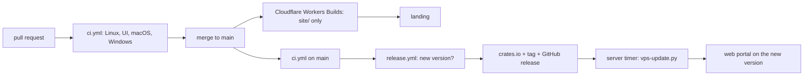

# Delivery: CI, release and server updates

Agents develop, open a pull request, wait for CI and merge. Everything after the merge is automatic:



## Cost

The repository is public, so GitHub-hosted **standard** runners (`ubuntu-latest`, `macos-latest`, `windows-latest`) are free with no minute cap. Nothing here uses larger runners, self-hosted runners or anything paid, and nothing may: if a check does not fit on a standard runner, narrow it.

**If the repository ever turns private, GitHub Actions stops being free:** a free account gets 2,000 minutes a month, macOS minutes count ten times and Windows twice. One full CI run (see the times below, each job rounded up to the minute) would then cost roughly 75 minutes, 50 of them for macOS; only about 25 runs a month would fit. Turn the macOS and Windows jobs off, or pay, before making it private.

The landing (`site/`) stays on Cloudflare Workers Builds (free plan), which publishes it on its own when `site/` changes on `main`. The server is never a runner: on a public repository a pull request from anyone could run code there. It pulls releases from crates.io instead.

## CI (`.github/workflows/ci.yml`)

Runs on every pull request and every push to `main`, with `contents: read` and no secrets (pull requests from forks run it too). A newer push to a pull request cancels its older run; runs on `main` always finish, because the release waits for them.

`Changes` decides what a change needs by comparing it with its base:

| Changed paths | Rust jobs (Linux, macOS, Windows) | UI and scripts job |
| --- | --- | --- |
| only `site/`, `docs/`, `.agents/`, `.claude/`, `AGENTS.md`, `CLAUDE.md`, `CONTEXT.md`, `README.md`, `LICENSE`, `.gitignore` | skipped | skipped |
| `scripts/` | skipped | run |
| `desktop/ui/`, `.github/` | run | run |
| anything else (`src/`, `tests/`, `Cargo.*`, `build.rs`, `desktop/`, …) | run | skipped unless also above |

A push to `main` whose `Cargo.toml` version crates.io does not have yet runs everything: it is a release candidate. Without a base to compare with (a new branch, a force push), everything runs.

| Job | Runner | What it runs |
| --- | --- | --- |
| Linux | `ubuntu-latest` | Tauri 2 system libraries; versions agree (`Cargo.toml`, `desktop/tauri.conf.json`; `--locked` checks `Cargo.lock`); `cargo fmt --check`; clippy and tests with and without `gui`; `cargo package --locked` (the `.crate` as crates.io receives it, built from the package) |
| UI and scripts | `ubuntu-latest` | `bun build desktop/ui/app.js`; `node --test scripts/test-activity-ui.cjs scripts/test-ui-i18n.cjs`; the Python script tests; `scripts/ui-preview/check.mjs` with Playwright's Chromium (axe WCAG 2.2 AA on every section, theme and phone, plus the interaction checks; any violation fails); the results are an artifact for 7 days |
| macOS | `macos-latest` | clippy and tests with `gui` |
| Windows (informative) | `windows-latest` | build and clippy with `gui`; `continue-on-error`, so a failure shows but blocks nothing |
| CI result | `ubuntu-latest` | fails if a required job failed or was cancelled; skipped jobs pass. It is the one check to require before merging |

Rust jobs cache dependencies with `Swatinem/rust-cache`, saved only from `main` (pull requests restore it). Third-party actions are pinned to a commit.

### Measured times

Wall-clock times on standard runners, from the pull request that added CI (no cache yet: pull requests only restore the cache `main` saves). The jobs run in parallel, so a full run takes as long as its slowest job.

| Job | No cache | Warm cache |
| --- | --- | --- |
| Changes | 6 s | 6 s |
| Linux | 4 min 46 s – 6 min 55 s | |
| UI and scripts | 1 min 36 s (Playwright's Chromium 18 s, preview checks 60 s) | same, no Rust |
| macOS | 3 min 33 s – 4 min 44 s | |
| Windows (informative) | 6 min 11 s | |
| CI result | 4 s | 4 s |
| Whole run | 7 – 7.5 min | |
| Release, version already published | | |
| Release, publishing | | |
| Server update (build, restart, healthy) | | |

In the Linux job the slowest steps are clippy with `gui` (about 2 min without cache), `cargo test` with `gui` (about 2 min) and `cargo package` (about 70 s).

## Release (`.github/workflows/release.yml`)

Runs on every push to `main` (and by hand, `workflow_dispatch`, on the head of `main`):

1. **Version and CI.** Reads the version in `Cargo.toml`. If crates.io already has it, it stops: nothing to publish (most runs end here in seconds). Otherwise it waits for this commit's CI run and requires it to have passed with the Linux job run (not skipped).
2. **Publish to crates.io**, in the `release` environment: a short-lived token from crates.io **Trusted Publishing** (OIDC, `rust-lang/crates-io-auth-action`), then `cargo publish --locked --no-verify` (CI already built, tested and packaged that commit).
3. **Tag and GitHub release** `vX.Y.Z` on that commit, with generated notes (`contents: write` only in this job).

Releasing is therefore: merge a pull request that bumps the version in `Cargo.toml`, `Cargo.lock` and `desktop/tauri.conf.json`. A merge without a bump runs CI and publishes nothing. If CI failed on a bump, fix `main` (the next commit releases) or re-run CI and then this workflow.

crates.io rejects Trusted Publishing from `workflow_run` and `pull_request_target` triggers; that is why the release runs on `push` and waits for CI itself. Its configuration on crates.io (crate settings → Trusted Publishing → GitHub):

| Field | Value |
| --- | --- |
| Repository owner | `elvisbrevi` |
| Repository name | `personal-teams-assistant` |
| Workflow filename | `release.yml` |
| Environment | `release` |

The GitHub environment `release` accepts deployments only from `main`. No crates.io token is stored anywhere in the repository or in GitHub.

## Server updates (`scripts/vps-update.py`)

The server that runs the web portal (`personal-teams-assistant-web.service`, a systemd user service with lingering) updates itself from crates.io. A systemd user timer runs the updater five minutes after each check ends. Each run:

1. compares `pta --version` with the newest stable, not yanked version in the crates.io sparse index; when it is not newer, it stops;
2. skips a version it blocked earlier, and does nothing while the portal service is not active (someone stopped it);
3. defers while work is in flight, reading each profile's databases read-only (the profile and every isolated web portal profile): an activity review running (`runs.status = 'running'`), a task being written (`entries.state` `sending`/`refining`) or a Teams message being answered or sent (`jobs.status` `processing`/`sending`/`refining`);
4. needs 5 GiB free (it removes only its own build cache to get them) and records the portal's health with `pta --json status`;
5. backs up both binaries and Cargo's install records, then runs `cargo install personal-teams-assistant --version X --locked --no-default-features --force` with `CARGO_INCREMENTAL=0` and its own build cache in `~/.cache/personal-teams-assistant-update/target` (outside `~/src`, removed above 10 GiB), at low CPU and I/O priority; the old portal keeps serving during the build;
6. checks for in-flight work again (waiting up to 15 minutes), restarts the service and waits up to 5 minutes for `pta --json status` to report the new host version and the health it had before (assistant running, active subscriptions and tunnel, when they were);
7. on any failure restores the backup (instantly, without rebuilding), restarts and verifies the previous version, and blocks the failed version until a newer one is published. A failed build never restarts the portal and is retried up to three times.

It opens no port and holds no token: it reads only public crates.io data. Everything it does goes to the journal (`journalctl --user -u personal-teams-assistant-update`) and one line per event to `~/.local/state/personal-teams-assistant-update/history.log`; `install.log` there keeps the last build's output. Exit status 1 means an update failed and was rolled back; 2 means the rollback failed too and the portal needs a person (`systemctl --user --failed` lists it).

### Install or update the updater

From a checkout of `main` on the server:

```sh
install -m 0755 scripts/vps-update.py ~/.local/bin/personal-teams-assistant-update
install -m 0644 scripts/systemd/personal-teams-assistant-update.{service,timer} ~/.config/systemd/user/
systemctl --user daemon-reload
systemctl --user enable --now personal-teams-assistant-update.timer
```

The updater is not part of the crate, so a release does not update it: repeat the first command after it changes.

### Operate it

```sh
systemctl --user list-timers personal-teams-assistant-update.timer   # next check
~/.local/bin/personal-teams-assistant-update --check                   # what a run would do, changing nothing
tail ~/.local/state/personal-teams-assistant-update/history.log        # updates, deferrals, rollbacks
~/.local/bin/personal-teams-assistant-update --rollback-drill          # update, then roll back on purpose
```

`--rollback-drill` installs the newest release, verifies it, rolls back to the previous version as if it had failed and verifies that one; it does not block the version, so the next timer run installs it for good. To retry a blocked version, delete its entry from `blocked` in `~/.local/state/personal-teams-assistant-update/state.json`. To pause updates: `systemctl --user stop personal-teams-assistant-update.timer`.

## Repository settings

- GitHub Actions enabled; first-time contributors from forks need approval before their workflows run (GitHub's default for public repositories).
- A ruleset on `main` requires the **CI result** check to pass before merging, so `gh pr merge --auto` waits for it.
- Auto-merge allowed, and branches deleted after merging.
- Environment `release`, deployments only from `main`.
- crates.io Trusted Publishing as in the table above.

## When the automatic path fails

The local checks of `AGENTS.md` stay as fast feedback before pushing. Manual delivery is the fallback, only when the automatic path is broken (GitHub Actions down, a release job failing for reasons outside the code):

- Publish: from a clean checkout of merged `main`, check the version is missing (`curl -s -A 'personal-teams-assistant (manual)' -o /dev/null -w '%{http_code}' https://crates.io/api/v1/crates/personal-teams-assistant/VERSION` → `404`) and run `cargo publish --locked` with a token from `cargo login`.
- Server: once the version is on crates.io, run `~/.local/bin/personal-teams-assistant-update` by hand; it applies the same precautions and rollback. Without the updater: check the databases as in step 3, `cargo install personal-teams-assistant --version X --locked --no-default-features --force`, `systemctl --user restart personal-teams-assistant-web.service`, and poll `pta status` until it shows the version, «Assistant: running» and «Teams: 1 active subscription(s); tunnel running» (it takes some seconds).
