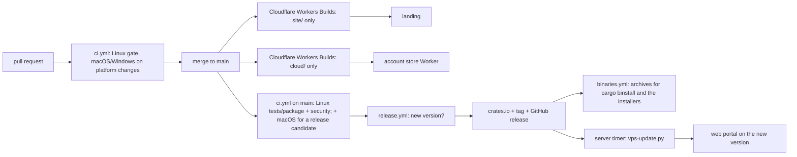

# Delivery: CI, release and server updates

Agents develop, open a pull request, wait for CI and merge. Everything after the merge is automatic:



## Cost

The repository is public, so GitHub-hosted **standard** runners (`ubuntu-latest`, `macos-latest`, `windows-latest`) are free with no minute cap. Nothing here uses larger runners, self-hosted runners or anything paid, and nothing may: if a check does not fit on a standard runner, narrow it.

**If the repository ever turns private, GitHub Actions stops being free:** a free account gets 2,000 minutes a month, macOS minutes count ten times and Windows twice. One full CI run (see the times below, each job rounded up to the minute) would then cost roughly 75 minutes, 50 of them for macOS; only about 25 runs a month would fit. Turn the macOS and Windows jobs off, or pay, before making it private.

The landing (`site/`) and the account store Worker (`cloud/`) stay on Cloudflare Workers Builds (free plan), which publishes each on its own when its directory changes on `main`. The server is never a runner: on a public repository a pull request from anyone could run code there. It pulls releases from crates.io instead.

## CI (`.github/workflows/ci.yml`)

Runs on every pull request, every push to `main` and weekly, with `contents: read` and no secrets (pull requests from forks run it too). A newer push to a pull request cancels its older run; runs on `main` always finish, because the release waits for them.

| Event | Checks |
| --- | --- |
| Pull request | Gated on Linux: Linux lint/tests/package, UI/scripts and the cloud Worker for changed paths; macOS and native Windows only when a platform-sensitive path changed; security always runs |
| Push to `main` | Linux tests and verified Cargo package when Rust/package inputs changed or a new version needs publication; macOS (not Windows) only for a release candidate (a version crates.io does not have yet); security always runs |
| Weekly | Full Linux/UI/cloud Worker/macOS/Windows/security matrix on `main`, also refreshing trusted shared caches |

A pull request that changes only platform-neutral Rust finishes in about the time the Linux job takes: `CI result` does not wait for macOS or Windows. Formatting, clippy and browser previews run on the PR instead of repeating after each merge. macOS and the clean native Windows installation run on a platform-sensitive PR and weekly; macOS also runs on a release candidate, in parallel with Linux. macOS is required whenever it runs and Windows remains informative. Linux still tests the exact merged commit with both feature sets and verifies the `.crate` before publication. Browser checks on the final `main` combination run weekly rather than on every push. This is not reuse of a PR's success or artifacts: the release still requires a passing `CI result` with Linux verification on its exact `main` commit, and that run includes macOS. It does not include Windows: every product merge carries a new version, so Windows on release candidates would delay each publication by about 20 minutes for a job that cannot block it; the weekly run and platform-sensitive pull requests cover it.

`Changes` decides what a change needs by comparing it with its base:

| Changed paths | Rust checks requested | UI/scripts checks requested | Cloud Worker checks requested |
| --- | --- | --- | --- |
| only `site/`, `docs/`, `.agents/`, `.claude/`, `AGENTS.md`, `CLAUDE.md`, `CONTEXT.md`, `README.md`, `LICENSE`, `.gitignore` | skipped | skipped | skipped |
| `cloud/` | skipped | skipped | run |
| `scripts/` | skipped | run | skipped |
| `desktop/ui/` | GUI asset tests only (below) | run | skipped |
| `Cargo.toml`, `Cargo.lock` changing only this package's version | GUI asset tests only (below) | skipped | skipped |
| `.github/` | run | run | run |
| anything else (`src/`, `tests/`, `Cargo.*`, `build.rs`, `desktop/`, …) | run | skipped unless also above | skipped unless also above |

When nothing else asks for the Rust checks, a change to `desktop/ui/` or a version-only bump (the one a GUI change is delivered with: `Changes` parses both sides of `Cargo.toml` and `Cargo.lock` and compares them without this package's version) runs the **GUI assets (Rust)** job instead of Linux: no clippy and no full suite, only `cargo test --locked --lib gui_assets`, which is every Rust test that reads a GUI file (`app::gui_assets`: each file under `desktop/ui` is served and each served path has a file; the portal's and the local page's served assets with the CSP, `no-store` and the other headers, from the binary and from a development directory; the local page's document marker). `scripts/test-ci-workflow.mjs` fails if Rust code outside `app::gui_assets` reads `desktop/ui`. Any other Rust change runs Linux, whose full suite includes those tests.

On a pull request, macOS and Windows run when any changed path is platform-sensitive. The list lives in one `case` of the `Changes` step, which sets the `macos` and `windows` outputs from it, and the step summary names the paths that matched:

- the dependency manifest, lock and toolchain: `Cargo.toml`, `Cargo.lock` (except a version-only bump), `rust-toolchain.toml`, `build.rs`;
- the workflows: `.github/`;
- host startup and the Windows startup check: `src/main.rs`, `src/bin/`, `src/app.rs`, `src/app/headless.rs`, `src/app/control.rs`, `scripts/test-windows-startup.py`, and the local page's browser opener: `src/app/page.rs`;
- the credential store, process spawning and private-file permissions: `src/security/`, `src/consumers.rs`, `src/app/cloud/restore.rs`, `src/app/azure_cli.rs`, `src/app/github.rs`, `src/app/github_cli.rs`, `src/llm/agent.rs`, `src/llm/implementation.rs`, `src/llm/implementation/`;
- update staging and apply: `src/maintenance.rs`, `src/maintenance/`, `src/app/maintenance.rs`, `src/app/maintenance/`, and the archive update with this build's own executables the Windows job runs: `tests/archive_update.rs`;
- the operator admission fixture the Windows job runs: `tests/account_authority.rs`.

`scripts/test-ci-workflow.mjs` fails when a Rust source with Windows- or macOS-only code (`cfg(windows)`, `cfg(not(unix))`, `target_os = "windows"` or `"macos"`) is not on that list, so a new platform branch must be added to it. A file with only `cfg(unix)` code is exercised by Linux.

A push to `main` whose `Cargo.toml` version crates.io does not have yet is a release candidate: it requests Linux tests/package verification even when the diff would skip it, and macOS, but not Windows. Any other push to `main` never runs macOS or Windows, because its pull request already did when it mattered. Without a base to compare with (a new branch, a force push), all path flags are enabled, and on a pull request macOS and Windows too; the event policy above still applies. Weekly runs enable every flag without a diff.

| Job | Runner | What it runs |
| --- | --- | --- |
| Linux | `ubuntu-latest` | No system libraries beyond the runner's; `--locked` checks that `Cargo.lock` agrees with `Cargo.toml`; `cargo fmt --check` and `cargo clippy --locked --all-targets -- -D warnings` only on PR/weekly runs; `cargo test --locked` and `cargo package --locked` on every selected run (the `.crate` as crates.io receives it, built from the package) |
| GUI assets (Rust) | `ubuntu-latest` | Only when `desktop/ui/` or a version-only bump is all the Rust side of a change: `cargo test --locked --lib gui_assets`, restoring the Linux job's cache from `main` |
| UI and scripts | `ubuntu-latest` | PR/weekly only: `bun scripts/test-ci-workflow.mjs` (actual workflow routing and merge gate); `bun build --no-bundle` of every module under `desktop/ui` (syntax); the GUI's type check (TypeScript at a pinned version installed outside the repository: `tsc --noEmit --checkJs -p scripts/ui-types/jsconfig.json` and `node scripts/ui-types/check.mjs`); `node --test scripts/test-activity-ui.cjs scripts/test-ui-i18n.cjs scripts/test-ui-themes.cjs` (the last one checks the contrast of every palette, mode and style); the Python script tests; Playwright's Chromium restored from a cache keyed by the pinned `playwright-core` version (downloaded only on a miss; its system libraries are installed either way; only `main`, that is the weekly run, saves the cache); `scripts/ui-preview/check.mjs` with that Chromium (axe WCAG 2.2 AA on every section, mode, palette and phone, plus the interaction checks; any violation fails); the results are an artifact for 7 days |
| Cloud Worker | `ubuntu-latest` | PR/weekly only, in `cloud/`: `bun install --frozen-lockfile`, `tsc --noEmit`, the Worker's tests inside the Workers runtime (`@cloudflare/vitest-plugin`, Miniflare, synthetic Access keys; contract tests include cross-account attempts) and a `wrangler deploy --dry-run` bundle of both environments; no secrets |
| macOS | `macos-latest` | Platform-sensitive PR, weekly and release candidate only: clippy and tests; required whenever it runs |
| Windows (informative) | `windows-latest` | Platform-sensitive PR and weekly only (never a release candidate): clean release `cargo install --path . --locked`; PE stack fields and subsystems (the host is a GUI-subsystem program without a console, `pta` a console program); twice (no flags, then `--headless` with `PTA_HEADLESS=1`, both ignored) the headless host's start, version and state with Teams stopped and no visible window, `pta app open` answering `not_ready` without a browser session and never returning a code, a second launch leaving the running host in place, quit and relaunch (`scripts/test-windows-startup.py`); clippy; operator admission/binding/recovery/revocation fixture through the real CLI; browser-assisted machine sign-in/trust tests (`machine_login`: two accounts, verifier, replay, expiry, denial, revocation, installation proof and native finish with Windows paths, locks and OS reporting); account machine management (two accounts, two machines, offline presence, roots and revocation); account variables, catalog and configuration synchronization, account standing, credential migration, readiness and local updates (including replacing running and locked executables, journal recovery and rollback); `continue-on-error`, so a failure shows but blocks nothing |
| Security | `ubuntu-latest` | GitHub dependency review on PRs; full-history and working-tree Gitleaks scan with a pinned checksum-verified release; `cargo audit` against RustSec; no repository secrets |
| CI result | `ubuntu-latest` | fails if a required job failed or was cancelled; skipped jobs pass, and Windows only warns. It is the one check to require before merging and the run the release waits for |

Rust jobs cache dependencies with `Swatinem/rust-cache`, and the UI job caches Playwright's Chromium with `actions/cache`; both are saved only from `main` (pull requests restore them). Third-party actions are pinned to a commit with a version comment.

Weekly runs execute the full matrix and require all mandatory results, including security. `scripts/test-ci-workflow.mjs` exercises the YAML's actual change filter with synthetic Git/registry inputs (including the platform-sensitive list and its step summary), event conditions, the Chromium cache step, pinned actions and standard runners, and required-job failure handling; run it with the existing Bun runtime. GitHub secret scanning, push protection, vulnerability alerts and automated security updates are enabled for the public repository; Dependabot proposes Cargo and Actions updates weekly. Audit output retains upstream maintenance/GUI notices, documented in [SECURITY.md](../SECURITY.md); known-vulnerability failures block delivery.

### Measured times

Wall-clock times on standard runners, from the pull request that added CI (no cache yet: pull requests only restore the cache `main` saves). The jobs run in parallel, so a full run takes as long as its slowest job.

| Job | No cache | Warm cache |
| --- | --- | --- |
| Changes | 6 s | 6 s |
| Linux | 4 min 46 s – 6 min 55 s | |
| UI and scripts | 1 min 36 s (Playwright's Chromium 18 s, preview checks 60 s) | same, no Rust |
| macOS | 3 min 33 s – 4 min 44 s | |
| Windows (informative) | 6 min 11 s | |
| CI result | 4 s | 4 s |
| Whole run | 7 – 7.5 min | |
| Release, version already published | | |
| Release, publishing | | |
| Server update (build, restart, healthy) | about 5 min build (four jobs) | 2 min 18 s (four jobs) – 3 min 33 s (two jobs) build, then about 7 s to healthy |

Measured on pull requests on 2026-11-06, before the Linux gate: Linux 5 to 6 min, UI and scripts 6 to 15 min (most of it reinstalling Playwright's Chromium, now cached), macOS 2 to 5 min, Windows (informative) about 20 min, which `CI result` used to wait for on every Rust change.

In the Linux job the slowest steps are clippy (about 2 min without cache), `cargo test` (about 2 min) and `cargo package` (about 70 s).

## Release (`.github/workflows/release.yml`)

Runs on every push to `main` (and by hand, `workflow_dispatch`, on the head of `main`):

1. **Version and CI.** Reads the version in `Cargo.toml`. If crates.io already has it, it stops: nothing to publish (most runs end here in seconds). Otherwise it waits for this commit's CI run and requires it to have passed (`CI result`, which on a release candidate includes macOS but not the informative Windows job) with the Linux job run (not skipped).
2. **Publish to crates.io**, in the `release` environment: a short-lived token from crates.io **Trusted Publishing** (OIDC, `rust-lang/crates-io-auth-action`), then `cargo publish --locked --no-verify` (CI already built, tested and packaged that commit).
3. **Tag and GitHub release** `vX.Y.Z` on that commit, with generated notes (`contents: write` only in this job).
4. **Prebuilt binaries** (`binaries.yml`, called by the release): a release build of both binaries per target on standard runners — `aarch64-apple-darwin` and `x86_64-apple-darwin` (`macos-latest`), `x86_64-pc-windows-msvc` (`windows-latest`) and `x86_64-unknown-linux-gnu` (`ubuntu-22.04`, older glibc), all the same package with the same flags — archived as `personal-teams-assistant-<target>-vX.Y.Z.tgz` (`.zip` on Windows) with a `.sha256` each. Each build job then runs the installer of its system against the archive it just built (`scripts/install/test-install.sh` on macOS, both archives, and Linux, `test-install.ps1` under Windows PowerShell on Windows; a temporary root and profile, a local test source only `PTA_INSTALL_TEST=1` accepts, the runner user's real login service, then uninstall), and a lint job runs `shellcheck` and `PSScriptAnalyzer` on the scripts. The build jobs only read; a final job checks every archive names the version and its sum, adds `install.sh` and `install.ps1` from `scripts/install/` with a `.sha256` each, signs GitHub build provenance for the archives and both scripts (`gh attestation verify FILE --repo elvisbrevi/personal-teams-assistant`) and uploads them to the release. The portal's Connect this computer command fetches the scripts from `releases/latest/download/`, so the latest release must carry them ([architecture](architecture.md#one-command-installation)). `[package.metadata.binstall]` in `Cargo.toml` points `cargo binstall` at these archives on all four targets; for a target whose build failed, binstall compiles like `cargo install` (the third-party `quick-install` strategy is disabled). A pull request that changes `binaries.yml` or `scripts/install/` builds every archive and runs the installers without uploading.

Releasing is therefore: merge a pull request that bumps the version in the two version files, `Cargo.toml` and `Cargo.lock`. A merge without a bump runs CI and publishes nothing. When delivering product changes, choose a version that crates.io does not have before opening the pull request, then verify the package was published and the server runs that version with its previous health. A green release workflow that skipped publishing an existing version is not a new delivery. If CI failed on a bump, fix `main` (the next commit releases) or re-run CI and then this workflow.

crates.io rejects Trusted Publishing from `workflow_run` and `pull_request_target` triggers; that is why the release runs on `push` and waits for CI itself. Its configuration on crates.io (crate settings → Trusted Publishing → GitHub):

| Field | Value |
| --- | --- |
| Repository owner | `elvisbrevi` |
| Repository name | `personal-teams-assistant` |
| Workflow filename | `release.yml` |
| Environment | `release` |

The GitHub environment `release` accepts deployments only from `main`. No crates.io token is stored anywhere in the repository or in GitHub.

## Server updates (`scripts/vps-update.py`)

The server that runs the web portal (`personal-teams-assistant-web.service`, a systemd user service with lingering) updates itself from crates.io. A systemd user timer runs the updater five minutes after each check ends. Each run:

1. compares `pta --version` with the newest stable, not yanked version in the crates.io sparse index; when it is not newer, it stops;
2. skips a version it blocked earlier, and does nothing while the portal service is not active (someone stopped it);
3. defers while work is in flight, reading each profile's databases read-only (the profile and every isolated web portal profile): an activity review running (`runs.status = 'running'`), a task being written (`entries.state` `sending`/`refining`) or a Teams message being answered or sent (`jobs.status` `processing`/`sending`/`refining`);
4. needs 5 GiB free (it removes only its own build cache to get them) and records the portal's health with `pta --json status`;
5. backs up both binaries and Cargo's install records, then runs `cargo install personal-teams-assistant --version X --locked --no-default-features --force` (the flag the server was installed with; it builds the same package as the defaults) with `CARGO_INCREMENTAL=0`, two compiler jobs (`CARGO_BUILD_JOBS=2`, overriding the server's global `jobs = 1`; `PTA_UPDATE_JOBS` changes it) and its own build cache in `~/.cache/personal-teams-assistant-update/target` (outside `~/src`, removed above 10 GiB), at low CPU and I/O priority and with `MemoryHigh=3G` on the unit; the old portal keeps serving during the build;
6. checks for in-flight work again (waiting up to 15 minutes), restarts the service and waits up to 5 minutes for `pta --json status` to report the new host version and the health it had before (assistant running, active subscriptions and tunnel, when they were);
7. on any failure restores the backup (instantly, without rebuilding), restarts and verifies the previous version, and blocks the failed version until a newer one is published. A failed build never restarts the portal and is retried up to three times.

It opens no port and holds no token: it reads only public crates.io data. Everything it does goes to the journal (`journalctl --user -u personal-teams-assistant-update`) and one line per event to `~/.local/state/personal-teams-assistant-update/history.log`; `install.log` there keeps the last build's output. Exit status 1 means an update failed and was rolled back; 2 means the rollback failed too and the portal needs a person (`systemctl --user --failed` lists it).

The updater is the **operator's** workflow and is independent of the update commands a person uses on their own computer (`pta update status|check|stage|apply|cancel|unattended`, the GUI's Update notice; [architecture](architecture.md#installation-updates-discovery-and-staging)). Those look at the registry, build a verified pair (or, for a computer installed with the one-command installer, download that release's archive from this repository's GitHub release and check its published SHA-256) under the profile's `maintenance/` directory and, when the owner asks or turned [unattended updating](architecture.md#unattended-updating) on for that computer, replace the installed pair and restart with rollback ([applying an update](architecture.md#applying-an-update-restart-and-rollback)); they never touch this updater's backup, state or build cache, and a host started by a systemd unit (this server's) is refused by `pta update apply` and cannot turn unattended updating on, so the two updaters cannot race. A portal session or an ordinary account cannot reach them: the portal shows only that the operator manages the server's updates, and its computers list shows each computer's reported version and update state without a way to start an update.

Archive installations depend on this pipeline's assets: a computer updates to a version only once `binaries.yml` has attached that version's archive and `.sha256` for its target. Until then (a few minutes after crates.io lists the version, or longer if the workflow failed) its staging fails with «no archive for this computer's target» and unattended updating retries an hour later; re-running `binaries.yml` for the tag is the fix when an asset is missing.

### Install or update the updater

From a checkout of `main` on the server:

```sh
install -m 0755 scripts/vps-update.py ~/.local/bin/personal-teams-assistant-update
install -m 0644 scripts/systemd/personal-teams-assistant-update.{service,timer} ~/.config/systemd/user/
systemctl --user daemon-reload
systemctl --user enable --now personal-teams-assistant-update.timer
```

The updater is not part of the crate, so a release does not update it: repeat the first command after it changes.

### Operate it

```sh
systemctl --user list-timers personal-teams-assistant-update.timer   # next check
~/.local/bin/personal-teams-assistant-update --check                   # what a run would do, changing nothing
tail ~/.local/state/personal-teams-assistant-update/history.log        # updates, deferrals, rollbacks
~/.local/bin/personal-teams-assistant-update --rollback-drill          # install, then roll back on purpose
```

`--rollback-drill` installs the newest release (or reinstalls the installed version when there is none newer), verifies it, rolls back to the backed-up binaries as if it had failed, restarts and verifies them; it blocks nothing, so the next timer run installs a newer release for good. It restarts the portal twice: run it when a short interruption is acceptable. To retry a blocked version, delete its entry from `blocked` in `~/.local/state/personal-teams-assistant-update/state.json`. To pause updates: `systemctl --user stop personal-teams-assistant-update.timer`.

## Account store Worker (`cloud/`)

The Worker of the [cloud storage design](organization-and-cloud-storage.md) is TypeScript outside the Cargo package, like `site/`. Its two environments are in `cloud/wrangler.jsonc`, each with its own custom domain, Durable Object namespaces and R2 bucket; `workers.dev` and preview URLs are off.

| Environment | Worker | Published by |
| --- | --- | --- |
| production | `pta-cloud` | Workers Builds on merges to `main` that touch `cloud/` |
| staging | `pta-cloud-staging` | the maintainer, by hand: `cd cloud && bunx wrangler deploy --env staging` from the pull request's branch |

**Workers Builds** (Cloudflare dashboard › Workers › `pta-cloud` › Settings › Build): the repository, root directory `cloud`, production branch `main`, build command `bun install --frozen-lockfile`, deploy command `bunx wrangler deploy`, build watch path `cloud/*`, and **non-production branch builds disabled**: a preview version would run against the production objects. GitHub holds no deploy secret.

**Access.** Each hostname is an Access application whose only policy is Service Auth for the listed service tokens (one per account), with an exact Bypass application for `/v1/health`. The Worker validates the `Cf-Access-Jwt-Assertion` again with the secrets `ACCESS_TEAM_DOMAIN` and `ACCESS_AUD`; until both are set it answers `not_configured` (503) to everything but the health check. `scripts/configure-cloud-access.py` creates the applications, sets both secrets with the maintainer's wrangler login and, for production, creates the account's service token and hands it to `pta cloud connect` on standard input; for staging it runs an end-to-end check with three temporary service tokens (enrollment, cross-account refusals, compare-and-swap, origin, erasure, rebinding, secret rotation, the shared plan, revocation) and deletes them. It reads its Cloudflare API token from `CLOUDFLARE_API_TOKEN_FILE` (a private file, removed afterwards) or `CLOUDFLARE_API_TOKEN` (account permissions: Access: Apps and Policies Edit, Access: Service Tokens Edit, Access: Organizations Read; limit it to the server's IP), takes the account from `CLOUDFLARE_ACCOUNT_ID` when the token cannot list accounts, and writes a report without secrets. A PTA launcher can pass the token instead (`CLOUDFLARE_API_TOKEN` from the variable that holds it, `CLOUDFLARE_ACCOUNT_ID` as `--account`): an agent proposes it with the exact arguments, and on a headless server the owner approves it in their own portal session (Settings › Variables › Local programs), so no token file is needed. Requests to the Worker carry an explicit User-Agent: Cloudflare's browser integrity check refuses some default ones (error 1010). Service tokens last a year: renew them in Zero Trust › Access controls › Service credentials before they expire.

**Replacing a service token.** `python3 scripts/configure-cloud-access.py production --rotate --report PATH` (add `--portal-user USER` for a portal account's) rotates the account's existing token's secret in Access (same client ID, the previous secret revoked at once, so no `rebind` and `ACCOUNT_SHARES` stays valid) and hands the new secret only to `pta cloud connect` (or `pta web users cloud enable USER`) on standard input; the account's computers trusted with the account store receive it from their coordinator. On a headless server it runs as the launcher `cloud-token-rotate` that the owner approves in the portal, which `pta cloud token` and the GUI then offer. The staging verification rotates one of its temporary tokens too (the previous secret stops at the edge, the new one reaches the same account without rebinding).

**Portal accounts.** `python3 scripts/configure-cloud-access.py production --portal-user USER --report PATH` creates (or replaces) that portal account's service token, admits it and hands it only to `pta web users cloud enable USER` on standard input, which keeps it in that account's own credential store and records the operator's permission; `pta web users cloud disable USER` withdraws it; then `configure-cloud-access.py production --portal-user USER --retire --report PATH` (refused while the account store is still enabled for that account) takes its token out of the Access policy and deletes it, keeping the portal account, its binding and its sign-in policy. To retire an account's copy first, erase it from that account (`PTA_PROFILE_DIR=<its profile> pta cloud rollback`, then `cloud erase`, both `--confirmed`). The account then connects and migrates from its own Settings.

**Host versions.** `MIN_HOST_VERSION` (`cloud/wrangler.jsonc` vars, default 0.10.37) is the oldest host an account's installations may mix with: the Worker refuses an enrollment from an older host, or into an account with an active installation that last reported an older one (`outdated`); hosts refuse adopting and promoting the same way. Raise it, in the Worker first, only when a host change needs every computer of an account on the new version.

**Shares of the quota.** Every account has the daily share `ACCOUNT_DAILY_REQUESTS` / `ACCOUNT_DAILY_ROWS_WRITTEN` (`cloud/wrangler.jsonc`), unless `ACCOUNT_SHARES` gives its service token's client ID its own (`{"<client ID>": {"requests": N, "rows_written": N}}`, not secret). `PLAN_DAILY_REQUESTS` / `PLAN_DAILY_ROWS_WRITTEN` (default: Free's 100,000) are what `cloud status` compares the shares with; raise them after moving to Workers Paid.

**Rehearsal.** `scripts/rehearse-cloud-migration.py --bin DIR --report PATH` (with the same `CLOUDFLARE_API_TOKEN_FILE` and `CLOUDFLARE_ACCOUNT_ID`) runs a branch's executables on a private copy of this user's profile, without its credentials, keys, variables, cloud link or machine files and with its Microsoft tokens cleared, against the staging Worker with two temporary service tokens: connect, migrate, verify, a repair with nothing to repair, promote, a configuration edit and a note through the store, pull with replace (the copy keeps its own settings), a second computer of the account from a fresh profile (refused without adopting, then adopts, verifies, joins primary and edits through the store, which the first pulls), a conflict (the second edits through the store, the first by hand) that the first lists field by field, resolves keeping its own and the second receives, another account that sees none of it, rollback, an erasure refused while the second computer is connected, its revocation and the erasure, and last the restore of the migration's backup (the host restarts itself, keeps the data from just before and comes back as before migrating, with its account store link). Every host it starts is stopped at the end. The token, its admission and the copy are removed afterwards, and temporary tokens a rehearsal stopped half way left behind are removed at the start of the next; the report holds steps and counts only. Staging's daily share (5,000 requests and rows) fits one rehearsal of a profile of a few thousand records a day.

**Order.** A host release that needs a Worker change merges only after that change is deployed and healthy: the Worker serves every protocol version the installed hosts use (additive changes within `/v1`), so the Worker goes first and the host follows.

**Verify a deployment.** `curl -s https://HOSTNAME/v1/health` (the hostname in `cloud/wrangler.jsonc`) answers without credentials with the environment, the Worker version, the deployment (Workers version ID, the same one Workers Builds shows), the protocols, the schema of each object and `configured: true`. Then `pta cloud status` on a connected installation reports the live principal and the account store.

**When Workers Builds fails:** from a clean checkout of merged `main` on a maintainer's machine, `cd cloud && bun install --frozen-lockfile && bunx wrangler deploy` (wrangler login with Workers write), then verify as above. Code rollback: `bunx wrangler rollback` (or Workers › Deployments); data rollback: the Durable Objects' 30-day point-in-time recovery. Migrations are forward-only and additive, so the previous code reads the current schema.

## Repository settings

- GitHub Actions enabled; first-time contributors from forks need approval before their workflows run (GitHub's default for public repositories).
- A ruleset on `main` requires the **CI result** check to pass before merging, so `gh pr merge --auto` waits for it.
- Auto-merge allowed, and branches deleted after merging.
- Environment `release`, deployments only from `main`.
- crates.io Trusted Publishing as in the table above.

## When the automatic path fails

The local checks of `AGENTS.md` stay as fast feedback before pushing. Manual delivery is the fallback, only when the automatic path is broken (GitHub Actions down, a release job failing for reasons outside the code):

- Publish: from a clean checkout of merged `main`, check the version is missing (`curl -s -A 'personal-teams-assistant (manual)' -o /dev/null -w '%{http_code}' https://crates.io/api/v1/crates/personal-teams-assistant/VERSION` → `404`) and run `cargo publish --locked` with a token from `cargo login`.
- Server: once the version is on crates.io, run `~/.local/bin/personal-teams-assistant-update` by hand; it applies the same precautions and rollback. Without the updater: check the databases as in step 3, `cargo install personal-teams-assistant --version X --locked --no-default-features --force`, `systemctl --user restart personal-teams-assistant-web.service`, and poll `pta status` until it shows the version, «Assistant: running» and «Teams: 1 active subscription(s); tunnel running» (it takes some seconds).
