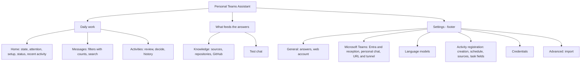

# UX redesign report (2026-10-15)

Audit and redesign of the GUI (`desktop/ui/`, shared by the native window, the web portal and the phone layout) for version 0.7.15. Method: the `product-designer`, `information-architect`, `ux-heuristics`, `ui-ux-pro-max` and `frontend-design` skills; the real UI served with a mocked bridge and synthetic data (`scripts/ui-preview/`), screenshots at 1440, 820 and 393 px in light and dark, axe-core scans and scripted interactions. Behavior, IPC methods, data, permissions and business rules are unchanged. The conventions that keep this standard are in [ui-design-conventions.md](ui-design-conventions.md).

Facts below come from the code and the screenshots; statements about what users need are marked as hypotheses: there was no user research or usage data.

## 1. Inventory of screens and functions

| Section | Functions |
| --- | --- |
| Shell | Sidebar navigation with counters (errors of the last 24 h, pending activities), status pill, version, web account and sign-out (portal), notices (toast), «New version installed» offer, unsaved-changes bar, Microsoft sign-in dialog (portal) |
| Home | Assistant state with Start/Restart/Stop; pending-activities notice; setup checklist (8 steps computed from the snapshot); status of account, mode, reception, tunnel, models, sources, personal chat; recent activity with counts by outcome |
| Messages | Last 100 jobs: filters by outcome, refresh every 10 s, hide messages not addressed to the assistant; per message: text, interpretation, outcome, sent/proposed answer (Markdown), references, details, step log; improve an unsent answer with context and send it (second tap) |
| Activities | Review a day (day, optional context, progress, effort against the target, configuration summary, refresh); pending decisions; editor (evidence, assistant question and refinement, HU or bug, title, effort, description, fields required by Azure DevOps, advanced JSON, create in Done, dismiss with second tap); the day's activities; process runs with diagnostics and a copyable diagnostic prompt; native activity window |
| Knowledge | Sources of every kind (state, description, topics, audiences, enabled, external processing, remove); add a file source; local repositories (path, update, remove, add); GitHub App (connect with device code, list and clone authorized repositories, disconnect) |
| Test chat | Simulation through the real pipeline with chosen saved sources, Markdown answers, verified references, partial coverage, new conversation |
| Settings | Credentials (store, replace, remove, retired); language models chain (on/off, model, effort, order, detect CLIs); Microsoft Teams and Entra (IDs, discovery, allowed chats, connect); public URL and tunnel; answers (observation mode, language, style); activity registration (16 fields); personal chat (validate, enable, disable, check); import of an older `config.toml` |

## 2. UX problems found

Severity follows the `ux-heuristics` scale (critical: blocks or loses work; major: slows or confuses; minor: friction).

| # | Severity | Heuristic | Problem (observed) |
| --- | --- | --- | --- |
| M1 | Major | Aesthetic and minimalist design; Hick | Settings was one page of about 3,500 px with eight unrelated panels and no in-page navigation. The most consequential switch (observation mode) was the fifth panel, below credentials, models, Entra and tunnel. |
| M2 | Major | Mental model; consistency | Navigation ordered by module: Settings second, between Home and the daily sections (Messages, Activities). The phone tab bar had six items with truncated labels. |
| M3 | Major | Recognition over recall; error prevention | Workdays were typed as «1, 2, 3, 4, 5»; duplicates, «0» or an empty list were only rejected by the host after saving, with an English error. |
| M4 | Major | Minimalist design | Fields that do not apply were always visible: the allowed-chats list while all chats are discovered; the daily time together with the interval and window fields. |
| M5 | Major | Flexibility and efficiency | Home's seven status tiles (two orphaned on a second row) repeated the checklist but led nowhere; recent activity rows could not open the message. |
| M6 | Major | Minimalist design | Knowledge rendered each source as a full form (three inputs, two switches, a remove button): about 170 px per source before reading anything. |
| M7 | Major | Accessibility (WCAG 1.4.3) | `--faint` text was 3.37:1 on white; axe found 4 contrast failures (optional step note, inactive model rank). |
| m1 | Minor | Selective attention | The pending-activities banner repeated at the top of every section except Activities, besides the navigation counter. |
| m2 | Minor | Visibility of status | The sidebar status pill was cut to «En ejecución · observ…». |
| m3 | Minor | Flexibility | Messages had no search and its counts were a separate sentence of labels instead of the filters. Dates showed seconds («14-10-2026, 1:16:00 p. m.»). |
| m4 | Minor | Consistency | A created task's link in «This day's activities» was centered (a link-styled button stretched in a grid). |
| m5 | Minor | Match with the real world | Spanish hint «plataformaAplicaciones móviles…» lacked a space (a translation split around `<em>`). |
| m6 | Minor | Accessibility | No skip link; focus stayed on the navigation after changing section; every notice, success included, was announced as an alert. |
| m7 | Minor | Hierarchy | Credentials showed four disabled primary «Replace» buttons; «Validate and enable» stayed primary while the personal chat was already enabled. |
| m8 | Minor | Aesthetic | Uppercase eyebrow labels, 14 px radius and stacked card shadows on every panel read as a generic card kit rather than a work tool. |
| m9 | Minor | Responsive | At 820 px the top bar overflowed and cut Settings; on phones a message's state badge stretched to the width of its date. |

Strengths kept: a clear assistant state with one primary action; the setup checklist; the activities flow numbered in working order with inline results; second-tap confirmation for irreversible sends; the shared save bar with revision control; full Spanish catalog; phone layout with safe areas.

## 3. Information architecture decisions

| Decision | Chosen | Alternatives | Why |
| --- | --- | --- | --- |
| Navigation | Sidebar grouped by task with a divider; Settings pinned to the footer | Top navigation; group headings | Hypothesis: users open Home, Messages and Activities daily and Settings rarely after setup. A divider separates the groups without adding labels. |
| Settings | Six categories as ARIA tabs, one visible at a time, with unsaved/attention dots | Anchored index over the long page; separate routes | Shows a sixth of the controls at once while keeping the single save bar; dots prevent forgetting edits in a hidden category; deep links open the right category. |
| Category names | By the user's goal (General, Microsoft Teams, Language models, Activity registration, Credentials, Advanced) | By config section (`graph`, `server`, `policy`) | The config schema mixes concerns (e.g. `server` holds the public URL users relate to Teams reception). |
| Phone navigation | Five sections in the tab bar; Settings as an icon in the title bar | Six tabs; Settings in a «More» menu | Material and HIG limit bottom bars to five; Settings is a destination, not a daily task. |
| Home | Status as rows that open where each part is changed; checklist hidden when complete; recent rows open the message | Tiles; a dashboard with charts | Turns a read-only summary into shortcuts (one click instead of navigating and scrolling). |
| Attention | Activities notice on Home only | Global banner | The navigation counter already signals it everywhere else. |
| Routes | No URL routes existed; the `?activity=` window parameter and every `showTab` target are unchanged | Hash routes | No compatibility to keep beyond existing entry points; adding routes was not needed for the goals. |

## 4. Changes implemented and why

| Area | Change | Problem |
| --- | --- | --- |
| Navigation | New order and divider, Settings in the footer; short labels and icon-only Settings at 681–860 px; five-item phone bar with Settings in the title bar | M2, m9 |
| Accessibility | Skip link; section change focuses its heading; ARIA tab pattern with arrow/Home/End; errors `role=alert`, confirmations `role=status`; `--faint` raised to 4.5:1+ | M7, m6 |
| Home | Status rows with deep links; checklist hidden once every step is done; recent activity rows open the message expanded; banner moved here | M5, m1 |
| Settings | Six categories; unsaved and attention flags; deep links select the category; activity registration split into Activity registration, Schedule, Activity sources and Tasks in Azure DevOps panels | M1 |
| Forms | Allowed chats hidden while discovering all chats; daily time vs interval/window shown by schedule (values kept); workdays as seven toggles validated before saving; additional task fields folded as advanced; credentials «Replace» secondary and «Save» primary; personal chat «Validate and enable» secondary once enabled | M3, M4, m7 |
| Messages | Search (accent- and case-insensitive) over text, answer, outcome, kind and model; counts inside the filters; «Showing N of M»; empty search offers «Clear search»; compact dates with the full one on hover; wrapping summaries on narrow screens | m3, m9 |
| Knowledge | Compact source rows (state, description, location, topics, audience, switches) with an edit fold that survives re-renders; GitHub App client ID folded as advanced | M6 |
| Visual system | Flat panels separated by borders, 10 px radius, floating elevation only for toast/save bar/dialogs, sentence-case labels, wrapping status pill, left-aligned links in cards | m2, m4, m8 |
| Copy | Spanish Entra hint spacing fixed; 27 new catalog entries | m5 |
| Tooling | `scripts/ui-preview/`: preview server with the portal CSP, mock bridge and fixture captured from a real host (throwaway profile), screenshot and check scripts | Reproducible before/after verification |
| Export | `scripts/export-public.py` skips `.claude/` like `.agents/` and `.codex/` | Agent tooling (third-party skills, plugin settings) stays out of public exports |

## 5. Moved, merged or simplified

- Moved: Settings to the navigation footer; the activities notice into Home; personal chat and public URL panels into Settings › Microsoft Teams; import into Settings › Advanced; observation mode, language and style first, in Settings › General.
- Merged: Home's seven tiles and their checklist overlap into one actionable status list; Messages' count sentence into the filters.
- Simplified: activity registration's single 16-field panel into four focused panels; workdays syntax into toggles; source forms into summary rows with an edit fold; advanced JSON and the GitHub client ID behind folds.
- Nothing was removed: every control, field and operation is still reachable.

## 6. Removal recommendations (not applied)

| Candidate | Why | Before removing |
| --- | --- | --- |
| Settings › Advanced › «Migrate this installation» | Imports a pre-0.4 `config.toml`; `pta config import` already covers it | Confirm no installation still migrates from that layout |
| «cloudflared config (optional)» file field | Two tunnel mechanisms in the GUI; the managed token is the documented path | Check portal and desktop users of local files |
| Editable «Teams user ID» | Filled on connecting; a manual edit can only break the identity check | Show it read-only with «Reconnect the account» |
| «Refresh every 10 s» toggle in Messages | Hypothesis: it exists to stop the list moving while reading; refreshes already pause while answer context is typed | Pause automatically while a message is open, then drop the toggle |
| Pending entries repeated in «This day's activities» | The same entries appear in step 2 | Filter step 3 to created, dismissed and failed, or add a state filter |

## 7. Tests run and results

| Check | Result |
| --- | --- |
| `cargo fmt --all --check` | Passed |
| `cargo clippy --all-targets -- -D warnings` | Passed |
| `cargo clippy --all-targets --no-default-features -- -D warnings` | Passed |
| `cargo test` | Passed: 174 library and 44 integration tests |
| `cargo test --no-default-features` | Passed: 172 library and 44 integration tests |
| `bun build desktop/ui/app.js --no-bundle` | Passed |
| `node --test scripts/test-activity-ui.cjs scripts/test-ui-i18n.cjs` | 10/10 passed (every new string has its Spanish entry) |
| axe-core WCAG 2.0/2.1/2.2 A and AA, 33 scans (every section and Settings category; desktop light, dark, phone) | 0 violations; the previous version: 4 `color-contrast` nodes in 18 scans |
| Interaction checks (`scripts/ui-preview/check.mjs`) | 30/30 passed: navigation order, banner placement, heading focus, deep links from status rows and setup steps, conditional fields, edited and attention flags, tab keyboard support, workdays saved as `[2,3,4,5,6]` with the other registration values unchanged, empty workdays blocked before the host, message opened from Home, search, filter counts, Knowledge fold persistence, five-item phone bar, Settings in the phone title bar, no horizontal scroll, no page errors |
| Visual review | Screenshots before and after of every section at 1440 px (light, dark), a fresh profile, 820 px and 393 px, plus the activity editor and a test chat answer |
| CSP | The preview serves the portal's CSP; no violations were reported |

Limits of this verification: the native macOS window (WKWebView) and the real portal behind Cloudflare Access were not run here (Linux VPS without macOS; no Access session). The mock does not exercise Microsoft or GitHub sign-in, answer refinement or real Azure DevOps writes; those paths keep their previous code. Phone checks emulate an iPhone-sized viewport in Chromium, not Safari.

## 8. Known risks and pending opportunities

Risks:
- Settings hides five of six categories; the flags and the save bar signal edits elsewhere, but a user may not notice an attention dot. Mitigation: Home's checklist and status rows link straight to the right category.
- Workdays are now saved in ascending order; the set is the same and the host validates the same rules.
- The setup checklist disappears once sending is on; the hero («Running and answering») and the status rows remain the confirmation.
- WebKit-specific rendering (fonts, `scrollbar-width`, focus after click) was reasoned about, not observed.

Opportunities:
- A filter or search in Knowledge once a profile holds more than about ten sources.
- Server-side search beyond the last 100 messages (needs an IPC parameter).
- Short descriptions for known credentials (what each is for, where it comes from).
- Remember the Settings category and the Messages filter across reloads (`sessionStorage`).
- Keyboard shortcut to focus search (`/`) and to switch sections.
- Validate the native window on macOS and the portal on an iPhone with the same check list.

## Appendix: design skills used

Installed at project level and committed in `.claude/`, each copied skill with its upstream MIT `LICENSE`:

- `product-designer`, `information-architect`, `ux-heuristics`: copied from `richhemsley3/claude-design-skills` (commit `1185d0d`) into `.claude/skills/`.
- `ui-ux-pro-max`: the official installer (`npx ui-ux-pro-max-cli@2.15.0 init --ai claude`, no install scripts) was run in an empty directory first, because it also writes six unrelated skills (brand, banners, slides…); only `ui-ux-pro-max`, which is self-contained, was copied into `.claude/skills/`.
- `frontend-design`: installed with `claude plugin install frontend-design@anthropic-plugin-directory --scope project` from the built-in Anthropic directory (the same `anthropics/claude-plugins-official` source), which avoids adding a marketplace to the user-level settings; it created `.claude/settings.json` with `enabledPlugins`.

The skills are advisory: where they differ from the repository's documents (landing-page guidance, external fonts, uppercase labels), AGENTS.md, the architecture and [the GUI conventions](ui-design-conventions.md) win.
